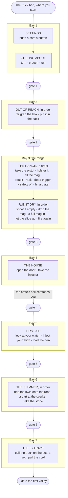

# The training yard: what you can do, in order

The tester asked for "a real solid flow chart of what the player can do in
the onboarding section" (playtest 2026-11-22, 16:44). This is it. The
source of truth is `STATIONS` and `Goal::how` in `src/onboarding/mod.rs`. A
step only counts at its own station. At a station marked *in order*, a step
counts only after the one before it.

## The route

Each bay's gate opens when its station is done. The lamp of the station
you're on is lit, and a finished station's lamp shows done. The truck's
cord ends the yard at any time. Before the last station it asks first.

## Every step, for a headset and at the window

| Station | Step | Headset | Flat (keyboard and mouse) |
|---|---|---|---|
| SETTINGS | Push the button | Point a finger, TRIGGER off. Push the amber cap. | Look at the card. Press E. |
| GETTING ABOUT | Turn around | Push the right stick left or right. | Move the mouse round. |
| | Crouch | Squat down, or pull the right stick down. | Press C (again to stand). |
| | Run | Push the left stick forward and click it. | Hold Shift and W. |
| OUT OF REACH | Get the box in the pen | Point at the ringed box. Squeeze GRIP, flick back. | From the fence: look at it. Press E. |
| | Something in the pack | The box: over your shoulder. Open your hand. | Hold something big (the cleaning kit). Press G. |
| THE RANGE | Take the pistol | The black pistol, ringed on the table. Squeeze GRIP. | Look. Press E. |
| | Holster the pistol | Hold it at your hip. Open your hand. | Hold it. Press G. |
| | Rounds into the mag | The ringed mag, the box: one a hand. Touch them. | Mag in one hand, box in the other. Press T. |
| | Mag into the pistol | Table's pistol in hand. Push the mag up into the grip. | Press R. |
| | Rack the slide | Other hand on the slide: TRIGGER, pull back, let go. | Pistol in hand. Press V. |
| | Squeeze it. Nothing? | Aim at a plate. Squeeze TRIGGER. | Left mouse fires. |
| | Safety off | Click the stick on the gun hand. | Press X. |
| | Hit a plate | Line up the sights. Squeeze TRIGGER. | Right mouse aims, left mouse fires. |
| RUN IT DRY | Shoot it empty | Squeeze TRIGGER at the plates till it stays back. | Left mouse till the slide stays back. |
| | Drop the empty mag | Press A on the gun hand. | Pistol in hand. Press B. |
| | A full mag in | The full mag in one hand: push it up into the grip. | Full mag in a pouch. Press R. |
| | Let the slide go | Press B on the gun hand (or rack it). | Press V. |
| | Fire again | Line up the sights. Squeeze TRIGGER. | Right mouse aims, left mouse fires. |
| THE HOUSE | Open the door | GRIP the door anywhere and pull it round. | Look at the door. Press E. |
| | Take the injector | The injector, ringed on the crate. Squeeze GRIP. | Look. Press E. |
| FIRST AID | You're hurt: look | It's buzzing. Raise your watch hand, look at it. | Hold H to check yourself. |
| | Inject your thigh | Its tip to your thigh. Squeeze TRIGGER. | Hold it. Press U. |
| | Load the pen | Cartridge in one hand: let go at the pen's empty well. | Pen in one hand, cartridge in the other. Press T. |
| THE SHIMMER | Ride the swirl | Stand in the blue flags, face the roof, hands still. | The same. Hold still. |
| | A part at the sparks | GRIP a part, swing, open your hand at the sparks. | Hold a part. Hold Q, let go at the sparks. |
| | Take the stone | Don't step in. Point at it, GRIP, flick back. | From the edge: look at it. Press E. |
| THE EXTRACT | Call the truck | The set on the post's pole. Squeeze GRIP on it. | Look. Press E. |
| | Pull the cord | Climb in the back. GRIP the cord by the cab. | Climb in. Look at the cord by the cab. Press E. |

One-handed play swaps a few of these: touch the mag to the box on the
table, bring the gun down onto a mag in a pouch, B or Y racks, A or X
injects, and bring the pen down onto the cartridge. Left-handed play swaps
the sticks and the hands.

## Always there, at any station

- Hold H (flat), or look at the watch on your wrist (headset): health, load,
  the clock, the driver's last words.
- Click both sticks (headset) or press F9 (flat): put a mark in the playtest
  log.
- The truck's cord: leave the yard.
