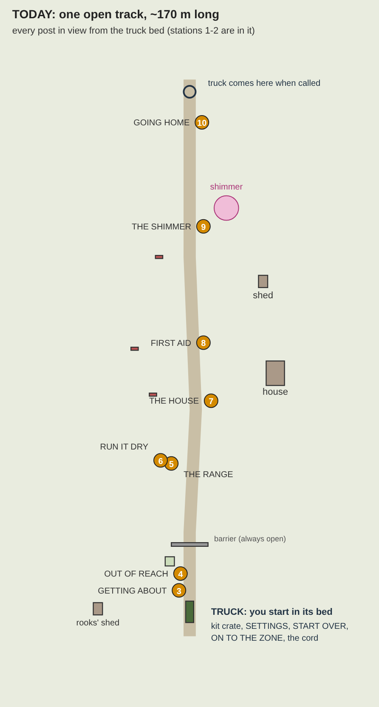
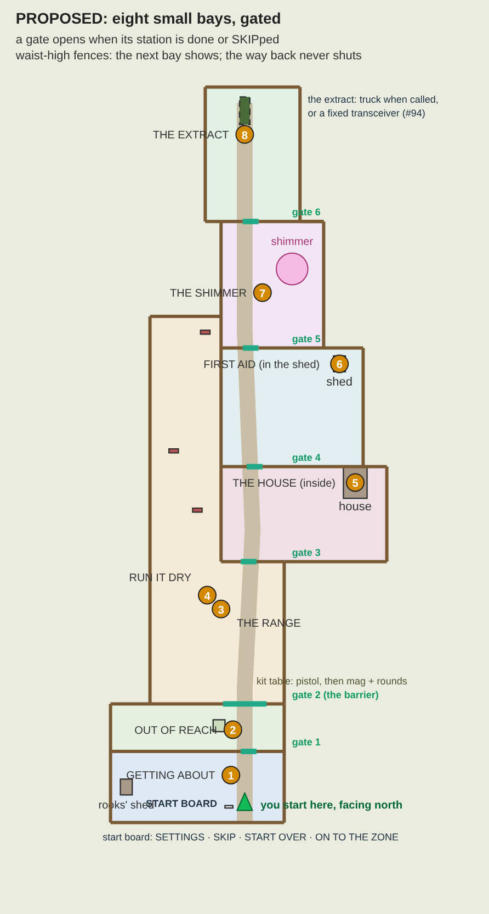
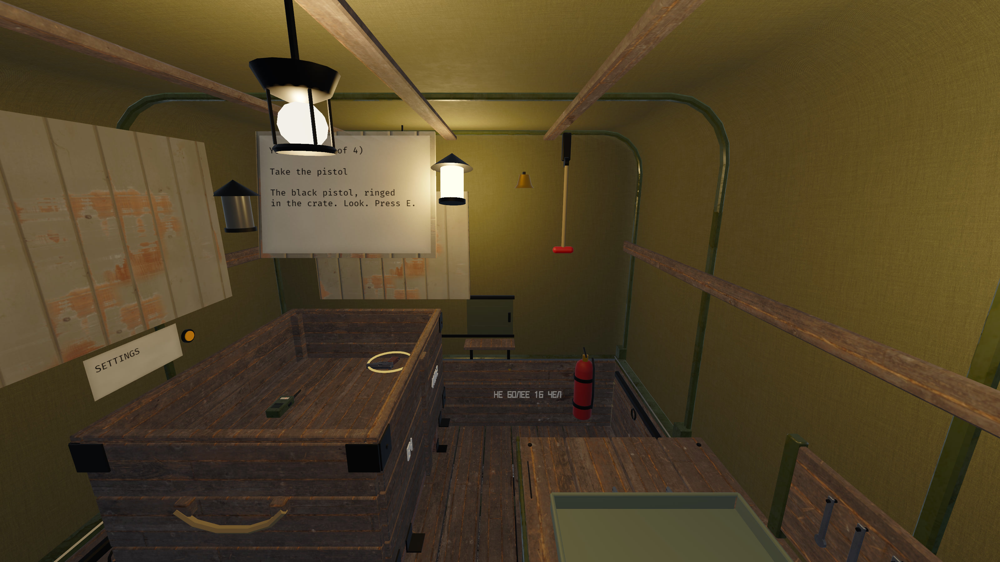
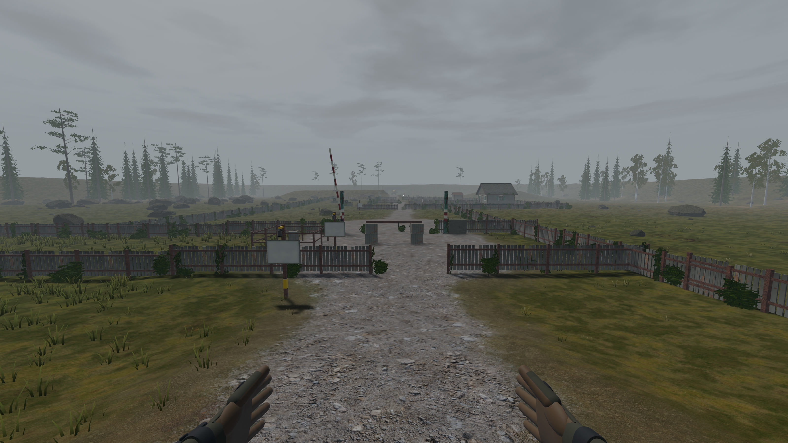
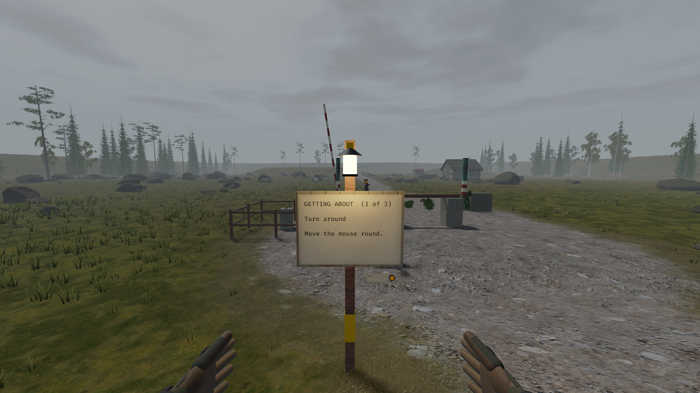
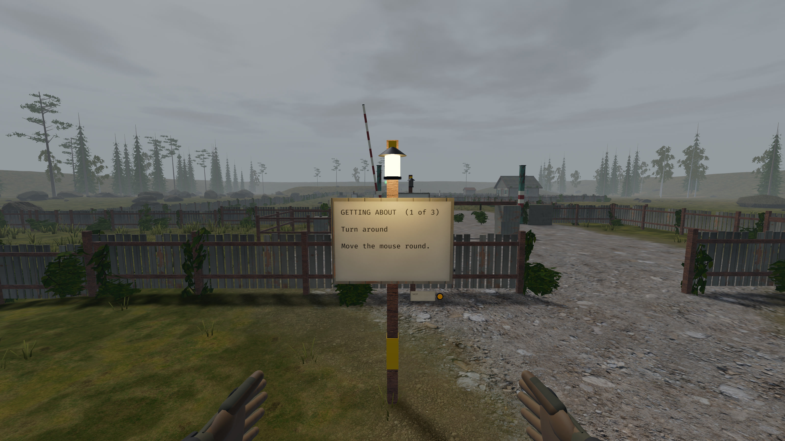
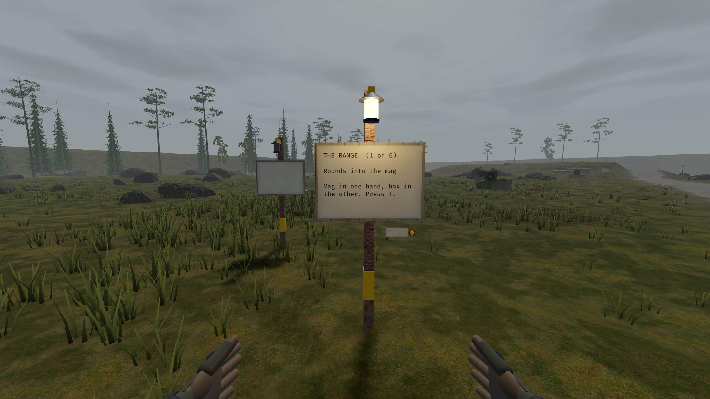
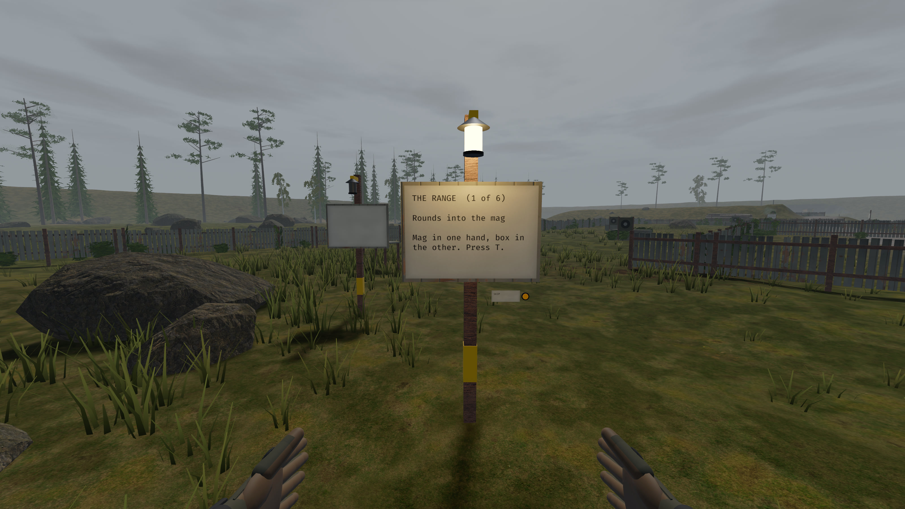
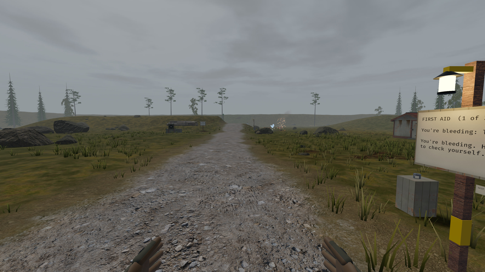
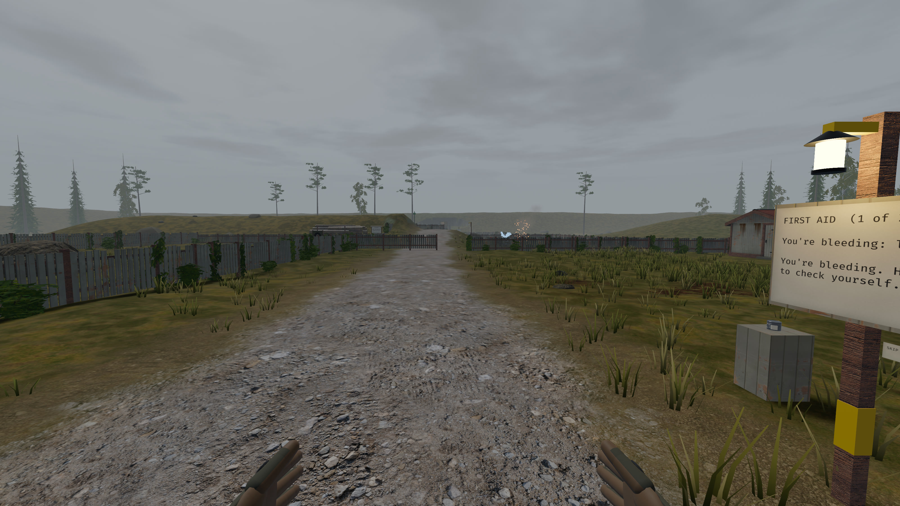

# The yard's shape (#89): a proposal

The designer, after a playtest: "Maybe we should make the tutorial either
entirely indoors, or structured in such a way that you can only move one
area at a time... being so wide open feels a bit rough for onboarding."
And: "We should not introduce the player to the truck/extract mechanic
until the end of the tutorial. Starting them in the truck exposes them to
a whole bunch of stuff at once when they load in that they don't need to
see."

This is a proposal. No code has changed yet. The "after" pictures are a
mock-up: today's binary with a scratch copy of `training_yard.ron` that
adds timber fences and moves the truck out of sight. The stations' posts,
lamps and boards are today's, where they stand today. Anything a picture
can't show yet is drawn on the plan.

## Gated, not indoors

Gate the yard into small bays, one station or a pair to each. Each gate
opens when its station is done or SKIPped. Rooms go where a station
already suits one: THE HOUSE inside the practice house, FIRST AID in the
shed. A fully indoor yard would fight the lessons that need room: running
and the rooks, the 15/30/60 m range, a shimmer you see from off and walk
round, and calling something in from the open.

- **Bays.** Waist-high fences (1.3 m) with a gate leaf across the track.
  You can see the next bay and its dark lamp over the fence and through
  the gate, so it's never hidden behind a blank wall. You just can't walk
  on until it opens.
- **The way back never shuts.** Gates block only forward. Going back
  through any bay is always open, so nobody can be locked in. A
  room-scale VR player who steps through a closed gate is not stopped or
  punished: the station you're on stays lit behind you, and the driver
  says once, "Back through the gate. That one's next."
- **Opening.** When the last step of a station ticks, or its SKIP card is
  pressed, its gate swings open with a creak and the next lamp lights.
  START OVER shuts every gate and puts you back at the start. Once the
  yard is done, every gate stands open.

| Bay | Station(s) | Size | What's new in it |
|---|---|---|---|
| 1 | START: the start board, GETTING ABOUT | 44 × 18 m, the rooks' shed in it | no items; the board's 4 cards |
| 2 | OUT OF REACH | 44 × 12 m | the far box (1 kind) |
| 3 | THE RANGE, RUN IT DRY | 34 × 36 m, a fenced lane 18 m wide out to the 60 m target | kit table: the pistol first, then mag + rounds |
| 4 | THE HOUSE | 42 × 24 m; the step is inside the house | the house's find |
| 5 | FIRST AID | 36 × 30 m; the step is inside the shed | the dressing |
| 6 | THE SHIMMER | 26 × 32 m | parts, the stone |
| 7 | THE EXTRACT | 24 × 34 m | the extract, then the truck |

Gate 2 is today's quarantine barrier at z 74. The other five gates are
new.

## The start: no truck

You load standing in bay 1 on the track, facing north (`Insertion`
moves to about (0, 98)). The truck, its crate, its bench and its cord
aren't in the yard at all until the last station.

**First frame on load, before and after (2×):**

**What's new in view at load** (`EXTRACTION_ITEM_CENSUS=1`, item kinds
within 6 m; the "after" figure is by design until it's built):

| | Today (measured on 9606f2c8) | Proposed |
|---|---|---|
| Item kinds within reach | 3 at 0 s: pm_pistol, pm_mag, radio | 0. The first item is the pistol on the range's kit table, about 30 m on |
| Boards and cards | 2: the YOUR KIT board and SETTINGS | 2: the start board and the GETTING ABOUT post |
| Fixtures in frame | crate, bench and vice, cord, extinguisher, seat rows, mag tray | fences, the gate, the rooks' shed |

**Where the kit goes.** A kind is met where it's used, at most 2 new at
once:

- The **pistol** goes on a kit table at the head of the range bay:
  take it, then holster it (today's TakePistol, PutAway). After that the
  table shows the **mag and a box of rounds**. These are today's range
  steps, unchanged.
- The **radio** goes to THE EXTRACT, where it's used (TakeRadio, Pocket,
  then CallTruck). If #94 replaces the radio with a fixed transceiver,
  these two steps go and the transceiver is the station.
- "Everything you own rides in that crate between raids" is said when
  you first stand in the truck at the end, beside the crate.

**The controls: SETTINGS, SKIP, START OVER, ON TO THE ZONE.** All four
are reachable from the first moment:

- **The start board**, on a post 1.5 m ahead and to the left of where you
  load, carries all four cards. SETTINGS is the first thing it asks you to
  press (today's Button step, so it keeps its place as step 1). START
  OVER folds away until something's been done, as it does now.
- **Every station's post** carries SKIP, as now, plus START OVER and ON TO
  THE ZONE on a small strip under it. Nobody has to walk back to the start
  to leave or restart.
- **ON TO THE ZONE** ends the yard as it does now. The fade goes straight
  to the raid's truck, so pressing it in bay 1 never shows the yard's
  truck.

## The last station: the extract

THE EXTRACT is the last bay. As #94 asks, it's written here without
fixing the mechanism:

- **If it stays the truck:** take the radio, pocket it, call. The truck
  arrives at the north post. It already appears at the rendezvous when
  called, so there's no route to clear. Get in and pull the cord. That
  ends the yard, as now.
- **If it becomes a fixed transceiver (#94):** it stands in the bay. Use
  it, and the truck arrives; get in and the yard ends.

Either way, the extract is the first time you see the truck. Its boards
(logbook, bench, route, job card) show only from then on, which is the
rule today (`yard_shows`, `Panel::Truck`).

## Standing height, before and after (2×)

**GETTING ABOUT.** Today the whole 170 m track and every post lie open
ahead. After, the next gate and the barrier frame one bay:

**THE RANGE.** The lane's fence closes the range off to the east, and the
track bays beyond it read as somewhere else. The big rock in the "after"
picture is the mock-up's own doing: the rock scatter re-rolls around new
placements. It's not part of the proposal.

**Down the track from FIRST AID.** Today the shimmer and the north post
are in plain view. After, the shimmer bay shows beyond its gate, and
nothing past it is in reach.

## What changes where

**Map (Map design's ground):**

- The bay fences, the lane and the extract bay in `training_yard.ron`.
- **A yard gate prefab:** two posts and a 3 m leaf with its own collider,
  open or shut as the code says.
- **A yard fence that can't be shot down.** `fence_garden` has breakable
  panels, and the range lane's fence would be shot at.
- **`Insertion` to bay 1, and `TruckStop` off the start.** The truck is
  absent until called at the extract.
- **Rooms:** FIRST AID uses the shed at (24, -12) as it stands, 4 × 3 m.
  Or, if Map design prefers, a slightly bigger room.

**Code (Onboarding):**

- **`STATIONS`:**
  - YOUR KIT goes. Its steps move: TakePistol and PutAway become the
    range's first two steps; TakeRadio and Pocket move to THE EXTRACT, or
    go if the extract becomes a fixed transceiver (#94).
  - SETTINGS (the Button step) moves to the start board.
  - Posts and `where_` lines say "through the gate".
  - THE HOUSE and FIRST AID posts move indoors.
- **A gates system:** gate *k* is open when the stations before it are
  done or skipped. START OVER shuts every gate, and the yard's end opens
  them all. The leaf swings, and its collider follows.
- **The start:**
  - Spawn standing in bay 1, not in the truck bed.
  - The start board, with its four cards.
  - The per-post card strip.
  - `in_truck` and `yard_shows` rewritten for a yard with no truck until
    the end.
- **The driver's lines:** today he talks from the truck at the start.
  Until the extract he's a voice on the yard's tannoy, then he's in the
  cab.
- **`stash_by_station`** follows the moved kit (pistol to the range, radio
  to the extract).

**Scenarios and tests (Onboarding):**

- **The `onboarding` scenario, in all 4 access modes:** the bot starts in
  bay 1, never needs a closed gate, and passes every step. The yard's
  step count changes with the kit's move, so that's checked, not assumed.
  Bot time through the yard: before/after table.
- **New scenario, the gate holds:** the bot walks for the next bay before
  its station is done, and stays in its bay. SKIP opens the gate, and the
  bot walks on.
- **New: START OVER from bay 6.** The bot is back in bay 1, all gates are
  shut, and the kit is back on its tables.
- **New: nobody locked in.** From every bay, with every gate ahead shut,
  a walk back to the start exists. This is a static test over the gate
  graph plus one physical walk.
- **VR harness:** the head and body pass through a closed gate. The yard
  carries on, and the "back through the gate" line is said once.
- **Census at load** (the table above), measured once built: 0 item kinds
  within reach.
- **`first_hour` personas:** the yard leg changes. The raid legs don't,
  except that boarding happens at the extract.

**Rough size:**

| Work | Who | Estimate |
|---|---|---|
| Bays, gate prefab, unbreakable fence, extract bay | Map design | about a day |
| Gates, start, kit moves, boards, lines | Onboarding | about 2 days |
| Scenarios and the A/B | Onboarding | about 1 day |

The bot's yard walks route through gates. If #95, the person grid, has
landed, a shut gate is just a blocked cell on that grid.

## Open questions

- **Hedge or bare fence?** The mock-up's `fence_garden` has climbers on
  it. Map design may want the yard plainer.
- **ON TO THE ZONE before anything's done:** keep it on the start board
  from the first moment, as the brief asks, or show it after SETTINGS has
  been pressed?
- **The extract's mechanism** waits on #94.
