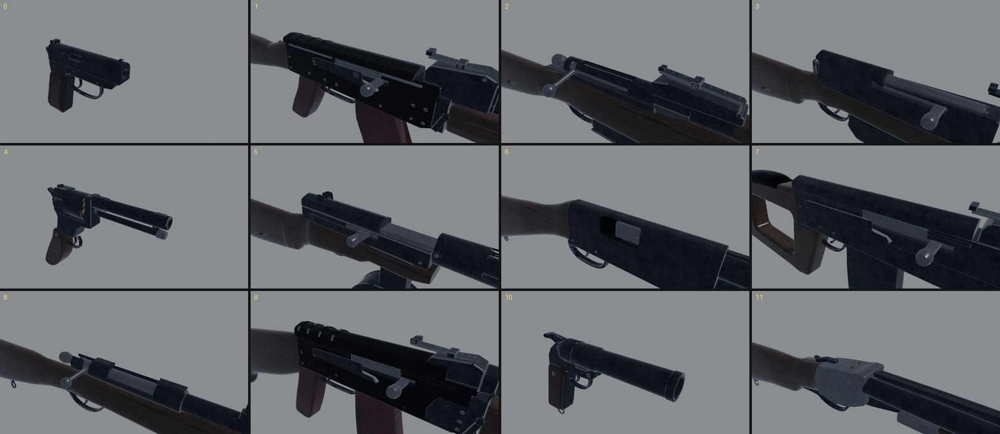
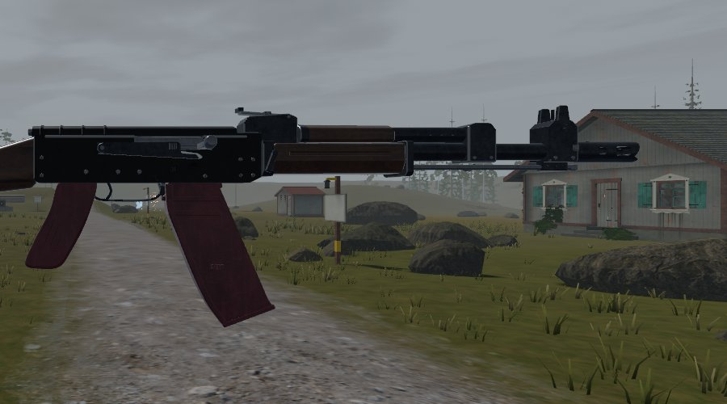
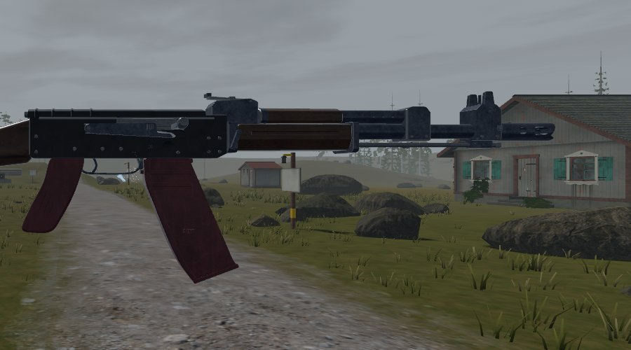
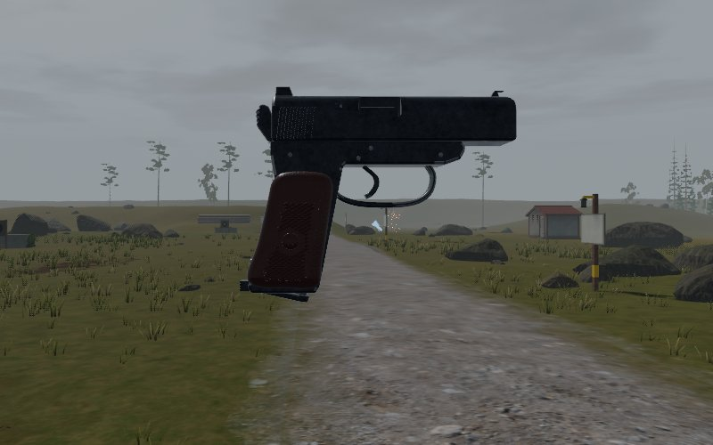
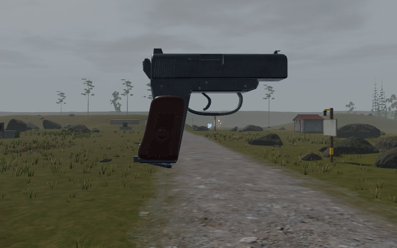
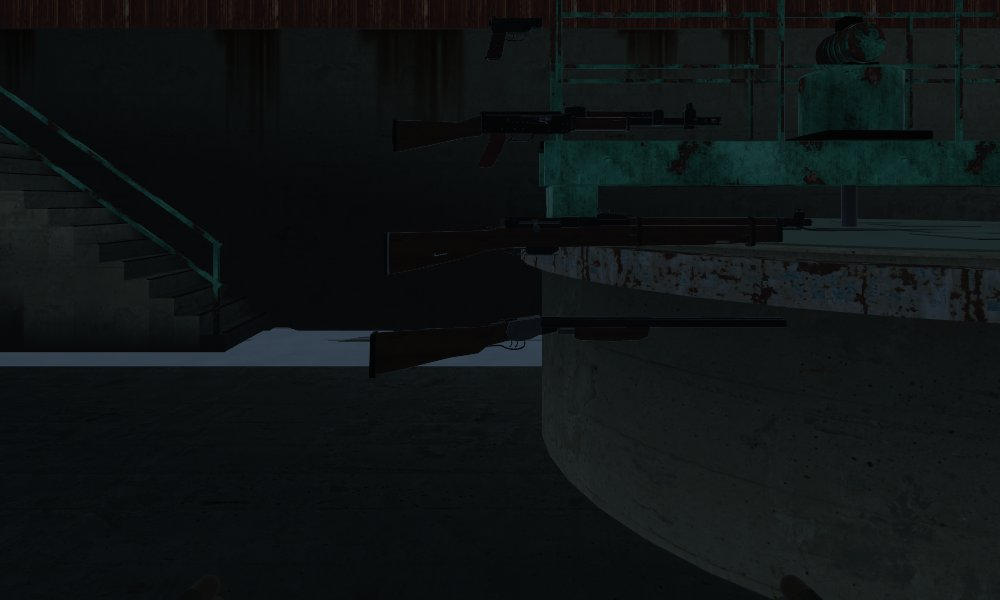
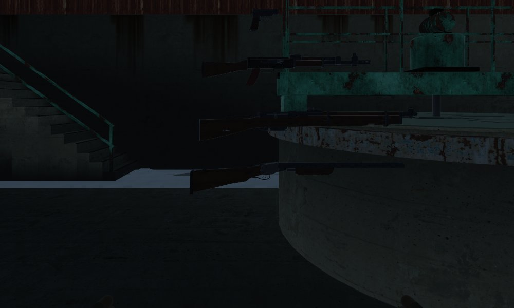
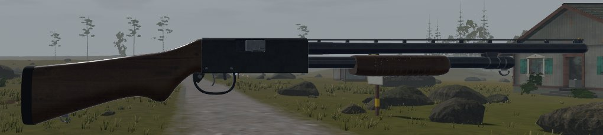

# Gunsmithing

> **Where I stopped (2 November 2026).** Every gun is reviewed: the AK-74,
> PM, MP-133, Mosin, SKS, PPSh, SVD, Nagant, IZh-43, TOZ-8M, RPK-74,
> SPSh-44 and crossbow. Each has a review in `docs/craft/guns/<id>/`. The
> last tip, on `claude/polish-gunsmith`, holds three changes: the SPSh-44
> (with its grip point at z 0.006, so Hands' trigger bound passes), the
> crossbow's 150 mm draw, and Models' 0.30 m bolt.
>
> **What's next.** The open items, each waiting on a reference, not to be
> guessed. Each gun's README lists them worst first.
> - **IZh-43**: the forend's depth.
> - **TOZ-8M**: the semi-pistol wrist.
> - **SVD**: its heights.
> - **PPSh**: the rear sight.
> - **SPSh-44**: the barrel latch, and the grip panels' material.
> - **Crossbow**: the prod's flex when drawn, which needs a mover. Weapon
>   feel and Hands have the one-hand draw as a question.
>
> Any new gun starts from "What a gun must show at arm's length in VR",
> at the end of this page. A home-made one starts from "Home-made
> weapons".

How a gun in this game is judged, and by whom: the gunsmith, working on one
gun at a time at the bench, away from the game. This is the procedure. Follow
it, and change it when it's wrong.

`docs/ARMOURY.md` "What a gun needs" is a completeness list: every gun has
a catalog entry, a model, a mechanism, a layout, hands, sound. It says
nothing about whether the gun looks and works like the real one in your
hands at 30 cm. The art lints (`art/check.py`) count cracks, gaps and
overlaps. Neither looks at the gun the way a person who has held one does.
That is this page's job.

## The workshop

`crates/gunsmith` holds everything that is the gun and nothing that is the
game:

| Module | What |
| - | - |
| `firearm` | the mechanisms as state machines: what the hands work, what the trigger does, the faults and their cures |
| `parts` | how each named object of a model moves with the mechanism (`moves_for`, `delta`) |
| `spec` | the handle's travel and hinge per gun, and the **real gun's measurements** |
| `ammo`, `cartridge`, `build`, `dice` | what the mechanism needs to know about rounds, alterations and luck |

The library has no engine in it (the game's core depends on it, and the core
has no Bevy). The game re-exports it (`extraction_core::firearm`, `::ammo`)
and animates its gun models with `gunsmith::parts::delta`, so the bench
moves a part exactly as the game does. A test
(`weapons::layout::tests::the_bench_works_each_gun_as_the_game_does`) holds
the spec's travel and hinge to the game's layout.

The models stay Blender Python in `art/guns/<id>.py` (`docs/ASSETS.md`,
"Models"), built by `python3 art/build.py <id>`, linted by `art/check.py`.

## The bench

```bash
cargo run -p gunsmith --example bench -- ak74            # a window
scripts/gun_bench.sh ak74 docs/craft/guns/ak74/shots/after   # the review's shots, headless
```

One gun, nothing else, under the game's calm daytime light (the overcast
sun, the grey-blue sky light, AgX at EV100 10.6) and with the game's
finishes (the CC0 scans under `assets/textures/materials/`; fetch them with
`python3 scripts/fetch_assets.py materials`, or the bench draws flat
colours and the surface can't be judged). The lens is 50 degrees: at 30 cm a
wider one bends the gun.

In the window: `Space` turns the turntable, `1`-`7` the views, `E` explodes
it, `B` `S` `M` `C` `T` work the bolt, the safety, the magazine release,
the dust cover and the trigger, slowly, with a pause at each end. `-` and
`=` move in and out.

`--shots DIR` takes the standard set and exits:

| Shot | What it's for |
| - | - |
| `right_30cm`, `left_30cm` | each side square on, the action filling the frame: the controls, the markings, the edges |
| `threeq_30cm` | the gun as it's shown: form, how the parts meet |
| `eye_30cm` | from behind and above, as you look down at it in your hands: selector, safety, grip, top of the receiver |
| `top_30cm`, `front_30cm`, `under_30cm` | the sections: is it as wide as it should be, round where it should be |
| `right_1m`, `left_1m`, `threeq_1m`, `eye_1m` | the whole gun: proportion and silhouette |
| `exploded_1m` | every moving part pulled clear: is each a part, and is it the right part |
| `bolt_back_30cm`, `safety_fire_30cm`, `mag_release_30cm`, `cover_off_30cm`, `trigger_pulled_30cm` | each motion at its end |

Close shots aim at the action over the grip; far ones at the whole gun,
backing off as far as a long gun needs to fit the frame.
`--screenshot FILE --view V --dist D --focus x,y,z` takes any other. Keep
before and after shots from the same command so they compare.

## The review

Do it in this order. Each step has a question; write down every answer that
isn't "yes", with where and how wrong.

### 1. Gather the reference

Before looking at the model, know the real gun.

- **What you know.** The parts, their names, what each does, the
  markings, the finish, how it's held. Write it down first: it's the list
  the model is checked against, and writing it shows what you don't know.
- **Numbers.** Overall length, barrel, sight radius, height, width, mass,
  length of pull. The manual's figures where they can be found; cite each
  in `gunsmith::spec` and the gun's review. Mark what's unconfirmed.
- **Pictures and drawings.** Public-domain manuals and diagrams where the
  network allows (old military manuals and US government photographs are
  often in the public domain; check). Any asset that comes in is CC0
  (`docs/ASSETS.md`) with a `CREDITS.md` row.
- **A reference you can't redistribute is for measuring only.** Most good
  side views are someone's copyright (the PM's, the Australian War
  Memorial's, is "all rights reserved"; the MP-133's is a gun site's).
  Measure from them, overlay them on your own machine, and write the
  numbers into the review. Never commit them, nor an overlay or crop that
  contains them. Name the source so the next gunsmith can find it. Only a
  public-domain or CC0 photograph (the AK's, a 1989 US Department of
  Defense photograph) goes in the repo, overlays and all, credited in the
  review.

### 2. The parts you can see and touch

At arm's length a gun is the parts your hands and eyes find. List every
part visible from outside and every part a hand can work, and for each:

- Is it there, in the right place, the right size?
- Is it its own object if it moves (`gunsmith::parts`)? Does it move as the
  real one does: about the right pivot, through the right angle, in the
  right order with the others?
- What do you see when it's worked? (The bolt back: the bolt face, the
  extractor, the empty chamber, the follower. The dust cover off: the
  recoil spring and carrier.)
- Is every control a hand works its own named part where the real one
  is, so the hands find it from the model? Above all the magazine catch
  or latch: `mag_catch` (a paddle tipping about its pin, the AK's and
  RPK's) or `mag_catch_heel` (drawn back at the butt, the PM's). The hand
  rule picks which finger reaches it from where the part sits.

### 3. Proportions

Measure the model on the bench against the real numbers: overall length,
barrel, sight radius, length of pull, height, width (the bench prints the
drawn size against `gunsmith::spec`'s). More than 2% off is a fault worth
listing; more than 5% is one the eye sees without knowing why.

Then the sections: a gun that's right in side view can still be a box in
the hand. Cut it across the bore at the muzzle, the ejection port and the
rear sight, and across the grip high and low:

```bash
blender -b --factory-startup --python art/sections.py -- \
    assets/models/guns/pm_pistol.glb pm.png -0.112,-0.04,y0.0,y-0.035 "nose,port,grip top,grip low"
scripts/draw_sections.py pm.png
```

Each object's outline is drawn in its own shade on a 10 mm grid. Look for
flat tops that should arch, square corners that should round, a slide
wider than the frame by more than the real one is.

Then the relations no table gives: where the magazine sits against the
trigger, the stock's drop, the grip's length and rake, how deep the
handguard is. For these, lay the model over a side-on photograph:

```bash
target/fast/examples/bench ak74 --screenshot side.png --view level_left --dist 1 --ortho 0.8
scripts/gun_overlay.py side.png photo.jpg overlay.png --mm-per-px 1 \
    --photo-muzzle 63,80.5 --photo-butt 597,80 --length 943 --align butt
```

`--ortho 0.8` draws an 800 mm frame on 800 px, so a pixel is a
millimetre. The overlay scales the photograph by its muzzle and butt to
the real length and registers it on the butt (or the muzzle) and the
bore. Before trusting the photograph, check one part of known size in it
(the AK's brake is 24-25 mm across). The photograph is for measuring; it
goes in the repo only if it's public domain or CC0, credited in the
review. `--hide NODE` leaves a top-level node out (the Mosin's bayonet,
when the photograph has it off).

### 4. Surface

- **Finish**: blued steel is blue-black and satin, not black gloss; the
  edges a hand rubs go silver-grey, the flats don't. Phosphate is grey and
  matt. Paint chips.
- **Wear**: where hands, holsters and slings rub (the slide's edges, the
  muzzle, the safety's tip, the grip's checkering, the stock's comb), and
  nowhere else. Wear that runs in stripes along an edge reads as candy
  cane, not use.
- **Wood**: grain runs along the stock; laminate shows its layers at the
  edges; old shellac is red-brown, not orange.
- **Edges**: a stamped part has rounded edges and an even thickness, its
  dimples and ribs pressed in; a machined part has crisp edges and flat
  faces; a casting is softer and grainier.
- **Markings**: the selector's letters, the serial, the year, the factory
  mark, where they really are.

#### Finishes

The model's material names (`art/common.py`, mapped in `src/models.rs`
and the bench) are the finishes. Judge a finish across the whole
line-up, not on one gun: take every gun's `threeq_30cm` into one sheet
(`docs/craft/finishes/`).

| Name | What it is | On |
| - | - | - |
| `Blued` | machined steel, polished and blued: the gun-metal scan at a 75 mm tile, a little glossy | barrels, sight blocks, bolts, slides, milled receivers |
| `Stamped` | stamped sheet under black lacquer over phosphate: near black, little metal, the scan's relief only | the AK-74's and RPK-74's receivers and dust covers |
| `Alloy` | aluminium alloy, anodised or painted black: a satin charcoal, no blue, no metal | the MP-133's receiver and trigger guard |
| `Steel` | bright steel, in the white | carriers, pins, springs |
| `Black` | blackened steel, matt | butt plates, small fittings |
| `Worn` | bare steel where the finish has rubbed off | edges, by `wear` |

First pass (31 October): every gun wore the same scan at a 150 mm tile,
which at 30 cm read as a casting's grain on everything. Blued is now at
half that tile; the stamped receivers have their own finish. Both sit at
the art direction's value floor (median about 20-22 at 30 cm on the
bench): lifting either further takes a decision on the whole line-up's
values, not one gun's.

Third pass (1 November): the coordinator saw every gun's steel go
near-black at 30 cm, so the PM's arched slide didn't show. Two causes.
The game has no environment light, so a metal reflects only the sun and
the flat ambient. And the scan's albedo, which is a metal's reflectance,
is 0.045: darker than charcoal, where blued steel is about 0.1-0.2. On
the bench, blued steel at an even 0.1 and stamped steel as a glossy paint
showed the form. But values tuned without an environment light are wrong
once one lands, so they wait for Visual design's. The finishes'
numbers are now in one table, `gunsmith::finish`, which the game
(`models::steel`) and the bench both build from.



Fourth pass (1 November), against Visual design's sky light
(`render::sky_light`), in the game in the yard at noon and inside the
Rime Fell mill: smooth metal now reflects a horizon brighter than its
zenith, so a curve grades from a light band to a dark top. Changes:

- **Blued**: an even 0.09 reflectance, a touch blue, on the scan's
  roughness (about 0.28) and relief.
- **Stamped**: a lacquer at 0.02, roughness 0.35.
- **Black**: about 0.07, matt.

- **Alloy** (new): the MP-133's black aluminium receiver and guard, a
  satin charcoal paint at 0.032 and roughness 0.36, apart from its blued
  barrel.

A first try at about 0.13 (gain 3 on the scan's albedo) went blue-grey
and blotchy, like a dusty casting: the scan's variation, tripled. Even at
0.1 it showed on the PM's slide at 30 cm as grain, so blued steel's
albedo is now flat and the scan gives only its roughness and relief. In the mill the metal stays
dark, reflecting the room. The bench has no sky light, so it shows these
finishes flatter and lighter than the game does; judge finishes in the
game.

| Yard, before | Yard, after |
| - | - |
|  |  |
|  |  |

| Mill, before | Mill, after |
| - | - |
|  |  |



### 5. Hands

- Where does the firing hand's thumb fall, and what does it find there
  (the PM's safety, the AK's selector out of reach of it)?
- Where does the support hand sit, and on what (the handguard's swells)?
- Which finger works each control, and can it reach?
- Hand poses belong to the hands' owner; the gunsmith says where the
  controls are and how they move, and checks the poses meet them.

### 6. Sound and feel

For each action: the sound it makes (the AK's selector's loud clack, the
PM's slide's short snap), its weight and travel, where it stops. Sound
timing and recoil belong to weapon feel; the gunsmith writes what the real
action does and checks the game matches it.

### 7. Score

Score each row 0 to 3: **0** wrong or missing, **1** there but a person who
knows the gun would wince, **2** right at a glance, wrong at 30 cm, **3**
right at 30 cm.

| Row | Looks at |
| - | - |
| Silhouette | the outline at 1 m, both sides |
| Proportion | the measured numbers and relations (step 3) |
| Sections | top, front, under: widths, rounds, tapers |
| Parts present | every visible part (step 2) |
| Parts move | every worked part, its pivot, travel, order |
| Controls | each control's shape and place for the hand |
| Finish | metal, wood, polymer as the real materials |
| Wear | where it is and how it reads |
| Edges and making | stamped, machined, cast, moulded |
| Markings | what's written where |
| Sound and feel | each action (step 6) |

The total out of 33 is the gun's score. Don't round it up.

### 8. Write it down, worst first

`docs/craft/guns/<id>/README.md`: the reference (with citations), the shots
(`shots/before/`, `shots/after/`), the scores, and the list of what's wrong
ordered by how much it costs the gun in the hand: what a newcomer sees in
their first minute first, a detail only a collector would catch last.

### 9. Fix the worst, show it

Fix from the top of the list. For each fix, a before and an after from the
same command. Run `art/check.py` (the models' lints are the models
owner's, and must stay clean), the weapons tests, and the bench. Update the
scores. Then the next gun.

### Home-made weapons

A home-made weapon has no real gun to measure against. It still has to be
something a person could build from what's lying about, and then work by
hand. Review it in place of steps 1 and 3; the rest stands.

1. **Name the stock parts.** List each part as what it was before: a car's
   leaf spring, a plank, angle iron, a gate latch, rebar, a door bolt. Size
   each to the real thing: a leaf's thickness and width, an angle's
   section, a bolt's thread. A part no shed or scrapyard holds needs a
   reason.
2. **Work every action through.** For each thing it does, follow the force
   from the hand to the part and say what stops it:
   - **Cocking**: the stroke and what bends to give it. A spring-steel
     leaf yields at about 1.2-1.5 GPa: a tip's deflection is at most about
     2σL²/3Et (L the free arm from the clamp, t the leaf's thickness). Check
     that the string or rod keeps its length between rest and drawn. The
     drawn length comes from the parts' limits, not from the reach of an
     arm.
   - **Holding**: what catches the drawn load, and that it holds without a
     hand on it.
   - **Release**: trace the trigger's travel through every link to the
     catch, and check each link turns the right way. A seesaw lever turns
     a push the wrong way round: lifting the tail of a lever pivoted at its
     middle drives the hook down.
   - **Safety**: what it blocks, and that it does block it.
3. **Size it for a body.**
   - A foot stirrup takes a boot's toe: about 120-140 mm inside.
   - A grip takes a hand of the hand rig's size.
   - A trigger sits in the finger's reach from the grip (`docs/craft/guns/nagant`).
   - The support hand has somewhere to go clear of a moving string or
     slide.
   - Every edge the hands work is eased.
4. **Read it at arm's length.** At 1 m, it should read as made: saw cuts,
   bolt heads, tape, wire, mixed materials, uneven spacing. Keep it neat
   enough that nothing looks broken by mistake.

Score the same rows. Proportion is then "the parts are the sizes of their
stock, and the actions are the lengths their parts allow". Write each
action's numbers down: stroke, deflection, stress, clearance.

## What the reviews have taught

- **Measure first, against a photograph.** The AK-74 looked "off" in a
  way nobody could name. It was 6% too long (53 mm of barrel between the
  gas block and the front sight), and deep and heavy below the bore: a
  butt 35 mm too deep, a comb that fell where the real one runs level, a
  grip 18 mm long, a magazine near straight. No single number in a table
  shows that; the overlay shows it at once.
- **The catalog knew.** `items.ron`'s box for the AK was the real gun's
  all along (943 x 240 mm). Check the model against it first.
- **A model is held by more tests than the guns'.** Re-curving the AK's
  magazine and re-drawing its stock broke the item-box and stowing tests
  (`models::tests::every_item_model_fits_its_box`,
  `capture::stowed::tests::origin_offsets_are_the_models`), which the
  weapons filter doesn't run. After changing a model's size, run the whole
  suite (`cargo test --profile fast --workspace`), and keep the catalog's
  box and `kit_cavities::ORIGIN_OFFSET` in step.
- **Welded parts.** A part that moves on the real gun but was joined into
  `static` (the AK's dust cover and magazine catch) can't be worked. Look
  for them in the exploded view: what doesn't fly off isn't a part.

- **Register on the hand, not the muzzle.** The SPSh-44's barrel was
  right, but its breech sat 23 mm too far from the grip. Registered on the
  muzzle, the overlay only showed a grip in the wrong place. Registered on
  the grip at the palm's height (the model's origin), it showed what had
  moved.
- **Copies are references.** A licensed or straight copy (a Type 57 for
  the SPSh-44, a vz. 44/67) is a fair photograph of the original. Check
  the parts the copy changed against a second source.
- **Every action, link by link.** The crossbow's latch looked right and
  could never release: its bars pivoted in the middle, so the trigger
  drove the hook down. Follow each force from the finger to the part.
- **The grip point is the palm.** The hand measures reach from `grip`,
  not the backstrap. On every gun, put `grip` the same distance in front
  of the backstrap at the palm's height (the PM's is 29 mm). Then a
  longer reach is the real gun's, not the layout's (`nagant`).

## What a gun must show at arm's length in VR

A player holds the gun at 30-60 cm and sees it at 1 m on a table or a
wall. Model for those distances, in this order:

1. **The silhouette at 1 m.** The outline from the side is what reads
   first and what a player recognizes. Check it with an overlay before
   anything else.
   - Missing or extra lumps show at once: a guard, a hammer spur, a hinge
     knuckle.
   - Wrong lengths along the bore show too: a barrel too long, a breech
     too far forward.
   - Every review this round found its worst error here.
2. **What the hands touch, as parts.** Every control a hand works is its
   own named part, of its real size, where the real one is:
   - trigger, magazine catch (`mag_catch`), safety, bolt or charging
     handle, latch, hammer, string.
   - The hand rig finds them in the model. A control welded into
     `static`, or drawn small, is one the player gropes for.
   - Give each control's working face its real texture, grooves or
     serrations, because at 30 cm it's the only part in focus.
3. **Where the hand sits.** The grip's rake and depth, and the trigger's
   reach from `grip`, are felt before they're seen. Hands measures them
   in the hand's frame. A grip 9° off reads as a different gun in the
   hand, even when the eye doesn't catch it.
4. **The finish under the sky light.** Blued, parkerized, stamped,
   alloy, wood, Bakelite and rubber must part from each other under the
   overcast sky (the `gunsmith::finish` table, the shots in
   `docs/craft/finishes/`). Near-black reads as plastic. Check a finish
   in the game's light (the yard and the Rime Fell mill), not only on the
   bench's grey.
5. **Seams and gaps.** At 30 cm a 4 mm see-through gap (the RPK's
   handguards) reads as broken, and a part floating 2 mm clear fails
   `capture::attach`. Where two parts meet, make the seam 1 mm or less.
6. **Making marks, last.** Stamped edges, machined faces, screw heads,
   markings and wear sell the gun at 30 cm. They can't save a wrong
   silhouette or a control in the wrong place, so they come last.
