# Item reading: a review procedure

> **Where Models stopped (2 November), and what's next.**
> Pushed and gated, on claude/polish-models: the crossbow bolt at 0.30 m
> (fd6c6cd5, riding with Gunsmith's tip: their in-flight bolt and
> crossbow.glb rebuild go with it). On main before that: the truck
> crate's radio face up; the house plans (farm, post office, plank B/C);
> the labels' shared `LIFT` and `art/check.py`'s item gap; the stencil
> glyphs and `art/check_glyphs.py`; the walk props (log stack, wrecks,
> stone ring); the robot line-ups.
> Next, when work resumes:
> - The guns' labels pick up the fixed glyphs when Gunsmith next builds
>   them; the depot's conveyor and cradle (a C in their codes) want their
>   owner's rebuild (rebuilt here they lost their rollers' baked AO).
> - ~~Lettering at 2 m in game~~: done 4 November (the crate reads; the
>   gate blocks' ivy kept off their lettering; below).
> - ~~The truck crate's later kinds at reading distance~~: done 4
>   November (the magazine on its side; the rounds out from under the map).
> - ~~The walk props past the first jobs~~: Map design's walk reviews
>   cover them and send model requests (Sallow's viewing bay, Rime's snow
>   poles); the first-job interiors in Kettle, Rime and Sallow are done
>   here (4 November, below).
> - ~~The first raid's loot in Marrow's first-job houses, in game
>   light~~: done 4 November (below, "The first raid's houses").
> - Cinder's Ash Row at raid 0 (the room cameras I had predate the map's
>   move; Ash Row is now at (-34.5, 108.2)).

Every item must be told apart from every other, and its family known,
from its shape and colour alone: at 1 m on a shelf (in reach) and at
3 m across a room, under the light most rooms in the Zone have. The
designer's first session: "bombarded with too many item types at once…
it felt muddy"; the yard's kit crate was "13 look-alike items".

This is the procedure. It's a living document: when a review teaches
something, write it here.

## 1. Render the line-up

`art/lineup.py` puts a family's items side by side on a shelf and renders
them as the headset sees them:

    blender -b --python art/lineup.py -- out.png 1 colour -- a.glb b.glb proc:bolt ...
    blender -b --python art/lineup.py -- out.png 1 grey   -- ...
    blender -b --python art/lineup.py -- out.png 3 colour -- ...
    blender -b --python art/lineup.py -- out.png 3 grey   -- ...

- **The eye's sharpness**: a 100° view on 1430 px, 14.3 px a degree, what
  the Beyond 2 renders in the middle of the view at the game's auto
  render scale (`docs/LEGIBILITY.md`). An item 10 cm across is about
  80 px at 1 m and 27 px at 3 m. Never judge a render scaled up smoothly:
  crop it, and enlarge only by whole pixels (nearest neighbour), so what
  you see is what the eye gets.
- **The light**: a room lit through a window to its left by overcast
  daylight (a large, soft, cool panel) and its own dim fill. No lamp, no
  rim light. An item has to read under the light most rooms have, not a
  studio's.
- **The shelf**: worn grey-brown board against a dull wall. Items stand
  as their models rest.
- **Grey**: the same render in greyscale. It tests silhouette and value
  without colour (and stands in for a dim room, and for colour-blind
  eyes). If two items only differ by hue, grey shows it.
- **Items built in code** (the bolt, the detector: `src/anomaly/visuals.rs`)
  are rebuilt from the same primitives with `proc:<id>`. Keep the two in
  step when either changes.
- **The sheet** (`art/lineup_sheet.py`): 1 m colour and grey cropped
  round the shelf, 3 m colour and grey cropped and enlarged 3x by whole
  pixels, the ids listed left to right. Sheets go in `docs/shots/items/`,
  before and after with the same camera.

Render the family together, and then the set a player meets together (a
crate's contents, a first house's shelves): confusion happens across
families as much as within them.

## 2. Look, in this order

1. **3 m, grey, first.** Squint. Count the shapes you can tell apart.
   Anything that's a smudge, or a twin of its neighbour, fails here.
2. **3 m, colour.** Does colour split what grey couldn't? Can you name
   each item's family from across the room?
3. **1 m, grey.** At reach, each item's silhouette should say what it is
   before its label does: a tin is a cylinder with a rim, a radio is tall
   with an antenna, a dressing is a soft packet.
4. **1 m, colour.** Labels, marks and the one distinguishing feature.
   Labels are bonus legibility at 1 m, never the only difference.

Write down, for the set:

- **pairs a newcomer would confuse** (at either distance, in either
  mode);
- **items that read as nothing** (a smudge, or so small or dark against
  the shelf it disappears);
- **items in the wrong family's colours** (a medical thing in tool
  colours).

## 3. What makes a silhouette distinct

- **The outline's big shape first**: tall, long, flat, round, boxy. Two
  items with the same proportions are twins at 3 m, whatever their
  detail. Change the proportion before adding detail.
- **One feature that breaks the outline**: an antenna, a handle, a cap,
  a strap, a lid. It must be big enough to survive 3 m: about 1.5 cm
  across (3 px) at the least, more if thin.
- **Value contrast against the shelf and the item's own parts**: a dark
  item on a dark shelf vanishes; a light band on a dark body reads from
  across the room.
- **How it rests**: an item that stands upright reads differently from
  one that lies flat. Use it.
- **How it rests is part of its silhouette**: a cell lies, a magazine
  stands. Set the model's rest pose and its catalog `dims` to the way the
  thing lies on a shelf, and check a dropped one comes to rest that way.
- **Small things need a flag**: anything under about 6 cm needs a bright
  or high-value feature to be found at all (a coloured cap, tape, a tag).

## 4. Colour and value, by family

The Zone's palette is muted (`docs/ART_DIRECTION.md`); each family gets
its own corner of it, so a glance says what kind of thing it is.

| Family | Language | Value | Its mark |
| - | - | - | - |
| **Food** | warm: bare tinplate, paper labels in faded warm colours (ochre, brick, cream), brown card and paper packets | mid to light | the tin's rim, a label band |
| **Medical** | off-white and cream, light grey; a red cross or band | light: the lightest family | red on white |
| **Ammo** | ochre and brown card boxes, printed; brass rounds | mid, warm | brass, print |
| **Magazines** | blued steel, near black; red-brown bakelite | dark | the follower, the lips |
| **Tools** | bare steel with painted handles (red, orange, blue), dark canvas or leather rolls | mixed, metallic highlights | a coloured handle |
| **Electronics and gadgets** | olive drab and dark grey military kit; a pale dial or a lit lamp | mid to dark | a dial, an antenna, a lamp |
| **Power** | dark bodies with a bright metal or coloured end | dark with a light end | the end cap |
| **Anomaly kit** | signal colours: the bolt's flagging tape, the detector's dial | — | tape, lamp |
| **Curios** | personal and odd: saturated or patterned, old paper, glass | any | whatever makes it someone's |

Within a family, items are told apart by **shape**; across families by
**colour first, shape second**.

## 5. Measure what can be measured

A check is only worth having if it's honest. Bounds and mean colour can
flag twins (two items with near-identical proportions, size and average
colour), but they can't tell a dressing from a tin of the same size and
colour. The pictures are the real test; a check only catches a
regression on what a picture already found.

## 6. Reviews

### The kit crate (31 October)

`docs/shots/items/kit_crate_before.jpg`. Its fifteen kinds as the yard
shows them (`persist::fresh_save`, `onboarding::stash_station`), less
the pistol (the Gunsmith's): flashlight, power cell, PM mag, 9x18
rounds, radio, field dressing, canned stew, cleaning kit, spare parts,
map case, compass, detector, bolt, the hearth stone.

- **Muddy olive.** Six of fourteen are olive or sage (flashlight, radio,
  field dressing, cleaning kit, the map case's frame, detector): colour
  says nothing about family.
- **Confused pairs**: the field dressing and the cleaning kit (sage,
  rounded, a pale label: two pale-green lumps at 3 m); the power cell and
  the PM mag (thin dark uprights at 3 m); the detector and the radio
  (olive boxes with knobs: told apart only by the radio's height).
- **Reads as nothing**: the bolt (a 6 cm dark stick, gone at 3 m, and
  it's thrown and has to be found again).
- **Reads well**: the canned stew, the map case, the compass, the radio,
  the spare parts (black and steel), the hearth stone (it glows).

### The first-job houses' starter set (31 October, Onboarding's draft)

`docs/shots/items/starter_set_before.jpg`: canned stew, crackers, water
bottle, field dressing, splint, 9x18 rounds, power cell, matches, bolt,
scrap metal.

- **Food in medical colours**: the crackers are a sage box, the field
  dressing a sage packet: at 3 m a pale-green box beside a pale-green
  pillow, food and medicine the same.
- **Twins**: the 9x18 rounds and the matches, two small pale boxes.
- **Reads as nothing**: the bolt again, and the scrap metal (a small dark
  crumple), which is meant to be the first thing worth bringing home.
- **Barely there**: the power cell, a thin upright found by its glint.
- **Reads well**: the canned stew, the water bottle (tall, white, a red
  cap), the splint (its ladder shape).

### After the first fixes (31 October)

`docs/shots/items/kit_crate_after.jpg`, `starter_set_after.jpg`, same
camera:

- **Field dressing**: pale, a red cross on top. Now the lightest thing in
  either set; no twin.
- **Crackers**: brown kraft paper. A warm box beside a white packet, food
  beside medicine.
- **Cleaning kit**: dark canvas roll, leather straps, steel showing.
- **Matches**: a blue label; no longer a second small pale box.
- **Scrap metal**: a bigger blue-painted plate with bright edges; it reads
  from 3 m.
- **Power cell**: dark with a copper band, and now lying on its side (its
  model along Z; every bay's seat turned to match: `gadgets`'
  `CELL_ALONG` and `CELL_UPRIGHT`, the radio deck's). A low round shape
  with a bright end beside the magazine's tall dark one: they read apart
  at 3 m in grey too. A dropped cell comes to rest lying down
  (`vr_harness::tests::a_dropped_cell_comes_to_rest_lying_down`).
- **Bolt** (Anomalies', `src/anomaly/visuals.rs`): orange flagging tape
  knotted round it, tails trailing. At 3 m an orange fleck in colour;
  in grey it's still tiny. It's found by colour, which is what a thrown
  bolt in grass needs; its size stays as it is.
- **Detector** (Anomalies'): a signal-yellow face plate on the survey
  sets. No longer the radio's twin, in colour or grey.

Sheets re-shot on main 2ee65c62 (the same camera, `art/lineup.py` now
building the bolt's and detector's new looks as the game does).

### The shared lettering font (1 November)

`docs/shots/items/water_bottle_label_before_after.png` (in hand, pixels
x5): the font's В was the 8's strokes, so the water bottle read "8ОДА".
The font's twins are fixed (`art/check_glyphs.py`, run with
`art/check.py`); the labelled items rebuilt (only those whose geometry
changed: the ammo boxes, tins, packets, tapes and records). At in-hand
sharpness a 1.3 cm label is still soft: labels stay bonus legibility,
never the only difference. Not rebuilt: the depot's conveyor and
cradle (rebuilt here they lost their rollers' baked AO; their only
change is the C in their codes) and the guns (Gunsmith's, mid-edit).
The rice bag's and sugar box's label z-fighting predates this.

### Prints that stand off their faces (1 November)

`art/check.py` flagged label z-fighting on the rice bag and the sugar box
(the coordinator: check the class). No item shared a lift: each script
laid its prints, labels and bands 0.2 to 0.8 mm off the face under them,
and the ones with a big overlap fought (the rice bag's print 0.05 mm off
its label; the sugar box's bands 0.2 mm; the spare parts' lid label; the
splint's straps' undersides in the slats'; the car bonnet's brace arms
0.5 mm apart where they cross). Now a print, label or band stands
`art/items/_kit.py`'s `LIFT` (1.2 mm) off what it's on, and `art/check.py`
judges items at 1 mm (held 0.3 to 3 m from the eye; props stay at 3 mm).
All 192 item models check clean.

### The truck's crate, as a newcomer opens it (1 November)

The crate shows only what the first stations use (`onboarding::
stash_station`): the PM pistol (its magazine in it), the radio, and at
the first station the cleaning kit. In game, from the truck's bed, about
a metre away, under the room's light (`render::grade` `ROOM_ADAPT`):

- **The pistol**: laid on its side already (stood on its grip it was a
  stick); black and bakelite, its ring round it. Reads.
- **The radio stood up**: from above an olive stub and an aerial on the
  crate's dark floor, its face (grille, tuning window, lamp) unseen. Now
  it lies on its back, its face up (`persist::fresh_save`'s `turn`, as
  the pistol's): `docs/shots/items/truck_crate_radio_before_after.png`.
- **The cleaning kit**: a dark canvas roll, leather straps, brass rod
  ends: distinct on the boards (`truck_crate_first_three.png`, the kit
  shown early for the shot).

**How it rests is part of its silhouette**, again, and so is which face is
up: an item in a crate is seen from above.

### The truck's crate, all its kinds (4 November)

`docs/shots/items/truck_crate_all_before_after.jpg`: the crate as it
stands after the yard (every station's kit unfolded; shown so for the
shot, not in code), from the truck's bed at about a metre, the room's
light. Twelve kinds; ten read at a glance: the stew's lid, the radio
face up, the map case, the bolts' orange tape, the torch, the cleaning
roll, the detector's yellow face, the dressing's red cross, the compass
dial, the pistol. Two didn't:

- **The spare PM magazine stood up**: a dark sliver from above (its feed
  lips). It lies on its side now, its length and the top round showing.
- **The 9x18 rounds weren't there at all**: laid out under the map case
  (`fresh_save` had them a hand apart). Now out in the open between the
  torch and the dressing, the card box's print and its brass showing.

A crate's layout is part of reading its items: nothing under anything,
and each lying with its telling face up.

## The first raid's houses (4 November)

What a newcomer meets on their first raid, in game light (drizzle,
11:00), from 1.2 m: the eye standing in the room, turned to each loot
spot as it would walk up to it. The roll is a career's raid 0 (a fresh
`--save`; a scenario or a screenshot without a save rolls every
family). The houses roll 12 kinds then: ammo_9x18, bolt, canned_stew,
cleaning_kit, crackers, field_dressing, gun_oil, matches, pm_mag,
power_cell, tea_tin, water_bottle. Progression's stagger
(claude/polish-progression) keeps raid 1 the same: the PM family is the
only gun family until raid 3.

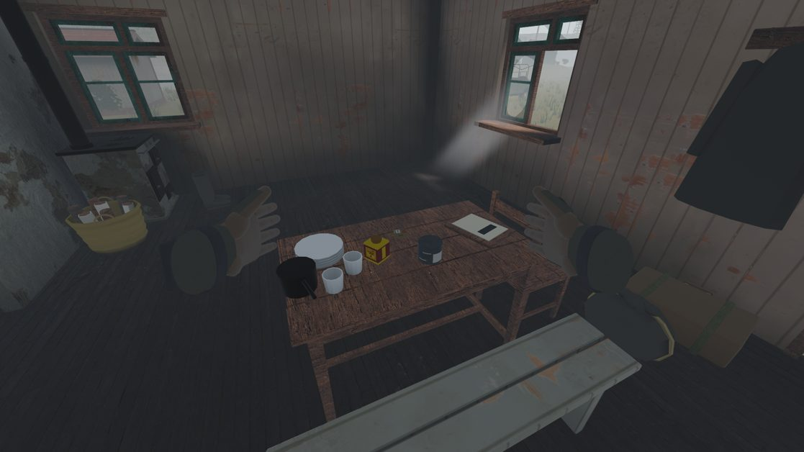
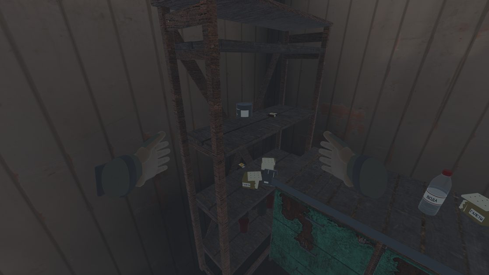
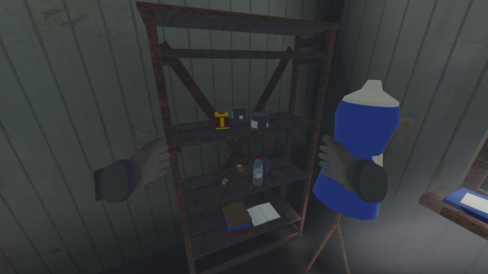

- **The food reads.** The tea tin's red ЧАЙ on yellow, the stew's dark
  tin with its white band, the crackers' box, the water's ВОДА: each
  is its kind at 1.2 m, and none is mistaken for the table's own
  dishes (the plates and cups are white and plain; the loot is
  labelled).
- **The small things are specks, true to size.** The 9x18 box (4 x 3 x
  7 cm), the matches, the bolt and the power cell are a few pixels at
  1.2 m on a shelf. They are their real sizes, and the hands
  read them when picked up; nothing to fix in the models. If the
  first raid wants them found sooner, that's how loot is shown (a
  glint, a place they're kept together), not their size.
- **Nothing lies under anything.** The rolled loot stood clear of the
  shelves' books and the tables' dishes in every view.
- **Fixed: the canteen was a plastic bottle.** Named, drunk and scaled
  as a canteen (Hands' rename for the twist-cap drink), it was a clear
  PET bottle labelled ВОДА. Now it is an aluminium flask, its lower half
  in a canvas cover, under a black screw cap; the cap's place and axis
  are the old ones, so the twist handle still sits on it. Two lessons:
  a cover to the shoulders made it a dark olive lump on a dark table
  (the bare metal is what's seen), and the library canvas, laid a metre
  to a repeat, wove 5 mm cells on a 7 cm flask, a knitted net (fixed
  for every model in canvas, below):
  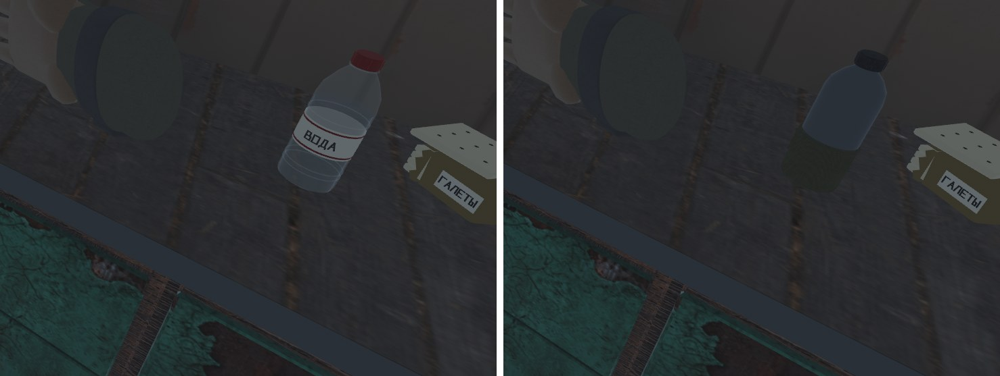
- **Fixed: the dress form read as a giant blue bottle** (plank C's
  seamstress, beside the shelf the newcomer loots). It tapered straight
  up to a narrow neck, and the dress covered it to 1.4 m. Now the
  shoulders are square and wider than the waist, the neck carries a
  wooden cap, and the dress is pinned up only to the bust:
  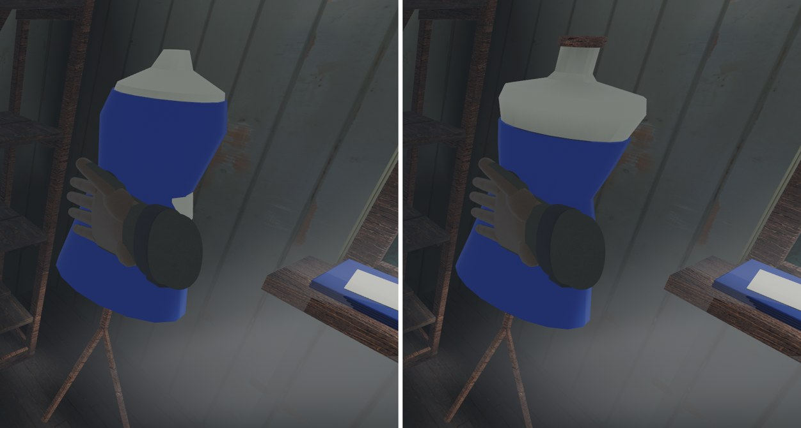

### Ash Row at raid 0 (4 November)

Cinder's first houses, the same rig (raid 0, drizzle, 11:00, 1.2 m):
the plank house's table (a 9x18 box), its crate by the bed (two PM
magazines and a box), the shop's counter (tea, a glass), its shelves
(crackers, stew, a dressing with its red cross). The same reading as
Marrow's: the food and the dressing read, the PM family is small and
dark on a dark crate top, true to size (Progression's placement rule
puts first-raid small kinds on lit tops). The stool's yellow seat seen
from above is a disc; it is a stool.

**Fixed: canvas read as a knitted net, everywhere in reach.** Looking
down at the plank house's crate, the player's own rig pouches at the
belt were a quilted check: the canvas scan, laid a metre to a repeat,
weaves 5 mm cells. The gloves (six repeats a metre) and the rag cloth
(four) had already been scaled; plain `Canvas` hadn't. It is four
repeats a metre now (`models.rs`), for the rig, the sacks, the bags,
the bedroll and the canteen's cover alike; the canteen's own scale went
back to one.
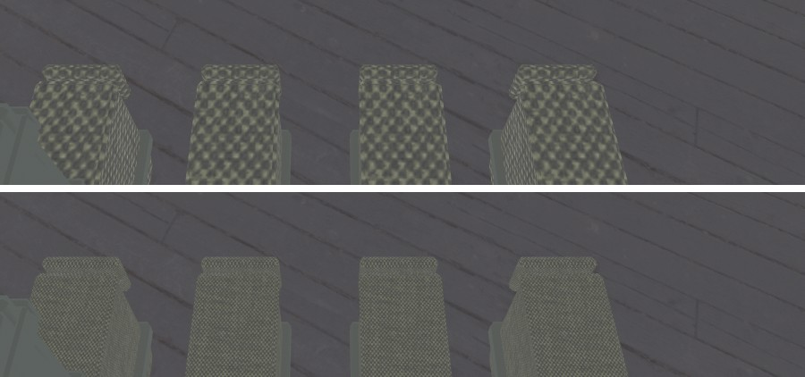

### Lettering at 2 m (4 November)

Face-on from 2 m, standing, in drizzle at 11:00.

- **A supply crate reads.** Marrow's pump keeper's store: ТАРА over
  17-6, cream on the olive boards, every glyph its own.
  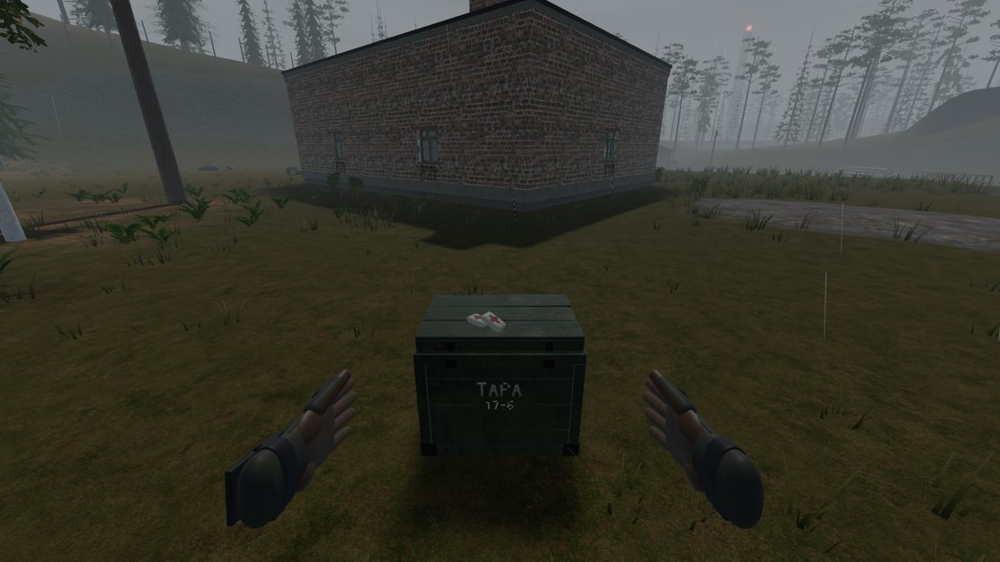
- **Fixed: the gate blocks' lettering was under ivy, in every valley.**
  The quarantine gate's blocks carry ФБС 24.3.6 on the face the walk
  out to the truck meets, which is their shaded north, the face ivy
  favours most. Marrow's, Kettle's and Cinder's were all sheets of
  leaves. `overgrowth::lettered` names a prefab's lettered faces and
  the ivy keeps off them; the rest of the gate grows as before
  (`ivy_keeps_off_lettering`). Kettle above, Cinder below:
  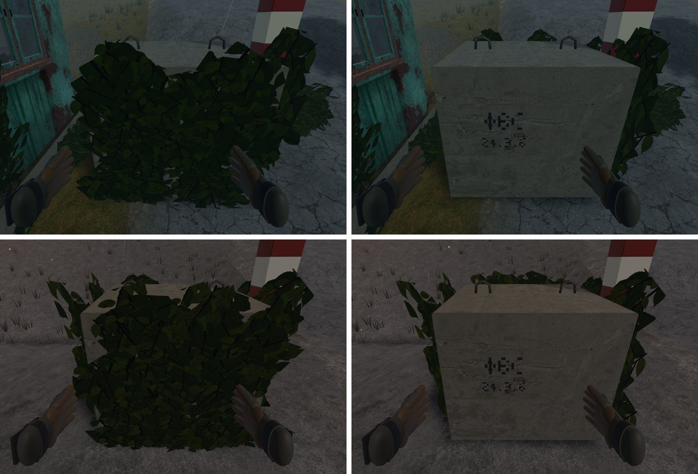

### The farmhouse with Progression's placement rule (4 November)

Progression's rule (claude/polish-progression, d525af94): on a
career's first two raids a Tiny or Small kind rolled at a spot out of
0.75–1.6 m moves to one in reach in the same building; a Tiny one
needs a flat top or the 1.25 shelf (the 0.80 shelf sits under a board,
shaded and seen edge-on). The same cameras at raid 0, main left, the
rule right (the roll differs; where each kind lands is the point):
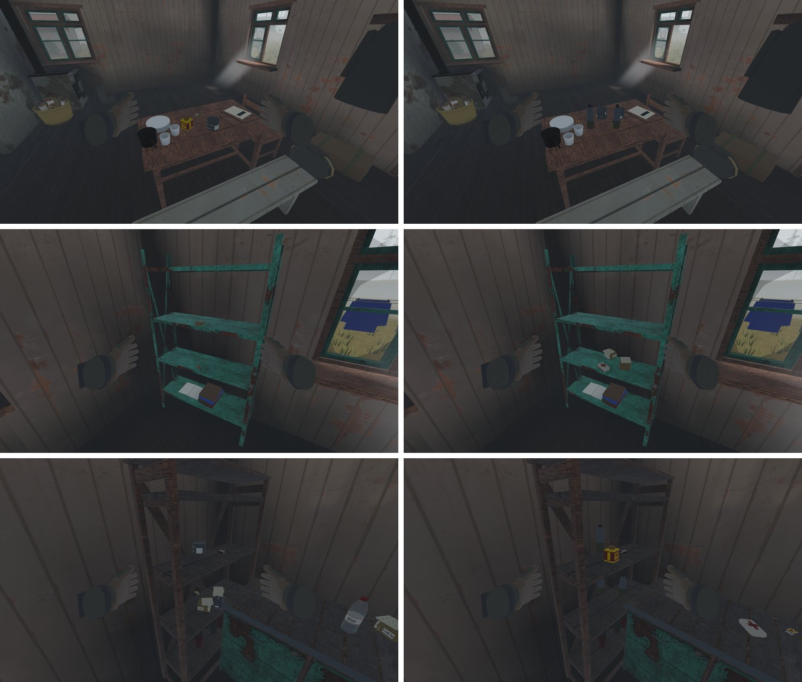
The kitchen worktop now carries a matchbox and a dressing, lit; the
low shelf holds Small kinds (crackers, a dressing) only:
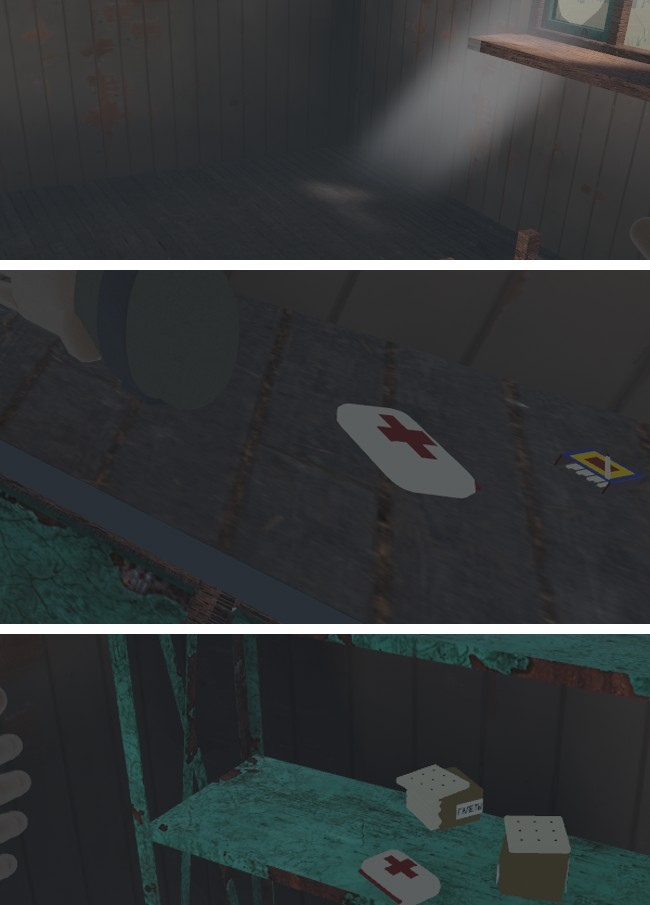

**Fixed: the canteen read black indoors.** From the door, two canteens
on the table were near-black bottles: their aluminium was `Zinc`,
0.9 metallic, a mirror of the dark room. They are `Aluminium` now, an
army flask's oxidised matte (lighter, half as metallic, rougher):
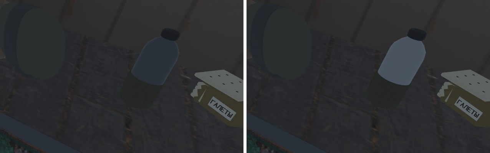

### The first jobs in Kettle, Rime and Sallow at raid 0 (4 November)

The same rig as Marrow's and Ash Row's (raid 0 from a fresh save,
drizzle, 11:00, 1.2 m from each loot spot), in the buildings of each
valley's first job: Kettle's Gatekeeper's cottage and its shed, Rime's
funicular valley station, Sallow's valve house. Main carries
Progression's placement rule now.
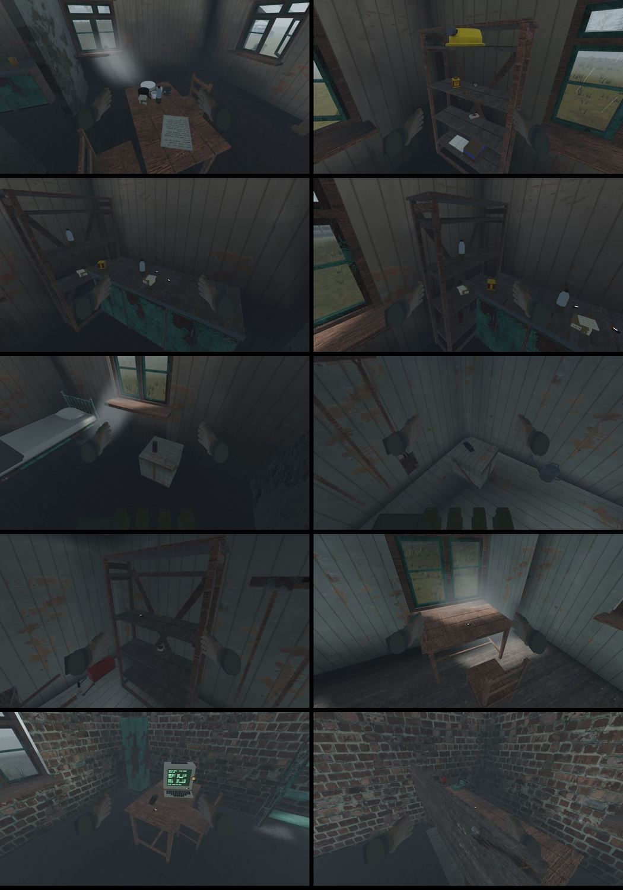

- **The placement rule holds outside Marrow.** Kettle's cottage keeps
  its food, canteens and tea on the table and the counter; the shed's
  bolt and power cell lie on the 1.25 shelf, the gun oil (Small) on the
  0.80 one; Rime's station has a power cell on its table, Sallow's valve
  house its kit on the table by the terminal and on the bench. No small
  thing on a low shaded shelf.
- **The models read.** The canteen in aluminium is a light flask on the
  counter, the tea tin and crackers their own, the terminal's green
  screen the brightest thing in the valve house. Nothing to fix.
- Still true everywhere: the 9x18 box, the bolt and a power cell are a
  few pixels at 1.2 m, true to size; the rule puts them where they are
  seen, which is the whole of it.

### Artifacts up close (4 November)

The Zone's most valuable finds, each lying 0.55 m off on the training
yard's road, fog at 11:00 (`--gallery art_<id>,30,0.55`). Left to right,
top to bottom: featherstone, hearth, glass eye; aegis, lodestone,
hushstone; stormglass, shard, rimestone:
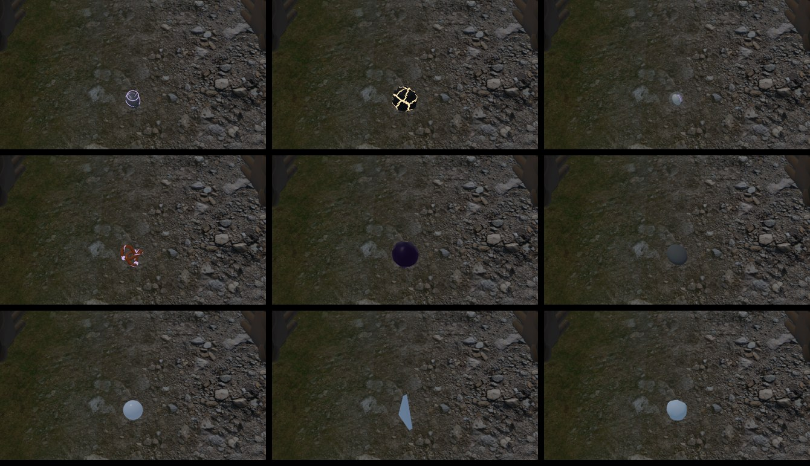

- **Read, and look valuable:** the hearth (black with glowing cracks),
  the aegis (a copper tangle), the shard (a blade of not-quite-glass),
  the featherstone (a dark pebble ringed in lilac), the glass eye (a
  marble with a highlight).
- **The hushstone** is what it says, a matte grey pebble: the one
  artifact you could take for a stone, by design.
- **Fixed (`anomaly/visuals.rs`, with Anomalies' go-ahead):**
  - *Stormglass and rimestone were twins*: two pale blue balls the same
    size. The stormglass is a clear bead with a dark cloud and a spark in
    it; the rimestone is pale stone furred with short white frost.
  - *The lodestone was a smooth violet ball*, not "a fist of dark iron".
    It is knobbled iron now, rough and barely metallic, with iron
    filings standing off its poles, their bright tips catching the light.
  - Each look inside its item's box; the bristles are one merged mesh per
    kind, built once and shared (fields hold several stones). Lessons:
    a lump's normals must be taken before its non-uniform scale (baked
    after, the lodestone went flat black); half-metal dark iron in fog
    renders black too.
  Before (top), after at 0.55 m (middle) and at 3 m (bottom):
  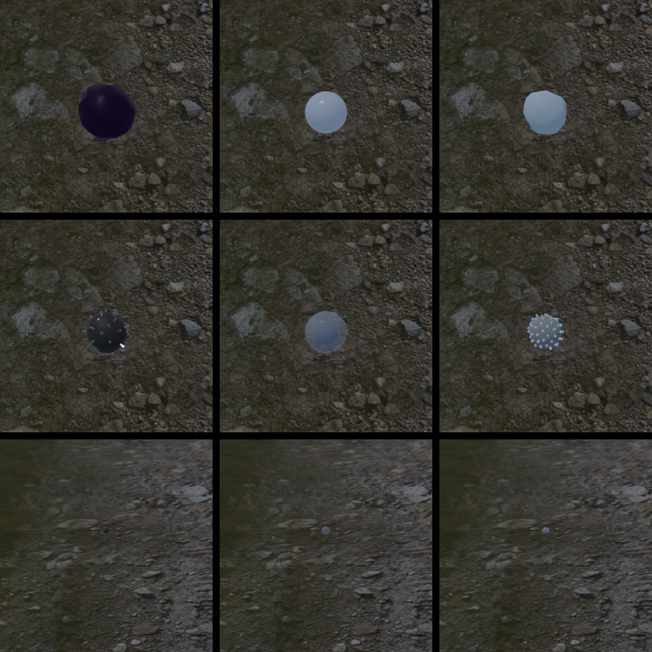
- **At 3 m every artifact is a speck**, before as after: small things on
  stony ground. Their fields' light is what finds them.

