# The most-carried guns at arm's length, in the game

The AK-74, the PM and the Mosin, checked against "What a gun must show at
arm's length in VR" (`docs/craft/GUNSMITHING.md`) on 4 November 2026, on
main 8d5c1105. Each was shot in the game under the sky light:

- **The yard**, noon, clearing: at 1 m from both sides, and at 30 cm.
- **The Rime Fell mill**, inside: at 30 cm.

The shots:

    scripts/shot.sh OUT.png 0,0,40,0,0 40 --map training_yard --gallery GUN,YAW,DIST --hour day --weather clearing --no-robots
    scripts/shot.sh OUT.png 140,91.85,38,0,0 90 --map rime_fell --gallery GUN,0,0.3 --hour day --weather clearing --no-robots

In each sheet: top left, 1 m from the right; top right, 1 m from the left;
bottom left, 30 cm in the yard; bottom right, 30 cm in the mill.

| AK-74 | PM | Mosin |
| - | - | - |
| 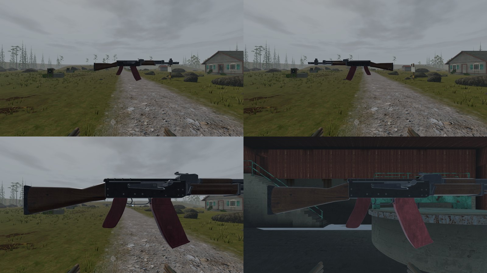 | 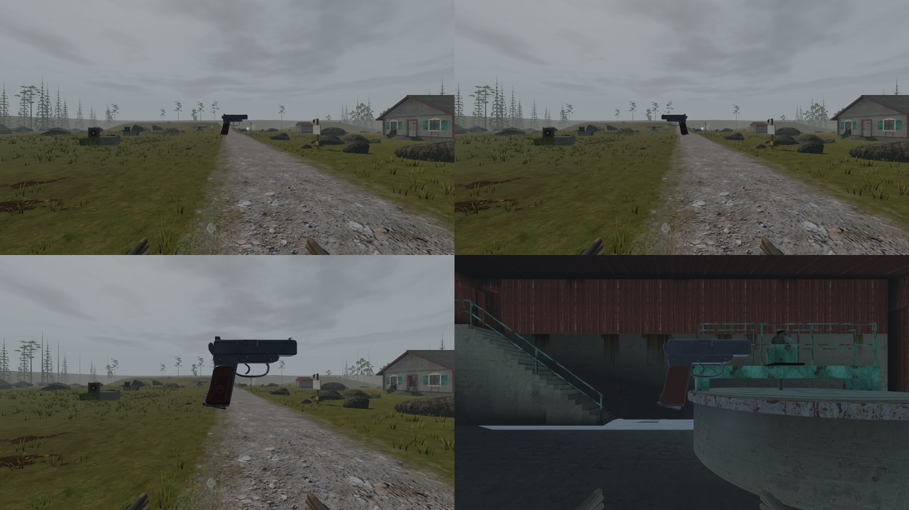 |  |

## Findings, worst first

1. **The Mosin's tang stood clear of the wrist.** The receiver's rear tang
   ran at a shallower slope than the wrist's top, so its end stood 5 mm
   above the wood. At 30 cm it read as a rod over the wrist. Fixed: its
   underside now follows the wrist half a millimetre into the wood, as an
   inlet tang does, and the tang screw sits on it (`art/guns/mosin.py`).

   | Before (game, 30 cm) | After (bench) |
   | - | - |
   | 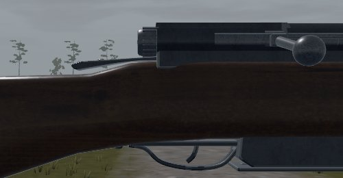 | 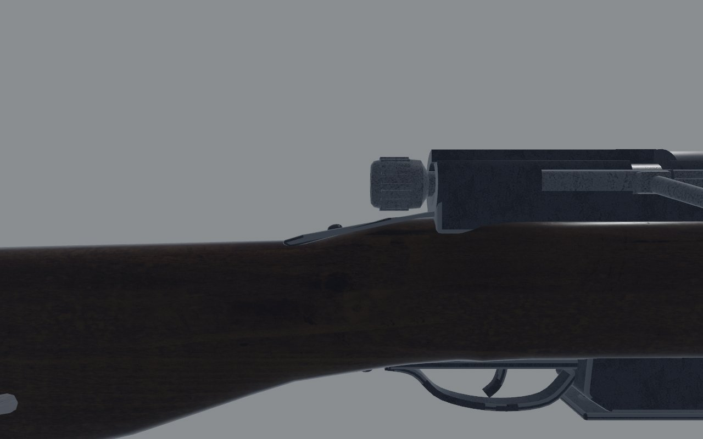 |

2. **The AK's handguards show a dark line between them.** At 30 cm a
   band of the gas tube shows. The two handguards are only 1.5 mm apart,
   and both edges are rounded, as the real ones are. It's the same seam
   settled on the RPK, so I've left it.

Checked and holding:

- **Silhouette at 1 m**, both sides: all three read as themselves.
  - The AK's plum grip and magazine.
  - The PM's slide over its wraparound grip.
  - The Mosin's long straight wrist, its box magazine and its bayonet.
- **Controls at 30 cm**:
  - **AK**: the selector lever, the charging handle and the magazine.
  - **PM**: the slide's serrations, the trigger in its guard, the
    magazine's base.
  - **Mosin**: the bolt handle's ball and the cocking knob.

  All are where the hand looks for them, each its own part.
- **Finish under the sky light**: wood, plum polymer, blued steel and
  Bakelite part from each other in the yard. In the mill they hold, a
  step darker.
- **Seams**: none open apart from the AK's handguard line (above).

## Second pass: the next three a player meets

The TOZ-8M (raid 3), the IZh-43 (raid 4) and the MP-133 (raid 5), in
Progression's gun order, on 4 November 2026. They were shot the same way.

| TOZ-8M | IZh-43, before | IZh-43, after | MP-133, before | MP-133, after |
| - | - | - | - | - |
|  | 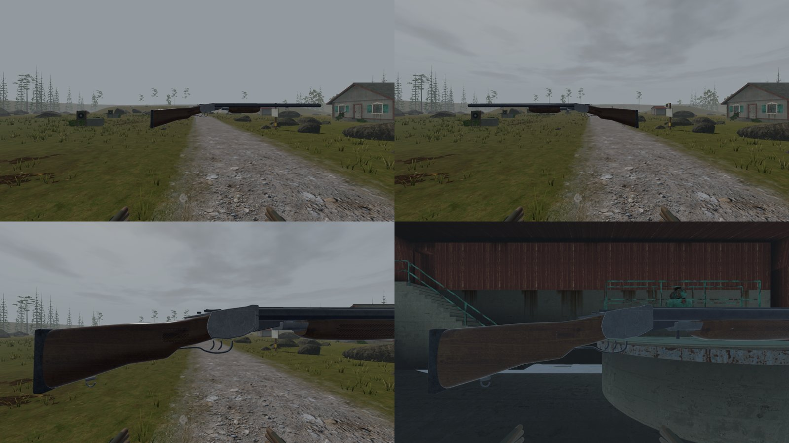 | 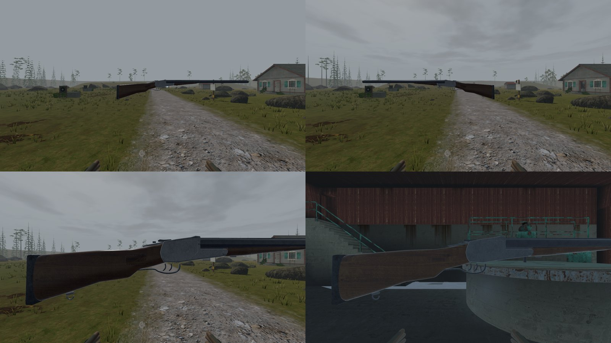 | 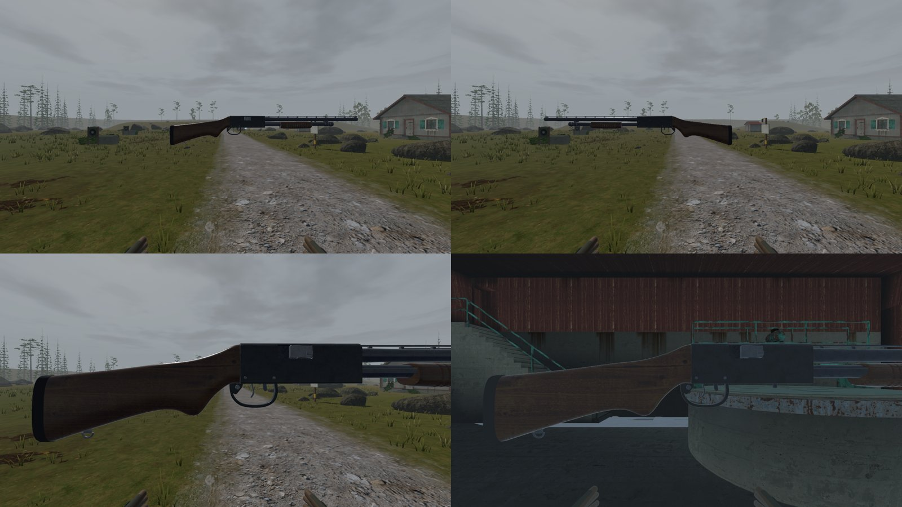 | 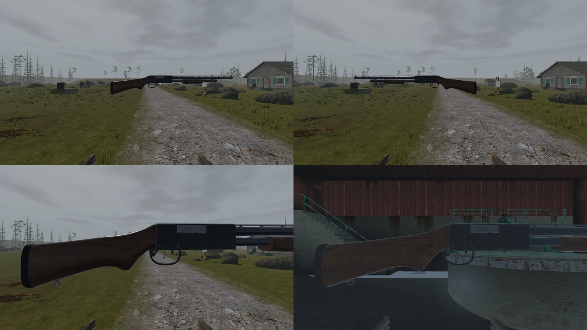 |

### Findings, worst first

1. **The IZh-43's action ended at the breech.**
   - **What 30 cm showed:** a dark gap under the chambers, the lumps and a
     bare forend iron hanging below, then a deep forend swelling under the
     hand.
   - **The real gun:** a dealer's side view of a 20 in IZh-43, measured
     from its barrels, shows the action's bar running 69 mm on under the
     chambers to the hinge. A slim forend meets it flush and tapers from
     50 mm under the rib's top to 30.
   - **Fixed:** the bar, a forward hinge, and the forend redrawn to those
     numbers. The support hand now sits on the forend's underside. This
     settles that gun's open item, "the forend looks deeper". Details are
     in `docs/craft/guns/toz_double/README.md`, second pass.

   | Before | After |
   | - | - |
   | 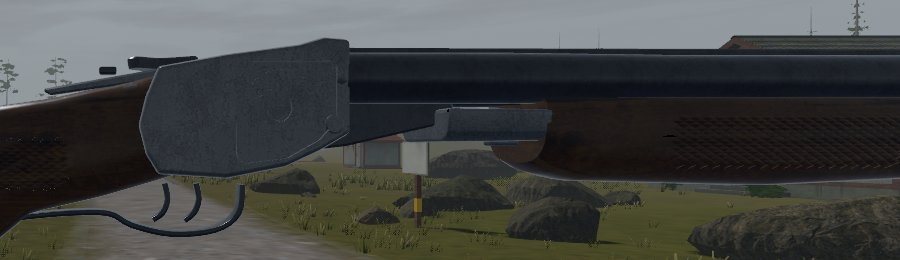 | 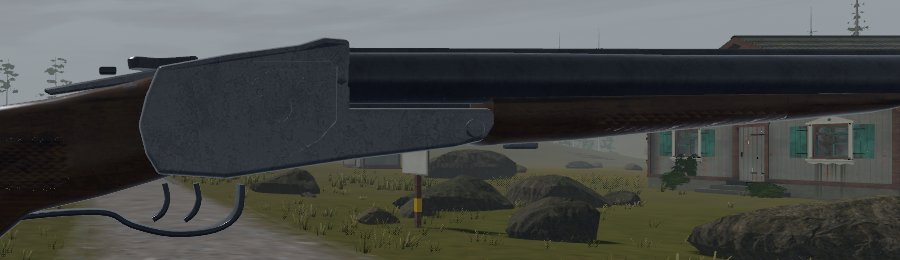 |

2. **The MP-133's ejection port was too short for its hull.** It was 60
   mm, and a fired 70 mm hull can't pass. It's now 78 mm, back from the
   barrel's breech, with the bolt lengthened to fill it closed. Details
   are in `docs/craft/guns/mp133/README.md`.

   | Before | After |
   | - | - |
   | 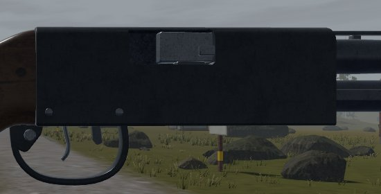 | 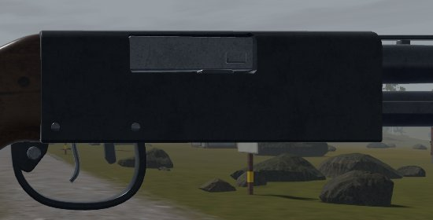 |

3. **The TOZ-8M reads right at 30 cm**: the bolt and its knob, the
   receiver's dovetail, the sights, the guard and the butt swivel. I left
   it alone. Its open item, the semi-pistol wrist, still has no side view
   or drawing to measure against; I found only text and listings without
   usable photographs.

Checked and holding on all three: the silhouettes from both sides at 1 m,
and wood against blued steel and black alloy in the yard and the mill.
