# Condition you can see

Does a gun's state read on the gun, at 30 cm and at 1 m in the game's
light, so that cleaning it at the bench is visibly worth doing? This
covers the first eight guns a player meets, on 4 November 2026.

## The states

Each gun is shown with `--gallery <gun>+<state>`, in five states:

| State | Flag | What the gun holds |
| - | - | - |
| clean | (none) | condition 1, no fouling, no grime |
| fouled | `+foul` | fouling 1 |
| grimy | `+grime` | grime 1 |
| worn | `+worn` | condition 0.45 |
| near failure | `+failing` | condition 0.08 |

The shots (`scripts/shot.sh`), each state in three places:

- the yard at 30 cm: `--map training_yard --gallery G+S,0,0.3`, camera
  `0,0,40,0,0`;
- the Rime Fell mill at 30 cm: `--map rime_fell`, camera
  `140,91.85,38,0,0`;
- the yard at 1 m: `--gallery G+S,0,1.0`.

In each sheet, the rows are those three places; the columns are clean,
fouled, grimy, worn and near failure.

## What was wrong, worst first

1. **A held gun kept the look it had when taken.**
   - **Why:** taking a gun in hand swaps its materials for marked copies,
     made once from what it then wore, so the room's light lifts it
     (`render::held_light`). The weathering then tinted its own
     materials, which no longer showed.
   - **What it meant:** cleaned, wiped or worn in the hand, a gun showed
     no change until it was put down. At 30 cm (the gallery stands in
     for a held gun), the PM read the same in every state.
   - **Fixed:** every gun now gets its own materials from the start, so
     the hand marks those, and each change also tints the copy shown.

   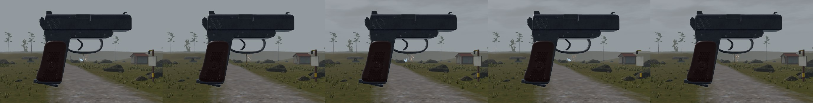

2. **Fouling showed only in the bore.** Burnt powder now lays a grey film
   on the metal and takes its sheen. A darker tint alone didn't read on
   near-black bluing, which shows mostly reflected sky. The film is
   metal-only, so a fouled gun's grip stays as it was. Grime, the
   weather's brown, covers the grip too.

   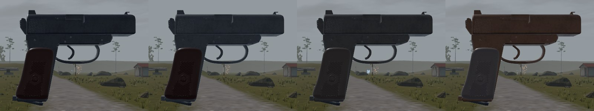

3. **Wear rusted everything, wood and Bakelite included, and only
   faintly.** Wear now follows the finish, by the material's name
   (`weather::ages`):
   - **Steel** rusts: Steel, Blued, the AK's lacquered Stamped, Black,
     Iron.
   - **Aluminium** wears through its anodising to bare grey: the
     MP-133's receiver.
   - **Wood, Bakelite, polymer and rubber** fade and scuff paler.

   The lacquered and anodised finishes are 0 metallic, as wood is, so
   only the name tells them apart.

4. **The rust didn't line up with the handling.** Weapon feel's one hard
   line is condition 0.6 (`DRY_FROM`): there the action starts to drag
   in the hand, and jams are about 1 in 40. Rust now starts at 0.8, is
   plain by 0.6, and goes through by 0.35, the second line (+6% jams, 3x
   the spread). The eye warns before the hand does (`rust_shown`, tested).

## Per gun

**Reads** means a player tells the state from clean without a side by
side. For fouled, a side by side helps at 1 m. Up close the grey film
reads, and in the hand, where it matters, the gun is at 30 cm.

| Gun | Fouled | Grimy | Worn | Near failure | Sheet |
| - | - | - | - | - | - |
| PM | slide and frame grey, matte, black at the port and muzzle; Bakelite grip unchanged: reads at 30 cm | all dull grey-brown, grip too: reads | metal rust-brown, edges rubbed bright, grip faded: reads, also at 1 m | edges rust orange, unlike worn's bright edges: reads | 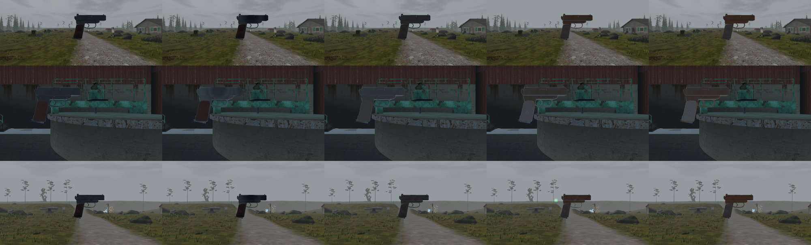 |
| TOZ-8M | receiver and barrel grey: reads at 30 cm | metal dull, stock darker: reads | receiver and barrel rust: reads | reads | 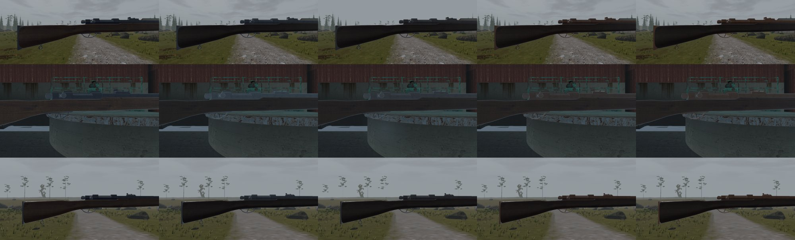 |
| IZh-43 | barrels grey; the bright action matte: reads | action and stock dull: reads | the action goes rust-brown: reads strongly | reads | 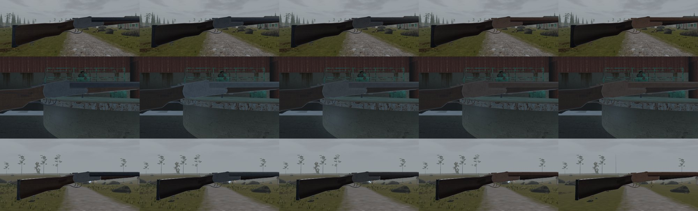 |
| MP-133 | the alloy receiver takes the grey film: reads | dull: reads | receiver worn to bare pale grey, steel bolt rusts in the port: reads | reads | 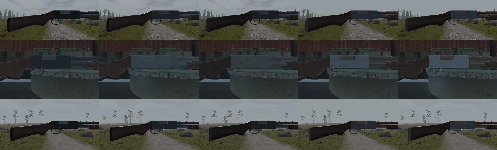 |
| SPSh-44 | grey: reads at 30 cm | grip greys: reads | rust-brown, grip pale: reads | reads | 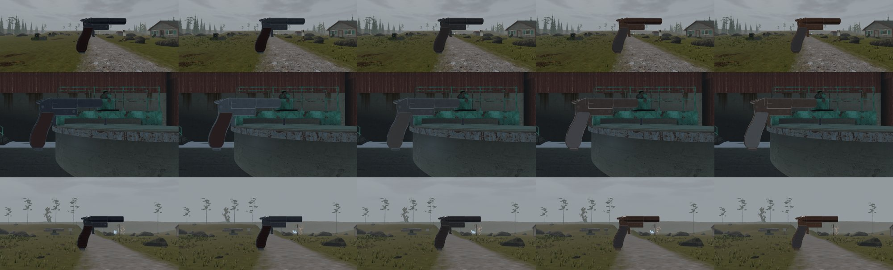 |
| Mosin | receiver and barrel grey: reads at 30 cm | dull: reads | rust along the receiver and bands: reads | reads | 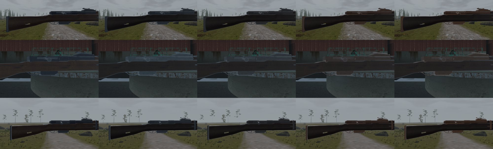 |
| SKS | grey: reads at 30 cm | dull: reads | rust: reads | reads | 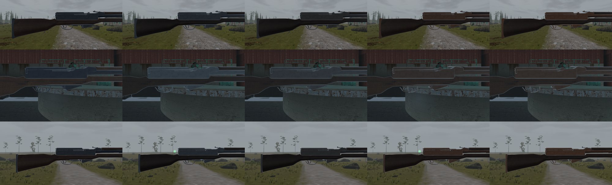 |
| AK-74 | the lacquered receiver greys; plum polymer unchanged: reads | dull: reads | receiver rust-brown; polymer faded: reads | browner and rougher than worn: reads | 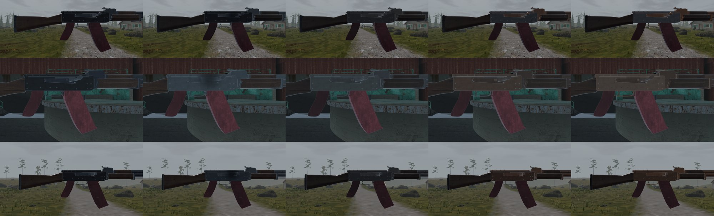 |

## Patterned wear

Near failure used to look only a little worse than worn, and fouling lay
evenly over the metal. Wear now has a pattern, from one shader patch for
every gun and no textures (`render::wear`):
- **Fouling** gathers black at the muzzle and the ejection port and
  thins over a few centimetres, on top of the grey film.
- **Edges** (bevels and roundings, where the hand and the holster
  rub) wear bright as the gun wears. Below weapon feel's 0.35 line
  they rust through instead, orange and rough. So worn shows bright
  edges and near failure shows rusted ones: different at a glance.
- **The art's bare edge steel** (`Worn`, from `art/common.py`'s
  `wear`) now rusts with the rest of the steel. It used to fade, as
  wood does.

Edges are found from how fast the shading normal turns across the
pixel, so no gun needs new data. The muzzle and port are points in
each mesh's own space, written when the condition changes, never per
frame, so the slide takes its soot with it. The material fields used
are ones only glass reads, and none of them is in a pipeline key, so
no new pipelines.

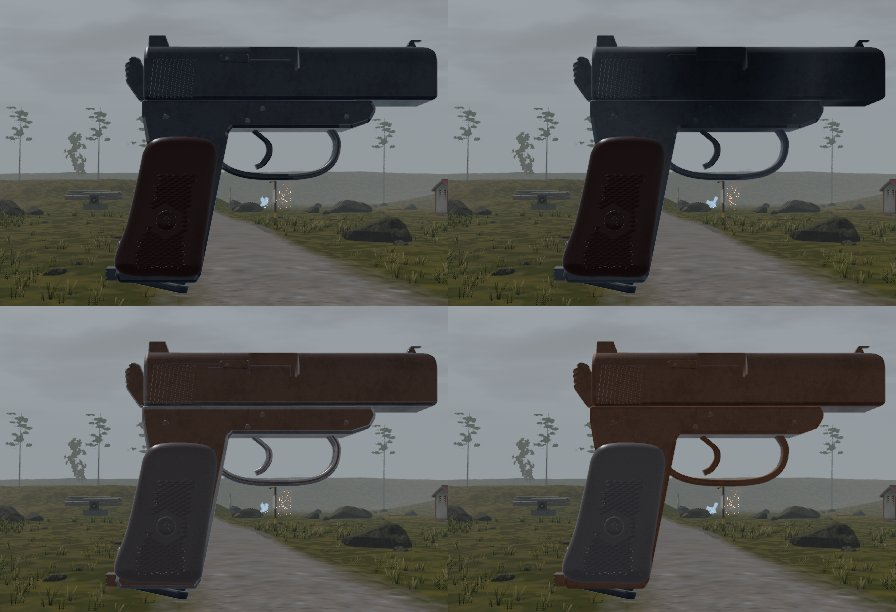

The PM and AK-74 sheets above are shot with it (the AK's soot gathers at
its port). The other six sheets are from before it.

## Still open

1. **Flat faces wear only at their edges.** Real guns also rub bright on
   the flats the hand rests on (the slide's grip serrations, the front
   of the trigger guard). That needs a contact map per gun; edges carry
   most of it.

## When a newcomer meets it

From Progression:
- **The kit PM** starts at condition 0.75: faint early rust, no fouling.
- **Fouling** comes from firing, so the newcomer's first fouled gun is
  their own PM, after the yard's range and the first fights.
- **Found guns** used to come up clean however worn they were. Now
  (Progression's 0fd9f25c) a found gun below condition 0.6 comes up
  grimy and fouled, scaled so no find jams more than 10% before
  cleaning. Found PMs, the kit, gifts, the armoury and sealed crates
  stay clean.

So the first find past raid 3 can look filthy, and the kit takes the
grime and the grey film straight off. Rust stays until spare parts.
