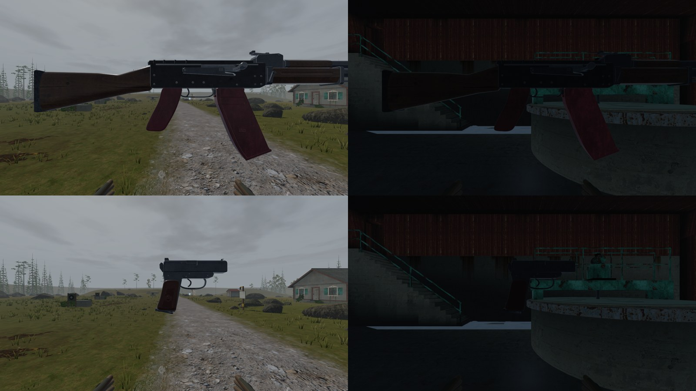
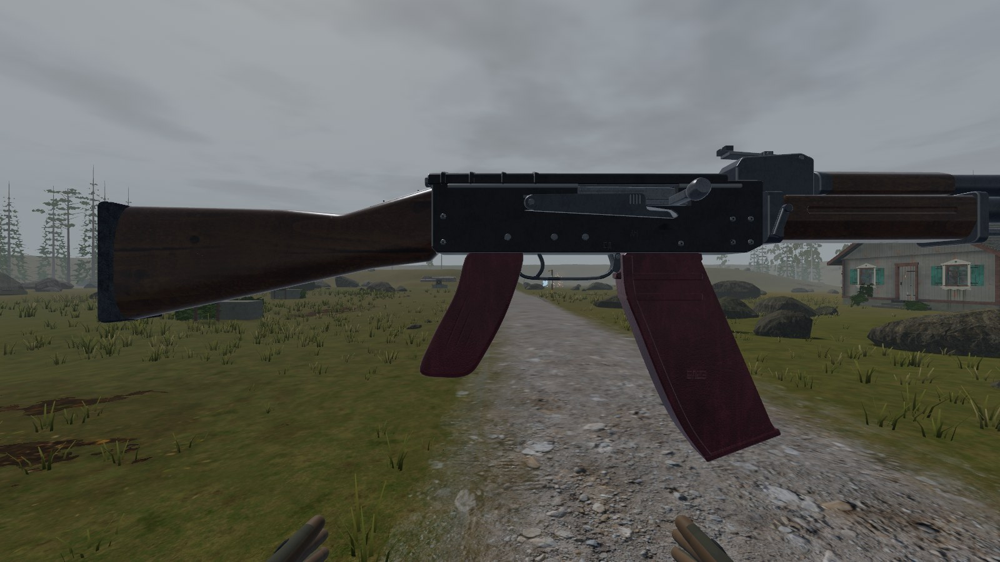
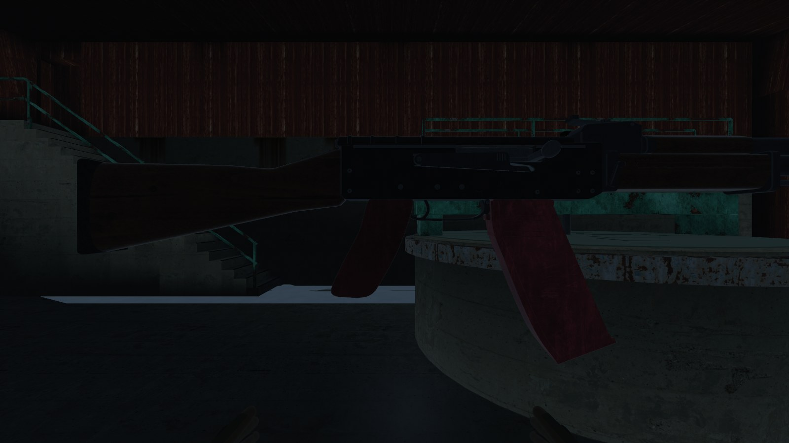
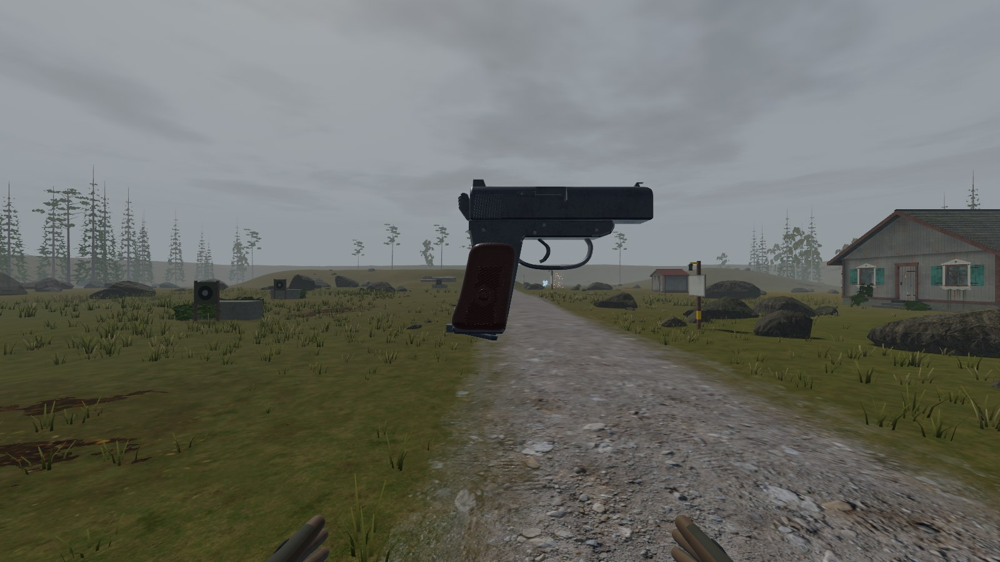
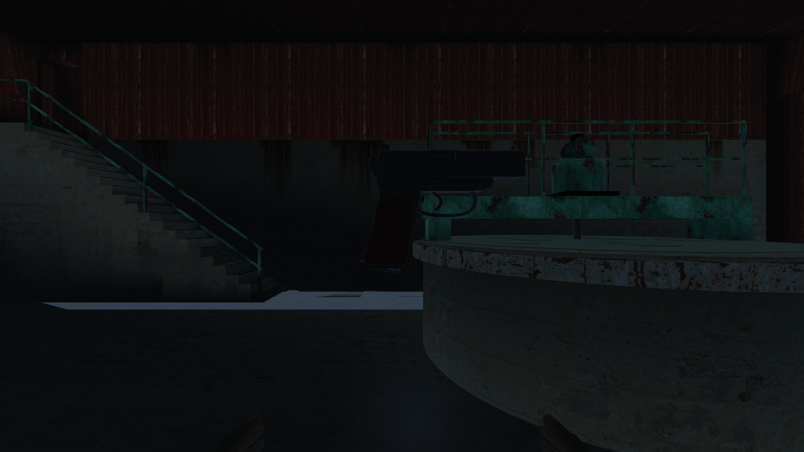

# AK-74 and PM at 30 cm on main, with the sky light

Taken on main 9af29c4f (merged into `claude/polish-gunsmith` at 2ff1626),
with Visual design's sky light (`render::sky_light`) and the tuned finishes
(`gunsmith::finish`). Each gun was shot at 0.3 m in two places:

- **The yard**: `training_yard`, noon, clearing.
- **The Rime Fell mill**: inside, ground floor.

The second AK magazine, hanging loose beside the gun, is the gallery's.

    scripts/shot.sh OUT.png 0,0,40,0,0 40 --map training_yard --gallery ak74,0,0.3 --hour day --weather clearing --no-robots
    scripts/shot.sh OUT.png 140,91.85,38,0,0 90 --map rime_fell --gallery ak74,0,0.3 --hour day --weather clearing --no-robots

| | Yard | Mill |
| - | - | - |
| AK-74 |  |  |
| PM |  |  |
