# AK-74: fidelity review

The first rifle a newcomer holds. Reviewed on the bench
(`docs/craft/GUNSMITHING.md`) on 31 October 2026.

## Reference

- **Numbers**: 943 mm overall with the brake, 415 mm barrel (Wikipedia;
  the Small Arms Survey's sheet gives 945). Sight radius 379 mm (the
  Russian manual's figure as commonly quoted; not confirmed here). The
  catalog's box (`items.ron`: 0.07 x 0.24 x 0.943 m) already had the real
  length and height. They're in `gunsmith::spec`.
- **Photograph**: *AK-74 RPK-74 DA-ST-89-06612* (US Department of
  Defense, 27 April 1989; public domain as a work of the US government),
  a left side view on a plain background. Scaled to the 943 mm, it checks
  against a known part: the brake comes out 24.7 mm across, as the real
  one is. The overlays below lay the bench's orthographic side view
  (`--view level_left --ortho 0.8`) over it with `scripts/gun_overlay.py`,
  registered on the butt and the bore line.
- **What I know of it**: stamped 1 mm receiver riveted to its trunnions;
  dust cover held by the recoil spring guide's button; the long selector
  lever on the right (safe up, then АВ auto, then ОД single) that blocks
  the charging handle on safe; the paddle magazine catch ahead of the
  guard, worked by the thumb or the heel of the hand; the mag rocks in
  front lug first; two-chamber brake; laminated wood handguards and
  stock with the 74's lightening grooves; plum polymer grip and magazine.

## Shots

Same commands before and after (`scripts/gun_bench.sh ak74 <dir>`):
`shots/before/`, `shots/after/`.

| | Before | After |
| - | - | - |
| Against the photograph | 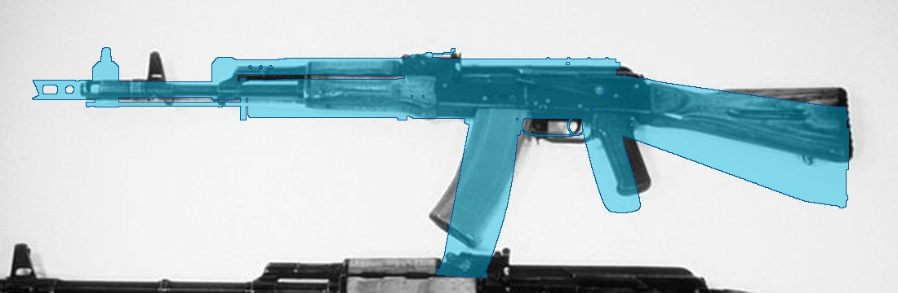 | 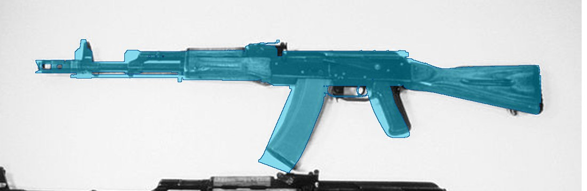 |
| Right, 1 m | 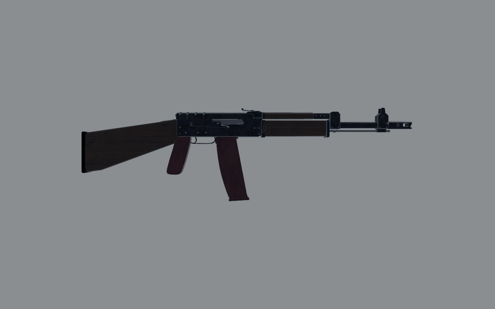 | 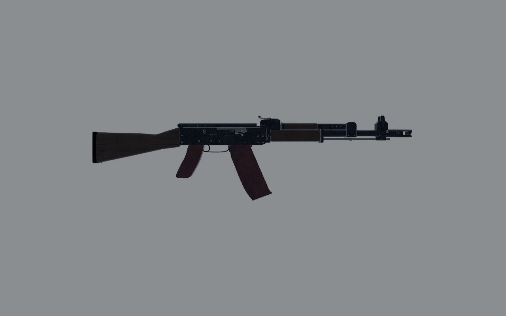 |
| Three-quarter, 30 cm |  | 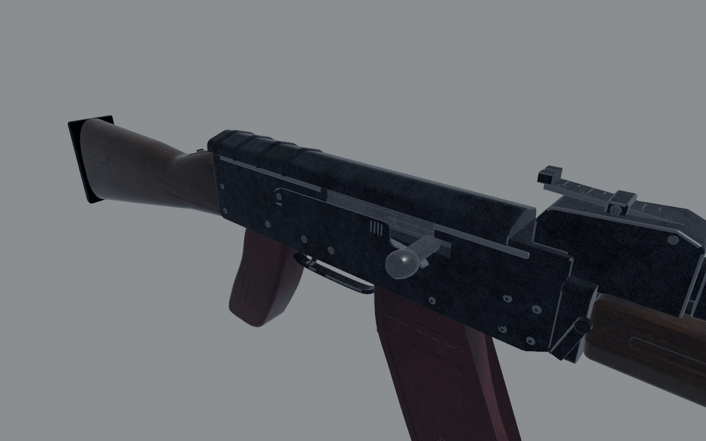 |
| Shooter's eye, 30 cm | 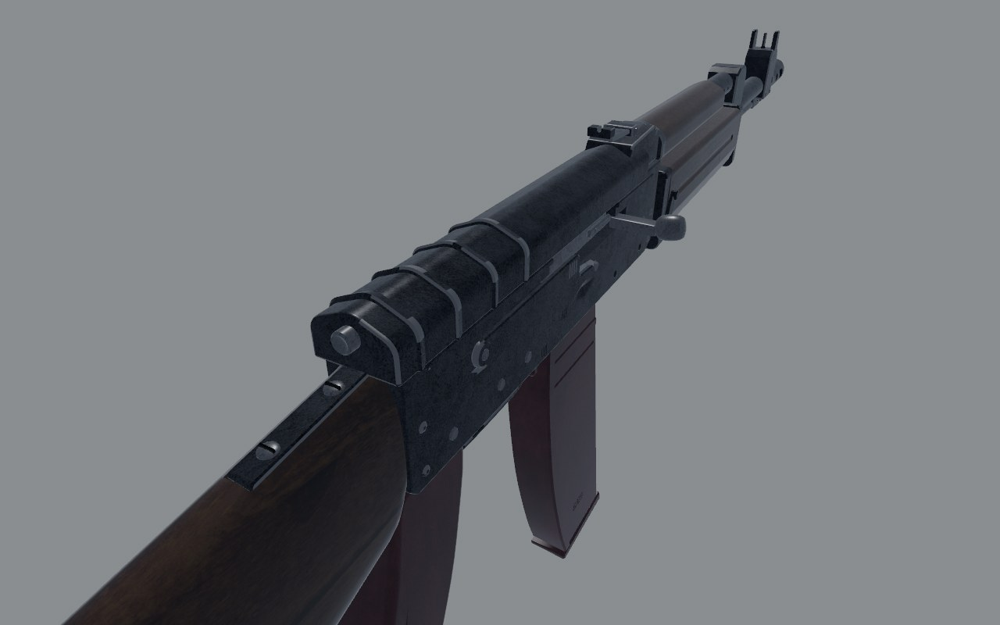 | 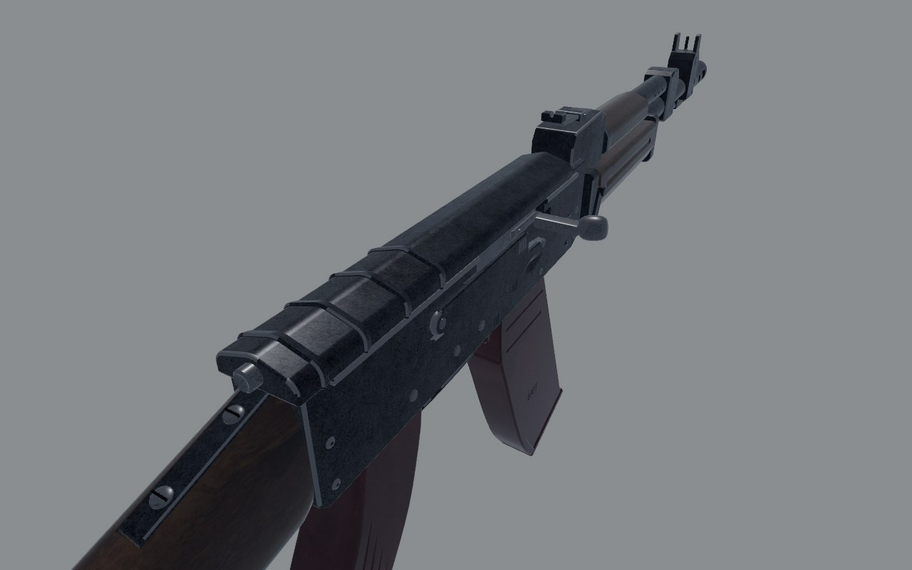 |
| Dust cover off | 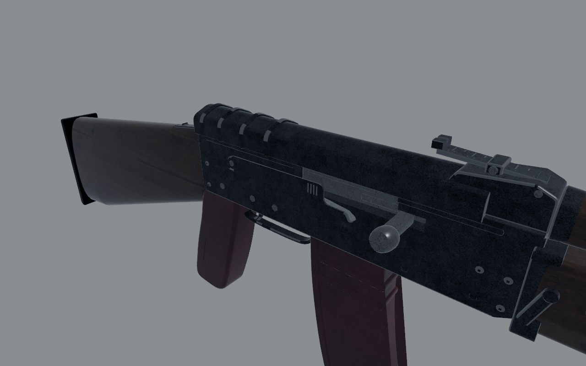 | 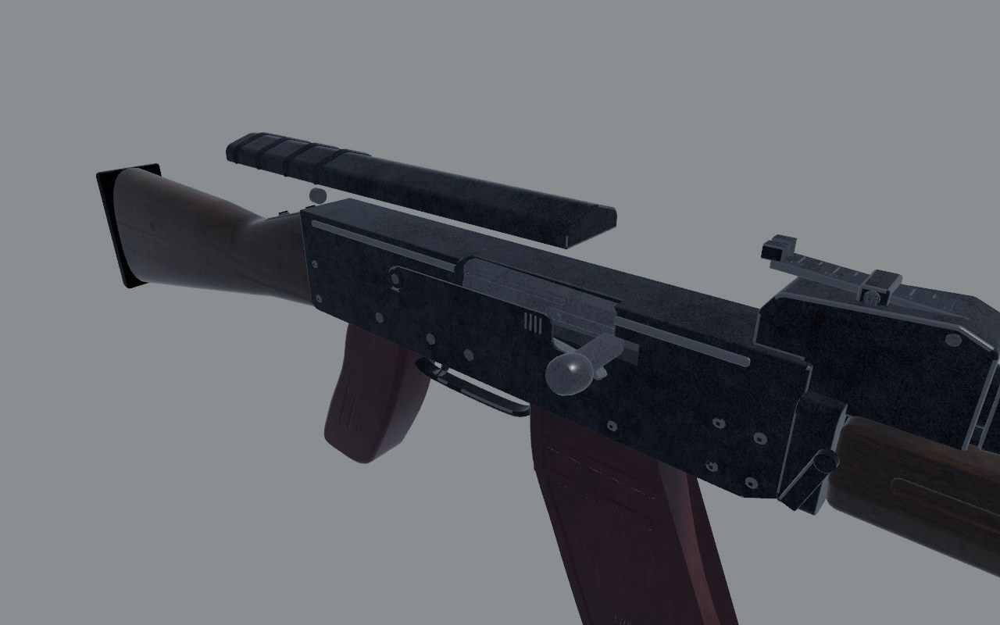 |
| Magazine release | 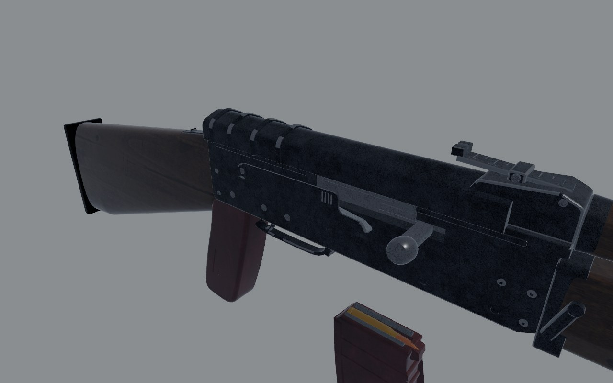 | 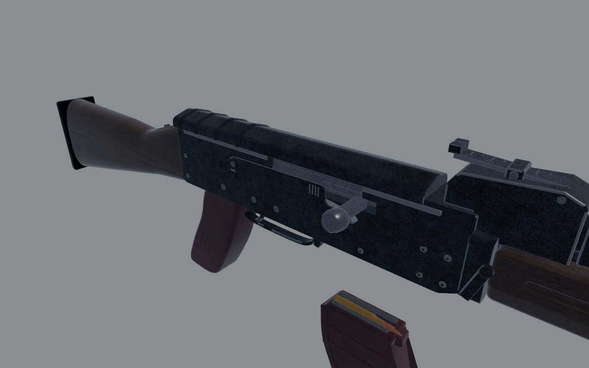 |
| Exploded | 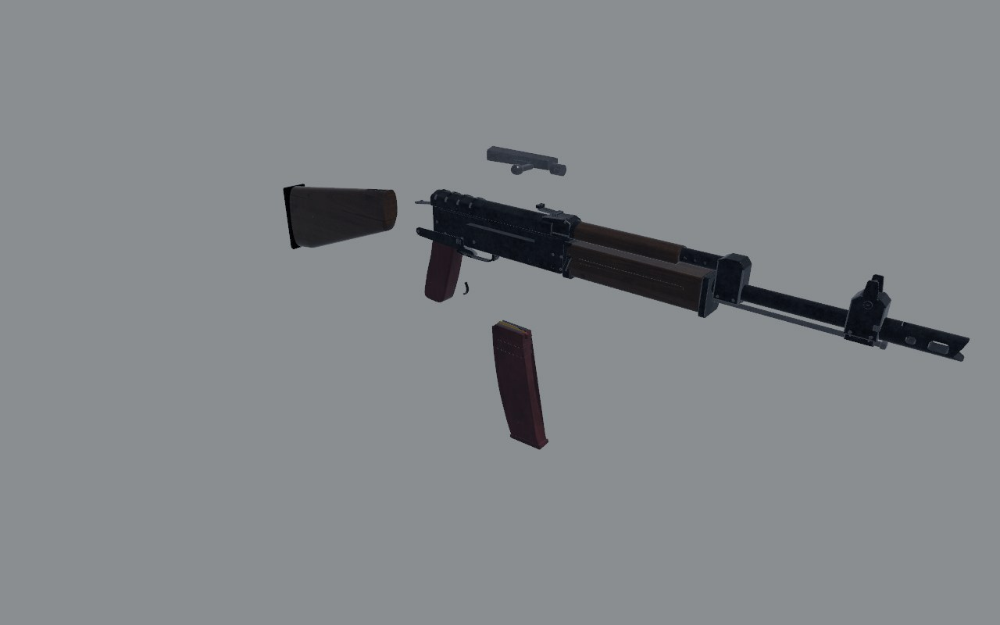 | 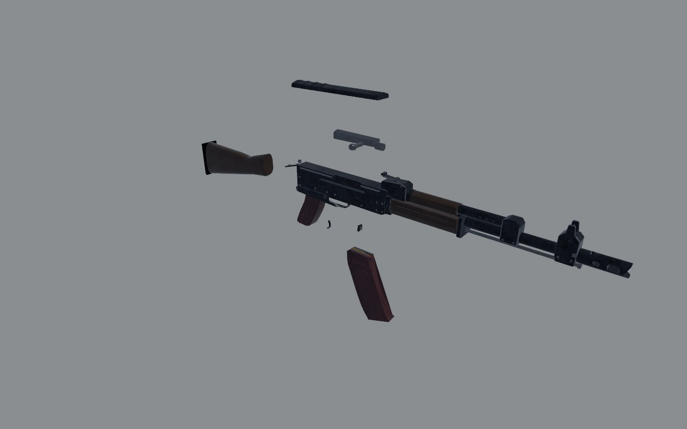 |

In the before set the dust cover and the magazine catch don't move: they
were welded into the receiver.

## Measured

| | Real | Before | After |
| - | - | - | - |
| Overall length | 943 | 1001 (+6.2%) | 948 (+0.5%) |
| Front sight to rear notch | 379 (photo: 367) | 425 (+12%) | 364 (-4%) |
| Butt's depth | about 90 (photo) | 125 | 93 |
| Stock's comb at the butt, over the grip's origin | 60 (photo) | 38 | 61 |
| Dust cover's crown over the bore | 29 (photo) | 39.5 | 30.5 |
| Gas tube's axis over the bore | about 18 (photo) | 27.5 | 19.5 |
| Lower handguard's depth | about 35 (photo) | 48 | 34 |
| Magazine: depth below the receiver | 157 (photo) | 195 | 164 |
| Magazine: front edge forward, 127 mm down | 55 (photo) | 17 | 55 |
| Pistol grip below the receiver | about 97 (photo) | 115 | 98 |

The gun "looked off" because it was: 6% long (all of it the barrel
between the gas block and the front sight, 53 mm, and the receiver sat
32 mm too far forward of the trigger and magazine), and below the bore
and behind the grip it was deep and heavy where the real one is slim.

## Scores

0 wrong or missing, 1 a person who knows the gun winces, 2 right at a
glance and wrong at 30 cm, 3 right at 30 cm. Sound and feel aren't
scored here: weapon feel owns them, and I haven't yet checked them
against the real actions.

| Row | Before | After | Notes |
| - | - | - | - |
| Silhouette | 1 | 3 | within about a centimetre of the photograph everywhere |
| Proportion | 0 | 2 | the grip still a touch long; the trigger guard hangs higher and shorter than the real one |
| Sections | 2 | 2 | |
| Parts present | 2 | 2 | no recoil spring under the cover; no bolt face or extractor to see through the port |
| Parts move | 1 | 2 | the dust cover and the catch move on the bench; the game doesn't drive them yet; the trigger slides instead of pivoting |
| Controls | 2 | 2 | |
| Finish | 2 | 2 | the gun-metal scan reads as a fine cast grain at 30 cm, not stamped sheet |
| Wear | 2 | 2 | |
| Edges and making | 2 | 2 | |
| Markings | 2 | 2 | АВ and ОД under the lever, serial and year on the left; no factory arrow-in-triangle |
| **Total (of 30)** | **16** | **21** | |

## What's still wrong, worst first

1. **Nothing inside the dust cover.** With it off the carrier's top shows,
   but no recoil spring and guide rod; the port, with the bolt back,
   shows no bolt face, extractor or chamber.
2. **The trigger slides 6 mm back** instead of pivoting about its pin
   (`Moves::Trigger`). Every gun shares this.
3. **The game doesn't work the magazine catch or strip the dust cover.**
   The parts are separate now (`mag_catch`, `dust_cover`) and the bench
   moves them; the hands' reload could press the catch as the magazine
   rocks out.
4. **Finish at 30 cm**: the gun-metal scan's grain is a casting's, not a
   stamped receiver's satin. It's the material every gun shares
   (`Mat::GunMetal`), so a change is for all of them, judged together.
5. **The charging handle's knob is bright steel**: on most AK-74s it's
   blued or parkerized like the carrier's visible face.
6. **The trigger guard** sits about 10 mm high and short against the
   photograph.
7. **No factory mark** (the Izhmash arrow in a triangle) by the serial.

## What changed

- `art/guns/ak74.py`: the receiver and everything in it 32 mm back; the
  front sight block, the brake and the bayonet lug 53 mm back; the rear
  sight block re-fitted onto the barrel ahead of the receiver; the
  lower handguard 147 mm (was 191) and 14 mm shallower; the gas tube,
  gas block and upper handguard 8 mm lower; the dust cover's crown 9 mm
  lower; the stock re-drawn from the photograph (level comb, 93 mm
  butt), its sling loop and the butt plate's screws moved with it; the
  pistol grip 18% shorter below the receiver and raked further back.
  The dust cover and the magazine catch are their own objects.
- `art/mags/ak_mag.py`: the magazine's curve from the photograph.
- `src/weapons/layout.rs` (`ak74()`): the muzzle, the port, the load port,
  the charging handle's grab and the support hand moved with the model
  (the RPK, which shares the AK's layout, keeps its own points).
  `src/weapons/sling.rs`: the rear swivel at the stock's new loop.
