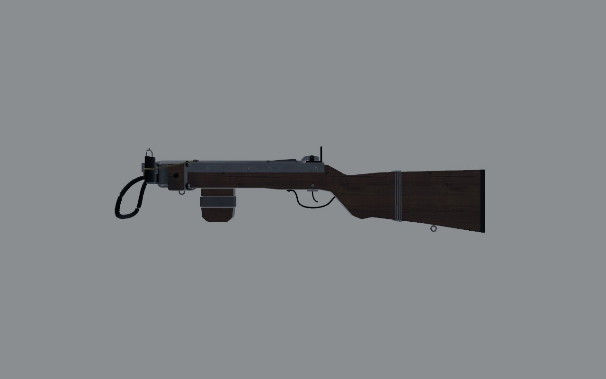
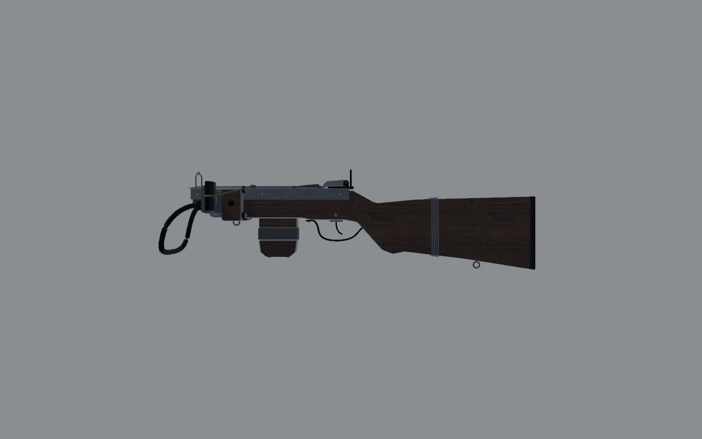
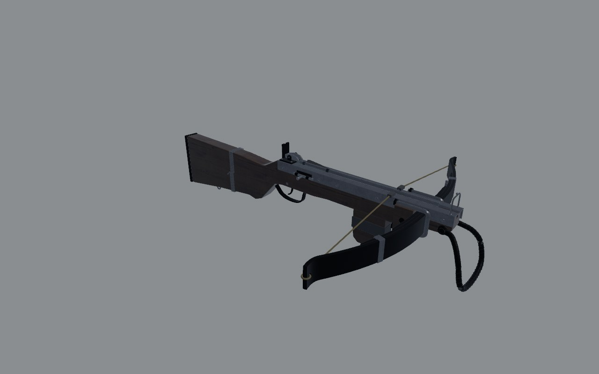
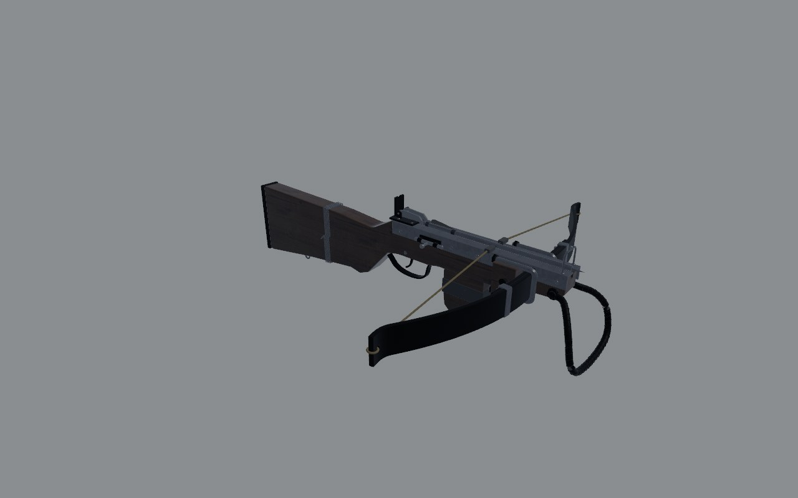
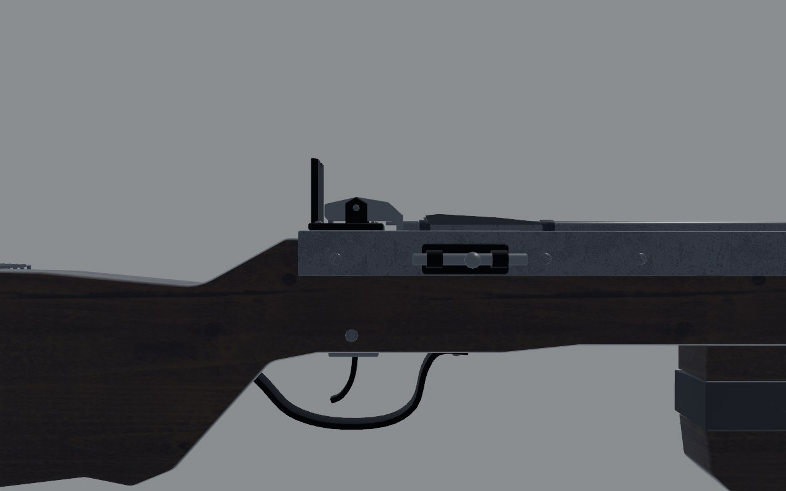
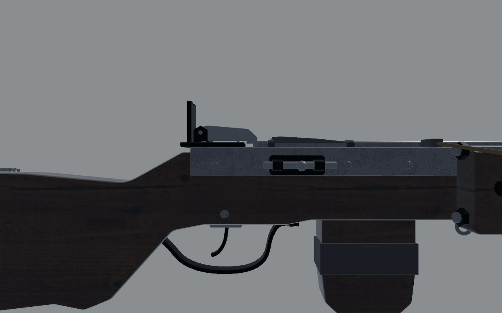
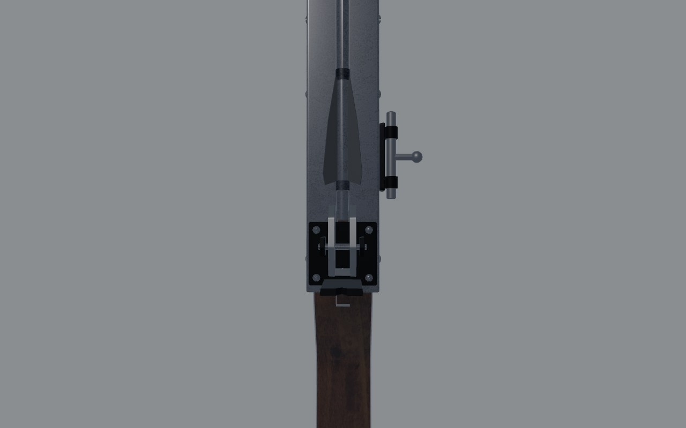
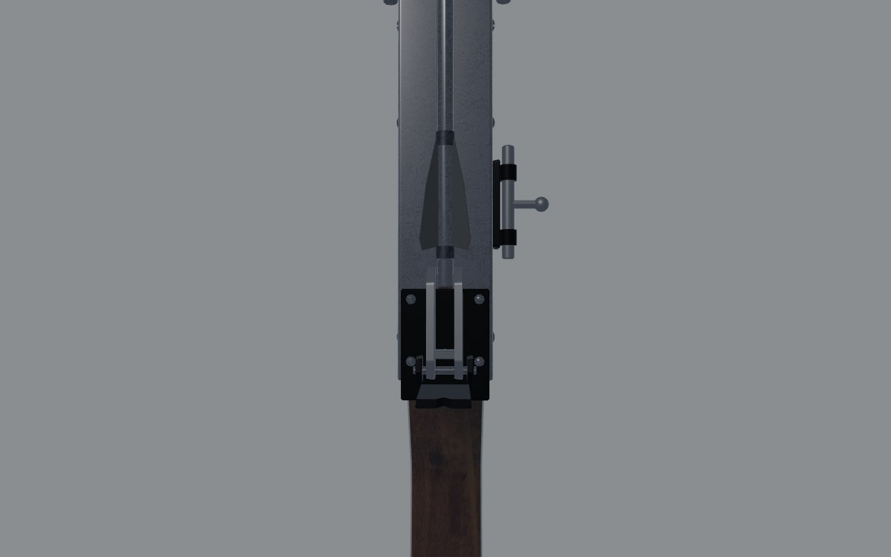

# Home-made crossbow: review

A crossbow from the zone: a car's leaf spring for the prod, on a plank.
There's no real gun to measure, so it's reviewed by the home-made method
(`docs/craft/GUNSMITHING.md`, "Home-made weapons"): could a person build
it from scrap, and then work it by hand? Reviewed on 2 November 2026.

## The stock parts

| Part | What it was | Size | Fits |
| - | - | - | - |
| Prod | a car's leaf spring, the main leaf and two shorter leaves | 612 mm long, 44 mm wide, 7 mm leaves | the leaves are a light car's; the pack is the problem (below) |
| Tiller and butt | a plank sawn to a rifle butt | 39 mm thick | yes |
| Rail | two steel angles, a gap between them | 23.5 × 20 mm | yes |
| Latch | a gate latch: two bars and keepers | | its pivot was in the wrong place (below) |
| Trigger | a bent steel strap | | yes |
| Safety | a door bolt | | yes |
| Stirrup | rebar, its ends flattened to eyes | 10 mm bar | too narrow for a boot (below) |
| U-bolts, carriage bolt, hose clamps, tape, wire, a tyre for the pad | as named | | yes |

## Working it

Before, three of the four actions failed.

- **Cocking: impossible.**
  - **The draw stretched the string.** The string was drawn 260 mm, from
    z -0.33 to the latch at -0.07. That makes the string from each tip
    to the cradle 378 mm, where the braced string is 266 mm: 28% longer.
    The prod's tips would have to come 54 mm in and 100 mm back.
  - **The pack was too stiff.** Three leaves clamped together leave the
    main leaf's ends free for only about 100 mm. A 7 mm spring-steel leaf
    over that length bends about 1 cm at the tip before it yields
    (2σL²/3Et at σ 1.2 GPa).
  - **Nobody could draw it.** Even at the yield point, the pack would ask
    for well over a tonne at the string.
- **Holding: works.** The bars' hooks sit in front of the drawn string,
  and the string rides in the notch behind them.
- **Release: impossible.** The latch bars pivoted in their middle, at z
  -0.050, with the hook in front and the tail behind. The trigger's
  pushrod lifts the tail, at -0.0345. On a seesaw, lifting the tail
  drives the hook down onto the string, so pulling the trigger could
  never let it go.
- **Safety: works.** The door bolt shoots forward under the bars and
  stops them rising.
- **The stirrup** was about 114 mm inside at its widest, a squeeze for a
  boot's toe.

## Shots

The same command was used before and after
(`scripts/gun_bench.sh crossbow <dir>`): `shots/before/` and
`shots/after/`.

| | Before | After |
| - | - | - |
| Left, 1 m |  |  |
| Three-quarter, 1 m |  |  |
| Right, 30 cm |  |  |
| Top, 30 cm |  |  |

## What changed

- **Prod: the main leaf and one short helper.** Builders use one leaf,
  or a leaf and its helper, because a whole pack can't be drawn. The
  main leaf is now free for about 250 mm each side of the U-bolts. The
  hose clamps moved onto the two leaves.
- **Draw: 150 mm.** That's what a leaf of this span gives at its tips'
  limit, about 25 mm in and 40 mm back. The latch stays by the trigger,
  so the prod and everything ahead of it moved 110 mm back: the tiller's
  front, the cheek blocks, the nose block, the U-bolts, the stirrup, the
  front sight, the front grip and the front sling eye. The tiller is
  shorter, and the gun 775 mm long, not 885.
- **Latch: a gate latch's bars pivot at their far end.** The keepers and
  pin moved to the bars' tails, at z -0.027. Now the pushrod lifts the
  bars in front of their pin, and the hooks rise off the string. The rear
  sight moved 10 mm back, behind the keepers, and the latch's base plate
  runs back under it.
- **Stirrup: about 134 mm inside**, wide enough for a boot's toe.
- **Code and data:**
  - **`src/weapons/layout.rs`** (`crossbow()`):
    - The handle: grab -0.22 and travel 0.15.
    - Support -0.17, muzzle -0.35.
    - The port and load port -0.15, the sight -0.017.
    - The blockout.
  - **`crates/gunsmith/src/spec.rs`**: the travel.
  - **`src/weapons/sling.rs`**: the front point.
  - **`assets/data/items.ron`**: the box is 780 mm.
  - **The bolt**: Models shortened it to 0.30 m to suit the draw
    (`art/items/crossbow_bolts.py`). A loaded bolt now ends 18 mm past
    the nose, not 95. The bolt in flight (`src/weapons/crossbow.rs`)
    matches it.

## Scores

Proportion here means the parts are the sizes of their stock, and the
actions are the lengths their parts allow.

| Row | Before | After | Notes |
| - | - | - | - |
| Silhouette | 2 | 2 | reads as a leaf-spring crossbow at 1 m |
| Proportion | 0 | 2 | a draw the prod can give; a prod that can bend |
| Sections | 2 | 2 | |
| Parts present | 3 | 3 | |
| Parts move | 1 | 2 | the latch could never release; the prod still doesn't flex |
| Controls | 2 | 3 | stirrup for a boot; the latch works from the trigger |
| Finish | 2 | 2 | |
| Wear | 2 | 2 | |
| Edges and making | 3 | 3 | saw cuts, bolt heads, tape, wire |
| Markings | 2 | 2 | none, as home-made |
| **Total (of 30)** | **19** | **23** | |

## What's still wrong, worst first

1. **The prod doesn't flex.** The drawn string runs to the tips where
   they sit at rest. The real tips come about 25 mm in and 40 mm back at
   full draw, so the drawn string is 15% too long (it was 28%). It needs
   the prod to bend with the draw: a bone or blend shape, which the
   game's movers don't have yet.
2. **The draw by one hand: decided.** Weapon feel chose not to require a
   foot in the stirrup. Feet aren't tracked, bending to the floor in a
   headset is a fall risk, and seated play couldn't do it. The draw is
   heavy instead: the string follows only a firm, steady pull of about a
   quarter second (`weapons::drag`). The stirrup stays modelled, as on the
   real gun. Bracing for a lighter draw may come later.
