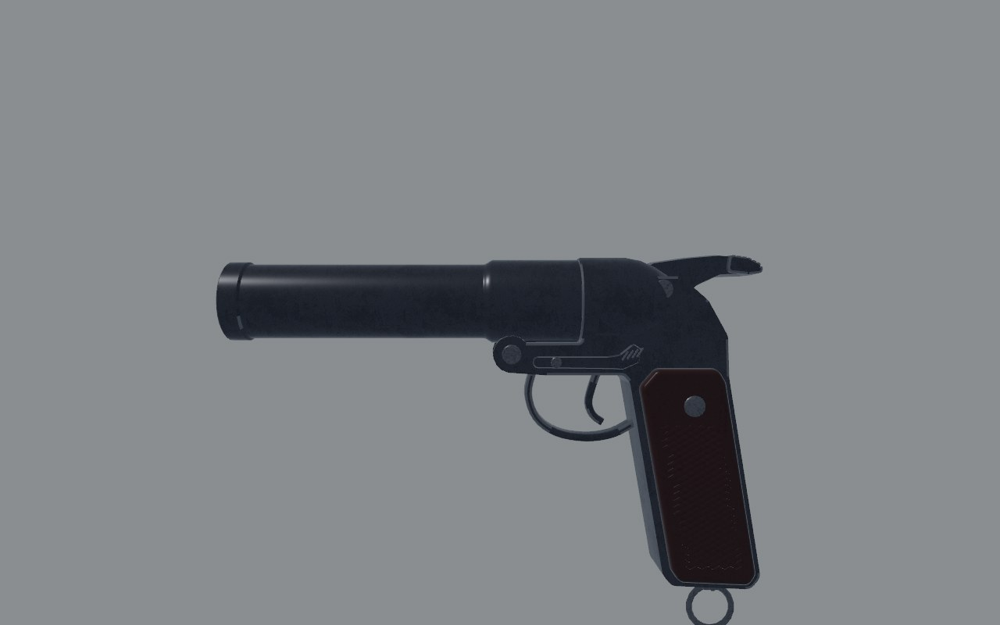
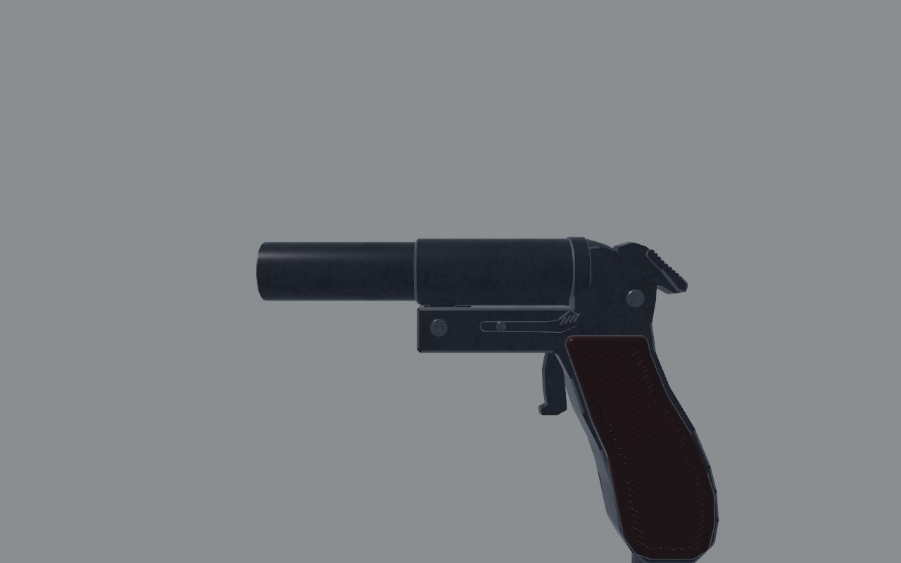
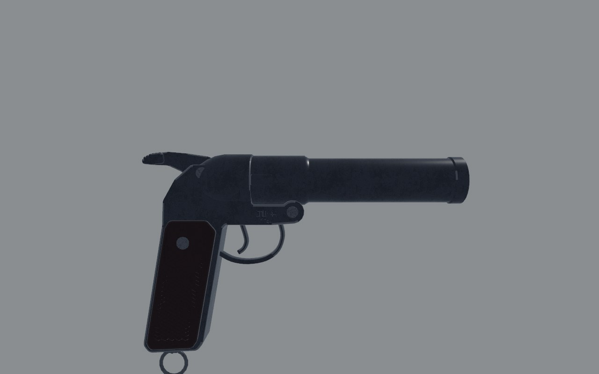
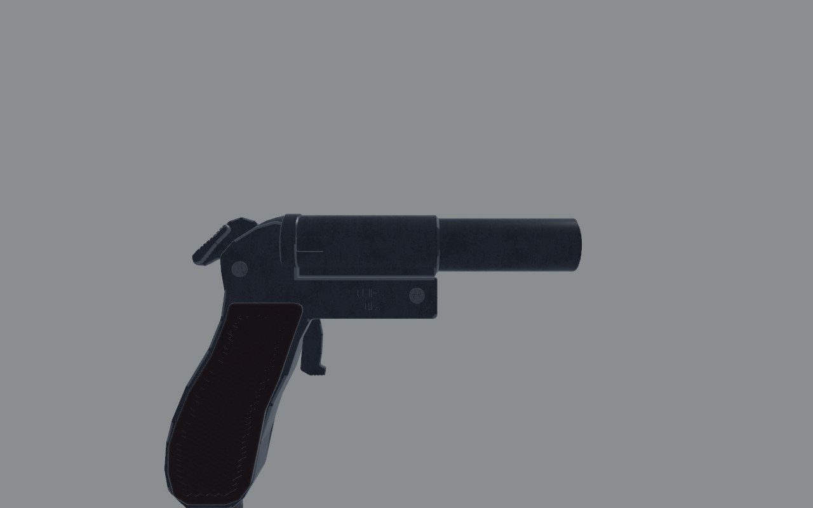
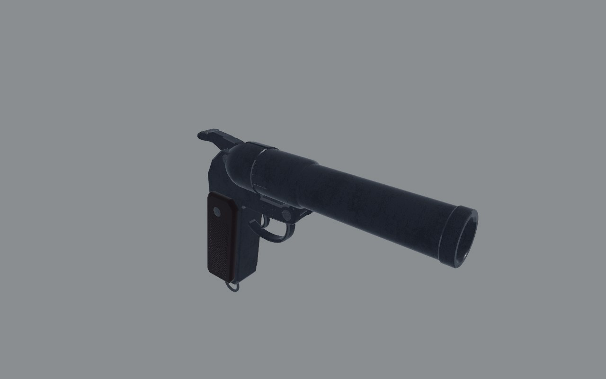
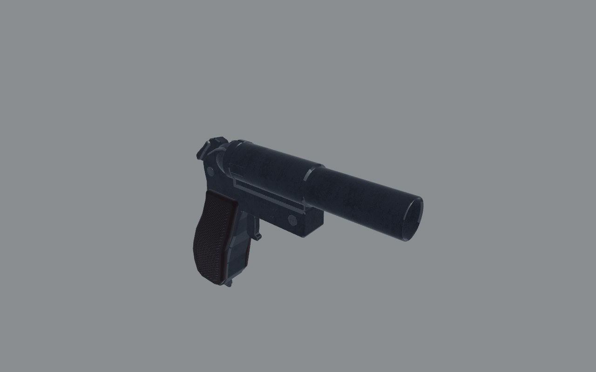
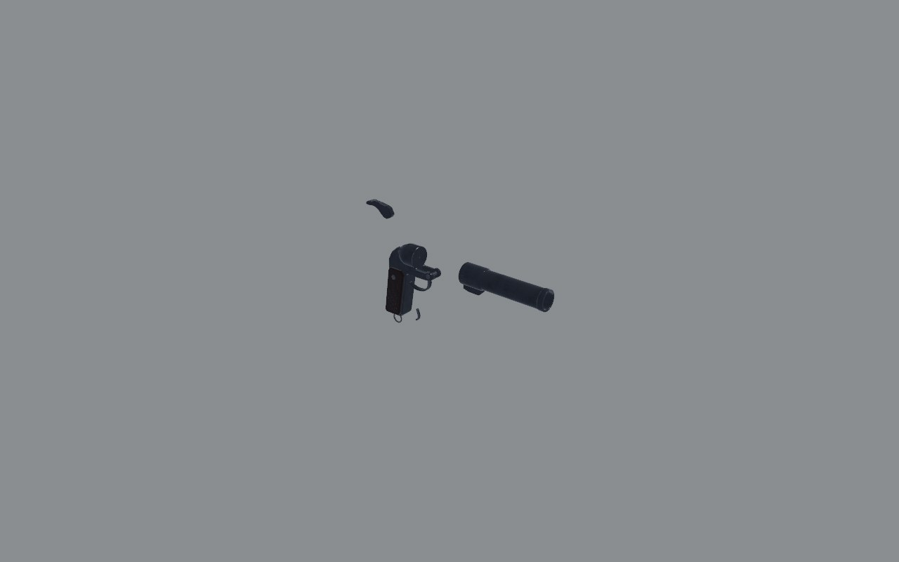
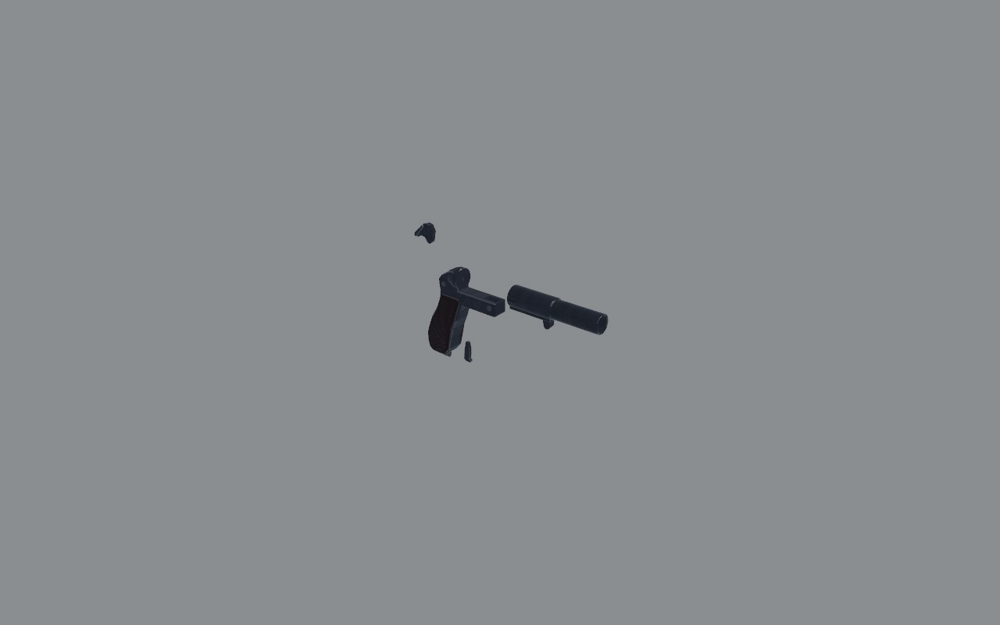

# SPSh-44 (`flare_pistol`): fidelity review

The Soviet 26 mm signal pistol: a single-shot break-open with an exposed
hammer. Reviewed on the bench (`docs/craft/GUNSMITHING.md`) on 2 November
2026.

## Reference

- **Numbers**: 220 mm overall, a 150 mm barrel, 0.93 kg unloaded, 26.5 mm
  (the Czech vz. 44/67 pages on valka.cz / armedconflicts.com, which
  agree with IMFDB's 22 cm). Wikipedia gives the same 150 mm barrel. No
  published height.
- **Photographs**:
  - A Chinese Type 57, a straight copy of the SPSh-44, right side on white
    (International Military Antiques' listing). I mirrored it, levelled
    its bore (1.8°) and scaled it to 220 mm, muzzle to the butt's back.
    Its barrel then measures 152 mm, as published.
  - Three side views of a Czech vz. 44/67, a licensed copy (valka.cz).
    They agree on the frame, the hinge and the lack of a trigger guard,
    but the grip is a different, shorter pattern, so I didn't measure the
    grip from them.

  Both are copyrighted, so I used them for measuring only and they aren't
  in the repo.

## Shots

The same command was used before and after
(`scripts/gun_bench.sh flare_pistol <dir>`): `shots/before/` and
`shots/after/`.

| | Before | After |
| - | - | - |
| Left, 30 cm |  |  |
| Right, 30 cm |  |  |
| Three-quarter, 30 cm |  |  |
| Exploded, 1 m |  |  |

## Measured

The overlay (`scripts/gun_overlay.py`) puts the bench's `level_left` shot
over the levelled photograph. Registered on the muzzle, the breeches
matched, but the real grip sat 12 mm further forward, deeper and more
raked. So I registered the photograph on the grip at the palm's height
(the model's origin) and traced it into gun space. Positions are z and y,
in metres.

| | Real (photo, scaled) | Before | After |
| - | - | - | - |
| Overall | 220 | 237 | 220 |
| Muzzle | -0.162 | -0.190 | -0.162 |
| Breech face | -0.012, over the grip | -0.035 | -0.012 |
| Barrel, front and breech halves across | 29.3, 32.8 | 33, 37 | 29.3, 32.8 |
| Hinge pin | (-0.0755, 0.028), at the front of a long side plate | (-0.065, 0.032), in a knuckle | as the photograph |
| Side plate | from -0.086, its bottom 39.5 mm under the bore | a knuckle and a short frame | as the photograph |
| Trigger guard | none: a bare blade | a wire loop | none |
| Grip's rake | about 20° | about 9° | about 20° |
| Butt under the bore | 141 | 124.5 | 141 |
| Lanyard | a flat wire stirrup under the butt | a round ring | a stirrup |
| Hammer spur | small, behind the frame's top | long and high, 237 mm overall with it | as the photograph |

## Scores

0 is wrong or missing; 1, a person who knows the gun winces; 2, right at a
glance and wrong at 30 cm; 3, right at 30 cm. Sound and feel aren't scored
here (weapon feel owns them).

| Row | Before | After | Notes |
| - | - | - | - |
| Silhouette | 1 | 3 | the guard, the knuckle hinge and the hammer spur |
| Proportion | 1 | 3 | the breech over the grip; the barrel and grip to the photograph |
| Sections | 2 | 2 | |
| Parts present | 2 | 3 | the barrel's flat-sided lug on the side plate, the stirrup |
| Parts move | 3 | 3 | barrel on its hinge, hammer, trigger |
| Controls | 2 | 2 | the latch isn't checked against a photograph |
| Finish | 2 | 2 | |
| Wear | 2 | 2 | |
| Edges and making | 2 | 2 | |
| Markings | 2 | 2 | |
| **Total (of 30)** | **19** | **24** | |

## What's still wrong, worst first

1. **The barrel latch.** The model's lever on the left of the side plate
   isn't in either photograph. The Czech left side shows a small block at
   the breech band's foot instead. It needs a clear left-side view of an
   SPSh-44 to settle.
2. **The grip panels' material.** The Type 57's panels are wood and the
   vz. 44/67's checkered Bakelite. The model keeps checkered Bakelite,
   unchecked against an SPSh-44.
3. **The hammer spur** stands a millimetre or two proud of the photograph
   at its back.

## What changed

- **`art/guns/flare_pistol.py`**:
  - **Barrel**: 150 mm, from a breech face 23 mm further back (over the
    grip). It's a thin 29.3 mm tube with a 32.8 mm breech half, plain at
    the muzzle.
  - **Lug and hinge**: the barrel's lug is flat-sided and sits on the side
    plate. A tongue at its front turns on the hinge pin, now forward in
    the plate's fork.
  - **Frame**: redrawn from the photograph:
    - The side plate runs out to the hinge.
    - There's no trigger guard.
    - The grip rakes about 20° to a flat butt.
    - The frame's top curves down behind the breech collar.
  - **Grip**: the panels and screw follow the new grip.
  - **Trigger**: a flat blade with a serrated foot, hanging bare under the
    plate.
  - **Hammer**: inside the frame, its grooved spur at the back of the top.
  - **Lanyard**: a flat wire stirrup under the butt.
- **`src/weapons/layout.rs`** (`flare_pistol()`): muzzle -0.162, the port
  and load port at the new breech, the hinge, and the blockout.
- **`src/weapons/layout.rs`**: `grip` is at (0, 0, 0.006), 29 mm ahead of
  the backstrap at the palm's height, as on every gun. At z 0 the trigger
  was 60 mm ahead of the hand, and Hands' pull came to a cramped curl of
  0.83, over the 0.8 bound.
- **`crates/gunsmith/src/spec.rs`**: the hinge.
- **`assets/data/items.ron`**: the box is 225 × 170 mm.
