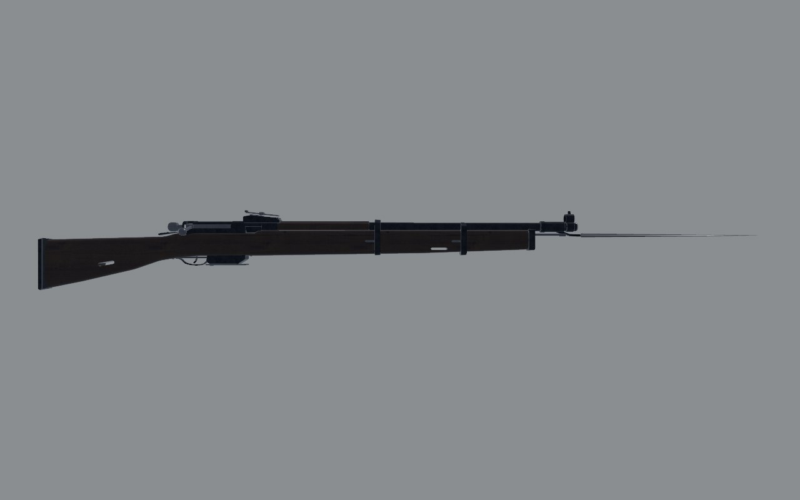
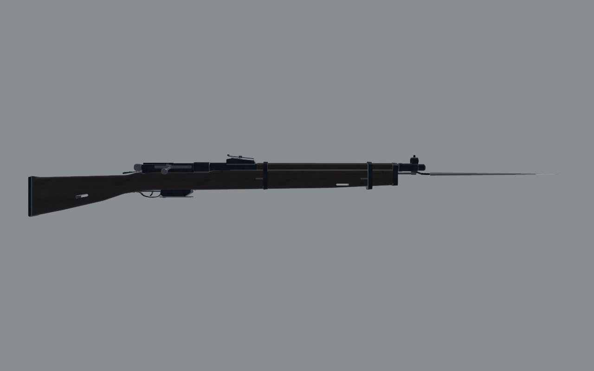
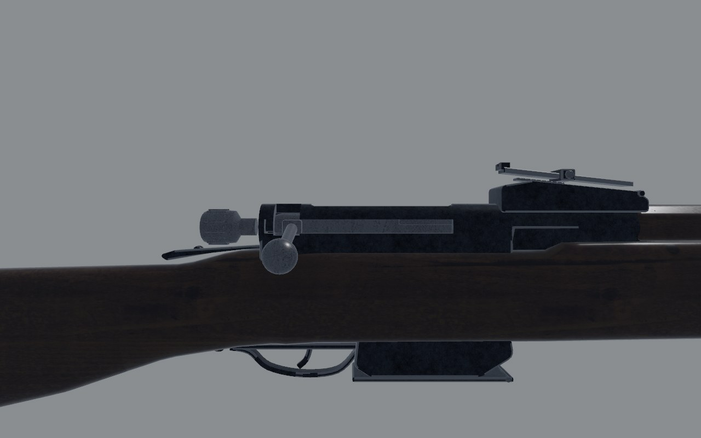
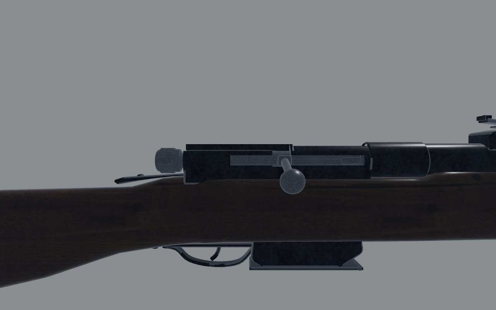
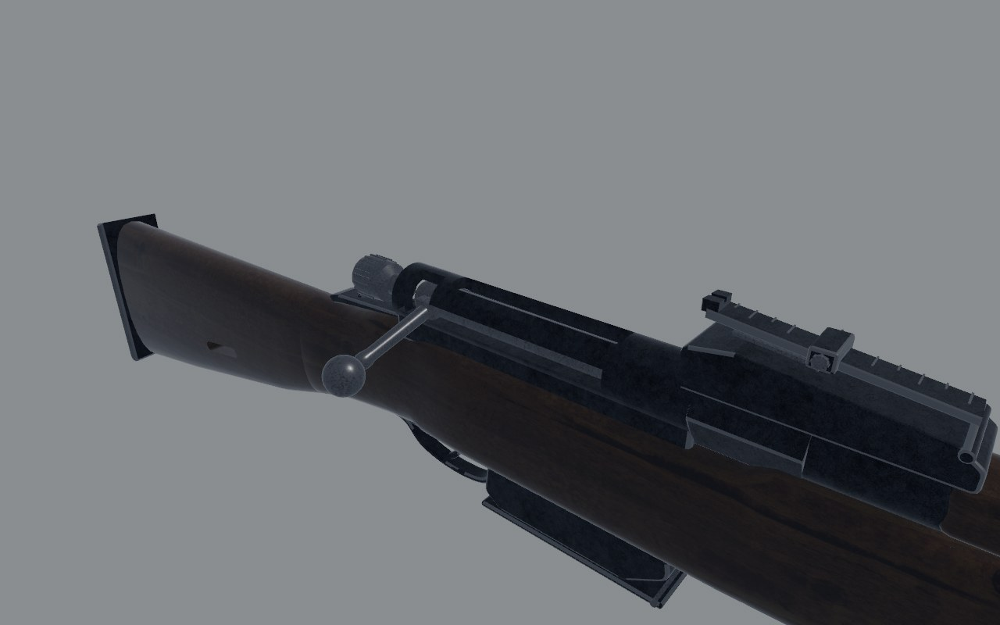
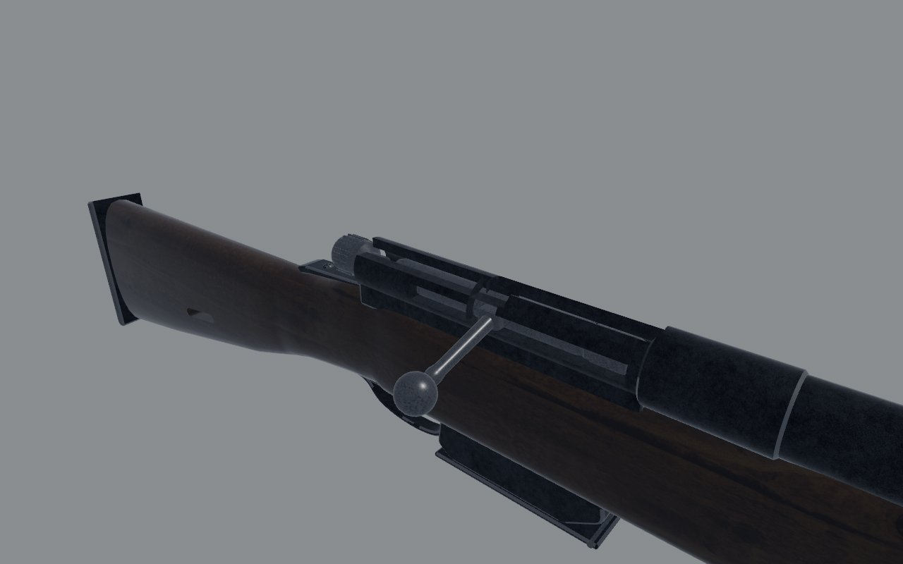
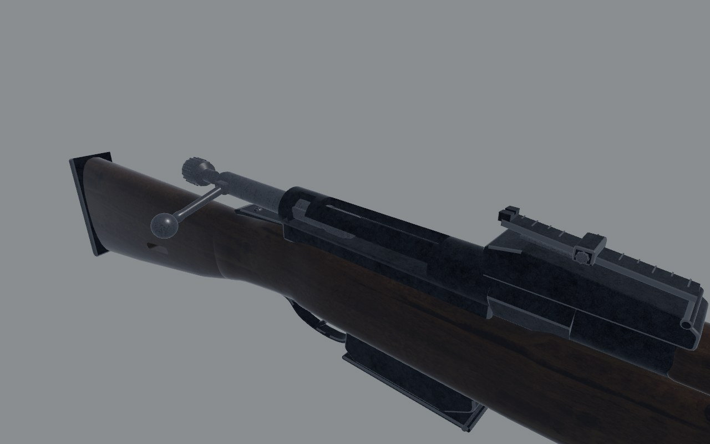
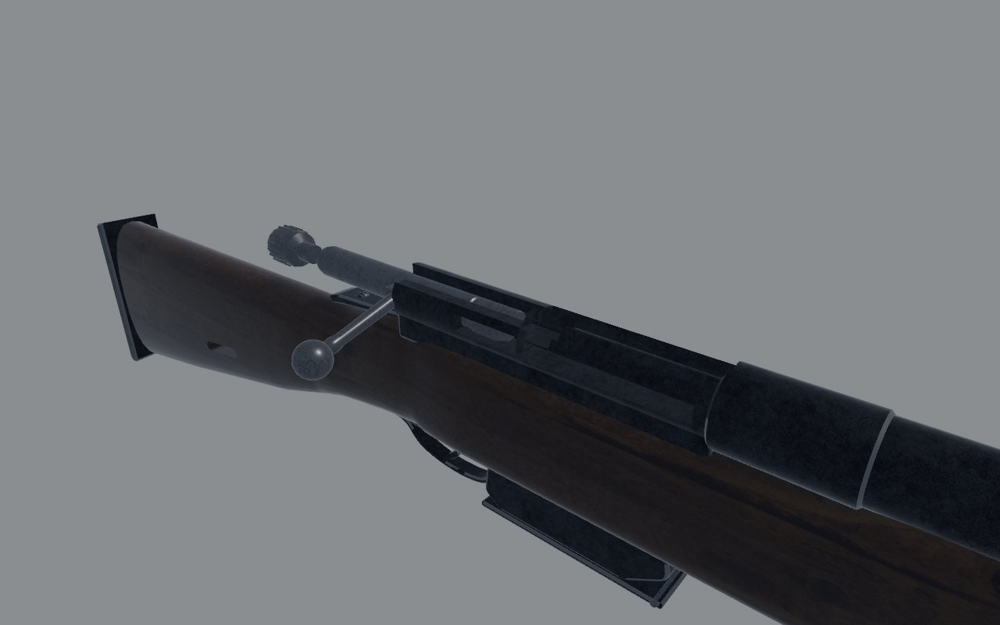
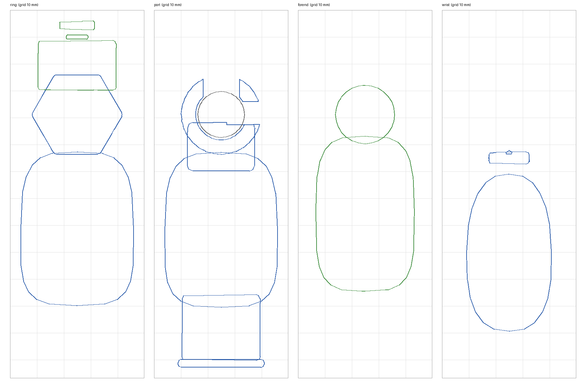
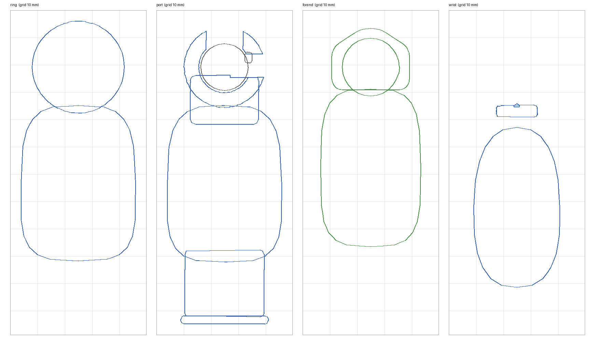

# Mosin 91/30: fidelity review

The bolt rifle: long, slow and hard-hitting, with the bayonet fixed as it was
carried. Reviewed on the bench (`docs/craft/GUNSMITHING.md`) on 1 November
2026.

## Reference

- **Numbers**: 1232 mm without the bayonet (published figures range from
  1227 to 1234), about 1660 mm with it. Barrel 730 mm. About 3.9 kg.
  Sources: Modern Firearms' Mosin-Nagant page; the Russian Wikipedia's
  figures agree.
- **Photographs**: all are copyrighted, so they are used for measuring only
  and are not in the repo.
  - A dealer's listing of a 1939 Tula 91/30 (eratarvike.fi). It has a
    right side view, 1440 px wide, with the rifle lying about 4° off level;
    I levelled it about the muzzle and mirrored it for the overlay. The
    listing also has a close-up of the left side and a view of the forend.
  - Modern Firearms' 91/30, with the bayonet off: 550 px, coarse. Scaled to
    1232 mm, its bayonet comes to about 500 mm, as the real one is.
- **What I know of it**:
  - **Action**: a long round receiver; the ring is hexagonal until 1936 and
    round after. The barrel's reinforce carries the maker's marks between
    the ring and the rear sight. The rear sight is a tangent leaf on a
    ramp, hinged at its front, with the notch at its rear.
  - **Bolt**: a straight bolt handle, its knob over the magazine's rear and
    well ahead of the trigger, with the knurled cocking knob behind.
  - **Magazine**: a sheet-steel box with a hinged floorplate, and the
    trigger guard behind it.
  - **Stock and furniture**: the upper handguard runs from the rear sight
    to the nose cap, under both bands. There are sling slots through the
    butt and the forend.
  - **Bayonet**: the socket bayonet slips over the front sight.

## Shots

The same command was used before and after
(`scripts/gun_bench.sh mosin <dir>`): `shots/before/` and `shots/after/`.
Far shots back off until the whole rifle fits, so the after shots, which
are 90 mm shorter, are drawn a little larger.

| | Before | After |
| - | - | - |
| Right, 1 m |  |  |
| Right, 30 cm |  |  |
| Three-quarter, 30 cm |  |  |
| Bolt back |  |  |

## Sections

Cut at four places, with `art/sections.py` on a 10 mm grid:

- the receiver ring;
- the loading port;
- the forend between the bands, at z −0.55;
- the wrist.

Before, the ring was hexagonal under the rear sight's base, and the forend
was the bare barrel in its channel. After, the ring is round, as on the
1942 rifle the stamps say this one is, and the handguard covers the barrel.

| Before | After |
| - | - |
|  |  |

## Measured

The overlay (`scripts/gun_overlay.py --align butt`) puts the bench's
`level_left` shot over the levelled photograph, run with `--hide bayonet`.
Positions are given as z in gun space, in metres. The butt, wrist, trigger
guard and magazine sat within a few millimetres of the photograph's before
any change.

| | Real (photo, scaled) | Before | After |
| - | - | - | - |
| Overall, no bayonet | 1232 | 1313 (+6.6%) | 1235 |
| With the bayonet | about 1666 | 1759 | 1667 |
| Barrel, bolt face to muzzle | 730 | 818 | 730 |
| Muzzle | -0.90 | -0.98 | -0.90 |
| Front sight's post | 30 mm behind the muzzle | 18 | 30 |
| Nose cap | -0.81 | -0.866 | -0.81 |
| Front band | -0.725 | -0.70 | -0.725 |
| Rear band | -0.40 | -0.49 | -0.40 |
| Rear sight's notch | -0.285 | -0.167 (over the ring) | -0.283 |
| Receiver ring | -0.226 to -0.175 | -0.208 to -0.168 | -0.226 to -0.175 |
| Bolt handle | about -0.10 | -0.034 | -0.102 |
| Cocking knob's rear | about -0.005 | +0.012 | 0.000 |
| Handguard | rear sight to nose cap | -0.47 to -0.245 | -0.797 to -0.372 |

Two independent checks agree:

- **The barrel**: the published lengths, 1232 overall and 730 for the
  barrel, put the bolt face 502 mm from the butt. The model had 495, so the
  stock and action were right and the 80 mm excess was all barrel.
- **The handle**: in both photographs, measured against the magazine and
  the guard, the bolt handle is about 0.42 of the way from the magazine's
  front to the guard's rear.

## Scores

0 is wrong or missing; 1, a person who knows the gun winces; 2, right at a
glance and wrong at 30 cm; 3, right at 30 cm. Sound and feel aren't scored
here (weapon feel owns them).

| Row | Before | After | Notes |
| - | - | - | - |
| Silhouette | 1 | 3 | the handguard to the nose cap, the bands placed |
| Proportion | 1 | 3 | length, barrel, sight and handle on the photograph's |
| Sections | 2 | 2 | the ring round; the receiver's flat underneath is a box |
| Parts present | 2 | 2 | no interrupter screw or bolt-stop on the left; no cleaning rod's nut |
| Parts move | 2 | 2 | the bolt turns, slides and cocks; the handle has a raceway; the floorplate doesn't open |
| Controls | 2 | 2 | |
| Finish | 1 | 2 | after the sky light (GUNSMITHING.md, "Finishes", fourth pass): blue-black, graded by the sky; the scan's grain still shows at 30 cm |
| Wear | 2 | 2 | |
| Edges and making | 2 | 2 | |
| Markings | 1 | 1 | serial and year on the left; the real ones are on the barrel's reinforce, with the arsenal's mark |
| **Total (of 30)** | **16** | **21** | |

## What's still wrong, worst first

1. **The markings** belong on top of the barrel's reinforce: the arsenal's
   mark, the year and the serial. The reinforce is there now to take them.
2. **The left side** lacks the interrupter-ejector's two screws and its
   plate, which the close-up shows plainly.
3. **The butt's toe** may be about 10 mm shallow. The dealer's photograph
   says so, but Modern Firearms' doesn't, and the dealer's was taken from a
   little above.
4. **The floorplate** can't swing open to empty the magazine.

## What changed

- **`art/guns/mosin.py`**:
  - **Barrel**: 730 mm from the bolt face, stepped up to a reinforce
    behind the rear sight. The front sight and cleaning rod moved back with
    the muzzle.
  - **Furniture**: the forend and nose cap are 56 mm shorter. The handguard
    runs from the rear sight to the nose cap, and the nose cap now caps it.
    The bands sit at −0.725 and −0.40, and both clear the handguard.
  - **Rear sight**: moved 116 mm forward as a piece, off the ring.
  - **Receiver**: the ring is round and 51 mm long. The loading port sits
    over the magazine. A raceway along the top right lets the handle,
    turned up, slide back.
  - **Bolt**: the face at −0.170, the handle at −0.102, the cocking knob
    12 mm forward.
  - **Bayonet**: moved with the muzzle; it is 1667 mm overall with it
    fixed.
- **`src/weapons/layout.rs`** (`mosin()`): the muzzle, port, load port and
  bolt grab moved with the model, and the blockout was redrawn to match it.
- **`src/weapons/melee.rs`**: the bayonet's point is at −1.332.
- **`crates/gunsmith/examples/bench.rs`**: added `--hide NODE`, to leave the
  bayonet off for the overlay.
