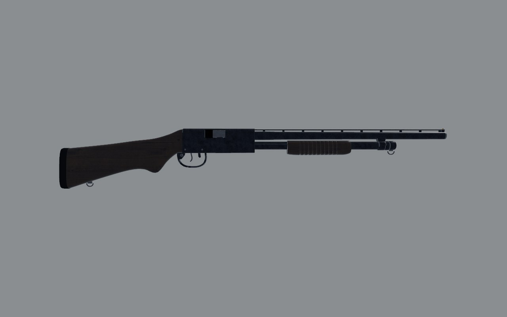
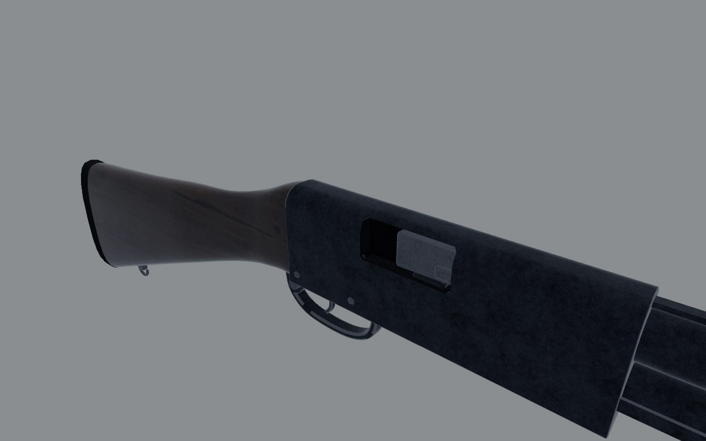
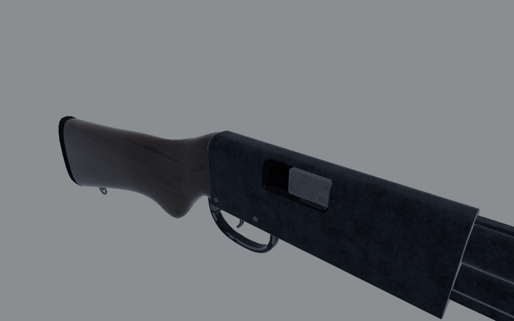
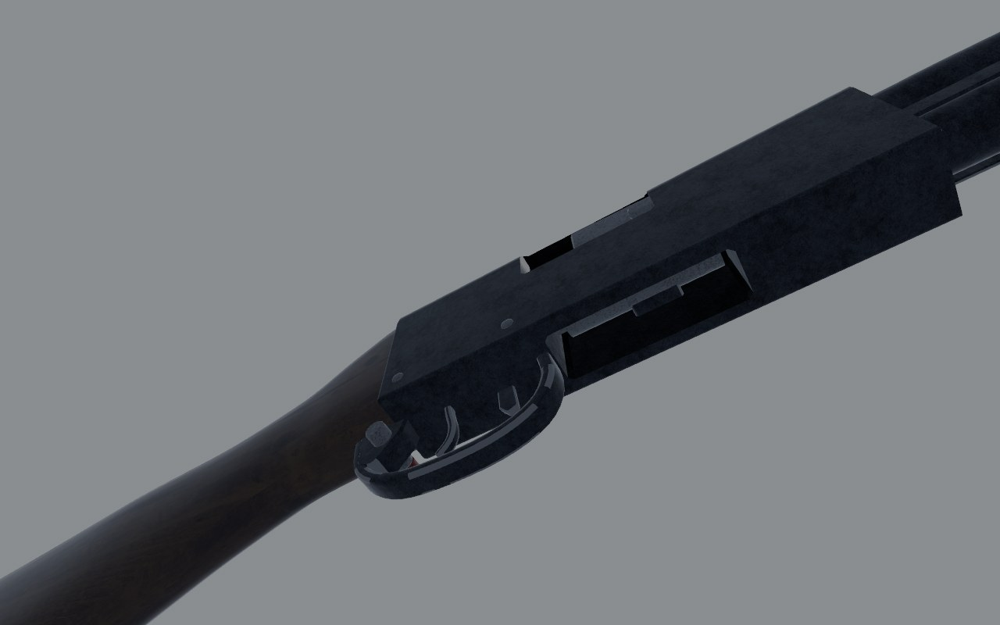
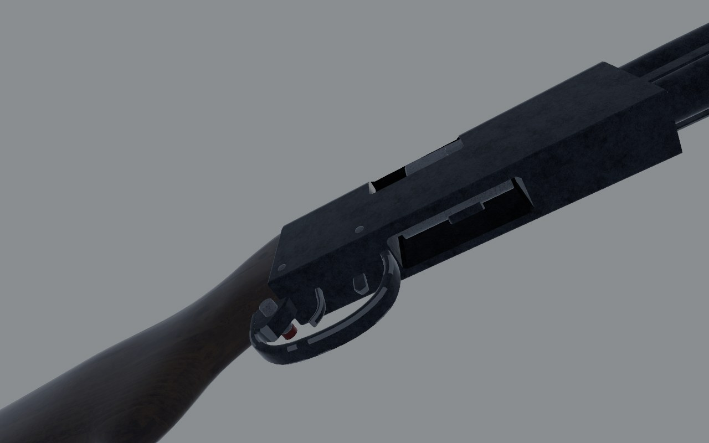

# MP-133: fidelity review

The pump shotgun: early in a newcomer's hands, in every farmhouse.
Reviewed on the bench (`docs/craft/GUNSMITHING.md`) on 1 November 2026.

## Reference

- **Numbers**: 1040 mm overall with the 510 mm barrel; barrels of 510,
  540, 610, 660, 710 and 750 mm; four shells in the standard tube;
  aluminium-alloy receiver; about 3.3 kg (Modern Firearms' MP-133 page;
  IMFDB agrees on 1040). The catalog has 3.4 kg and a 1.13 m box.
- **Photograph**: Modern Firearms' MP-133 with a wooden stock and an
  extended magazine (modernfirearms.net, `mp133-1.jpg`), a right side
  view, small (650 px). Copyrighted: measured from here, mirrored, scaled
  by its receiver's front to its butt (567 mm on the model) and
  registered on the butt (`scripts/gun_overlay.py --align butt`). Not in
  the repo.
- **What I know of it**: a pump on the IZh-81's lines. The alloy receiver
  is black, its top rounded, its rear sloping into the stock's comb. The
  ejection port is on the right, the loading port underneath. The
  crossbolt safety is in the guard's rear web, the action release ahead
  of the guard. The forend is ribbed and rides twin action bars along
  the tube. The stock has a semi-pistol-grip neck on most guns (a
  straight wrist on the older IZh-81), with a rubber pad.

## Shots

Same commands before and after (`scripts/gun_bench.sh mp133 <dir>`):
`shots/before/`, `shots/after/`.

| | Before | After |
| - | - | - |
| Right, 1 m |  |  |
| Three-quarter, 30 cm |  |  |
| Under, 30 cm |  |  |

## Measured

| | Real | Model |
| - | - | - |
| Overall length | 1040 with a 510 mm barrel; about 1140 with 610 | 1127 |
| Barrel, breech face to muzzle | 510-750 by version | 637: a 610 mm gun (its docstring says 560) |
| Receiver's section | rounded top, flat sides | 35 x 72 mm, its top rounded 10 mm (`art/sections.py`) |
| Forend at rest, its length and its gap to the receiver | about 185 and 110 (photo) | 185 and 95 |
| Butt's depth | about 110 (photo, a pistol-grip stock) | 135; 118 after |

Against the photograph the receiver, barrel, forend and trigger group
sit where the real ones do, within about a centimetre. Unlike the AK
and PM, the MP-133 isn't out of proportion.

## Scores

0 wrong or missing, 1 a person who knows the gun winces, 2 right at a
glance and wrong at 30 cm, 3 right at 30 cm. Sound and feel aren't
scored here (weapon feel owns them).

| Row | Before | After | Notes |
| - | - | - | - |
| Silhouette | 2 | 3 | the semi-pistol neck |
| Proportion | 2 | 2 | the butt still 8 mm deeper than the photograph's |
| Sections | 2 | 2 | |
| Parts present | 2 | 2 | the action release is there; no bolt face to see in the port |
| Parts move | 2 | 2 | forend, bars and bolt as one, the crossbolt, the trigger on its pin |
| Controls | 2 | 2 | the crossbolt where it is |
| Finish | 1 | 1 | the alloy receiver is in `Blued`; its black is anodising or paint |
| Wear | 2 | 2 | |
| Edges and making | 2 | 2 | |
| Markings | 2 | 2 | МР-133 and 12x76 on the left |
| **Total (of 30)** | **19** | **20** | |

## What's wrong, worst first

1. ~~**The stock.**~~ It had the IZh-81's straight wrist and a 135 mm
   butt, where the MP-133 is usually seen with a semi-pistol-grip neck.
   Redrawn: the neck dips into a grip behind the guard where the
   layout's raked hold (0.35 rad) already closes, and the butt is 118 mm.
   The layout is unchanged (Hands agreed; their poses read it).
2. **The receiver's finish**: it's alloy, anodised or painted black, not
   blued steel. It wants its own finish (the `Stamped` lacquer is close),
   tuned once the environment light lands.
3. ~~**The trigger guard**~~ was 8 mm shallower than the photograph's:
   deepened.
4. **No bolt face** to see through the ejection port with the action back.
5. ~~The docstring's "560 mm barrel"~~: corrected to the 610 mm its
   geometry has.
