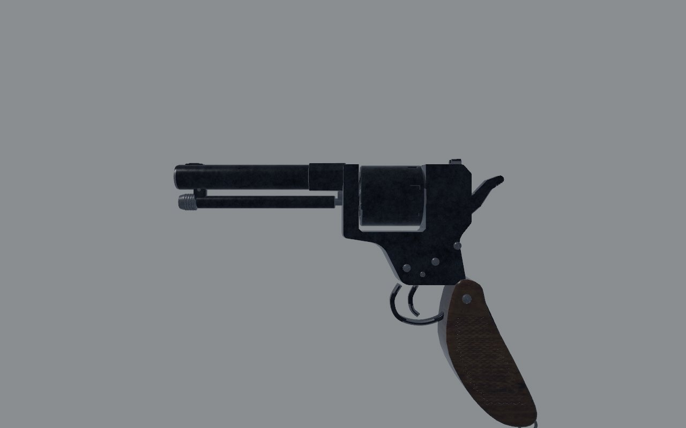
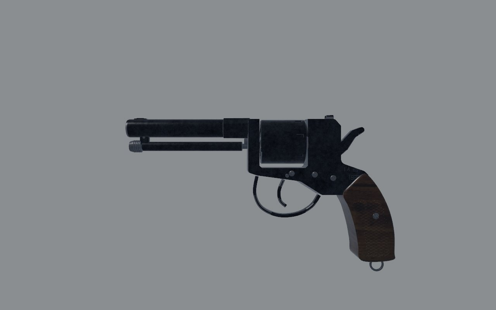
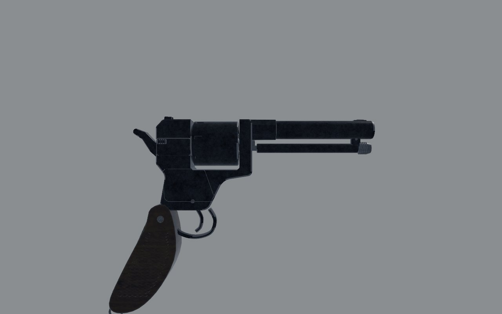
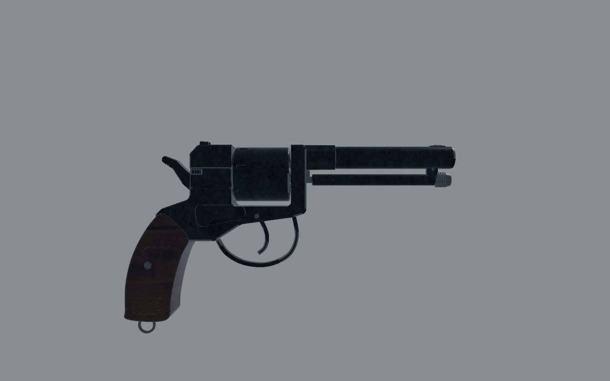
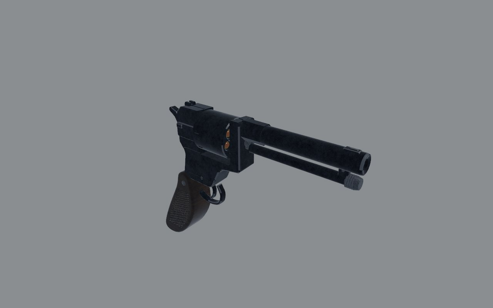
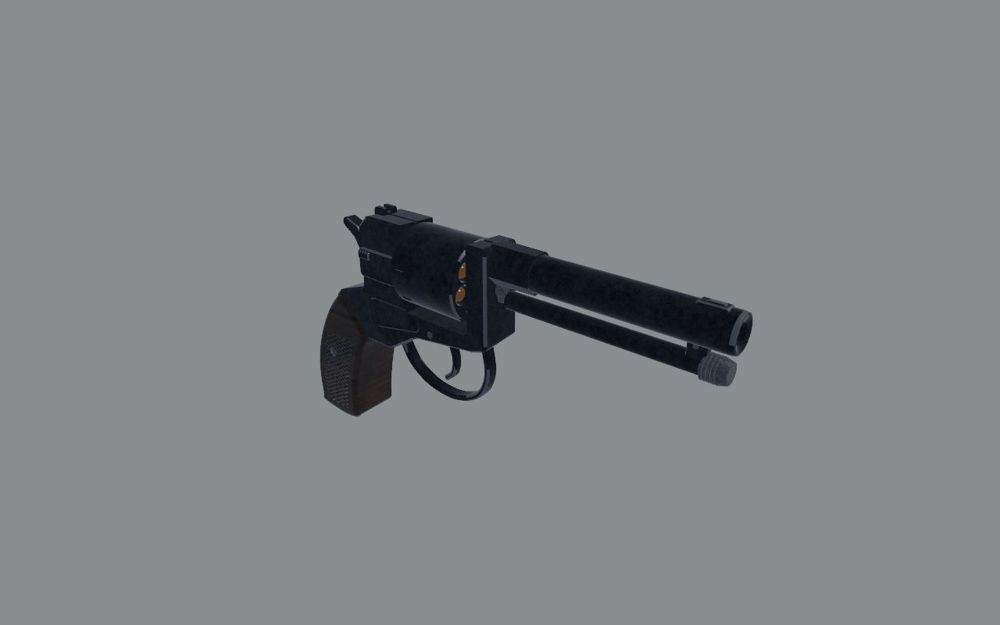

# Nagant M1895: fidelity review

The seven-shot revolver, loaded one chamber at a time through the gate.
Reviewed on the bench (`docs/craft/GUNSMITHING.md`) on 1 November 2026.

## Reference

- **Numbers**: 235 mm overall (230 in some sources), a 114 mm barrel,
  0.75–0.8 kg (Wikipedia and Modern Firearms). No published height.
- **Photograph**: Modern Firearms' M1895 page has a left side view, muzzle
  left, on boards (`1287753335.jpg`, 576 px). I scaled it to 235 mm, muzzle
  to the grip's rear. Its barrel comes to about 14 mm across, as the real
  one is. It's copyrighted, so I used it for measuring only and it isn't
  in the repo. The page's cutaway drawing is cut off at both ends, so I
  didn't measure from it.
- **What I know of it**:
  - **Frame**: solid, with the cylinder in a window and the loading gate
    on the right.
  - **Guard and trigger**: the guard is big and round, well forward, and
    the trigger hangs a long reach ahead of the grip.
  - **Grip**: short, set back behind the hammer, raking back to a
    bird's-head butt with the lanyard ring.

## Shots

The same command was used before and after
(`scripts/gun_bench.sh nagant <dir>`): `shots/before/` and `shots/after/`.

| | Before | After |
| - | - | - |
| Left, 30 cm |  |  |
| Right, 30 cm |  |  |
| Three-quarter, 30 cm |  |  |

## Measured

The overlay (`scripts/gun_overlay.py`, registered on the muzzle) puts the
bench's `level_left` shot over the photograph. The muzzle, barrel,
cylinder, top strap and hammer matched it before any change. Positions are
z and y in gun space, in metres.

| | Real (photo, scaled) | Before | After |
| - | - | - | - |
| Overall height | about 126 + the ring | 180 | 141 with the ring |
| Frame's bottom over the guard | +0.031, stepping down to +0.014 at the grip | +0.004 | as the photograph |
| Guard | -0.062 to -0.006, its bottom -0.004 | -0.038 to +0.003, -0.021 | as the photograph |
| Trigger | about -0.043 to -0.025 | -0.026 to -0.021 | -0.042 to -0.036 |
| Grip at the palm's height (y 0) | z +0.018 to +0.053 | -0.006 to +0.018 | +0.017 to +0.053 |
| Grip's butt | y -0.043 | -0.085 | -0.043 |
| Grip's rake | about 13° | near upright, then raked below the palm | about 13° |

## Scores

0 is wrong or missing; 1, a person who knows the gun winces; 2, right at a
glance and wrong at 30 cm; 3, right at 30 cm. Sound and feel aren't scored
here (weapon feel owns them).

| Row | Before | After | Notes |
| - | - | - | - |
| Silhouette | 1 | 3 | the grip was a long pole under the hammer |
| Proportion | 1 | 3 | the frame, guard, trigger and grip on the photograph's |
| Sections | 2 | 2 | |
| Parts present | 3 | 3 | gate, ejector rod, rounds and cases in their chambers |
| Parts move | 3 | 3 | cylinder, hammer, gate, rod, trigger |
| Controls | 2 | 2 | |
| Finish | 1 | 1 | near-black (the held finish series lifts it) |
| Wear | 2 | 2 | |
| Edges and making | 2 | 2 | |
| Markings | 2 | 2 | |
| **Total (of 30)** | **19** | **23** | |

## What's still wrong, worst first

1. **The hold**: the layout's `grip` has no rake (`Transform` rotation
   identity), though the grip now rakes about 13°. Whether the hand follows
   it, which tilts the aim, is for Hands and Weapon feel.
2. **The grip's frame**: the real grip shows a thin steel strap down its
   back. Here it's all wood.
3. **The frame's tang** meets the grip on a straight line; the real one is
   a curve.

## What changed

- **`art/guns/nagant.py`**: the frame's lower half is redrawn to the
  photograph:
  - **Frame**: its bottom over the guard rose 18 mm, and its tang runs
    back onto the grip.
  - **Guard and trigger**: the guard moved forward and up, and the trigger
    moved with it onto a new pin.
  - **Grip**: short, set back behind the hammer and raked, with the
    lanyard ring at its butt. Its screw and checkering moved with it.
  - **Side plate**: its screws and outline moved onto the new frame.
- **`src/weapons/layout.rs`** (`nagant()`): `grip` is at (0, 0, 0.027),
  on the new grip (see the second pass). The blockout's frame, grip and
  trigger were redrawn.

### Second pass: the hold

The first pass put `grip` at the middle of the grip at the old origin's
height (z 0.035, y 0): only 11 mm in front of the backstrap, and low.
Hands measured the trigger 116 mm out in the hand's frame, against 63–89
mm on every other gun.

The trigger itself was nearly right. The photograph's reach, backstrap to
the trigger's face at mid-height, is about 86 mm, about 16 mm more than
the PM's. The model had 88.

So `grip` moved 8 mm forward, to (0, 0, 0.027), and the trigger 4 mm back
onto the photograph's (pin at z −0.032). That puts the trigger about 65 mm
ahead of the grip point along the bore, as on the PM.

A hand on a raked revolver grip also sits higher, with the web up under
the hammer, at about y 0.014. That height cuts the bore's lever over the
palm from 74 mm to 60. With it, `weapons::signature`'s gauge found the
Nagant's kick too like the PM's (1.3 apart), and at y 0.008 too like the
IZh-43's (2.7). So the height stays at 0 until weapon feel gives the
Nagant a kick of its own at the higher hold.

### Third pass: the heel

The build now fails a bevelled outline whose corner is tighter than its
bevel, since the bevel folds over itself there. The grip's heel, at the
butt's back corner, was one. It's now rounded over about 4 mm instead of 1,
and the butt's length and depth are unchanged.

### Fourth pass: the hold's height

Weapon feel gave the Nagant a kick of its own (items.ron: a straight shove,
less climb), so `grip` rose to (0, 0.014, 0.027), the web up under the
hammer. The bore's lever over the palm is 60 mm.

### Fifth pass: the grip point along the bore

Hands measured the reach from the grip point, not the backstrap. The PM's
grip point sits 29 mm ahead of its backstrap at palm height; the Nagant's
sat 20.5 mm ahead of its own. So the Nagant carried 9 mm of extra reach
the real gun doesn't have. `grip` moved to (0, 0.014, 0.018), 29 mm ahead
of the backstrap and 5 mm inside the grip's front. The trigger is now 17 mm
further from the grip point than the PM's, the photograph's difference
(85.5 mm backstrap to trigger here, 68 on the PM).
