# PM pistol: fidelity review

The pistol a newcomer holds first. Reviewed on the bench
(`docs/craft/GUNSMITHING.md`) on 31 October 2026.

## Reference

- **Numbers**: 161 mm long, 126.75 mm high, 29.4 mm wide, a 93.5 mm
  barrel, a 130 mm sight line, 730 g with the magazine empty: the Soviet
  manual's figures as Wikipedia (Russian and English) carries them. In
  `gunsmith::spec`.
- **Photograph** (third pass): the Australian War Memorial's REL22188, a
  right side view of a Soviet PM on a plain background
  (awm.gov.au/collection/C268264). Scaled to its 161 mm, it comes out
  127 mm high, as the manual has it. It's *all rights reserved*, so it's
  measured from here (`scripts/gun_overlay.py`, mirrored to the bench's
  left side) and the overlays stay out of the repo.
- **What I know of it**: a blowback 9x18; the slide's rounded nose and
  domed top; the frame's front ends short of the slide's; the safety on
  the slide's left rear, a lever whose tip the thumb pushes down to safe
  (it decocks the hammer and blocks it); the big hinged trigger guard
  that pulls down to strip it; the slide stop on the left above the
  trigger; the heel magazine catch, drawn back by the thumb; one
  wrap-around bakelite grip, checkered, the star in a smooth disc low in
  the checkering (the photograph put it right: it was modelled at the top),
  held by one screw up the back; the lanyard ring at the left of the
  heel; a spur hammer showing behind the slide.

## Shots

Same commands before and after (`scripts/gun_bench.sh pm_pistol <dir>`):
`shots/before/`, `shots/after/`.

| | Before | After |
| - | - | - |
| Right, 30 cm | 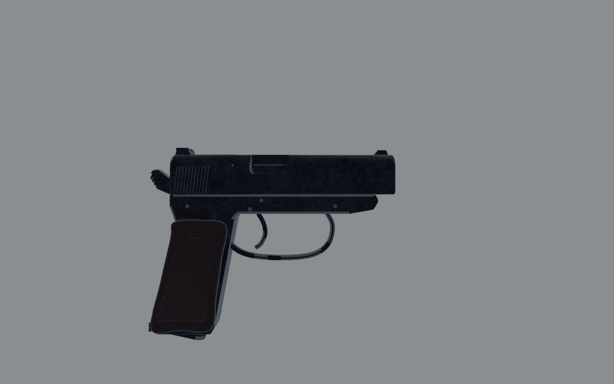 | 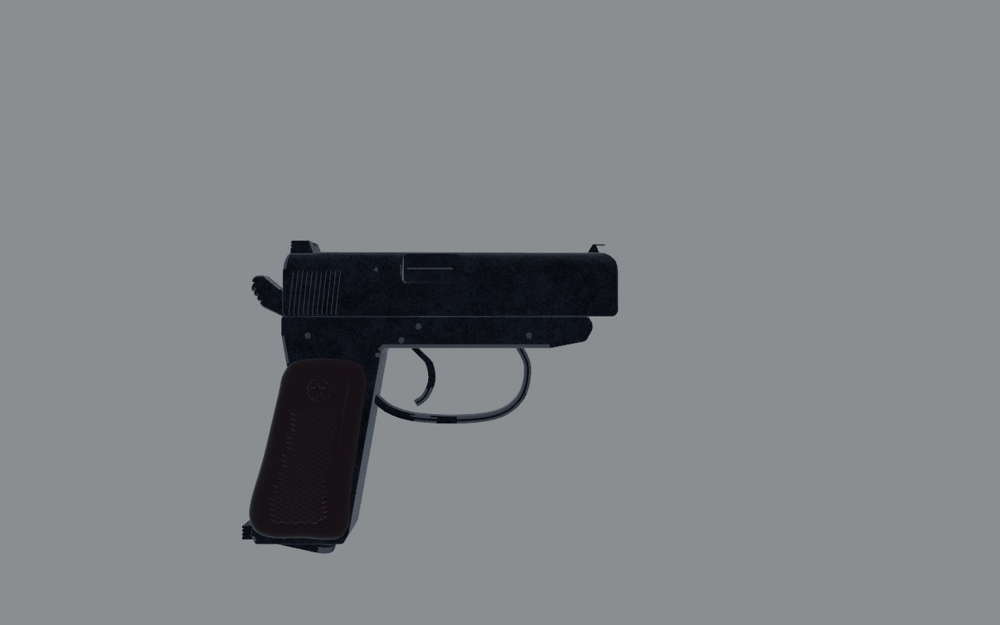 |
| Left, 30 cm | 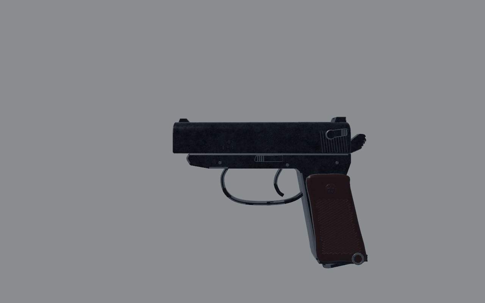 | 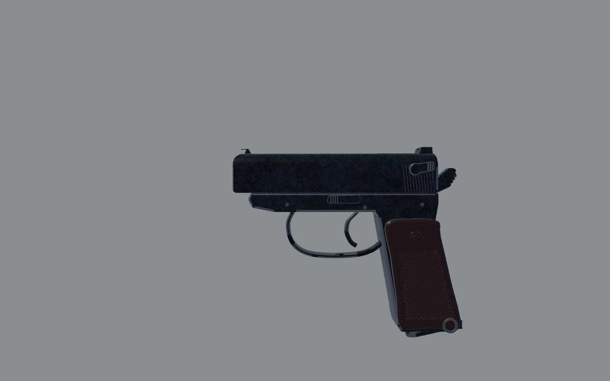 |
| Three-quarter, 30 cm | 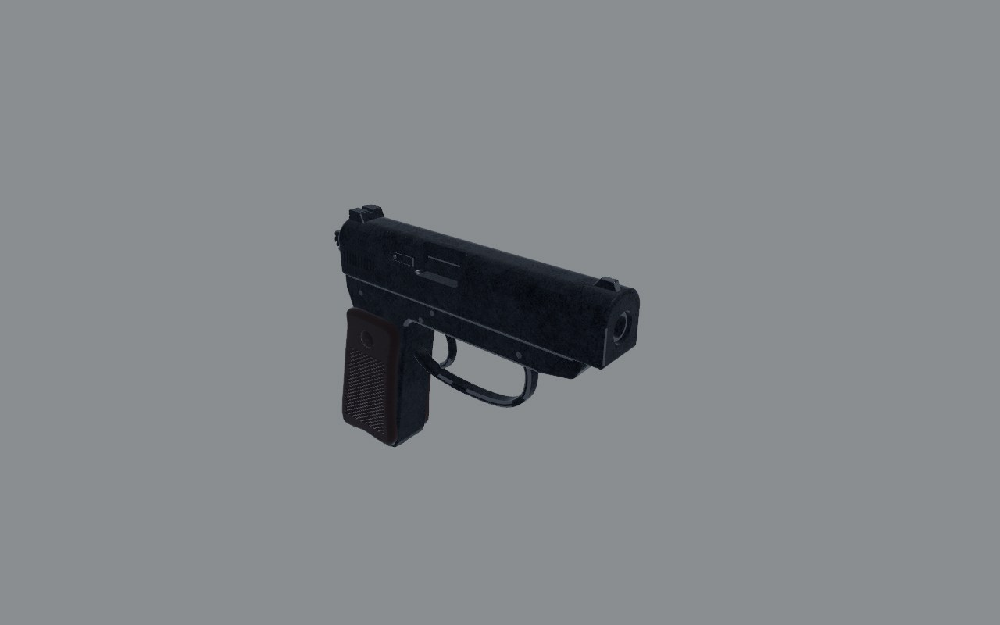 | 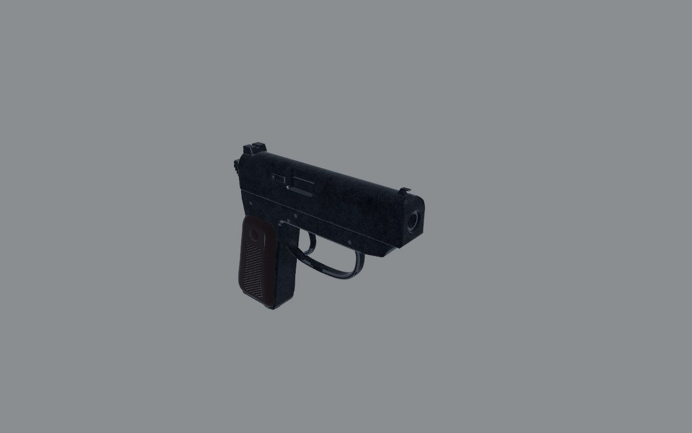 |
| Shooter's eye, 30 cm | 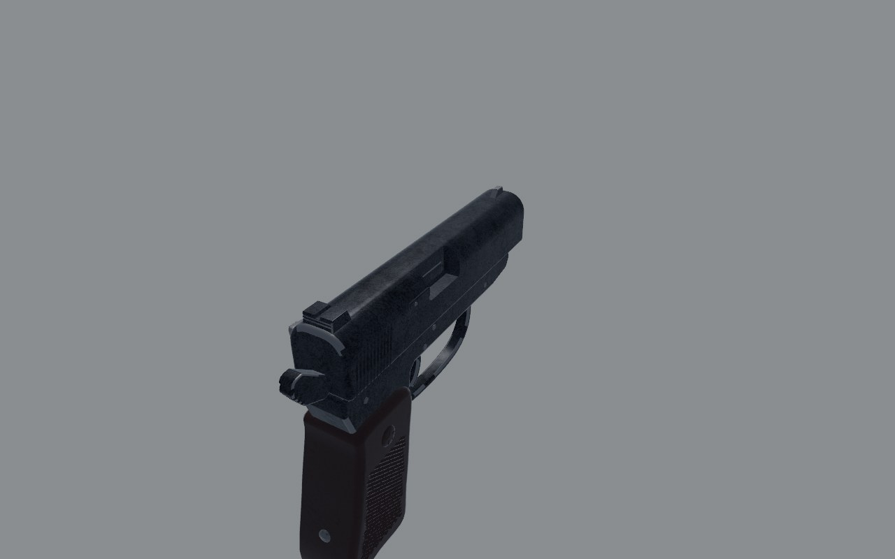 | 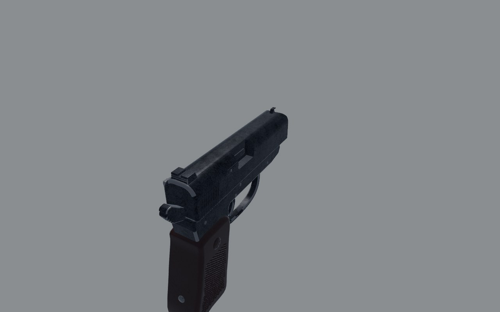 |
| Slide back | 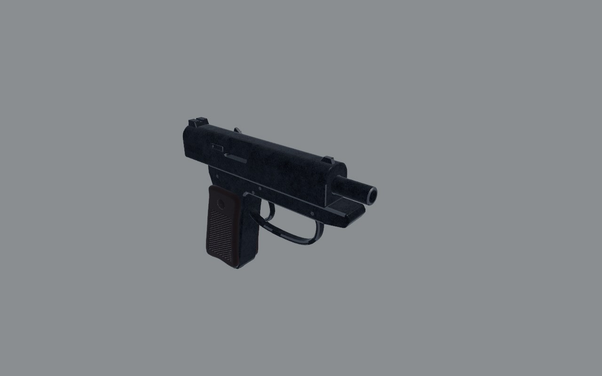 | 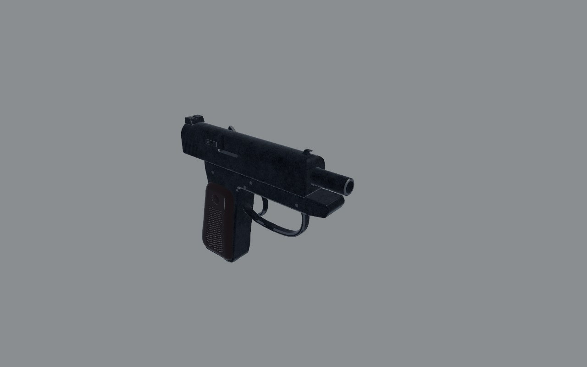 |
| Exploded | 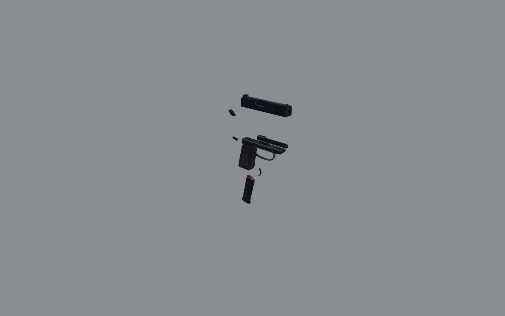 | 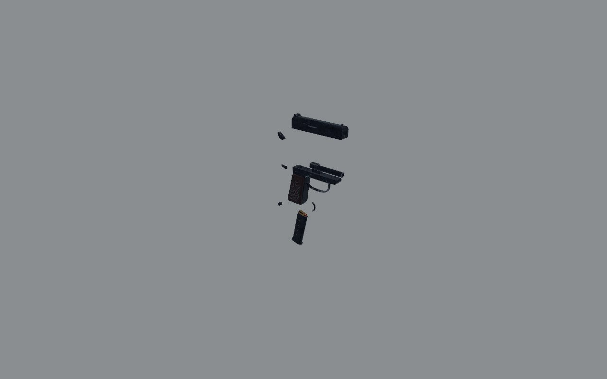 |

## Sections

Cut across the bore at the nose and the ejection port, and across the grip
at its top and low down (`art/sections.py`, 10 mm grid), in a second pass
after the coordinator saw the PM still read as a box at 30 cm. Before: the
slide 28 mm wide with a flat top between two small rounds; the grip a box
with 3.5 mm corners. After: the slide 25.4 mm, arched nearly across; the
grip a rounded oblong (7 mm rounds), its heel rounded. (The first pass
scored the sections 2; seen cut, they were a 1, and the before total is
re-scored to match.)

| Before | After |
| - | - |
| 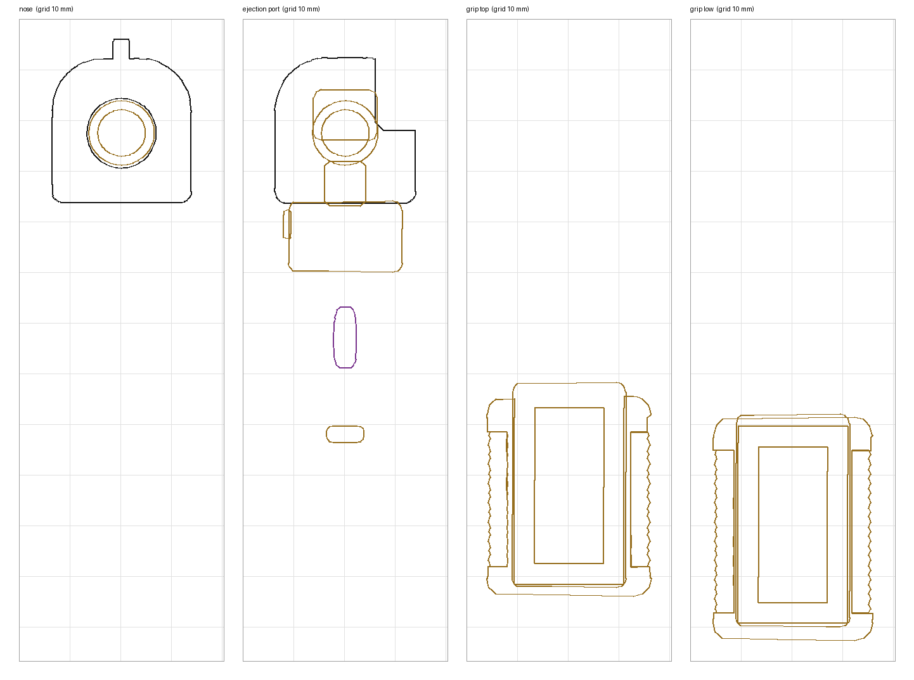 | 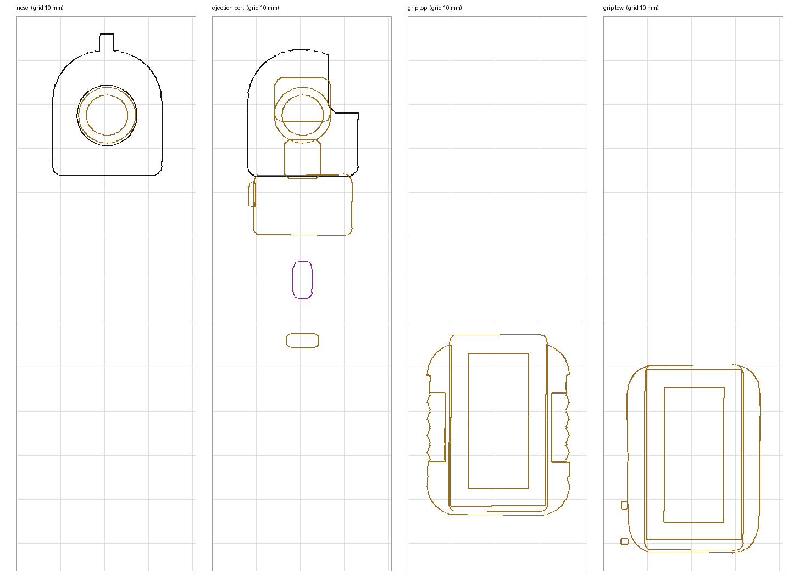 |

## Measured

| | Real | Before | After |
| - | - | - | - |
| Overall length (the drawn gun) | 161 | 175 (+9%) | 165 (+2%) |
| Barrel | 93.5 | 102.5 (+10%) | 94 |
| Sight line | 130 | 141.5 (+9%) | 130 |
| Height (the drawn gun, magazine in) | 126.75 | 138 (+9%) | 130 (+2.6%) |
| Width (the drawn gun) | 29.4 | 35 | 34 |
| Slide's width | about 25 | 28 | 25.4 |

Third pass, against the photograph: the slide matched it, top line and
nose; what read as a box was below it. The frame ran 20 mm too far
forward under the slide as a deep shelf; the trigger guard was too big,
its foot 9 mm low and its front 8 mm forward; the butt hung 8.5 mm low
(with the magazine, which is 8 mm shorter now to sit flush). The slide
doesn't taper: its top is level over the bore, the roundness is all at
the nose.

Everything above the grip was 9% long along the bore. The grip, which
holds the magazine, was left as it was; the frame blends between them
through the top of the grip (`ABOVE` in `art/guns/pm_pistol.py`). The
height and width stay over: what makes them up (the magazine's floor
under the grip, the safety lever and lanyard ring at the sides) needs a
photograph to settle. (The height is now settled; the width still
counts the safety lever and the lanyard ring.)

## Scores

0 wrong or missing, 1 a person who knows the gun winces, 2 right at a
glance and wrong at 30 cm, 3 right at 30 cm. Sound and feel aren't
scored here (weapon feel owns them).

| Row | Before | After | Notes |
| - | - | - | - |
| Silhouette | 1 | 3 | within a few millimetres of the photograph but the frame's lower edge before the guard and the hammer spur |
| Proportion | 1 | 2 | length, barrel, sight line and height right; the width over |
| Sections | 1 | 2 | the slide arched, the grip a rounded oblong; the frame's front strap still square-edged |
| Parts present | 2 | 2 | no red dot under the safety; the slide stop's shape is a plain tab |
| Parts move | 2 | 2 | the heel catch is its own part, the trigger turns on its pin; the guard can't swing down |
| Controls | 2 | 2 | |
| Finish | 2 | 3 | after the sky light (GUNSMITHING.md, "Finishes", fourth pass): the slide blue-black, its arch graded by the sky, no grain at 30 cm |
| Wear | 2 | 2 | |
| Edges and making | 2 | 2 | |
| Markings | 1 | 2 | serial and year on the left of the slide; the star moved low, where it is |
| **Total (of 30)** | **16** | **23** | |

## What's still wrong, worst first

1. **The frame's lower edge** before the guard sits about 5 mm low, and
   the **hammer's spur** stands up more than the real one's.
2. **The width** counts the safety lever and lanyard ring: 34 mm against
   29.4; the grip panels may be a millimetre thick a side.
3. **The frame's front strap and trigger guard** are square-edged steel
   under rounded bakelite.
4. **The trigger guard can't swing down**, so the gun can't be stripped
   as the real one is. It's welded into `static_frame`.
5. **No red dot** on the frame under the safety, which shows when it's
   off safe: the one thing the eye checks on a PM.

## What changed

- `art/guns/pm_pistol.py`: everything above the grip 8.3% shorter along
  the bore; the slide's nose rounded over (9 mm) and under (4 mm), the
  front sight bedded into it; the heel magazine catch its own object
  (`mag_catch_heel`, `Moves::HeelCatch`); the grip's share of the
  magazine well cut wider than the frame's so they no longer z-fight
  (`art/check.py` failed on it).
- Second pass: the slide 25.4 mm wide (it was 28) and arched across its
  top; the grip's edges rounded 7 mm, its outline's corners eased; the
  trigger's origin on its pin.
- Third pass, against the photograph: the frame's front 20 mm shorter
  under the slide; the guard 12% smaller along the bore and its foot
  8 mm higher, the trigger's blade shortened to hang inside it; the butt
  8.5 mm higher (`lift`), its heel catch and lanyard ring with it; the
  star low on the grip in a smooth disc; the magazine (`art/mags/pm_mag.py`,
  `items.ron`) 8 mm shorter to sit flush.
- `src/weapons/layout.rs` (`pm()`): the muzzle, port, sight, slide grab
  and load port moved with the model.
