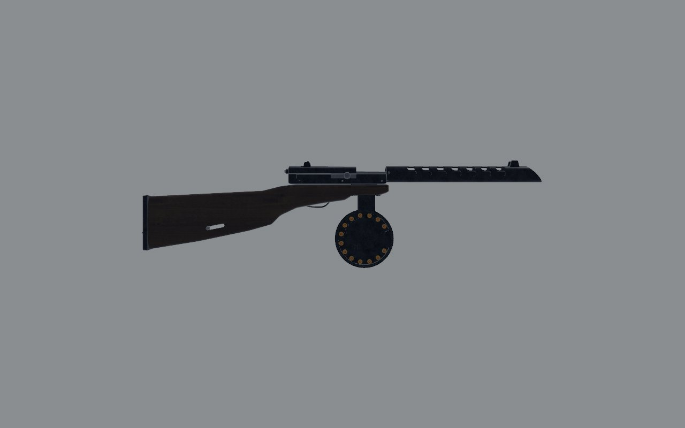
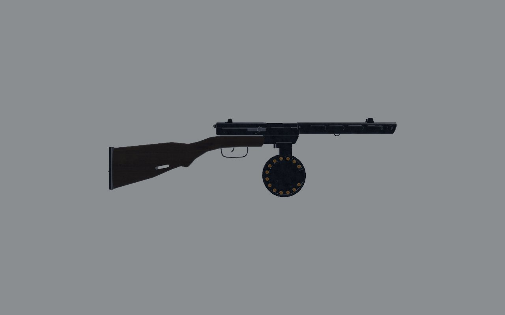
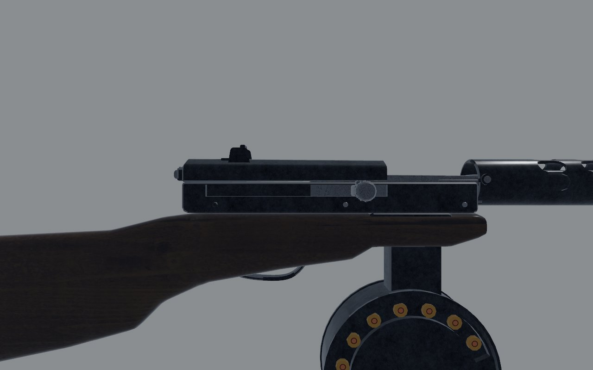
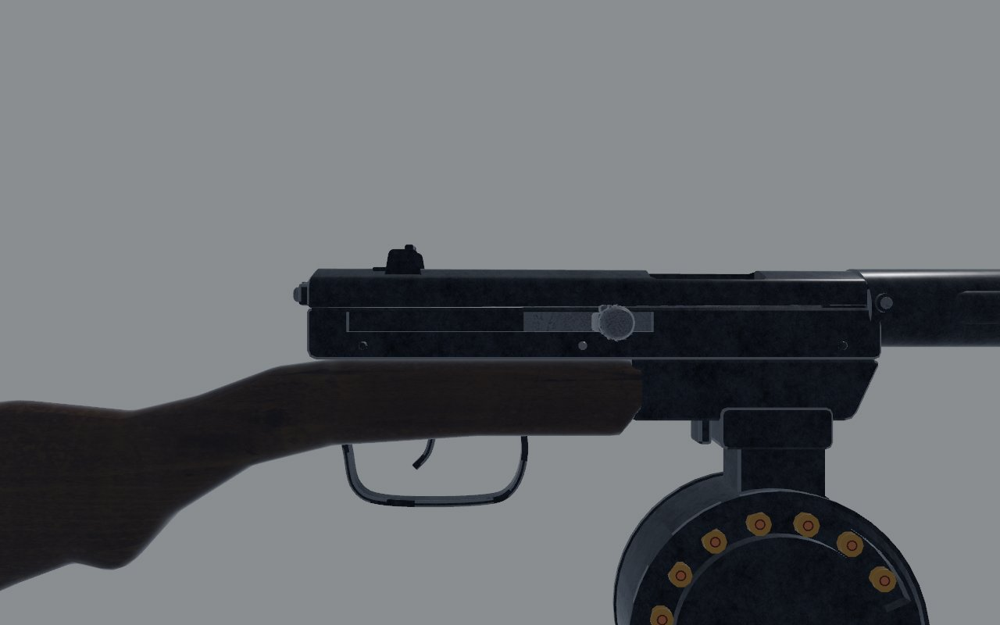
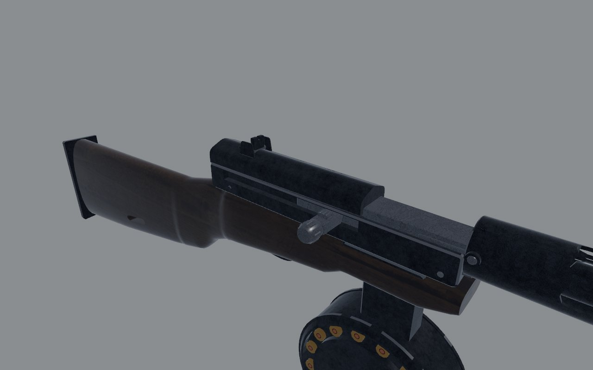
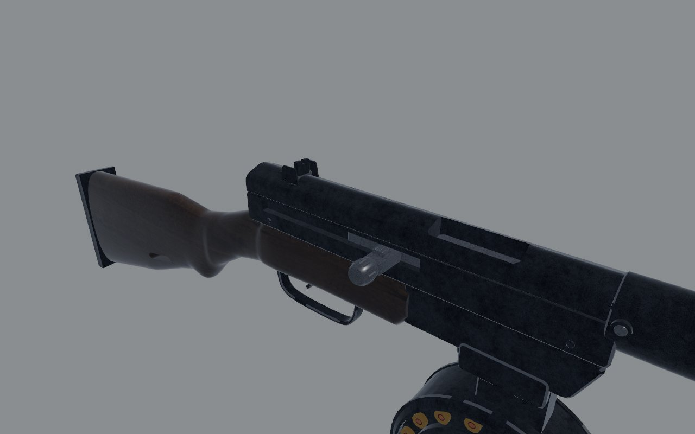
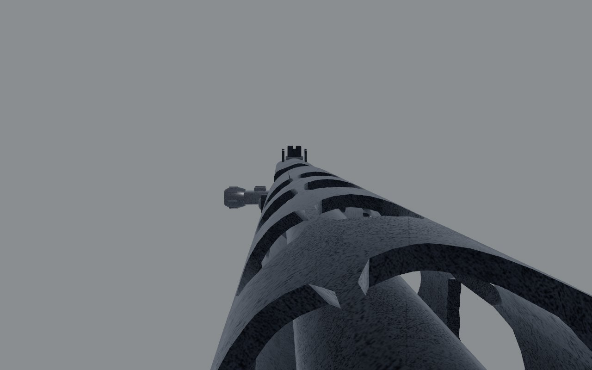
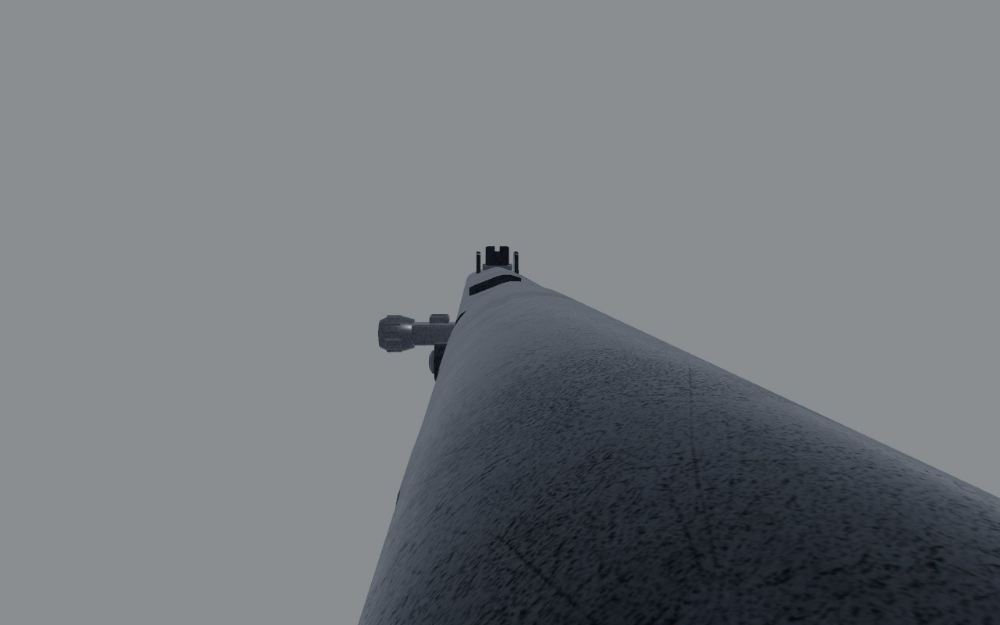
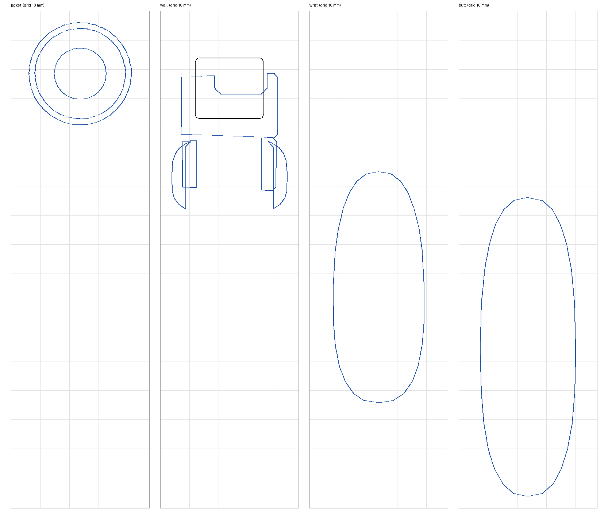
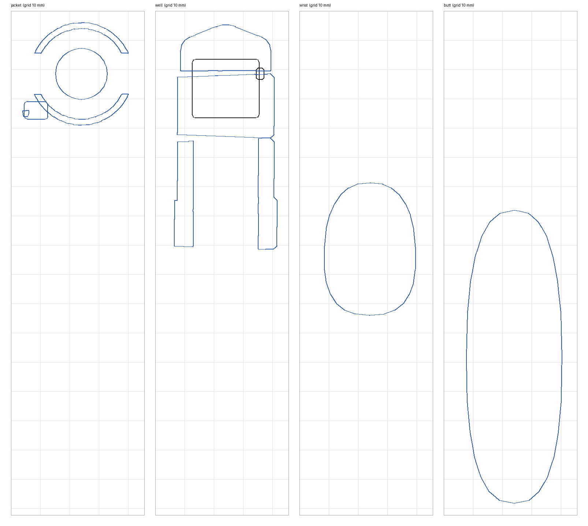

# PPSh-41: fidelity review

The submachine gun, with a 71-round drum and an open bolt. Reviewed on the
bench (`docs/craft/GUNSMITHING.md`) on 1 November 2026.

## Reference

- **Numbers**: 843 mm overall, a 269 mm barrel, 5.45 kg with the drum
  loaded (Modern Firearms). The Royal Museums Greenwich's AAA2570 measures
  120 x 850 x 40 mm.
- **Photographs** (all copyrighted, so measuring only, and not in the
  repo):
  - Modern Firearms' PPSh-41 page has a left side view with the drum
    (`ppsh41-1.jpg`, 650 px) and a right side view with a 35-round box
    (`ppsh41-2.jpg`, 650 px). Both are scaled to 843 mm and registered on
    the butt. They agree on every position below to within about 10 mm.
  - The Royal Museums Greenwich photograph (AAA2570) is taken from the
    rear quarter, so it's too steep to measure. It confirms the
    compensator's slant and the side ports.
- **What I know of it**:
  - **Jacket**: the perforated barrel jacket is hinged to the receiver's
    front and opens for stripping. Its front is a compensator: a face
    nearly upright, its top lip forward, closed but for the bullet's hole,
    with a round port in each side. Gas striking the lip pushes the muzzle
    down.
  - **Barrel and sights**: the 269 mm barrel ends well inside the jacket.
    The front sight sits in ears about 75 mm behind the lip, and the rear
    sight flips on the receiver cover.
  - **Receiver**: the magazine well is bare steel at the receiver's front,
    ahead of the wood. The guard is long and deep, with the fire selector
    inside it ahead of the trigger.
  - **Stock**: birch, with a slim wrist and a knob under the grip.

## Shots

The same command was used before and after
(`scripts/gun_bench.sh ppsh <dir>`): `shots/before/` and `shots/after/`.

| | Before | After |
| - | - | - |
| Right, 1 m |  |  |
| Right, 30 cm |  |  |
| Three-quarter, 30 cm |  |  |
| Front, 30 cm |  |  |

## Sections

Sections are cut with `art/sections.py` on a 10 mm grid, at four places:

- the jacket at z −0.34;
- the magazine well, at −0.152 before and −0.187 after;
- the wrist at 0.06;
- the butt at 0.2.

What changed:

- **Jacket**: the slots now go through its sides, where before only the
  rows at other angles showed in the section. The sling swivel hangs under
  them.
- **Magazine well**: the cover closes over the receiver above the well.
  Before, there was an open gap from the jacket back to the cover.
- **Wrist**: 77 mm deep before, 46 mm after.

| Before | After |
| - | - |
|  |  |

## Measured

The overlay (`scripts/gun_overlay.py --align butt`) puts the bench's
`level_left` shot over the left side photograph. Positions are z in gun
space, in metres.

| | Real (photos, scaled) | Before | After |
| - | - | - | - |
| Overall | 843 | 869 | 849 (counting the swivel) |
| Compensator | face upright less 15°, top lip forward at -0.519 | 45°, bottom lip forward at -0.545, open on top | -0.519 at the top lip |
| Front sight | -0.434 to -0.443 | -0.478 | -0.441 |
| Side slots | four long ones, centres -0.45, -0.39, -0.34, -0.28 | seven rows of short ones | four, 48 mm long |
| Barrel's muzzle | 269 from the breech, inside the jacket | at the compensator | -0.479 |
| Jacket's hinge | -0.223 to -0.242 | -0.205 | -0.232 |
| Magazine well | -0.181 to -0.193 | -0.152 | -0.187 |
| Wood's front | -0.121 to -0.140, steel ahead | -0.205, round the well | -0.130 |
| Guard's bottom | -0.036 | -0.020 | -0.035 |
| Wrist's depth at 0.065 | 48 mm | 76 mm | 47 mm |
| Heel and toe | -0.005, -0.127 | +0.004, -0.112 | -0.006, -0.128 |

The receiver's rear, the cover's line and the guard's length matched before
any change.

## Scores

0 is wrong or missing; 1, a person who knows the gun winces; 2, right at a
glance and wrong at 30 cm; 3, right at 30 cm. Sound and feel aren't scored
here (weapon feel owns them).

| Row | Before | After | Notes |
| - | - | - | - |
| Silhouette | 1 | 3 | the compensator the right way, the jacket and well where they are, the guard |
| Proportion | 1 | 3 | front sight, slots, hinge, well, wrist on the photographs' |
| Sections | 2 | 2 | the wrist slim; the receiver's sides are flat slabs |
| Parts present | 2 | 2 | the compensator's face and ports are there now; no stripping catch on the receiver's back |
| Parts move | 2 | 2 | bolt, trigger, selector; the jacket can't break open |
| Controls | 2 | 2 | |
| Finish | 1 | 1 | near-black; the finish series tuned against the sky light lifts it |
| Wear | 2 | 2 | |
| Edges and making | 2 | 2 | |
| Markings | 2 | 2 | |
| **Total (of 30)** | **17** | **21** | |

## What's still wrong, worst first

1. **The drum.** In the left side photograph it shows edge-on, as a tall
   narrow shape, not as the round face the model has. Either that
   photograph has the drum turned, or the model's drum is. I haven't
   changed it on one photograph; it wants a second, clean side view with
   the drum on.
2. **The jacket can't break open** about its hinge for stripping.
3. **The rear sight**: the two photographs disagree on where it sits
   (−0.018 and −0.066), so it stays at −0.03.
4. **The receiver's sides** are flat slabs; the real ones carry stamped
   ribs.

## What changed

- **`art/guns/ppsh.py`**:
  - **Compensator**: drawn as it is, upright less 15° with the top lip
    forward. The face is closed but for the bullet's hole, with a port in
    each side.
  - **Jacket and barrel**: the jacket ends at −0.519. Four long slots run
    down each side. The barrel stops 35 mm behind the face, and the front
    sight moved 37 mm back.
  - **Receiver**: the hinge is at −0.232. The receiver's front is bare
    steel with the well's housing at −0.187. The cover runs on from the
    jacket, with the ejection port in it.
  - **Stock and guard**: the wood starts at −0.130. The wrist is slim, with
    the knob under the grip, and the heel and toe are lower. The guard is
    deeper and the trigger's blade longer.
  - **Front swivel**: on the jacket's left.
- **`src/weapons/layout.rs`** (`ppsh()`): the muzzle and the magazine well
  moved, and the blockout was redrawn. The grip, support, bolt, handle and
  trigger are unchanged.
- **`src/weapons/sling.rs`**: the front sling point is at the jacket's
  swivel.
