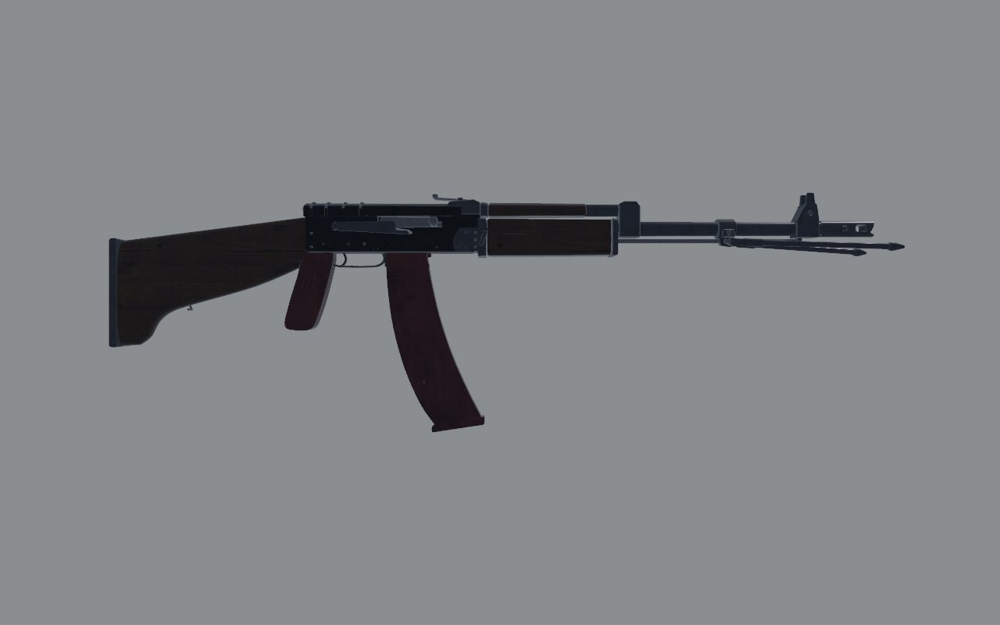
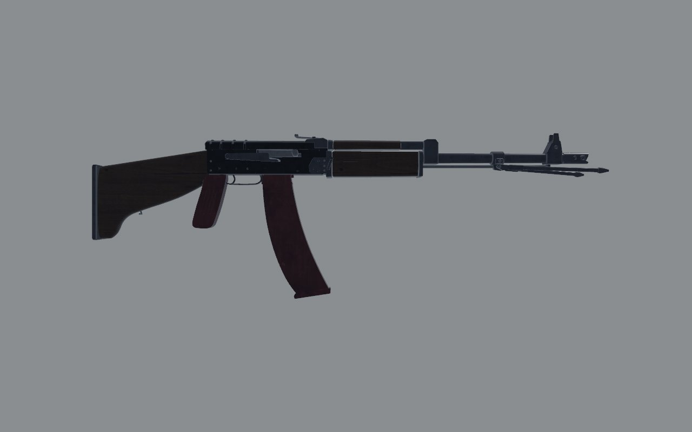
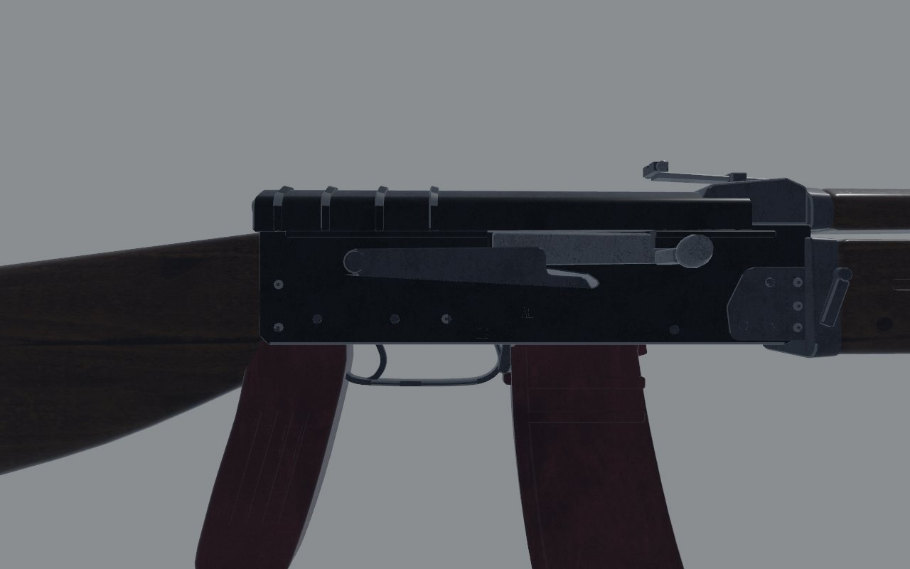
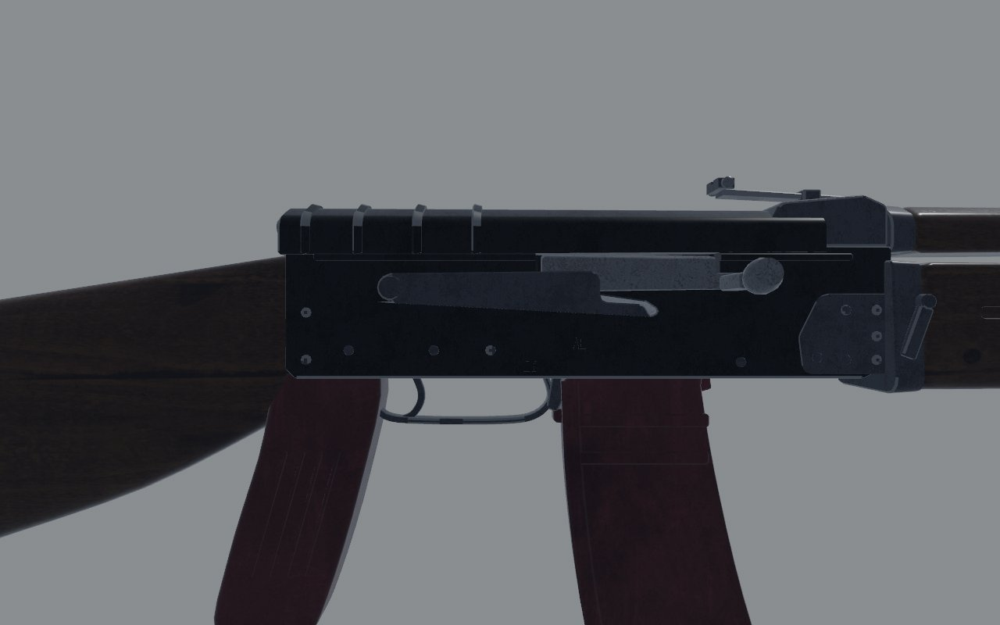
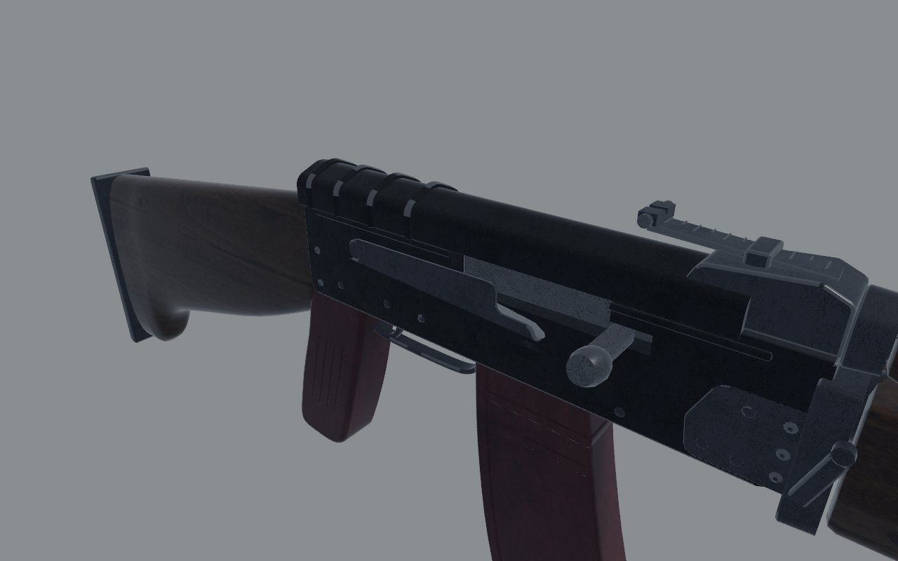
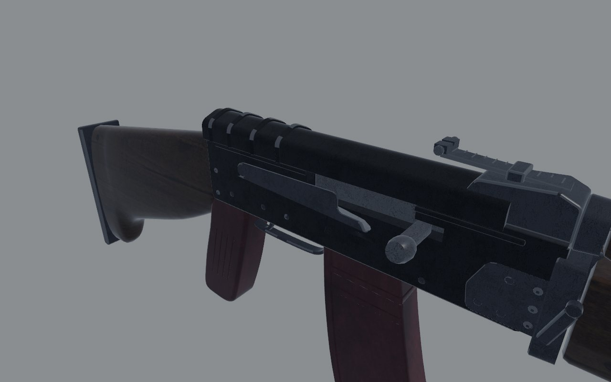

# RPK-74: fidelity review

The squad's light machine gun: an AK-74 with a long, heavy barrel, a
club-foot stock and a folding bipod. Reviewed on the bench
(`docs/craft/GUNSMITHING.md`) on 1 November 2026.

## Reference

- **Numbers**: 1060 mm overall, a 590 mm barrel, 4.7 kg empty, and a
  45-round magazine (Modern Firearms).
- **Photograph**: Modern Firearms' RPK-74 page has an early RPK-74 with
  wooden furniture and the bipod down, seen from the right
  (`rpk74_01.jpg`, 650 px). I mirrored it to the bench's left side, scaled
  it to 1060 mm and registered it on the butt. It's copyrighted, so I used
  it for measuring only and it isn't in the repo.

## Shots

The same command was used before and after
(`scripts/gun_bench.sh rpk74 <dir>`): `shots/before/` and `shots/after/`.

| | Before | After |
| - | - | - |
| Right, 1 m |  |  |
| Right, 30 cm |  |  |
| Three-quarter, 30 cm |  |  |

## Measured

The overlay used `scripts/gun_overlay.py --align butt`, with the bench run
`--hide bipod` because the photograph has the bipod down.

| | Real (photo, scaled) | Before | After |
| - | - | - | - |
| Overall | 1060 | 1128 | 1059 |
| Grip to butt | about 244 | 289 | 244 |
| Muzzle device | about 55 | 80 | 55 |
| Front sight, from the grip | about 752 | 745 | 745 |
| Magazine, from the grip | within 10 mm | | |

From the grip forward, the barrel, handguards and front sight were already
right. The extra 68 mm was the stock (45 mm) and the muzzle device
(25 mm).

## Scores

0 is wrong or missing; 1, a person who knows the gun winces; 2, right at a
glance and wrong at 30 cm; 3, right at 30 cm. Sound and feel aren't scored
here (weapon feel owns them).

| Row | Before | After | Notes |
| - | - | - | - |
| Silhouette | 2 | 3 | the stock and the muzzle on the photograph's |
| Proportion | 1 | 3 | 1059 mm against 1060 |
| Sections | 2 | 2 | |
| Parts present | 3 | 3 | bipod, club-foot stock, the RPK's handguard |
| Parts move | 3 | 3 | bipod, carrier, selector, trigger |
| Controls | 2 | 2 | |
| Finish | 2 | 2 | stamped receiver, blued barrel |
| Wear | 2 | 2 | |
| Edges and making | 2 | 2 | |
| Markings | 2 | 2 | |
| **Total (of 30)** | **21** | **24** | |

## What's still wrong, worst first

1. **The magazine's curve**: the photograph's 45-round magazine sweeps a
   little further forward at its foot.
2. **The muzzle device's shape**: it was cut down from the AK-74's
   two-chamber brake. The RPK-74's own device is a different pattern, and
   the photograph is too small to draw it from.

## What changed

- **`art/guns/rpk74.py`**:
  - **Stock**: 45 mm shorter behind the wrist, with the same profile. The
    butt plate, sling loop and studs moved with it.
  - **Muzzle device**: 55 mm, its muzzle at −0.795.
  - **Bipod**: its folded legs are 25 mm shorter, ending at the muzzle.
  - **Magazine catch**: its own part, `mag_catch` (the AK's paddle, tipping
    about its pin), so the hands find it from the model.
  - **Upper handguard**: it stood 4.5 mm clear of the lower, a gap you
    could see through side-on. On the real gun the two meet at a seam, as
    on the AK, so its bottom came down to 1 mm over the lower's top.
- **`src/weapons/layout.rs`** (`rpk74()`): the muzzle is at −0.795.
- **`src/weapons/sling.rs`**: the rear point moved with the loop.
- **`assets/data/items.ron`** and **`src/capture/scale.rs`**: the gun's box
  is 1.08 m and the stock 245 mm.
