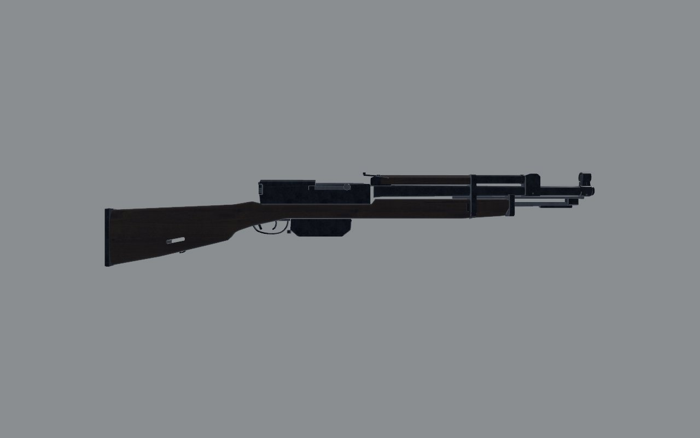
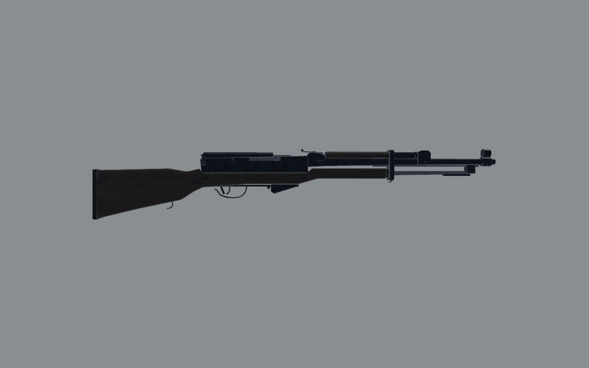
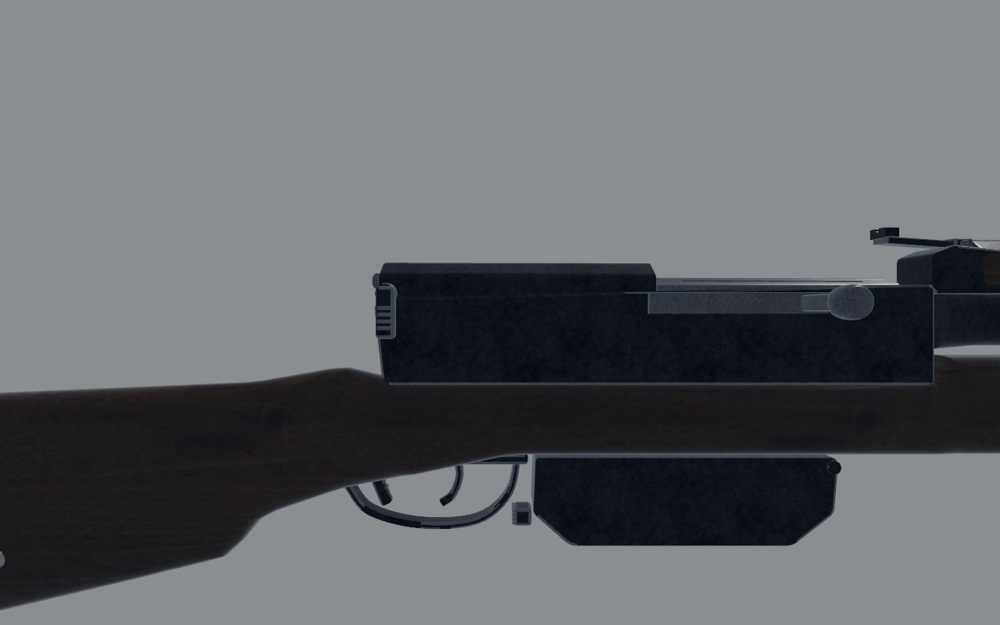
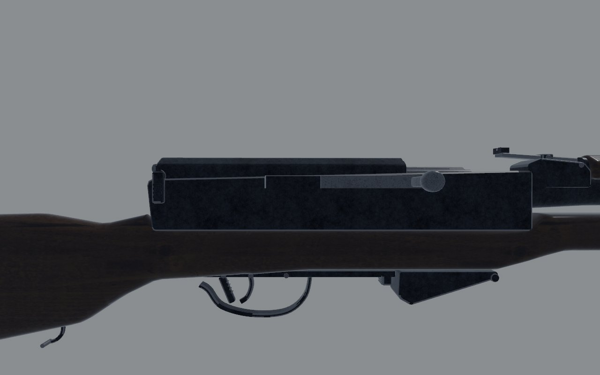
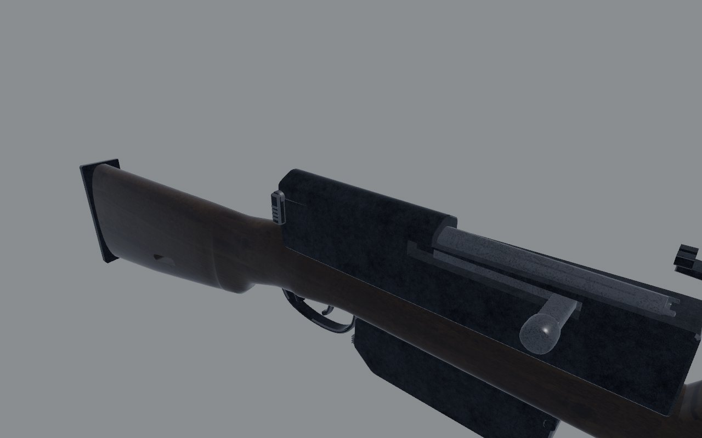
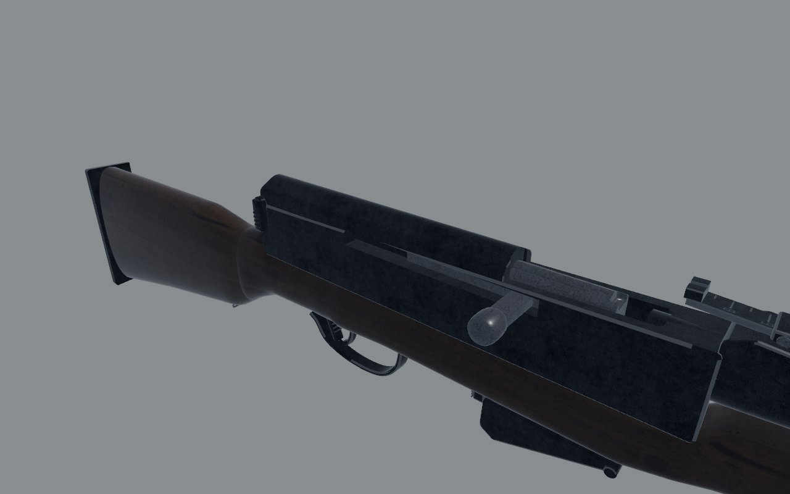
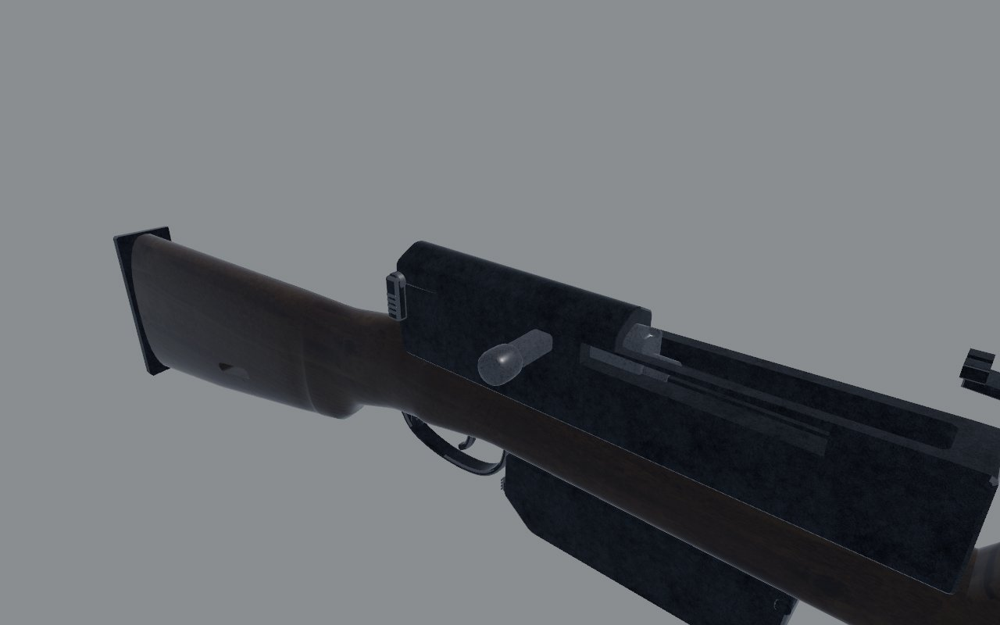
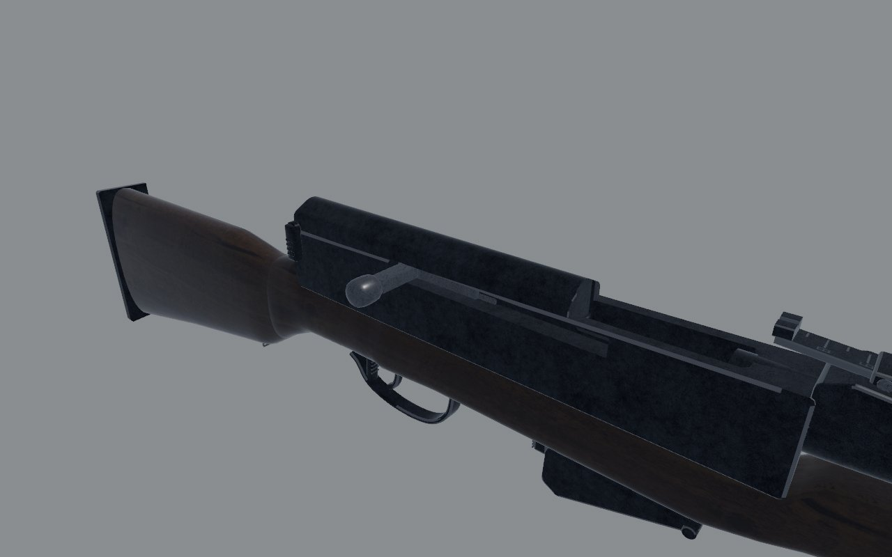
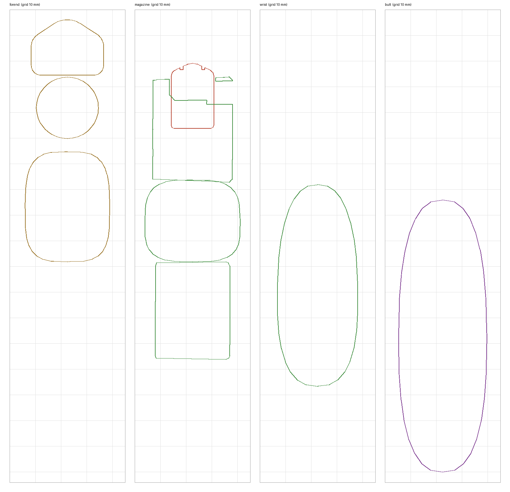
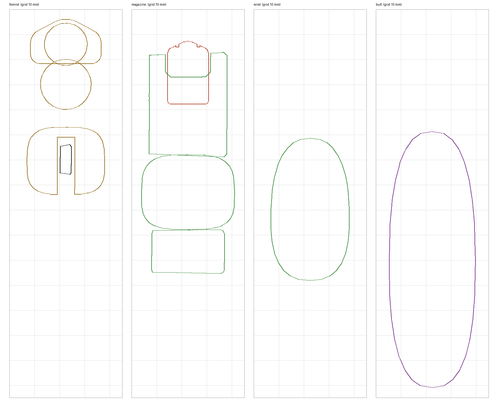

# SKS: fidelity review

The self-loading carbine, with a fixed ten-round magazine filled from
clips and a folding blade bayonet. Reviewed on the bench
(`docs/craft/GUNSMITHING.md`) on 1 November 2026.

## Reference

- **Numbers**: 1020–1025 mm with the bayonet folded, a 520–521 mm barrel
  and 3.85 kg. These are Modern Firearms' figures, and the catalog agrees.
- **Photograph**: Modern Firearms' SKS page (`sks5.jpg`) shows a 1950s
  Tula rifle on white, in a right side view and a left side view. The left
  view, 1500 px, is drawn muzzle-left, as the bench's `level_left` is, so
  it isn't mirrored. Scaled to 1022 mm, its trigger guard comes to 76 mm
  long, and the model's is 78. It's copyrighted, so it was used for
  measuring only and isn't in the repo.
- **What I know of it**:
  - **Barrel and gas**: the gas cylinder sits on the barrel, with its block
    well back from the bayonet's lug. The upper handguard covers the tube
    from the band to the rear sight.
  - **Action**: there's a short open top in front of the cover, with the
    carrier and clip guide showing. The long receiver cover runs back to
    the takedown lever at the receiver's end.
  - **Magazine**: shallow, its front sloping, its latch behind it.
  - **Stock**: the one-piece stock ends at a band just ahead of the
    handguard's front. The blade bayonet folds back into a groove under the
    forend. The wrist is slim, and the comb is nearly in line with the
    receiver.

## Shots

The same command was used before and after
(`scripts/gun_bench.sh sks <dir>`): `shots/before/` and `shots/after/`.

| | Before | After |
| - | - | - |
| Right, 1 m |  |  |
| Right, 30 cm |  |  |
| Three-quarter, 30 cm |  |  |
| Bolt back |  |  |

## Sections

The sections are cut with `art/sections.py` on a 10 mm grid, at the
forend (z −0.38), the magazine (−0.17), the wrist (0.06) and the butt
(0.2).

- **Wrist**: 78 mm deep before, 56 mm after.
- **Forend**: now carries the folded blade in its groove, open from below,
  under a slimmer barrel and gas tube.
- **Magazine box**: 38 mm below the stock before, 24 mm after.

| Before | After |
| - | - |
|  |  |

## Measured

The overlay (`scripts/gun_overlay.py --align butt`) puts the bench's
`level_left` shot over the photograph. In the table, positions are z in
gun space and heights are y, both in metres; widths are in millimetres. The
trigger guard was the one part where it was before any change.

| | Real (photo, scaled) | Before | After |
| - | - | - | - |
| Overall | 1020-1025 | 1048 | 1026 |
| Muzzle | -0.713 | -0.735 | -0.713 |
| Bayonet's lug | -0.650 | -0.690 | -0.650 |
| Gas block's front | -0.546 | -0.618 | -0.546 |
| Forend's front (band) | -0.440 | -0.552, with a nose cap | -0.440 |
| Forend's underside | about +0.005 | -0.012 | +0.004 |
| Handguard | -0.445 to -0.292, top +0.075 | -0.47 to -0.275, top +0.0845 | -0.446 to -0.280, top +0.0755 |
| Gas cylinder's axis | about +0.062 | +0.073 | +0.064 |
| Barrel at the muzzle, across | about 12-14 | 21 | 16 |
| Rear sight's notch | -0.222 | -0.242 | -0.220 |
| Sight line (the notch's floor, the post's top) | about +0.078 | +0.086 | +0.078 |
| Open top | -0.212 to -0.146 | -0.243 to -0.138 | -0.213 to -0.145 |
| Receiver cover | -0.146 to +0.035 | -0.137 to -0.018 | -0.146 to +0.033 |
| Bolt face | about -0.19 (from the barrel's length) | -0.255 | -0.205 |
| Magazine box | -0.24 to -0.14, its floor -0.032 | -0.215 to -0.085, its floor -0.050 | -0.214 to -0.140, its floor -0.034 |
| Trigger's blade | about -0.025 | -0.047 | -0.029 |
| Wrist's top and bottom, at 0.055 | +0.026, -0.025 | +0.020, -0.058 | +0.028, -0.027 |
| Comb at 0.12 | +0.031 | +0.017 | +0.031 |
| Heel and toe | +0.027, -0.097 | +0.008, -0.112 | +0.027, -0.097 |

## Scores

0 is wrong or missing; 1, a person who knows the gun winces; 2, right at a
glance and wrong at 30 cm; 3, right at 30 cm. Sound and feel aren't scored
here (weapon feel owns them).

| Row | Before | After | Notes |
| - | - | - | - |
| Silhouette | 1 | 3 | the forend was 110 mm long and the butt hung low |
| Proportion | 1 | 3 | the gas block, action, magazine and trigger are where the photograph has them |
| Sections | 1 | 2 | the wrist slim, the barrel thinner; the receiver is still a slab |
| Parts present | 2 | 2 | the front swivel is on the band, where the photograph has it under the gas cylinder; no takedown pin through the stock |
| Parts move | 2 | 2 | carrier, bayonet, trigger, safety; the cover can't come off |
| Controls | 2 | 2 | |
| Finish | 1 | 2 | after the sky light (GUNSMITHING.md, "Finishes", fourth pass): blue-black, graded by the sky; not yet seen at 30 cm in the game |
| Wear | 2 | 2 | |
| Edges and making | 2 | 2 | |
| Markings | 2 | 2 | |
| **Total (of 30)** | **16** | **22** | |

## What's still wrong, worst first

1. **The front sling swivel** belongs under the gas cylinder's front, on
   the lug's assembly, hanging below the folded bayonet, not on the band.
   The game's sling point moves with it, so I left it on the band for
   now.
2. **The receiver** is a slab in section; the real one is milled, with
   flats and a step along each side.
3. **The bolt stop's tab** and the **takedown lever** are boxes.

## What changed

- **`art/guns/sks.py`**:
  - **Barrel and front**: the barrel is thinner. The front sight moved back
    27 mm and down 8 mm. The bayonet's lug and pin moved 40 mm back. The
    gas block moved 72 mm back, with the tube 9 mm lower.
  - **Forend**: it ends at a band at −0.440, with no nose cap. Its
    underside is 16 mm higher, and a groove takes the folded blade. The
    handguard is lower and shorter.
  - **Rear sight**: moved 22 mm back and 8 mm down, as a piece.
  - **Action**: the open top is 68 mm long. The cover runs to the receiver's
    end at +0.035, and the carrier sits 50 mm further back. The magazine
    box is shorter and shallower, with its latch behind it. The trigger
    moved 18 mm back.
  - **Stock**: the wrist is 51 mm deep. The comb and heel are about 18 mm
    higher, and the belly and toe about 20 mm higher. The sling slot in the
    butt is gone, and the rear swivel is on the belly.
- **`src/weapons/layout.rs`** (`sks()`):
  - the muzzle, port, load port and charging handle's grab moved;
  - the sight line is at y 0.078, down from 0.086;
  - the trigger is at −0.03;
  - the blockout matches the model.
- **`src/weapons/melee.rs`**: the fixed bayonet's point is at −0.935.
- **`src/weapons/sling.rs`**: both sling points moved with their swivels.
