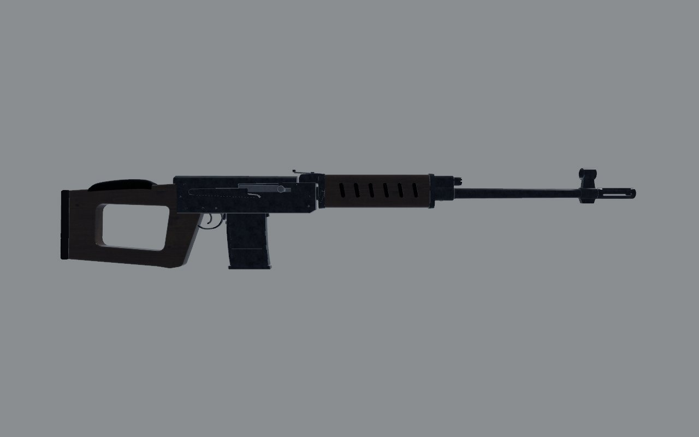
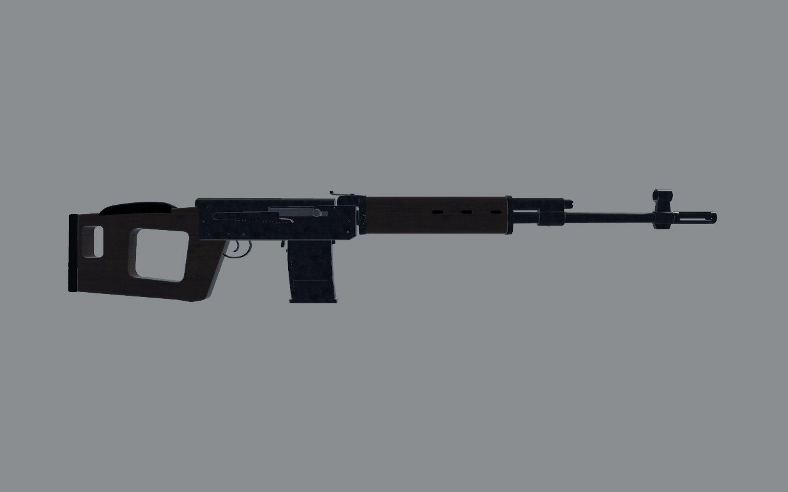
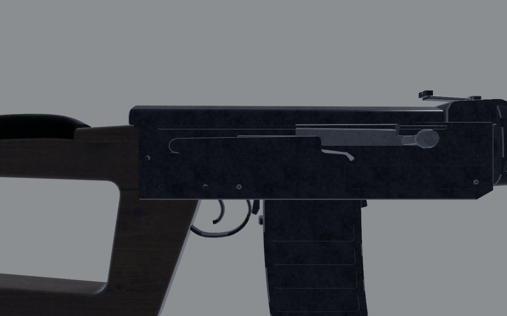
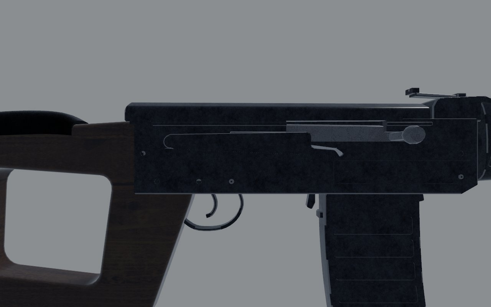
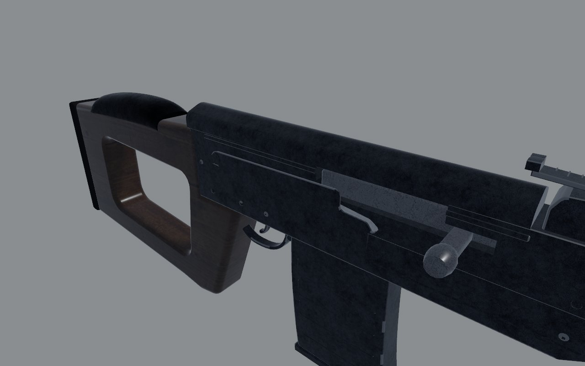
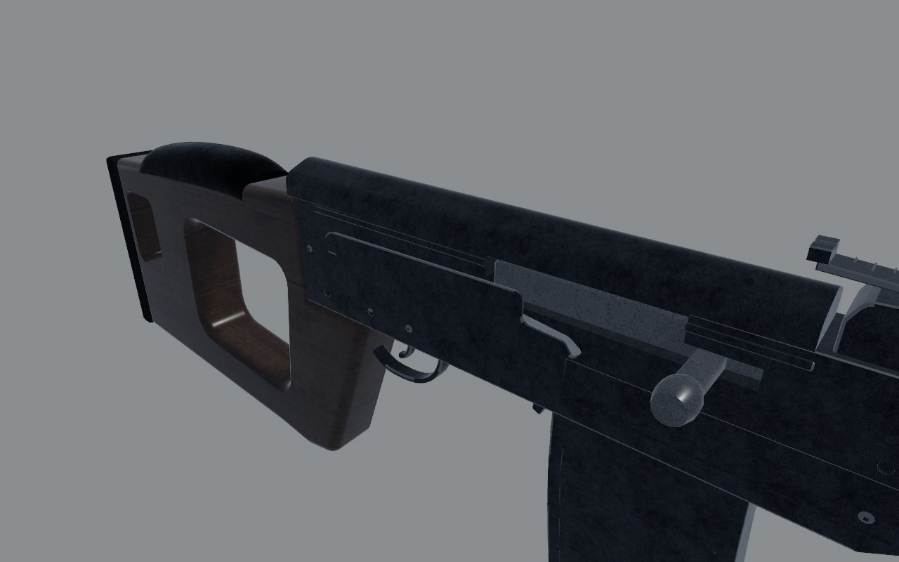
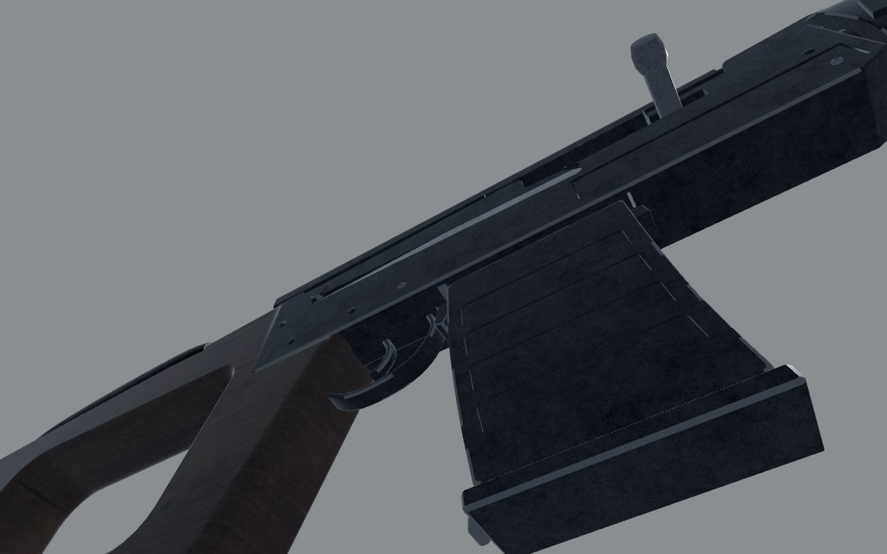
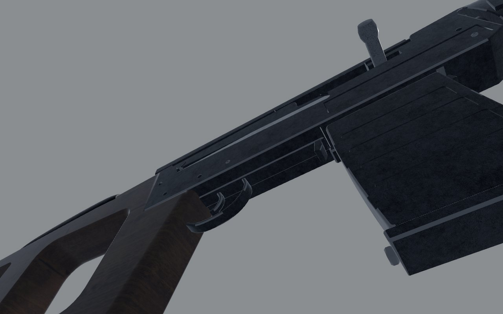
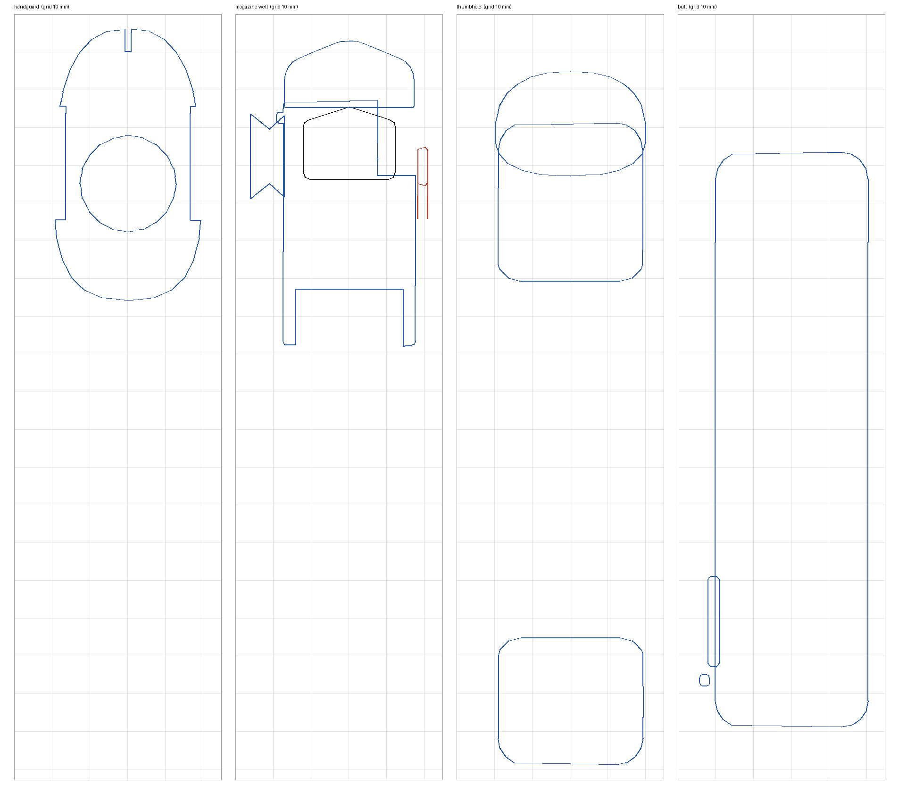
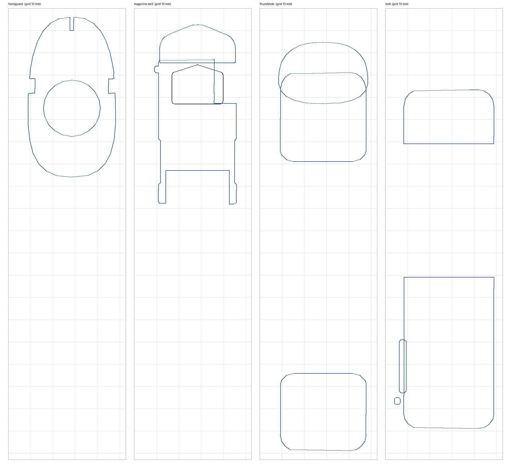

# SVD: fidelity review

The marksman rifle: a laminated skeleton stock and a ten-round magazine.
Reviewed on the bench (`docs/craft/GUNSMITHING.md`) on 1 November 2026.

## Reference

- **Numbers**: 1225 mm without the bayonet, a 620 mm barrel, 4.3 kg with
  the scope (Modern Firearms; the Small Arms Survey's sheet agrees on the
  length and the barrel).
- **Photograph**: Modern Firearms' SVD page has a wooden-stocked rifle from
  the left, muzzle left (`1486290308.jpg`, 850 px). The right side view
  beside it is the same image mirrored. It's copyrighted, so I used it for
  measuring only and it isn't in the repo.
  - **Lengths are trusted.** Scaled to 1225 mm, it puts the flash hider,
    the front sight and the muzzle on the model's within a few
    millimetres.
  - **Heights aren't.** Its flash hider measures 19 mm across, against the
    real one's 23–24, so the image looks squashed vertically by about 0.8.
    Nothing was moved up or down on its say-so.
- **What I know of it**:
  - **Action**: an AK-pattern long receiver, with the scope rail on its
    left.
  - **Magazine**: well ahead of the trigger guard, with its catch just
    behind it.
  - **Gas system**: the gas block stands clear ahead of the handguard,
    with the piston's cylinder running back into it.
  - **Handguard**: wooden, with three cooling slots a side running along
    it.
  - **Stock**: a skeleton, with the thumbhole behind the grip and a
    smaller opening through the butt behind it.

## Shots

The same command was used before and after
(`scripts/gun_bench.sh svd <dir>`): `shots/before/` and `shots/after/`.

| | Before | After |
| - | - | - |
| Right, 1 m |  |  |
| Right, 30 cm |  |  |
| Three-quarter, 30 cm |  |  |
| Under, 30 cm |  |  |

## Sections

The sections are cut with `art/sections.py` on a 10 mm grid, at four
places:

- the handguard at z −0.42;
- the magazine well, at −0.124 before and −0.185 after;
- the thumbhole at 0.1;
- the butt at 0.22.

The butt now shows its opening.

| Before | After |
| - | - |
|  |  |

## Measured

The overlay (`scripts/gun_overlay.py --align butt`) puts the bench's
`level_left` shot over the photograph. Positions are z in gun space, in
metres.

| | Real (photo, scaled) | Before | After |
| - | - | - | - |
| Overall | 1225 | 1227 | 1227 |
| Flash hider, front sight | -0.953 to -0.868, -0.85 | the same | the same |
| Gas block | -0.666 to -0.631, ahead of the handguard | -0.566 to -0.517, against it | -0.666 to -0.617 |
| Handguard | -0.567 to -0.288 | -0.519 to -0.287 | -0.562 to -0.287 |
| Its cooling slots | 3 a side, running along it, at -0.534, -0.479, -0.424 | 6 a side, standing up | 3 a side, along it |
| Magazine | about -0.24 to -0.155; 66 mm clear of the guard | -0.174 to -0.074, against the guard | -0.235 to -0.135 |
| Trigger guard | -0.089 to -0.045 | -0.067 to -0.010 | the same |
| Thumbhole | about 0.04 to 0.15 | 0.041 to 0.201 | 0.045 to 0.162 |
| Opening through the butt | 0.204 to 0.246 | none | 0.205 to 0.245 |

The magazine was also wrong as a mechanism. Its round lay centred on
−0.12, where the bolt's face stops when open, so half of the round was
behind the bolt it feeds from. At −0.185 the round lies between the open
bolt and the chamber.

## Scores

0 is wrong or missing; 1, a person who knows the gun winces; 2, right at a
glance and wrong at 30 cm; 3, right at 30 cm. Sound and feel aren't scored
here (weapon feel owns them).

| Row | Before | After | Notes |
| - | - | - | - |
| Silhouette | 1 | 2 | magazine forward, gas block ahead, the butt's opening; the heights unconfirmed |
| Proportion | 1 | 2 | along the bore, on the photograph's; the stock and handguard may be deep |
| Sections | 2 | 2 | |
| Parts present | 2 | 3 | the butt's opening, the exposed gas cylinder, the catch where it is |
| Parts move | 2 | 2 | carrier, safety lever, trigger |
| Controls | 2 | 2 | |
| Finish | 1 | 1 | near-black (the held finish series lifts it) |
| Wear | 2 | 2 | |
| Edges and making | 2 | 2 | |
| Markings | 1 | 1 | none on the receiver |
| **Total (of 30)** | **16** | **19** | |

## What's still wrong, worst first

1. **Heights unconfirmed**: the model's handguard is 72 mm deep and its
   stock 150 mm at the butt. The photograph, corrected for its squash,
   says about 62 and 140. That wants a photograph whose vertical scale can
   be trusted, or a published height.
2. **No markings** on the receiver: the arsenal's mark, the serial and the
   year.
3. **The cover and the scope rail** have no rivets or clamp detail at
   30 cm.

## What changed

- **`art/guns/svd.py`**:
  - **Magazine well**: moved to −0.185, with its catch just behind it and
    the trigger group's floor running back from there.
  - **Gas block**: moved 100 mm forward, with its cylinder running back
    into the handguard. The front swivel moved with it.
  - **Handguard**: its front is at −0.562, with three slots a side running
    along it.
  - **Stock**: the thumbhole is shorter, and the butt has its opening.
- **`src/weapons/layout.rs`** (`svd()`): the magazine well moved, and the
  handguard's blockout is longer.
- **`src/weapons/sling.rs`**: the front point moved with the gas block.
