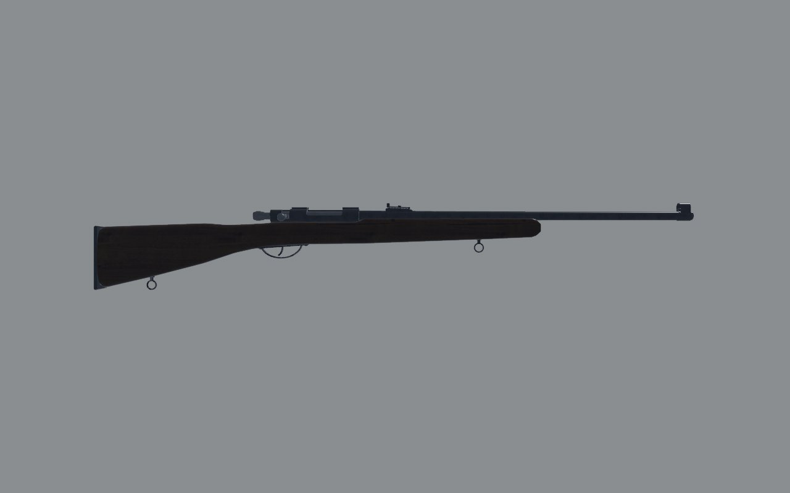
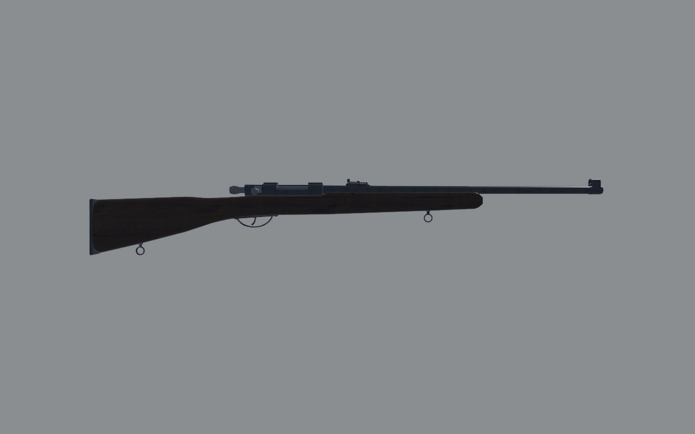
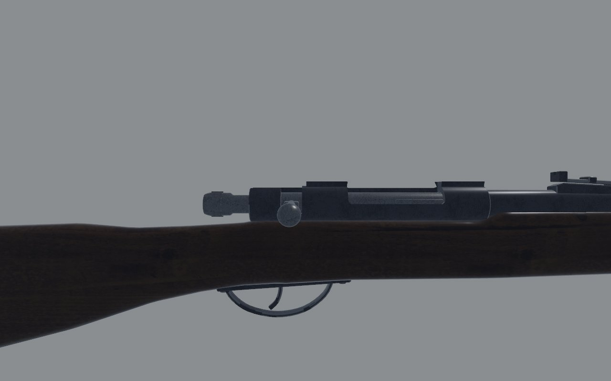
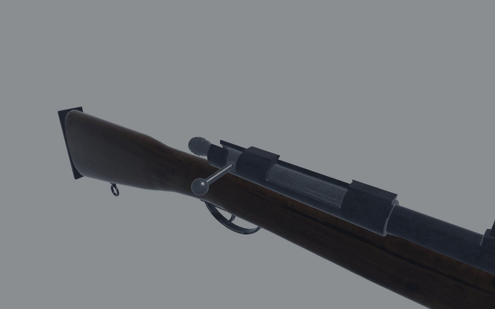

# TOZ-8M: fidelity review

The single-shot .22 club rifle: a turn-bolt, loaded by hand into the trough.
Reviewed on the bench (`docs/craft/GUNSMITHING.md`) on 1 November 2026.

## Reference

- **Numbers**: about 1113 mm overall (the base TOZ-8 is given as 1120), a
  640 mm barrel and about 3.1 kg. These figures are from the Russian
  encyclopedia's TOZ-8 entry and the English Wikipedia's TOZ rifle page.
  The same sources describe the TOZ-8M's birch stock as having a
  semi-pistol-grip wrist.
- **Photographs**: none found to measure. The listings that turned up had
  been taken down, and the encyclopedia's images aren't reachable from
  here. So no overlay: the fix below follows the published numbers.

## Shots

The same command was used before and after
(`scripts/gun_bench.sh toz8 <dir>`): `shots/before/` and `shots/after/`.

| | Before | After |
| - | - | - |
| Right, 1 m |  |  |
| Right, 30 cm |  |  |
| Three-quarter, 30 cm |  |  |

## Measured

| | Real | Before | After |
| - | - | - | - |
| Barrel, from the bolt face | 640 | 670 | 640 |
| Overall | about 1113 | 1143 | 1113 |

## Scores

0 is wrong or missing; 1, a person who knows the gun winces; 2, right at a
glance and wrong at 30 cm; 3, right at 30 cm. Sound and feel aren't scored
here (weapon feel owns them).

| Row | Before | After | Notes |
| - | - | - | - |
| Silhouette | 2 | 2 | not checked against a side view; see the wrist below |
| Proportion | 2 | 3 | barrel and length on the published numbers |
| Sections | 2 | 2 | |
| Parts present | 2 | 2 | |
| Parts move | 3 | 3 | the bolt turns, slides and loads the trough; the trigger |
| Controls | 2 | 2 | |
| Finish | 2 | 2 | blued, rubbed on the edges |
| Wear | 2 | 2 | |
| Edges and making | 2 | 2 | |
| Markings | 1 | 1 | |
| **Total (of 30)** | **20** | **21** | |

## What's still wrong, worst first

1. **The wrist**: the model has a straight wrist, where the sources
   describe a semi-pistol grip on the TOZ-8M. It waits for a photograph to
   measure the grip's drop and its curve against, rather than a guess.
2. **No markings**: the maker's mark, the year and the serial.

## What changed

- **`art/guns/toz8.py`**: the barrel is 30 mm shorter, to 640 mm, and the
  front sight moved with the muzzle.
- **`src/weapons/layout.rs`** (`toz8()`): the muzzle is at −0.81, and the
  blockout's barrel follows.
- **`assets/data/items.ron`** and **`src/capture/scale.rs`**: the box is
  1.115 m, and the scale note gives 1113 mm with the 640 mm barrel.
