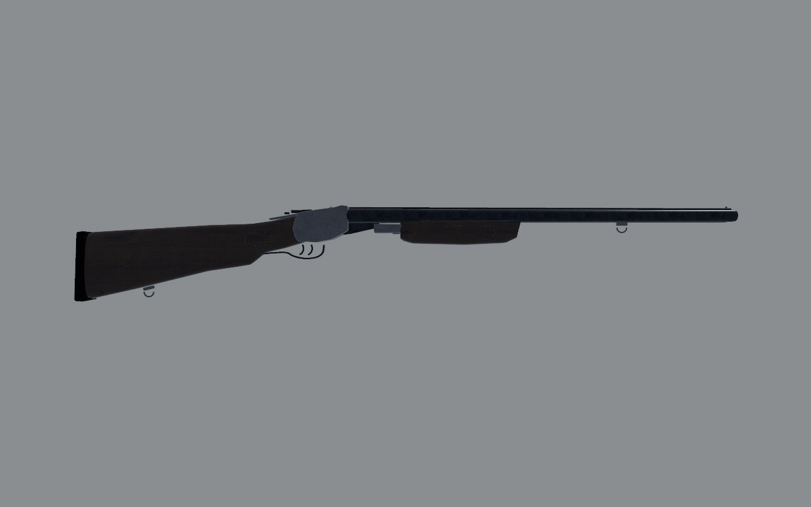
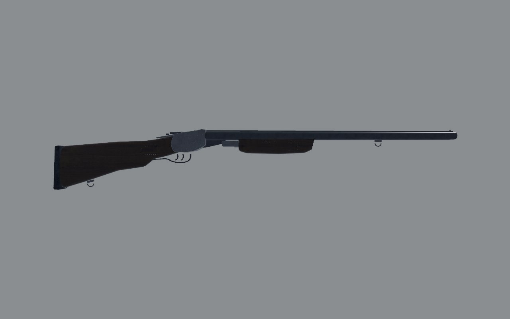
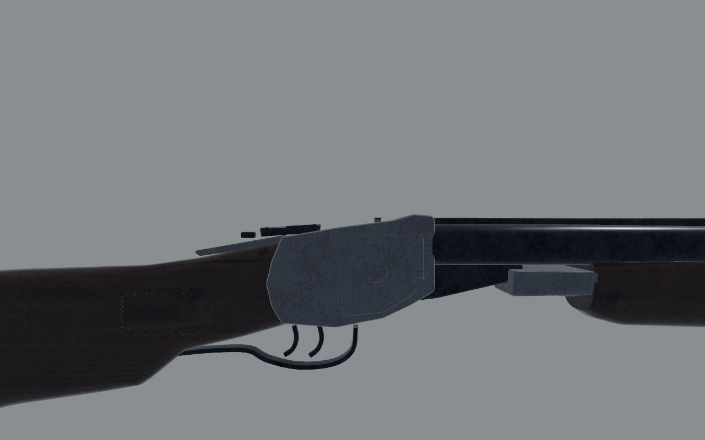
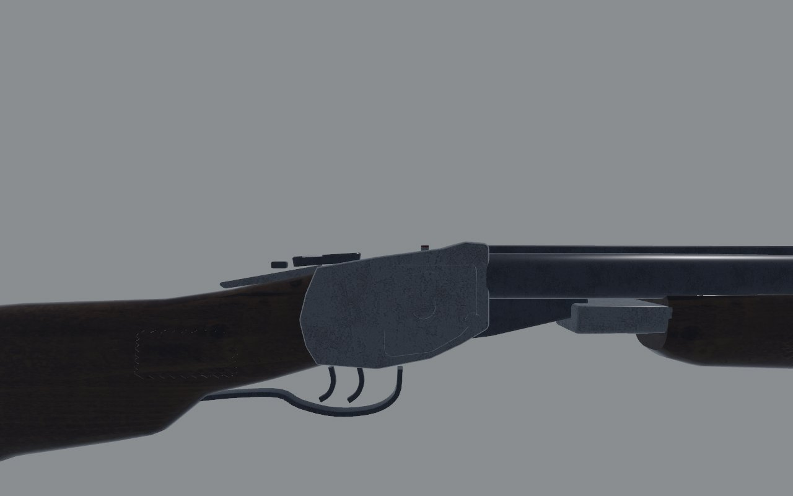
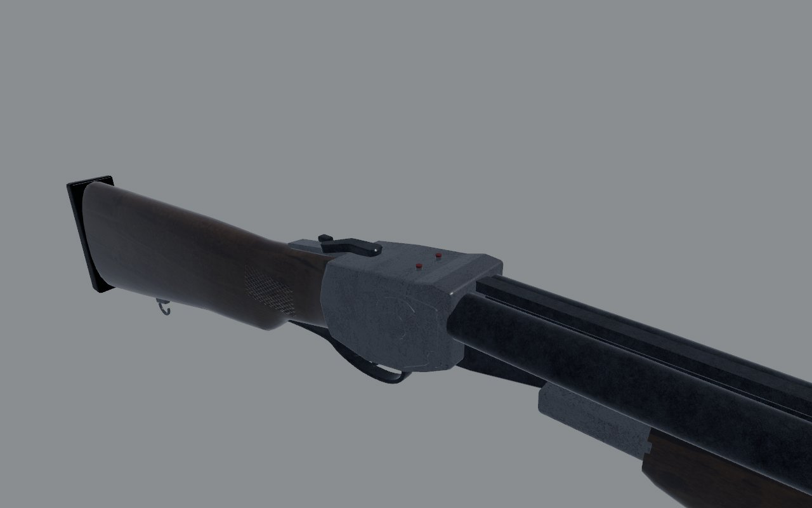
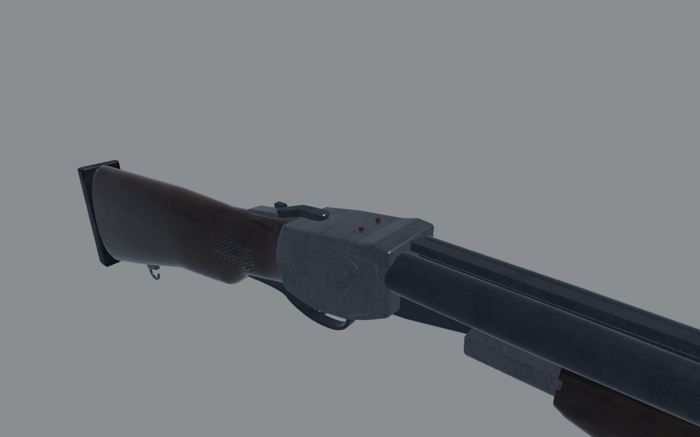

# IZh-43 (`toz_double`): fidelity review

The side-by-side twelve-gauge: a boxlock with double triggers and ejectors.
Reviewed on the bench (`docs/craft/GUNSMITHING.md`) on 1 November 2026.

## Which gun

The catalog and the model are a side-by-side boxlock with double triggers.
That's the Izhevsk IZh-43 (Baikal), the commonest Russian side-by-side
twelve. `capture/scale.rs` called it the TOZ-34, which is an over-under. The
coordinator chose the IZh-43, keeping the model's form and its play.

## Reference

- **Numbers**: 720–725 mm barrels and 3.2–3.3 kg (Wikipedia), and a
  14.25 in (362 mm) length of pull (auction listings of 28.5 in guns).
  IMFDB gives 44.7 in (1135 mm) overall, with the variant unstated; the
  importer quoted about 45 in.
- **Photographs**: Gun Mart's review of the IZh-43 (`gunmart.net`) has
  close views of the action, triggers, muzzles and forend, but no full
  side view. So no overlay: the fixes below come from the published
  numbers. The photographs are copyrighted, so I used them for reference
  only and they aren't in the repo.

## Shots

The same command was used before and after
(`scripts/gun_bench.sh toz_double <dir>`): `shots/before/` and
`shots/after/`.

| | Before | After |
| - | - | - |
| Right, 1 m |  |  |
| Right, 30 cm |  |  |
| Three-quarter, 30 cm |  |  |

## Measured

| | Real | Before | After |
| - | - | - | - |
| Barrels, breech to muzzle | 720-725 | 703.5 | 722 |
| Length of pull, front trigger to the pad | 362 | 420 | 365 |
| Overall | about 1135-1150 | 1196 | 1157 |

## Scores

0 is wrong or missing; 1, a person who knows the gun winces; 2, right at a
glance and wrong at 30 cm; 3, right at 30 cm. Sound and feel aren't scored
here (weapon feel owns them).

| Row | Before | After | Notes |
| - | - | - | - |
| Silhouette | 2 | 2 | not checked against a side view |
| Proportion | 1 | 2 | barrels and pull to the published numbers |
| Sections | 2 | 2 | |
| Parts present | 2 | 2 | top lever, tang safety, both triggers, indicators |
| Parts move | 3 | 3 | the barrels tip at the hinge; the triggers |
| Controls | 2 | 2 | |
| Finish | 1 | 1 | near-black (the finish series lifts it) |
| Wear | 2 | 2 | |
| Edges and making | 2 | 2 | |
| Markings | 1 | 1 | none on the action |
| **Total (of 30)** | **18** | **19** | |

## What's still wrong, worst first

1. **No side view to measure against.** The stock's drop, the forend's
   depth and length, and the action's outline are unchecked. The IZh-43's
   forend is a slim checkered splinter, and the model's looks deeper.
2. **No engraving** on the action's sides: the IZh-43's scrolls.
3. **No markings**: the maker's mark and the gauge on the barrels and
   action.

## What changed

- **`art/guns/toz_double.py`**: the barrels are 722 mm. The butt is 58 mm
  shorter behind the comb's start, with the same drop, so the pull is
  365 mm. The butt pad and rear swivel moved with it.
- **`src/weapons/layout.rs`** (`toz()`): the muzzle is at −0.8385, and the
  blockout's barrels and butt follow.
- **`src/weapons/sling.rs`**: the rear point moved with its swivel.
- **`src/capture/scale.rs`** and **`assets/data/items.ron`**: the labels
  now say IZh-43, not TOZ-34; the stock is 249 mm; the gun's box is
  1.16 m.
