# Marrow Creek: the first job's walk

The career's first job (scout the Old farm), then on to the nearest way out, the Rail yard: 343 m from the truck, in the valley's reference weather (drizzle by day). Walked by the procedure in `docs/craft/WALK_REVIEW.md`; shots from `walk.stills`, stops from `stops.json`.

## Beats

```mermaid
flowchart LR
    s01["s01 0 m<br/>threshold"]
    s01 --> s02["s02 40 m<br/>approach"]
    s02 --> s03["s03 53 m<br/>calm"]
    s03 --> s04["s04 88 m<br/>arrival"]
    s04 --> s05["s05 103 m<br/>arrival"]
    s05 --> s06["s06 123 m<br/>threshold"]
    s06 --> s07["s07 160 m<br/>tension"]
    s07 --> s08["s08 200 m<br/>climb"]
    s08 --> s09["s09 248 m<br/>nothing"]
    s09 --> s10["s10 292 m<br/>discovery"]
    s10 --> s11["s11 320 m<br/>approach"]
    s11 --> s12["s12 343 m<br/>nothing"]
```

## Stops

### s01: 0 m, drop

At (22.0, 148.5), 20.7 m; looking 49 deg along the way, and 132 deg to chimney (59 m).

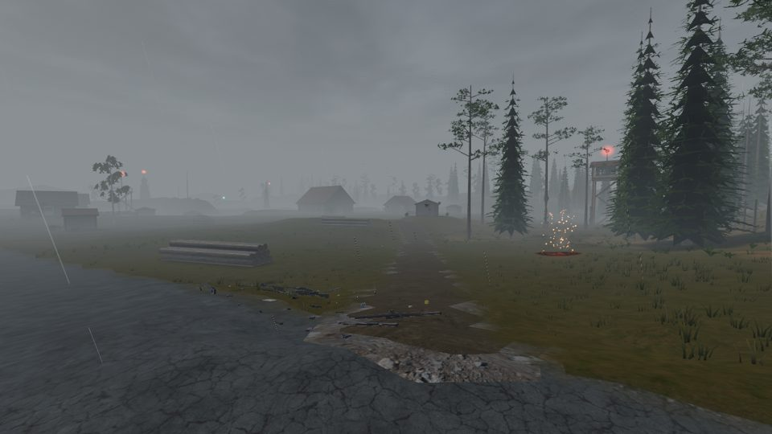 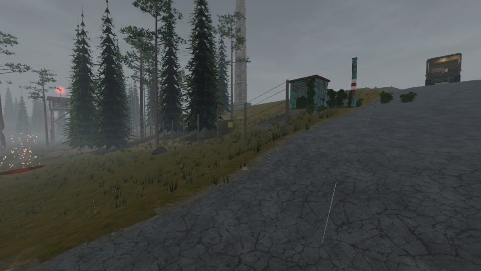

- **Vista.** A farm track runs off the road into flat, misted meadow; three or four roofs float in the haze ahead, a woodpile by the verge. Grey, but it has depth.
- **Draws the eye.** An anomaly sparking in the grass right by the track, 10 m off; behind you the gate, the guard booth and the truck. The lamp on the ranger tower to the right.
- **For.** threshold: The drop: what's this place, and where do I go. The roofs ahead answer the second; the sparks answer the first.

### s02: 40 m, pace

At (52.3, 121.7), 19.2 m; looking 49 deg along the way, and 120 deg to ranger_tower (45 m).

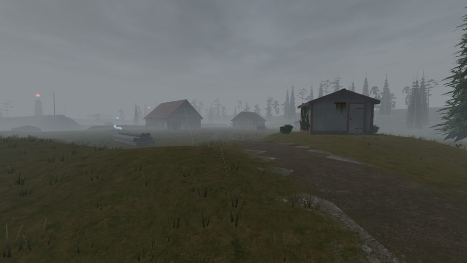 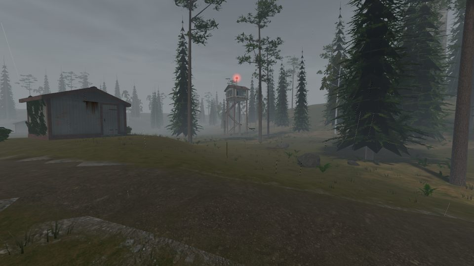

- **Vista.** The farm resolves: a barn and a house in the mist, a shed on a hummock to the right, a tower lamp on the left skyline.
- **Draws the eye.** The shed on its mound, close; the ranger tower's lamp and its stair. Something white glints by the far house.
- **For.** approach: Walking toward the job with it in view; the shed is the first 'could go in there' for a newcomer.

### s03: 53 m, door (shed)

At (61.4, 113.7), 18.7 m; looking 48 deg along the way, and 138 deg to the shed's door.

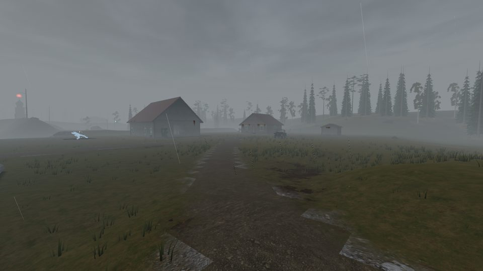 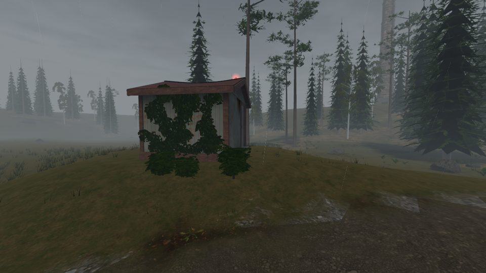

- **Vista.** The barn and house at a middle distance down a muddy track, pines behind. The best composed frame of the walk so far.
- **Draws the eye.** Side: the shed's ivy-covered back wall. Its door faces away from the track, so it reads as a box, not a room.
- **For.** calm: Calm walking; the shed should be the small first discovery, and isn't, because its door is round the back.

### s04: 88 m, fork (Farm lane / Farm track)

At (87.8, 90.0), 18.3 m; looking 48 deg along the way, and 177 deg to ranger_tower (54 m).

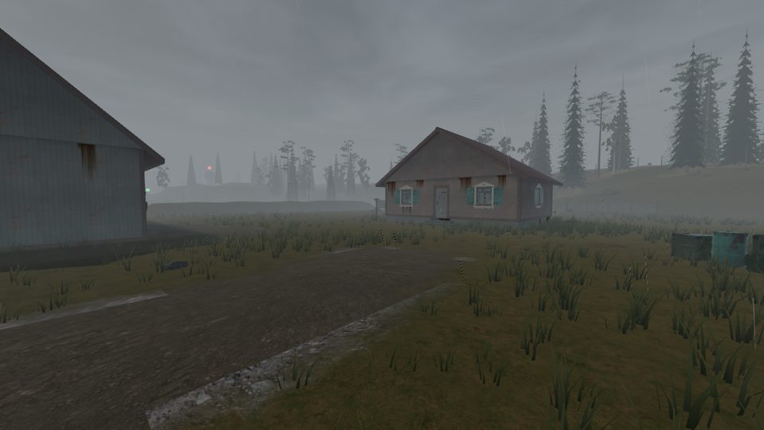 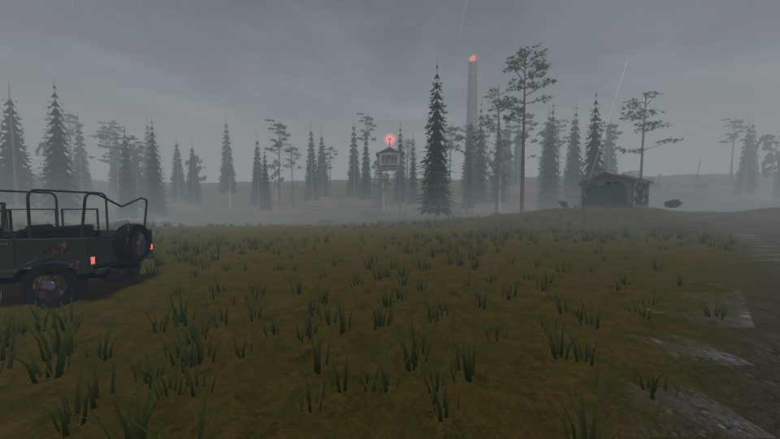

- **Vista.** At the fork the farmhouse with green shutters stands square ahead, the barn's wall filling the left; a proper farmyard frame.
- **Draws the eye.** Side: a jeep with a trailer, the ranger tower and a factory chimney with lamps on them both. Plenty to look at.
- **For.** arrival: Arrival at the farm: this frame is the job's real reveal, 15 m before the job's own point.

### s05: 103 m, job (the career's first (Old farm))

At (99.0, 79.8), 18.2 m; looking 48 deg along the way, and 187 deg to ranger_tower (65 m).

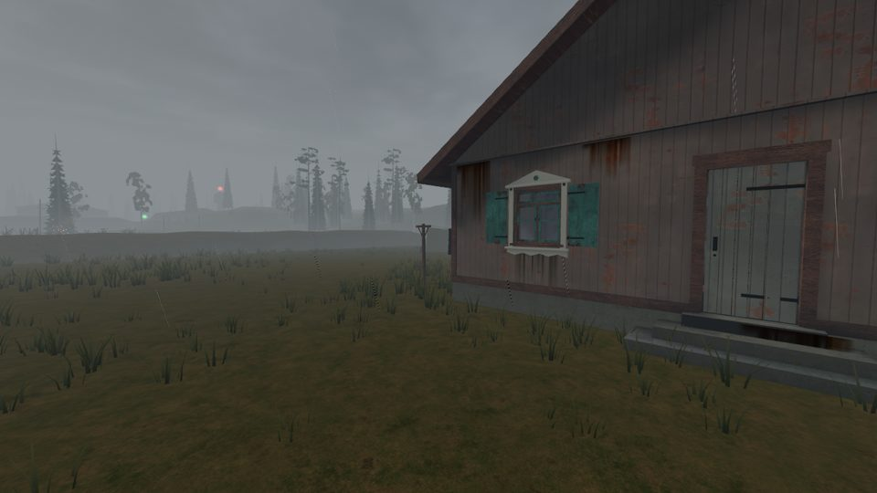 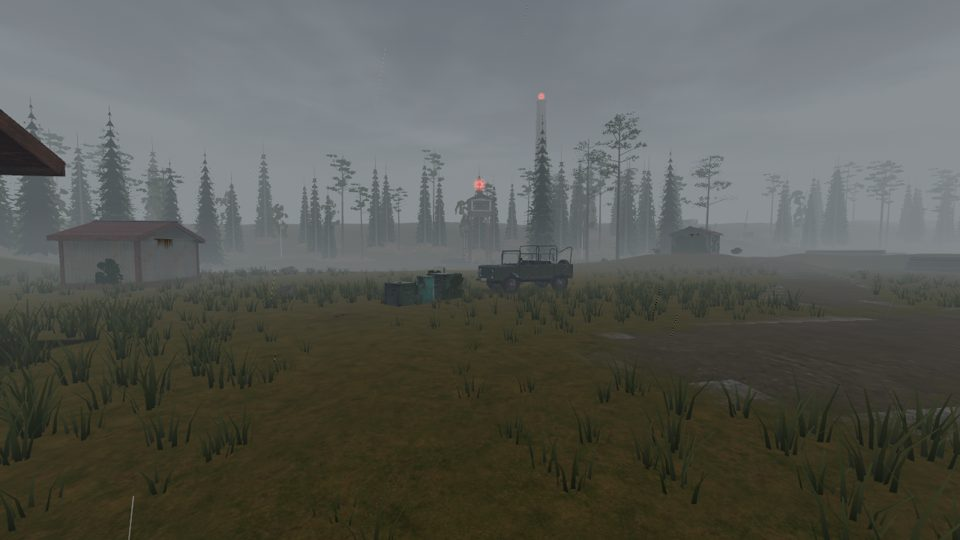

- **Vista.** Arriving, you stand at the farmhouse's corner: its door and shuttered window close on the right, an empty slope and the mist on the left.
- **Draws the eye.** The door, close and plain. Side: the shed and jeep you passed, lamps on the skyline.
- **For.** arrival: 'You're there', the scout job's moment, and half of it works: the door says go in; the empty left half of the frame says nothing.

### s06: 123 m, door (barn)

At (95.1, 59.9), 17.7 m; looking 349 deg along the way, and 260 deg to the barn's door.

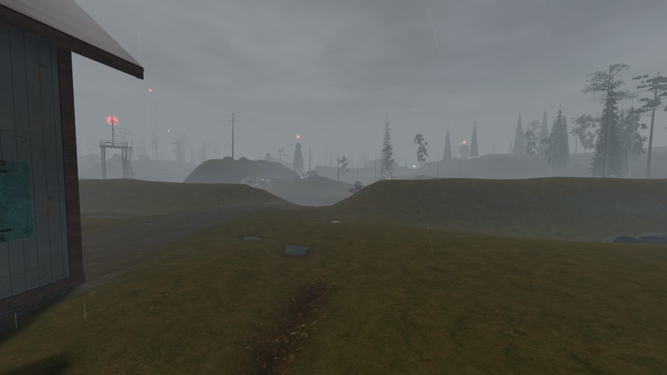 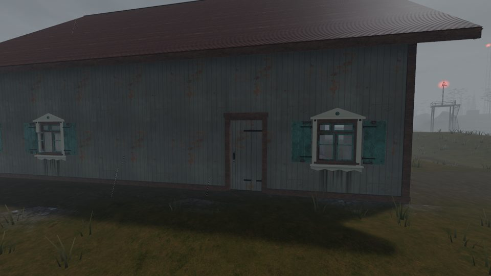

- **Vista.** A cut through a bank with lamps and a mast beyond it: the way on, framed by the farmhouse's corner.
- **Draws the eye.** Side: the farmhouse's door and shuttered windows; the mast to the right.
- **For.** threshold: Leaving the farm: the gap in the bank is a good threshold.

### s07: 160 m, pace

At (97.9, 25.5), 17.5 m; looking 27 deg along the way, and 342 deg to The Hollow (50 m).

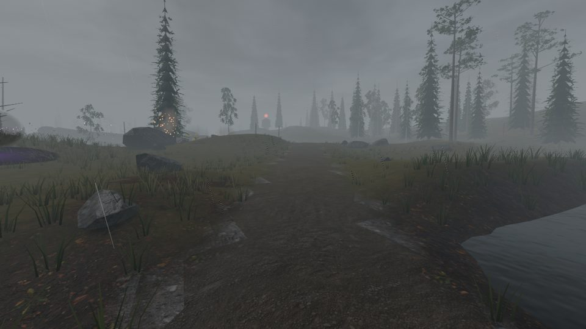 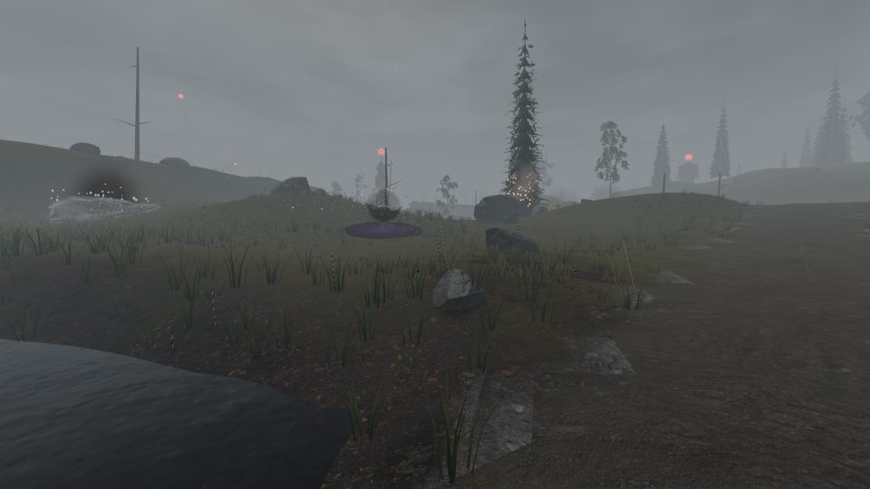

- **Vista.** A low wet hollow: puddle, rocks, a single tall spruce, sparks in the grass.
- **Draws the eye.** Side: the Hollow's anomalies (a burner's sparks, a purple disc), a concrete wall on the rise. It looks wrong, and you want to look closer.
- **For.** tension: Tension: the danger-3 ground you skirt, seen, not entered.

### s08: 200 m, pace

At (116.4, -10.4), 18.6 m; looking 27 deg along the way, and 289 deg to The Hollow (36 m).

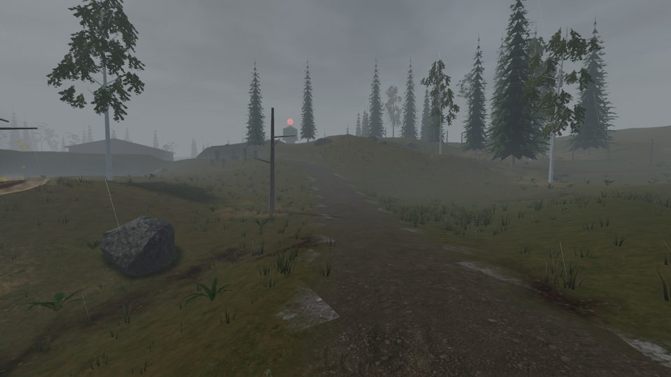 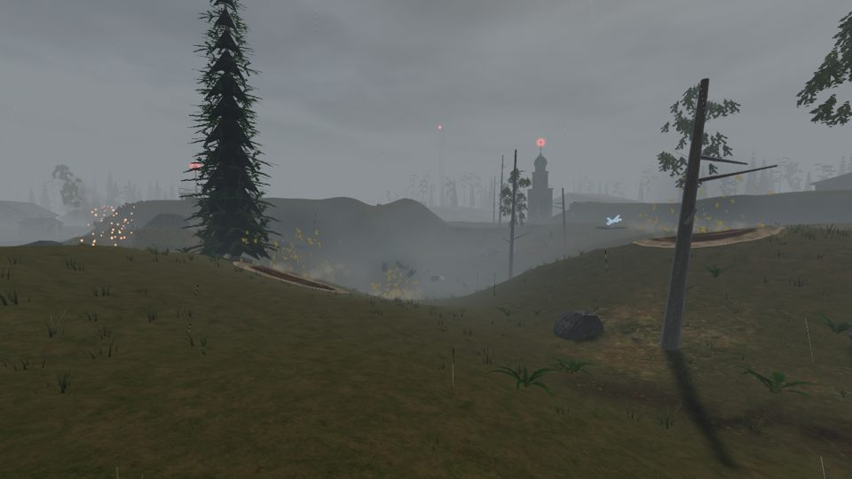

- **Vista.** The path climbs past poles toward roofs on the skyline (the depot), firs either side.
- **Draws the eye.** Side: back down into the Hollow, sparks and a steeple's lamp beyond. A bird lifting.
- **For.** climb: Leaving the danger behind and up; it works.

### s09: 248 m, crest

At (121.0, -55.0), 22.6 m; looking 325 deg along the way, and 28 deg to water_tower (45 m).

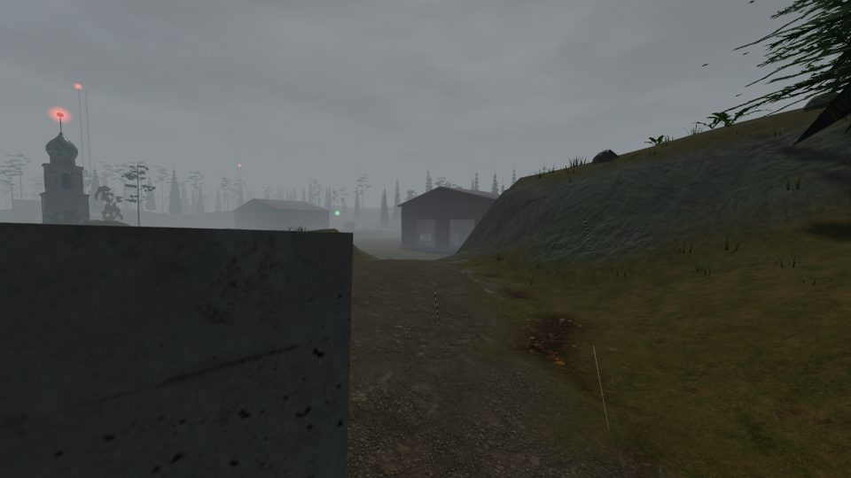 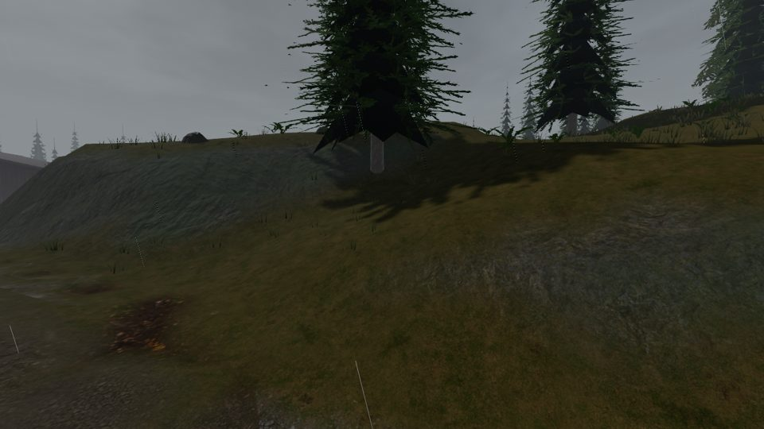

- **Vista.** The crest: a grey concrete block fills the left half of the frame, a grass bank the right. The steeple, a shed and the depot sit in the gap between them.
- **Draws the eye.** Side: the grass bank and a fir, nothing else.
- **For.** nothing: A crest should be a reveal (the rail yard, the way out). This one is a corridor between a block and a bank.

### s10: 292 m, door (rail_shed)

At (98.4, -90.4), 19.8 m; looking 41 deg along the way, and 355 deg to the rail_shed's door.

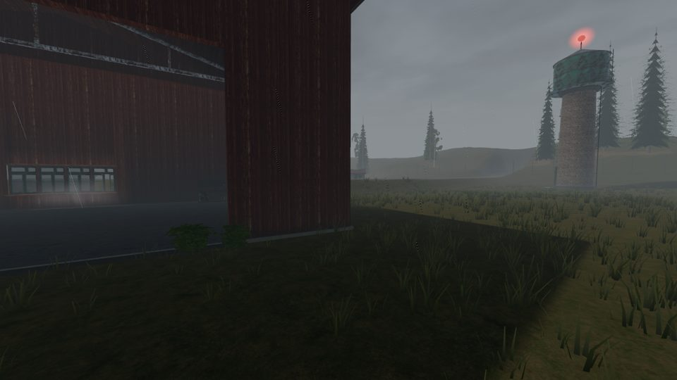 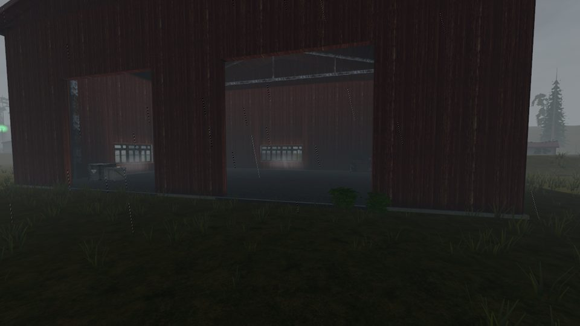

- **Vista.** The rail shed's long wall on the left, the water tower with its lamp on the rise ahead.
- **Draws the eye.** Side: the shed's open doors, lit inside. The best 'go in' of the walk.
- **For.** discovery: A discovery right on the way out: tempting with the clock running.

### s11: 320 m, pace

At (113.5, -113.9), 21.2 m; looking 30 deg along the way, and 270 deg to Rail yard (19 m).

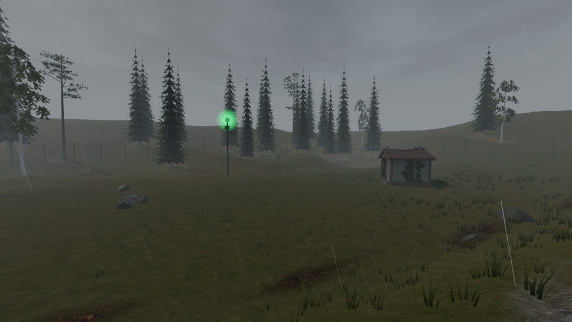 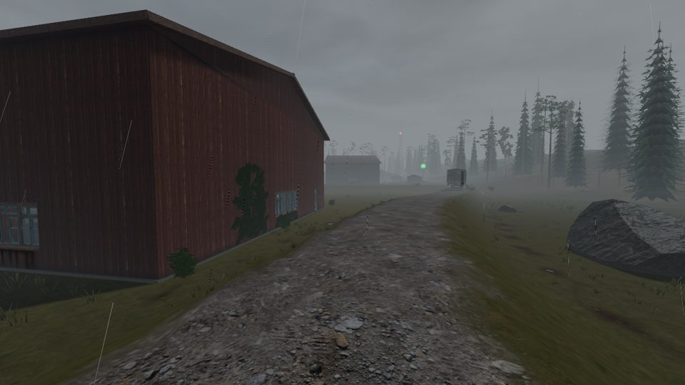

- **Vista.** Open grass to a fence, a green lamp on a post, a small hut: the way out, plainly.
- **Draws the eye.** Side: the shed's red wall down a gravel track to more roofs.
- **For.** approach: The last approach: the green lamp does its job.

### s12: 343 m, rendezvous (Rail yard)

At (125.0, -133.8), 19.8 m; looking 30 deg along the way, and 236 deg to Rail yard (36 m).

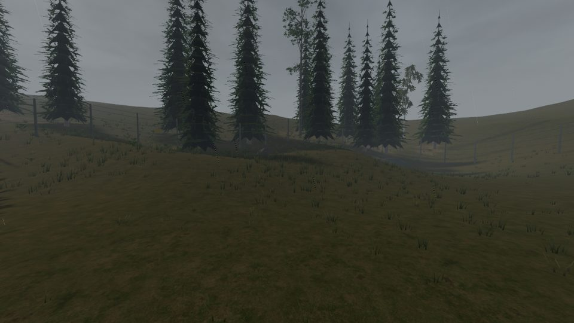 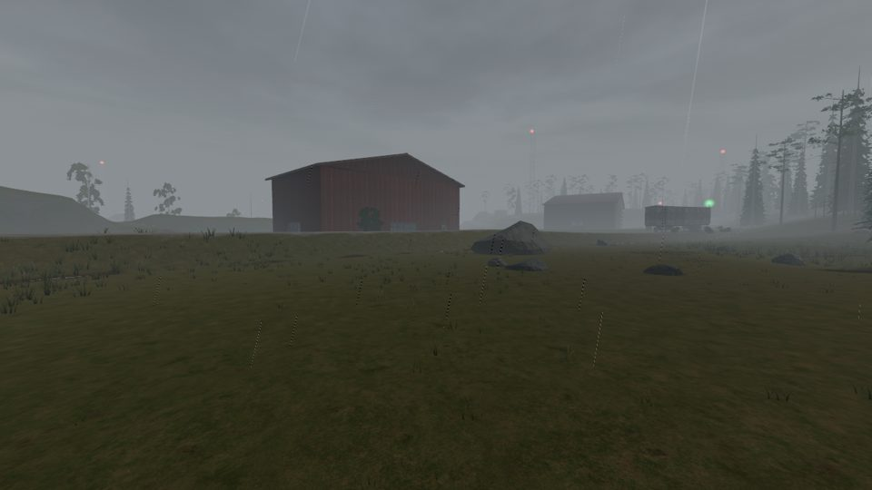

- **Vista.** Arriving the way you came, you face a rise with pines and a fence: no truck, no lamp, no road in frame.
- **Draws the eye.** Side: the rail shed and the depot's sheds in the mist, the green lamp beside them.
- **For.** nothing: It should be relief (I made it). Facing into the trees, it reads as a dead end.

## What's wrong

- Muddy arrival (s05): the job's point is at the farmhouse's corner, with an empty slope beside it. The farm's best frame is 15 m earlier at the fork (s04); the job should be there, or the slope should have a subject.
- A crest with no reveal (s09): the climb out of the Hollow ends between a concrete block and a grass bank. It's the walk's one rise and it shows nothing.
- A rendezvous facing into trees (s12): the last stop of the first raid has no subject ahead. The way out should read as a place: the truck's road, a lamp, an opening.
- A discovery facing away (s03): the shed by the track has its door round the back.
- Dead stretch: none. Calm, arrival, threshold, tension, climb, discovery: the walk alternates. It has three 'nothing' moments, at the job, the crest and the end.
