# Rime Fell: the first job's walk

T
h
e
 
c
a
r
e
e
r
'
s
 
f
i
r
s
t
 
j
o
b
 
i
n
 
R
i
m
e
 
(
p
l
a
n
t
 
t
h
e
 
s
u
r
v
e
y
 
k
i
t
 
a
t
 
t
h
e
 
o
b
s
e
r
v
a
t
o
r
y
,
 
u
p
_
t
h
e
_
f
e
l
l
)
,
 
t
h
e
n
 
o
n
 
t
o
 
t
h
e
 
n
e
a
r
e
s
t
 
w
a
y
 
o
u
t
,
 
t
h
e
 
s
a
d
d
l
e
:
 
9
1
9
 
m
 
i
n
 
a
l
l
,
 
i
n
 
t
h
e
 
v
a
l
l
e
y
'
s
 
r
e
f
e
r
e
n
c
e
 
w
e
a
t
h
e
r
 
(
s
n
o
w
 
a
b
o
v
e
 
t
h
e
 
l
i
n
e
)
.
 
W
a
l
k
e
d
 
a
g
a
i
n
 
o
n
 
5
 
N
o
v
 
o
n
 
t
h
e
 
v
a
l
l
e
y
 
a
s
 
i
t
 
s
t
a
n
d
s
 
(
t
h
e
 
f
i
r
s
t
 
w
a
l
k
,
 
4
 
N
o
v
,
 
i
s
 
i
n
 
g
i
t
:
 
c
3
9
f
0
0
4
c
,
 
w
i
t
h
 
i
t
s
 
f
i
x
e
s
 
i
n
 
6
7
6
7
5
c
9
5
 
a
n
d
 
i
t
s
 
a
f
t
e
r
s
 
i
n
 
f
i
x
e
s
/
)
.
 
W
a
l
k
e
d
 
b
y
 
t
h
e
 
p
r
o
c
e
d
u
r
e
 
i
n
 
d
o
c
s
/
c
r
a
f
t
/
W
A
L
K
_
R
E
V
I
E
W
.
m
d
;
 
s
h
o
t
s
 
f
r
o
m
 
w
a
l
k
.
s
t
i
l
l
s
,
 
s
t
o
p
s
 
f
r
o
m
 
s
t
o
p
s
.
j
s
o
n
.

## Beats

```mermaid
flowchart LR
    s01["s01 0 m<br/>threshold"]
    s01 --> s02["s02 40 m<br/>approach"]
    s02 --> s03["s03 61 m<br/>choice"]
    s03 --> s04["s04 80 m<br/>reveal"]
    s04 --> s05["s05 120 m<br/>climb"]
    s05 --> s06["s06 160 m<br/>climb"]
    s06 --> s07["s07 200 m<br/>climb"]
    s07 --> s08["s08 240 m<br/>climb"]
    s08 --> s09["s09 284 m<br/>reveal"]
    s09 --> s10["s10 321 m<br/>discovery"]
    s10 --> s11["s11 360 m<br/>threshold"]
    s11 --> s12["s12 378 m<br/>calm"]
    s12 --> s13["s13 400 m<br/>approach"]
    s13 --> s14["s14 425 m<br/>discovery"]
    s14 --> s15["s15 440 m<br/>calm"]
    s15 --> s16["s16 480 m<br/>approach"]
    s16 --> s17["s17 501 m<br/>choice"]
    s17 --> s18["s18 520 m<br/>calm"]
    s18 --> s19["s19 556 m<br/>nothing"]
    s19 --> s20["s20 600 m<br/>nothing"]
    s20 --> s21["s21 640 m<br/>approach"]
    s21 --> s22["s22 673 m<br/>approach"]
    s22 --> s23["s23 690 m<br/>calm"]
    s23 --> s24["s24 704 m<br/>nothing"]
    s24 --> s25["s25 720 m<br/>nothing"]
    s25 --> s26["s26 760 m<br/>reveal"]
    s26 --> s27["s27 805 m<br/>arrival"]
    s27 --> s28["s28 833 m<br/>calm"]
    s28 --> s29["s29 880 m<br/>approach"]
    s29 --> s30["s30 919 m<br/>relief"]
```

## Stops

### s01: 0 m, drop

At (-10.0, 266.0), 51.7 m; looking 57 deg along the way, and 341 deg to Hairpin hut (123 m).

 

- **Vista.** Wet moor, a turf hump, roofs and the water tower's lamp in the mist; spruce on the skyline.
- **Draws the eye.** Side: the Hairpin hut's bench and the stream bed.
- **For.** threshold: threshold: The drop: a village up ahead in the murk.

### s02: 40 m, pace

At (23.7, 243.7), 53.9 m; looking 57 deg along the way, and 106 deg to water_tower (90 m).

 

- **Vista.** A shuttered house close on the right, the station's long roof on the rise.
- **Draws the eye.** Side: the house's front, lit windows.
- **For.** approach: approach: Walking into the lower village.

### s03: 61 m, fork (Lorry road / Station lane)

At (40.6, 232.6), 55.0 m; looking 46 deg along the way, and 117 deg to water_tower (78 m).

 

- **Vista.** The lorry road and the lane parting; a house on the knoll.
- **Draws the eye.** Side: the station's end, the water tower's lamp beyond.
- **For.** choice: choice: Two ways shown; the rise is the one with roofs.

### s04: 80 m, pace

At (52.6, 218.6), 57.4 m; looking 23 deg along the way, and 131 deg to water_tower (76 m).

 

- **Vista.** The valley station square on, its veranda and windows.
- **Draws the eye.** Side: the slope down to the mill's mist.
- **For.** reveal: reveal: The funicular's foot: where you're going is up.

### s05: 120 m, pace

At (61.4, 180.0), 65.2 m; looking 1 deg along the way, and 182 deg to Valley station (45 m).

 

- **Vista.** The funicular's rails and steps up the hill, the chimney on top.
- **Draws the eye.** Side: the station behind, a lone spruce.
- **For.** climb: climb: The line drawn for you, a goal at the top.

### s06: 160 m, pace

At (62.3, 140.0), 72.5 m; looking 1 deg along the way, and 182 deg to Valley station (85 m).

 

- **Vista.** Up the rails, the stopped car on the line, the chimney.
- **Draws the eye.** Side: the station shrinking in the mist.
- **For.** climb: climb: Something to reach: the car.

### s07: 200 m, pace

At (61.2, 100.0), 79.9 m; looking 355 deg along the way, and 314 deg to chimney (86 m).

 

- **Vista.** The cutting: snow starts at its lip, the top station's lamp.
- **Draws the eye.** Side: the chimney over the snow bank.
- **For.** climb: climb: Snow begins: the valley changes under you.

### s08: 240 m, pace

At (58.3, 61.0), 86.4 m; looking 356 deg along the way, and 290 deg to chimney (62 m).

 

- **Vista.** A snow cutting, the top station's roofs and lamp ahead.
- **Draws the eye.** Side: the cutting's wall (a blind side, fine on a climb).
- **For.** climb: climb: Nearly up; the cutting frames the top.

### s09: 284 m, fork (Coldharbour street / Funicular)

At (55.1, 17.0), 93.7 m; looking 291 deg along the way, and 47 deg to Top station (18 m).

 

- **Vista.** Topping out: Coldharbour's roofs, the chimney, rocks in the snow.
- **Draws the eye.** Side: the top station's tower and lamp, its platform steps.
- **For.** reveal: reveal: A village on the fell.

### s10: 321 m, door (house_brick)

At (20.7, 7.1), 93.6 m; looking 283 deg along the way, and 7 deg to the house_brick's door.

 

- **Vista.** A brick house's corner close on.
- **Draws the eye.** Side: its door, lit, the steps.
- **For.** discovery: discovery: Coldharbour's first house; go in.

### s11: 360 m, pace

At (7.5, -18.0), 96.3 m; looking 4 deg along the way, and 225 deg to Coldharbour (53 m).

 

- **Vista.** The col track over the white, the Col track sign and a boulder, huts on the brow.
- **Draws the eye.** Side: the chimney and Coldharbour's houses.
- **For.** threshold: threshold: Leaving the village: the sign says where.

### s12: 378 m, fork (Col track / Tram bed)

At (8.2, -35.0), 98.9 m; looking 354 deg along the way, and 215 deg to Coldharbour (67 m).

 

- **Vista.** A white bank, a hut and rubble on the skyline.
- **Draws the eye.** Side: the village behind, the chimney's lamp.
- **For.** calm: calm: A breath after the village.

### s13: 400 m, pace

At (4.5, -56.7), 102.5 m; looking 342 deg along the way, and 204 deg to Coldharbour (84 m).

 

- **Vista.** Huts on the brow, a fence, the snow survey hut's lamp.
- **Draws the eye.** Side: Coldharbour and a red-and-white pole.
- **For.** approach: approach: The poles start; a hut to make for.

### s14: 425 m, door (shed)

At (-3.2, -80.7), 107.0 m; looking 342 deg along the way, and 77 deg to the shed's door.

 

- **Vista.** The refuge shed, the avalanche watch tower's lamp far off.
- **Draws the eye.** Side: the refuge's door, square on.
- **For.** discovery: discovery: A roof halfway over the white.

### s15: 440 m, pace

At (-7.8, -95.2), 109.6 m; looking 21 deg along the way, and 269 deg to Snow survey hut (17 m).

 

- **Vista.** Log piles, poles, the tower ahead.
- **Draws the eye.** Side: the snow survey hut and its lamp.
- **For.** calm: calm: On the poles, the tower to steer by.

### s16: 480 m, pace

At (11.6, -128.6), 115.4 m; looking 35 deg along the way, and 227 deg to Snow survey hut (50 m).

 

- **Vista.** The avalanche watch tower and its lamp on the rise, a pole.
- **Draws the eye.** Side: the chimney behind, logs.
- **For.** approach: approach: A subject ahead at last.

### s17: 501 m, fork (Col track / Gate track)

At (22.6, -145.9), 118.4 m; looking 337 deg along the way, and 57 deg to Avalanche watch (44 m).

 

- **Vista.** A pole, the col fork sign at the edge, the tower.
- **Draws the eye.** Side: the sign square on, the tower behind it.
- **For.** choice: choice: The gate track leaves; the sign says the col is ahead.

### s18: 520 m, pace

At (15.1, -163.6), 120.8 m; looking 337 deg along the way, and 82 deg to Avalanche watch (45 m).

 

- **Vista.** A white bank, a pole and a rock.
- **Draws the eye.** Side: the tower close.
- **For.** calm: calm: On the poles under the tower.

### s19: 556 m, fork (Col track / Saddle track)

At (1.3, -196.1), 125.2 m; looking 337 deg along the way, and 21 deg to The col (52 m).

 

- **Vista.** Flat white, a sign speck, rocks; the poles go on to the col, out of frame.
- **Draws the eye.** Side: white, a few rocks.
- **For.** nothing: nothing: The saddle track leaves the poles here, unmarked: the way to the job goes white.

### s20: 600 m, pace

At (-26.2, -229.3), 130.2 m; looking 311 deg along the way, and 71 deg to The col (49 m).

 

- **Vista.** Rocks and a big boulder in the snow, a fence, deer far off.
- **Draws the eye.** Side: white, a hut speck.
- **For.** nothing: nothing: Off the poles; something alive, nothing to steer by.

### s21: 640 m, pace

At (-58.8, -251.2), 133.9 m; looking 283 deg along the way, and 95 deg to The col (79 m).

 

- **Vista.** White slope, a fence and the saddle's green lamp small.
- **Draws the eye.** Side: rocks and a hut speck.
- **For.** approach: approach: The saddle's beacon the only lead.

### s22: 673 m, fork (Miners' path / Saddle track)

At (-91.3, -258.6), 135.7 m; looking 283 deg along the way, and 182 deg to The bivouac (91 m).

 

- **Vista.** The saddle's hut, its fence and green lamp.
- **Draws the eye.** Side: white, rocks.
- **For.** approach: approach: The saddle reached; the job beyond.

### s23: 690 m, door (shed)

At (-107.1, -262.1), 136.6 m; looking 270 deg along the way, and 14 deg to the shed's door.

 

- **Vista.** The beacon's lamp, the fence, log piles.
- **Draws the eye.** Side: the shed's door and its logs.
- **For.** calm: calm: The rendezvous: the way out is here.

### s24: 704 m, fork (Observatory path / Saddle track)

At (-121.0, -262.2), 137.1 m; looking 265 deg along the way, and 164 deg to The bivouac (98 m).

 

- **Vista.** Rocks, the observatory a grey block with its red lamp, faint on the brow; the fence pulls the eye right.
- **Draws the eye.** Side: the beacon's post filling the frame.
- **For.** nothing: nothing: The observatory path leaves; the job is a smudge, nothing carries you to it.

### s25: 720 m, pace

At (-137.0, -260.8), 138.1 m; looking 265 deg along the way, and 82 deg to The saddle (22 m).

 

- **Vista.** A white bank, the fence.
- **Draws the eye.** Side: the beacon lamp, the hut.
- **For.** nothing: nothing: Climbing blind: the brow hides the job.

### s26: 760 m, pace

At (-171.6, -245.9), 144.4 m; looking 224 deg along the way, and 72 deg to The saddle (59 m).

 

- **Vista.** The observatory on the brow, its lamp, rocks.
- **Draws the eye.** Side: the fence back down.
- **For.** reveal: reveal: The job on the fell's top.

### s27: 805 m, job (plant (up_the_fell: The observatory))

At (-189.0, -227.6), 146.2 m; looking 224 deg along the way, and 64 deg to The saddle (82 m).

 

- **Vista.** The observatory square on, its door ahead, the mast and dome over it.
- **Draws the eye.** Side: the saddle below, its lamp.
- **For.** arrival: arrival: You're there, facing the door.

### s28: 833 m, crest

At (-195.0, -239.0), 149.2 m; looking 65 deg along the way, and 204 deg to The observatory (32 m).

 

- **Vista.** White slope, the fence, the beacon's lamp below.
- **Draws the eye.** Side: the observatory behind.
- **For.** calm: calm: Turning for home.

### s29: 880 m, pace

At (-152.1, -258.8), 141.8 m; looking 75 deg along the way, and 229 deg to The observatory (74 m).

 

- **Vista.** The saddle's green lamp and the fence.
- **Draws the eye.** Side: a boulder, the observatory's lamp behind.
- **For.** approach: approach: Home in sight.

### s30: 919 m, rendezvous (The saddle)

At (-115.0, -264.0), 136.9 m; looking 79 deg along the way, and 168 deg to The bivouac (98 m).

 

- **Vista.** The saddle's hut and benches by the track.
- **Draws the eye.** Side: rocks in the snow.
- **For.** relief: relief: Arrived.

## What's wrong

- A strong first third, as before: the station, the funicular climb into the snow, Coldharbour at the top.
- The 4 Nov dead stretch after Coldharbour (s11 to s18) is alive now: the col track sign, the refuge, the snow poles, the snow survey hut and the avalanche watch tower each give a frame a subject. It reads as calm, approach, discovery, calm.
- Weakest now, in order: the col fork (s19), where the poles go on to the col and the way to the job turns off them into the white; the saddle track after it (s20, s21), off the poles with only the saddle's lamp to steer by; and the observatory path's foot and climb (s24, s25), where the job is a grey smudge on the brow and the fence pulls the eye the other way.
- The arrival is good now (s27): the observatory square on, its door ahead (the 4 Nov fix).
- Side view at s24 is the saddle beacon's post in your face: the beacon stands 7 m off the rendezvous, which is where the observatory path forks. It's a stop camera's frame, not a walker's: noted, not moved.
- Night, with the hand torch (6 Nov, HOUR=night): the lower valley reads by its rooflines and the funicular's rails; Coldharbour by its lamps. Above it the torch lights only the snow at your feet and the snow poles are gone: you steer by the rendezvous beacons (green), the avalanche watch's red lamp and Coldharbour behind. Reflectors on the poles would carry the line after dark (a material and model change, asked of World models). The observatory's door is unlit; its way home has a yard lamp (dd59ca5d).
- Cold, from extraction_core::cold along this route (cold 1.0, snow line 84 m): at a looking-about pace (1.4 m/s) with no stops a newcomer shivers from 430-550 m (past Coldharbour) and reaches the observatory frozen through (stamina capped at 0.45), worse in falling snow or at night; at 2.4 m/s by day, chill 0.5 at the job. A roof every 250 m or less (track refuge 425 m, snow survey hut 440 m, saddle refuge 690 m, the observatory 805 m), and 50 s under one warms you through; the col track's signs name the refuge. A pressure with a plain answer, not a stall.

## Fixes

Before on the left, after on the right.

### 1. The col fork says where the job is (s19)

Framing: a sign at the fork, square to whoever comes up the col track (rot 337, the way they're heading), so it stands in the way-ahead frame: THE OBSERVATORY and THE SADDLE, left; THE COL, right; poles both ways. The old Coldharbour sign's 'keep the poles on your left' is true both ways now.

 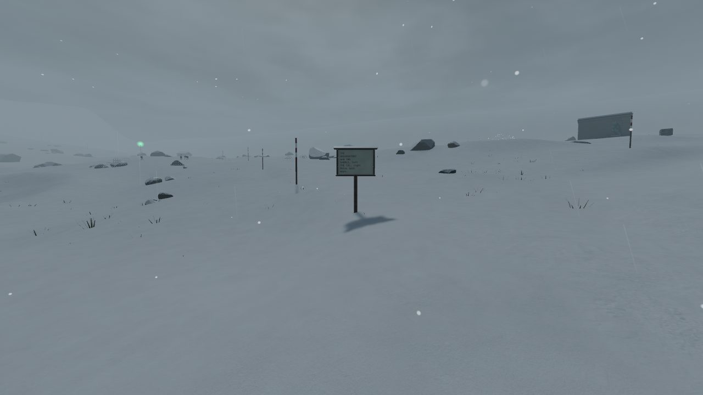

### 2. The poles go on along the saddle track (s20 to s22)

Scenery: the snow pole line continues from the fork to the saddle, every 20 to 30 m on the walker's left, set off the probed route (3 m) so it follows the road as it's graded. One moved off the outcrop at (-51.9, -242.0) (rocks::every_outcrop_stands) and none by the saddle shed's door.

 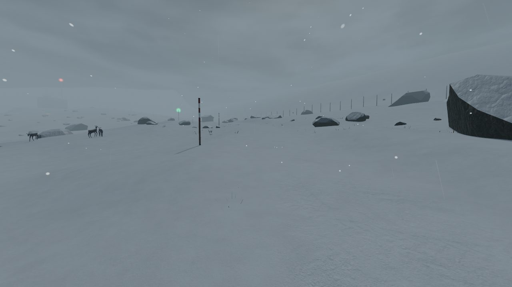

### 3. And up the observatory path (s24, s25)

Scenery: four poles from the saddle up the observatory path. From its foot the first pole marks where the path leaves; on the climb they line up under the observatory's red lamp and lead the eye to the brow, where the job is.

 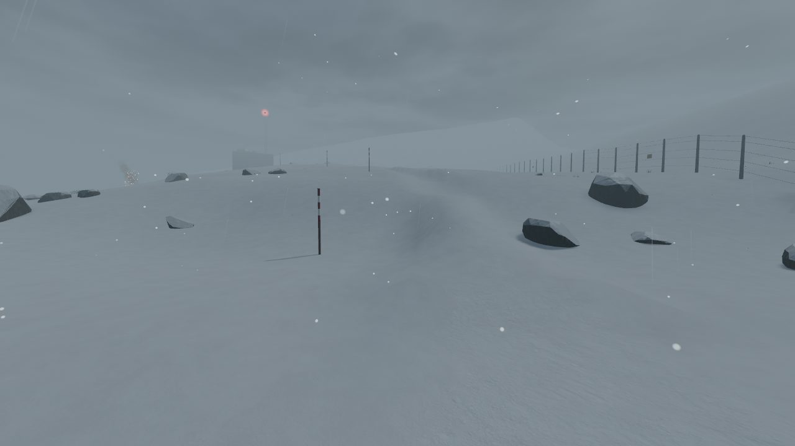
 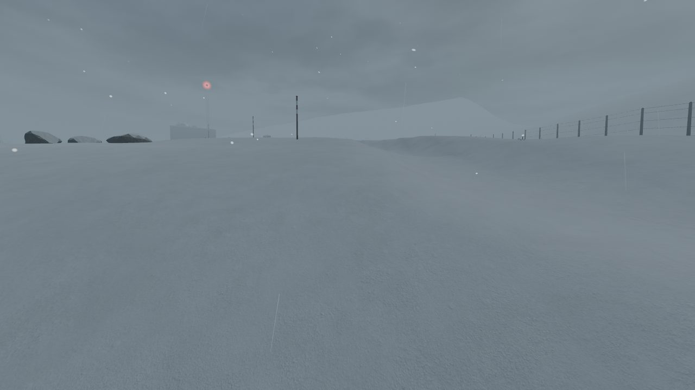

### 4. A lamp at the saddle fork, for the way out after dark (s18, s19)

At night the saddle fork sign was an unlit shape and the poles were gone. A way_lamp beside the sign: from s18 its light is a point ahead, and at the fork the sign stands lit in its pool.

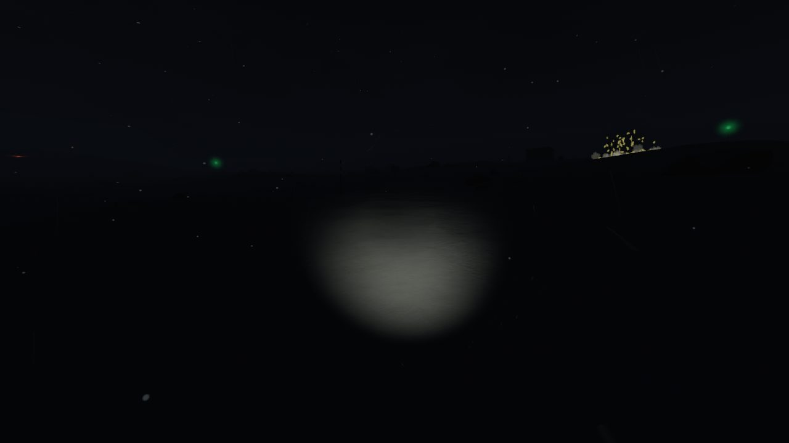 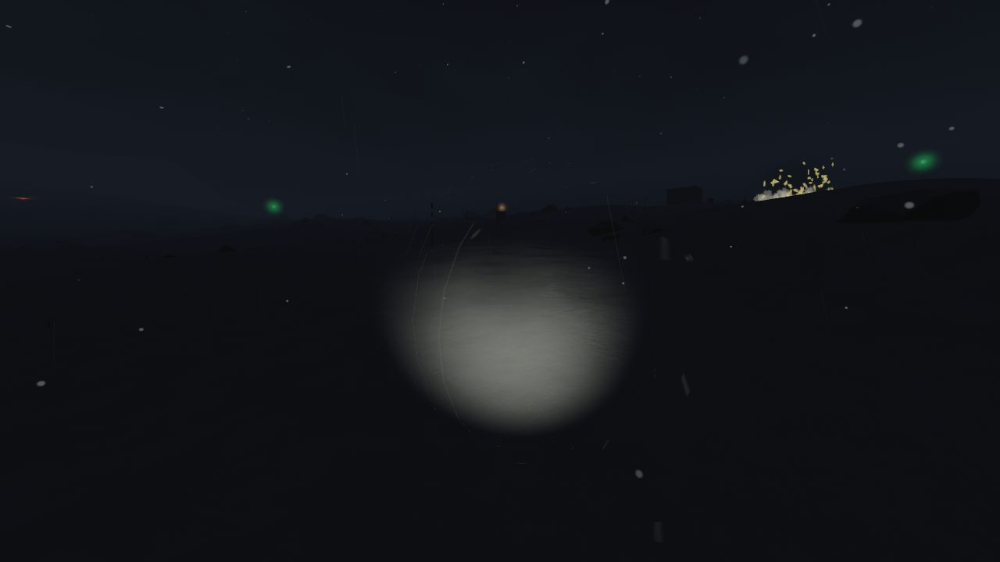
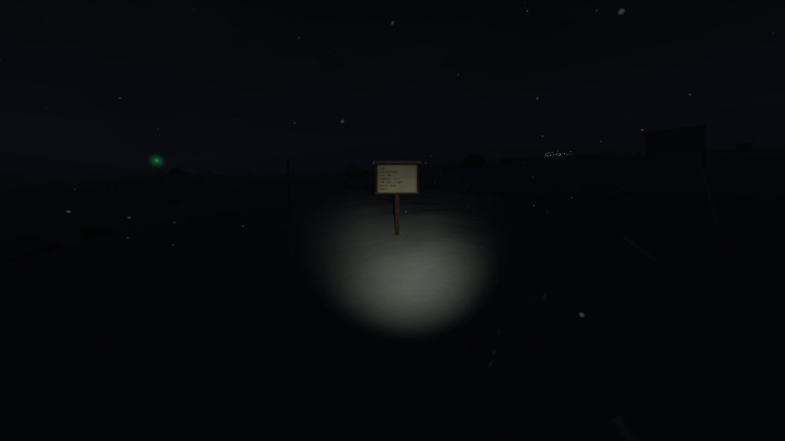 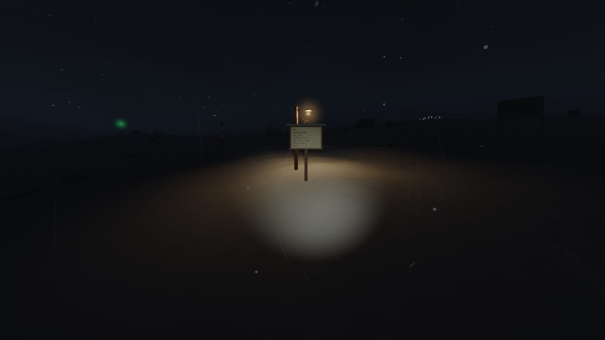
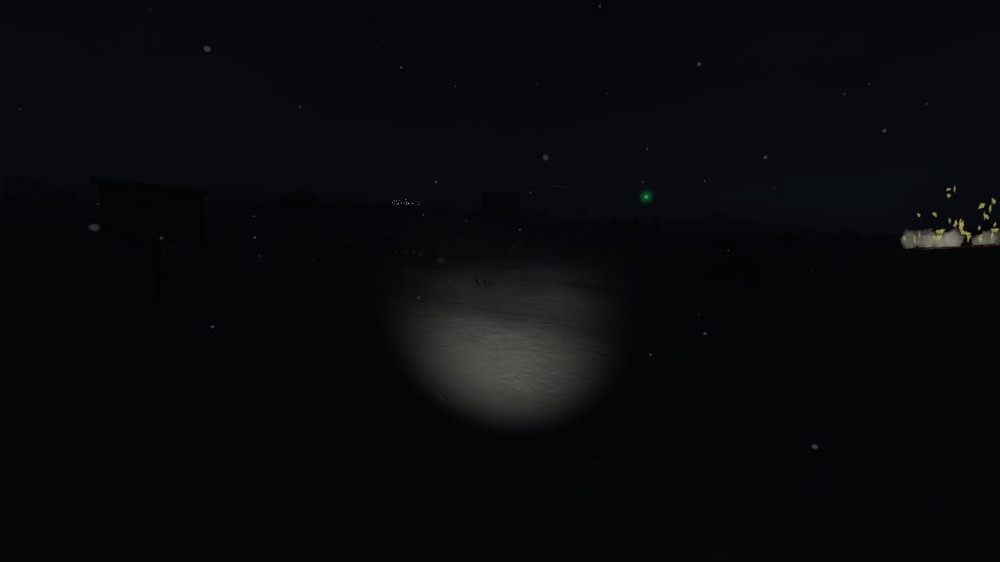 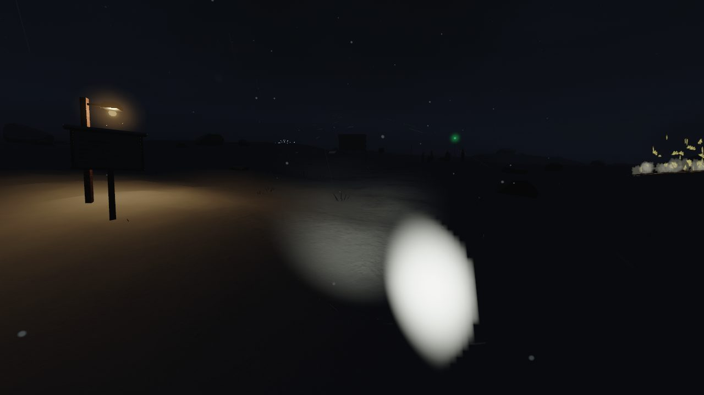
