# Timeline: transcript + game log + screenshots

Video `2026-10-27 23-24-59.mkv` (1:07:35). Video 0:00:00 = 2026-10-28 06:24:59 UTC in the logs = 23:24:59 PDT.
Plain lines are the tester's speech (Whisper large-v3, unedited). Quoted `LOG` lines are game events from `game-data/logs/session-*.log`, shifted onto the video clock.

**[0:00:21]** Okay, testing 1, 2, 3. Let's look at the recording. All right, the microphone is coming

> `[0:00:21] LOG` rig::xr: input: Left grip works

> `[0:00:21] LOG` rig::xr: input: Right grip works

> `[0:00:21] LOG` rig::xr: input: left hand profile /interaction_profiles/valve/index_controller

> `[0:00:21] LOG` rig::xr: input: right hand profile /interaction_profiles/valve/index_controller

> 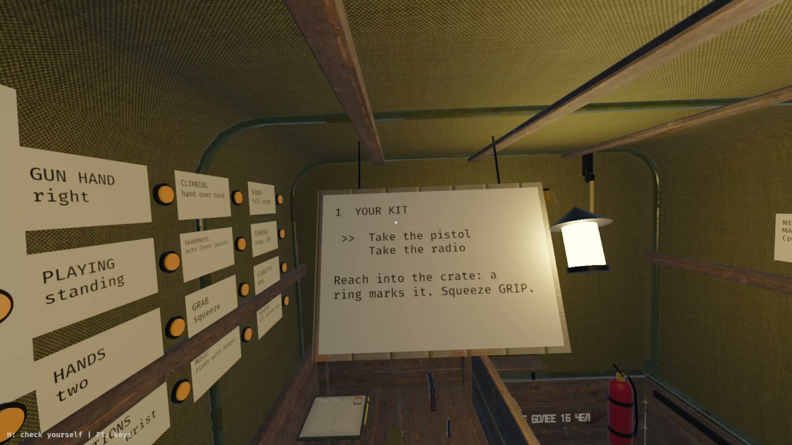 `[0:00:22]` screenshot: `screenshots/00022_log-index-profile-bound.jpg`

> `[0:00:26] LOG` rig::xr: input: Right trigger works

**[0:00:34]** through. All right, let's get started. I'm going to bolt through a whole bunch of feedback here

**[0:00:45]** really quickly. Um, first, uh, okay. Um, immediately over to the left here, there is some

> `[0:00:54] LOG` onboarding: onboarding: Wrist done

> 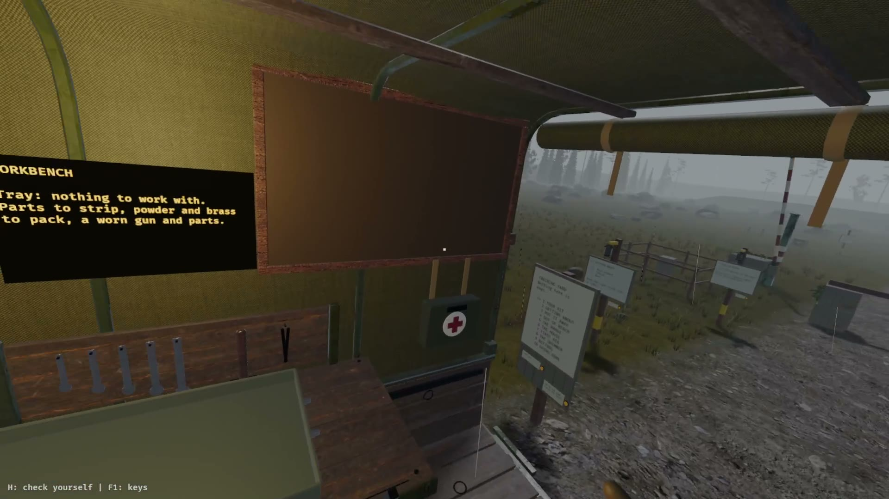 `[0:01:00]` screenshot: `screenshots/00100_text-z-fighting-truck-boards.jpg`

**[0:01:03]** z-plane fighting on some of the text, which is incredibly distracting. Um, I'm getting bombarded

**[0:01:10]** with way too much text all at once. Uh, I don't know. We probably need a title screen and a

**[0:01:18]** settings menu and an onboarding sequence that puts one thing in front of you at a time

**[0:01:24]** because this everything in here is just completely overwhelming um the first thing that i noticed and

**[0:01:34]** i don't know why i didn't notice this the last time is that i feel like i am like very vaguely

**[0:01:42]** tilted for one reason or another maybe the floor isn't even or whatever um and also as i am moving

> 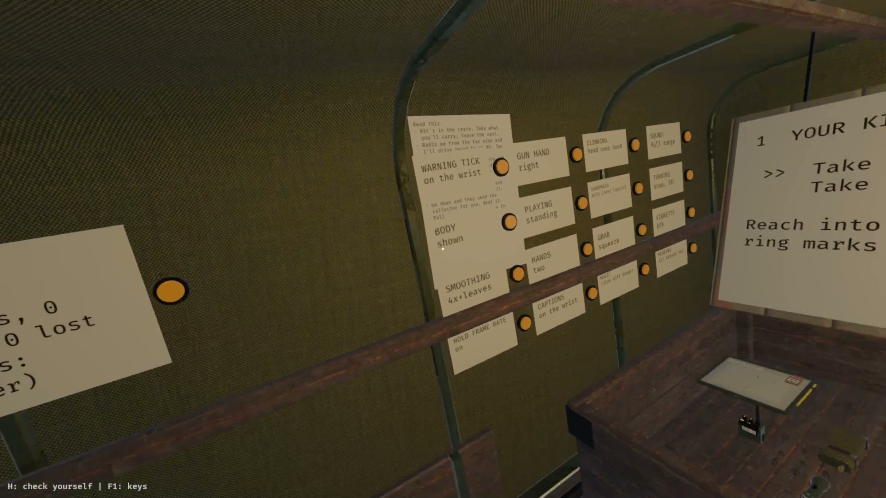 `[0:01:45]` screenshot: `screenshots/00145_player-tilted-hips-stay-put.jpg`

**[0:01:49]** my legs around the space the uh the hips of the character model are staying in place and it looks

**[0:01:57]** like i am instead tilting around uh so that needs work and then obviously just the arm ik isn't good

**[0:02:06]** at all uh the textures on the character model probably best not to have literal like character

**[0:02:15]** model textures like that i don't know how to describe what feels wrong about this uh

> 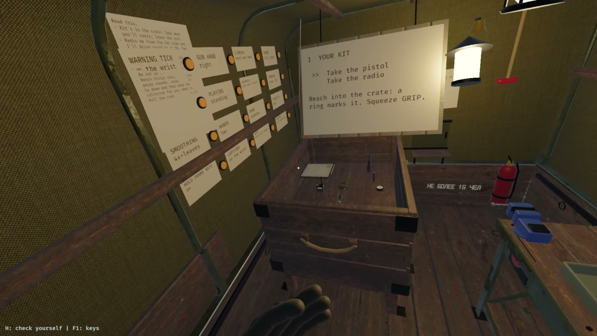 `[0:02:20]` screenshot: `screenshots/00220_visible-torso-body-textures.jpg`

**[0:02:21]** but it definitely looks weird and the way that the you can see your torso rather than just like

**[0:02:30]** the UI elements that you need to be able to see is, ugh, icky, you know? Um, my hands are glowing

**[0:02:38]** green, I guess because I'm bringing them close to something I can grab. Uh, hey, the sound effects

**[0:02:47]** on the backpack are good, but I take it out, and yeah, it's randomly flipping out as I'm grasping

> 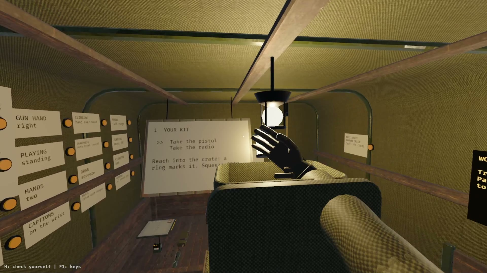 `[0:02:50]` screenshot: `screenshots/00250_backpack-flipping-on-wrist-rotate.jpg`

**[0:02:54]** it and I rotate my wrist there. Um, and it, opening from the top I do not think is necessarily

**[0:03:02]** a good idea. I think opening from the side would be a lot better because you're going to be dragging

**[0:03:05]** this thing right in front of your face. I would like to see the open, some kind of open cavity

**[0:03:11]** there. Um, yeah. Modeling still needs work. Texturing still needs work. Thank you for

> `[0:03:14] LOG` rig::xr: input: Right stick works

**[0:03:16]** raising some of that stuff in the truck off the floor that is nice uh yeah i oh there's a body

> `[0:03:16] LOG` rig::xr: input: Left stick works

**[0:03:29]** hidden toggle well i'm gonna turn on body hidden that looks better marginally um

**[0:03:36]** okay i mean for for placeholder models like it will do i think that how do i describe it

**[0:03:52]** when you're playing a VR game, the vast majority of the time you are going to be looking at your

**[0:03:59]** hands. There really very much needs to be a very high amount of detail and energy that is put into

**[0:04:07]** these things, more than I think anything else at all in the thing, right? And these are,

**[0:04:14]** I mean, they're game developer assets. They aren't particularly good looking, a bit awkward.

**[0:04:22]** I don't know if we need to do some more research on how to do good searching for, like, model components or whether we're doing, instead of searching for better off-the-shelf assets, we're instead going to be looking for, let's figure out how to make a rigged 3D model that doesn't look bad.

**[0:04:42]** Either way, this is, like, I think before anything else, the stuff that you immediately see when you start the experience, which is going to be, like, hands or something needs to happen.

**[0:04:51]** I think you should also just get rid of the arm model entirely that way if you don't show the arm

**[0:04:58]** model then you can hide the fact that the IK is garbage right which I think is worthwhile and it

**[0:05:03]** also it just looks bad and the back face culling is happening on the sleeves so you can kind of

> 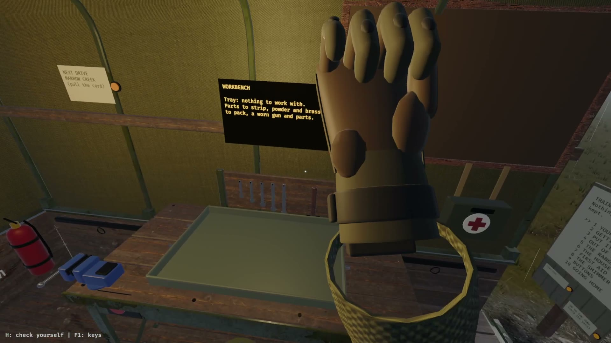 `[0:05:05]` screenshot: `screenshots/00505_sleeve-backface-culling-see-through.jpg`

**[0:05:09]** see through your own body it's weird and bad and rash okay not to talk too much about that I want

**[0:05:15]** to get through some of this uh way too easy to accidentally pull out the backpack and the uh

**[0:05:22]** green circle around it is kind of like a hula hoop i'm not sure what's up with that

> 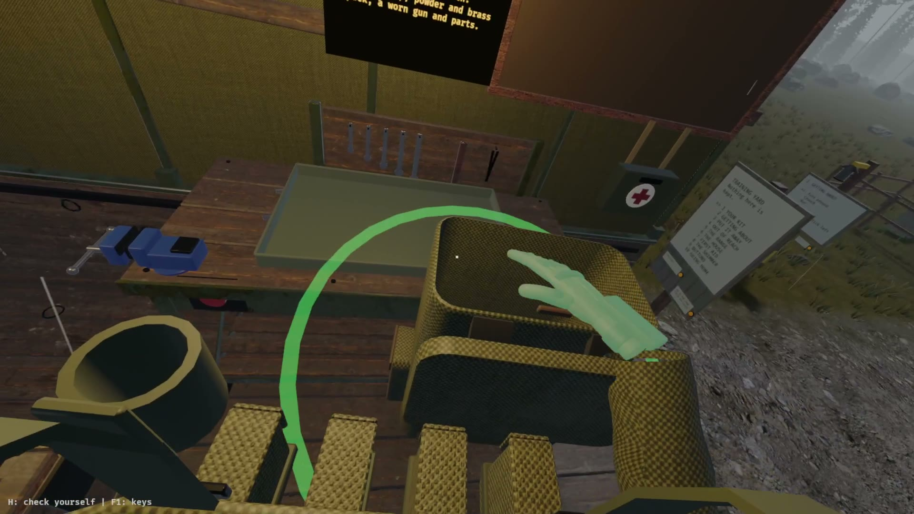 `[0:05:25]` screenshot: `screenshots/00525_backpack-green-hula-hoop-ring.jpg`

**[0:05:31]** uh i'm not sure if the backpack needs the hula hoop necessarily um because i don't know i don't

**[0:05:42]** know what's going on with that it doesn't look great the fact that the hula hoop kind of moves

**[0:05:46]** as I move my hand is cool I guess but it is it's hard to describe exactly what's awkward about it

**[0:05:53]** so I will get to that all right uh this sign in front of this uh box here it kind of gets in the

> 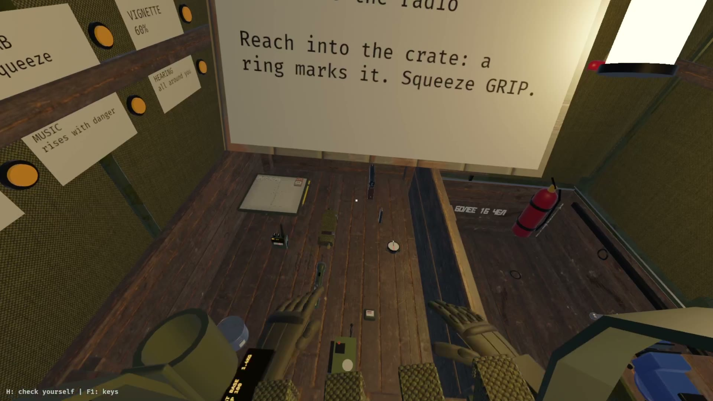 `[0:06:00]` screenshot: `screenshots/00600_tutorial-sign-in-front-of-crate.jpg`

**[0:06:04]** way I get that it's a tutorial message so it's cool presumably that will be dismissed yeah I

**[0:06:13]** I think that reworking the tutorial did not and reworking the onboarding to be slower and

**[0:06:20]** presenting one thing at a time will be important right now let's see the buttons I don't seem to

> `[0:06:25] LOG` rig::xr: input: Left secondary works

> `[0:06:25] LOG` rig::xr: input: Right secondary works

> `[0:06:26] LOG` rig::xr: input: Left primary works

> `[0:06:26] LOG` rig::xr: input: Right primary works

**[0:06:28]** have a menu button or anything like that locomotion works something that is very uncomfortable is that

> `[0:06:29] LOG` rig::xr: input: Right stick click works

**[0:06:33]** if I lean my body over to the right over this table it physically pushes my character model

> 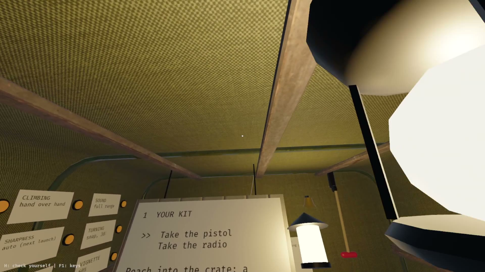 `[0:06:40]` screenshot: `screenshots/00640_leaning-over-table-pushes-playspace.jpg`

**[0:06:41]** out of the table, thereby moving the root of the play space. That feels horrible. I don't think

**[0:06:50]** you should ever, ever do that, where moving the head pushes you back. Instead, let the head clip

**[0:06:59]** into where it's not supposed to clip into, and handle that with visual effects, right? Like,

**[0:07:05]** if we're clipping through solid geometry, you can maybe black out with a vignette or something. Or

**[0:07:11]** there's a certain rendering technique that pushes the geometry in front of your face further back

**[0:07:17]** as your head enters into it in order to but but this i'm not even entering any real geometry my

**[0:07:24]** head is going into a space above some geometry and it's pushing the logical player model which

**[0:07:29]** is no good um okay take the pistol uh i took the magazine out of the pistol while reaching for the

> 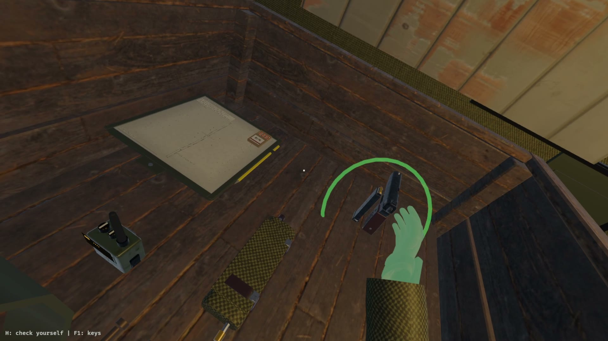 `[0:07:40]` screenshot: `screenshots/00740_grabbed-magazine-instead-of-pistol.jpg`

**[0:07:41]** pistol that's no good at all um that probably should not be possible uh maybe magazine ejection

> `[0:07:42] LOG` onboarding: onboarding: TakePistol done

**[0:07:49]** needs to be a separate thing i don't know and i just dropped a magazine through the crate onto

**[0:07:55]** the floor incredible um grab and flick of the wrist resulted in the magazine floating like a

> `[0:07:55] LOG` rig::xr: input: Left trigger works

> 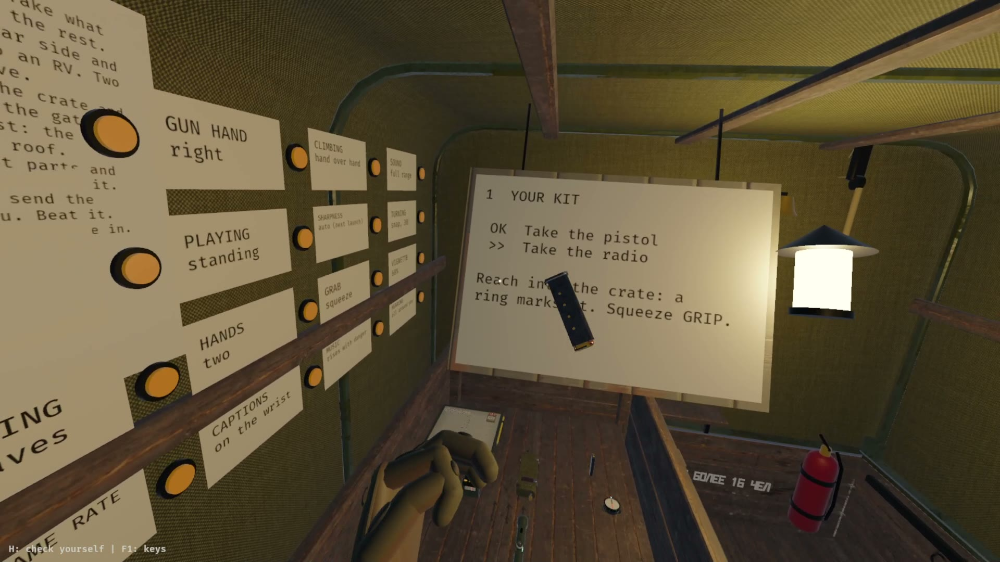 `[0:08:00]` screenshot: `screenshots/00800_far-grab-magazine-floats-ahead-of-hand.jpg`

**[0:08:02]** solid foot out from the tip of my hand instead of in the hand the sound effect was very satisfying

**[0:08:08]** again i'm i'm very happy with the sound but uh yeah that's i don't know if i the pistol works

> `[0:08:13] LOG` raid: raid: Safety's on. Click the stick on the gun hand.

**[0:08:14]** the pistol goes straight into the hand and like obviously the thumb clips through the gun so it's

> 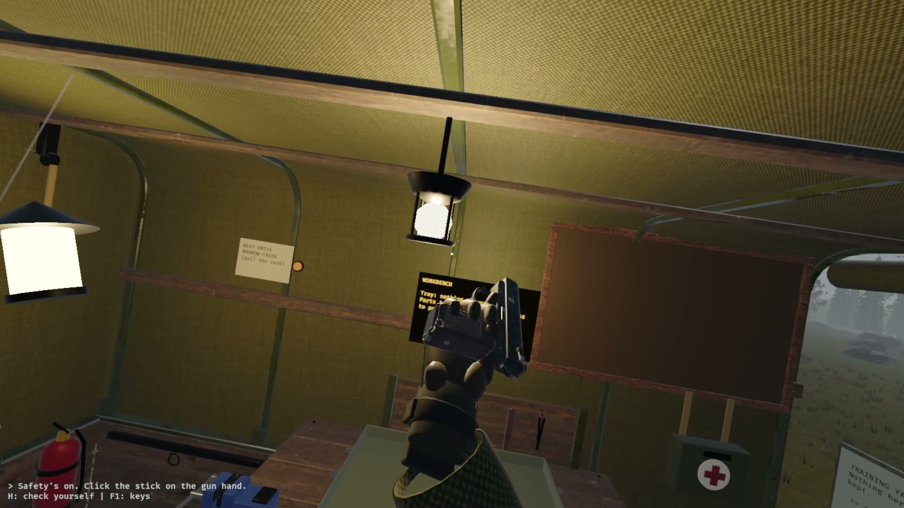 `[0:08:14]` screenshot: `screenshots/00814_log-safety-prompt.jpg`

> 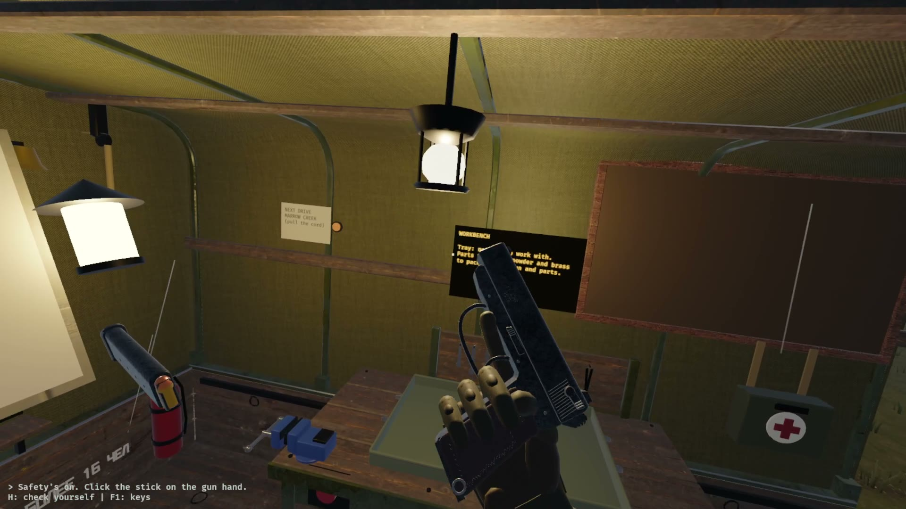 `[0:08:16]` screenshot: `screenshots/00816_thumb-clips-through-pistol.jpg`

**[0:08:19]** not perfect but like the fact that there are like dedicated hand posing things feels amazing like

**[0:08:25]** this is definitely on the right track anyway let's try to put the magazine back in and there it goes

**[0:08:31]** the magazine clips through the geometry of the bottom of the gun so i guess the model still

> 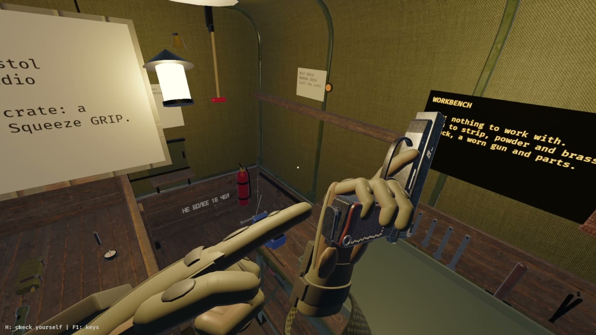 `[0:08:32]` screenshot: `screenshots/00832_magazine-clips-through-gun-bottom.jpg`

**[0:08:36]** needs work uh take the radio okay which one of these again onboarding experience i'm looking at

**[0:08:43]** a box full of stuff i have no idea what's the radio what's the walkie talkie what's the weird

> 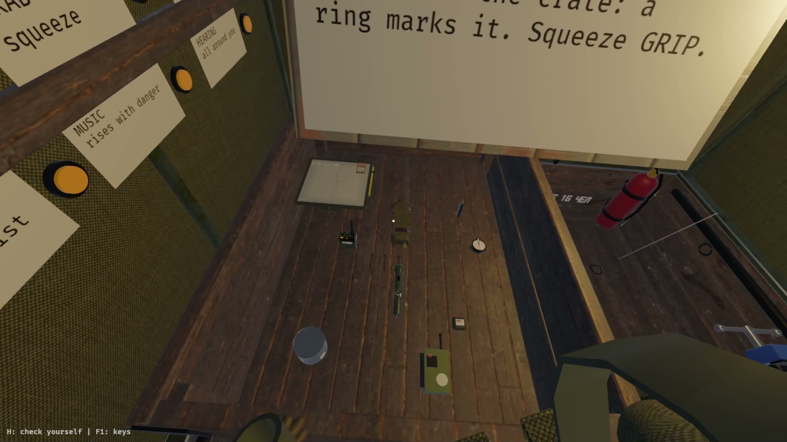 `[0:08:45]` screenshot: `screenshots/00845_crate-which-one-is-the-radio.jpg`

**[0:08:48]** gadget. That looks kind of like a radio. Ba-bum! Okay, I think I did it. Uh, because I'm holding

> `[0:08:51] LOG` onboarding: onboarding: TakeRadio done

> `[0:08:51] LOG` raid: raid: Driver: "Good. Next: the lamp off the back of the truck."

**[0:08:56]** it. Done. Everything you own rides in that crate between raids. Next, the lit lamp. Okay, that's

**[0:09:03]** over there. Uh, the game has not taught me how to use pockets yet, so I'm holding both of these

**[0:09:09]** things in my hands. So I guess that's an onboarding oversight. I'm just gonna try to put this... Oh,

**[0:09:14]** I don't know. I don't have wrist pockets. Do I? Nope. Okay. Um, maybe a chest pocket? There we go.

> `[0:09:24] LOG` onboarding: onboarding: PutAway done

**[0:09:25]** Yeah, it kind of clips sideways into the chest pocket. It doesn't fit in it at all. Um, that'll

> 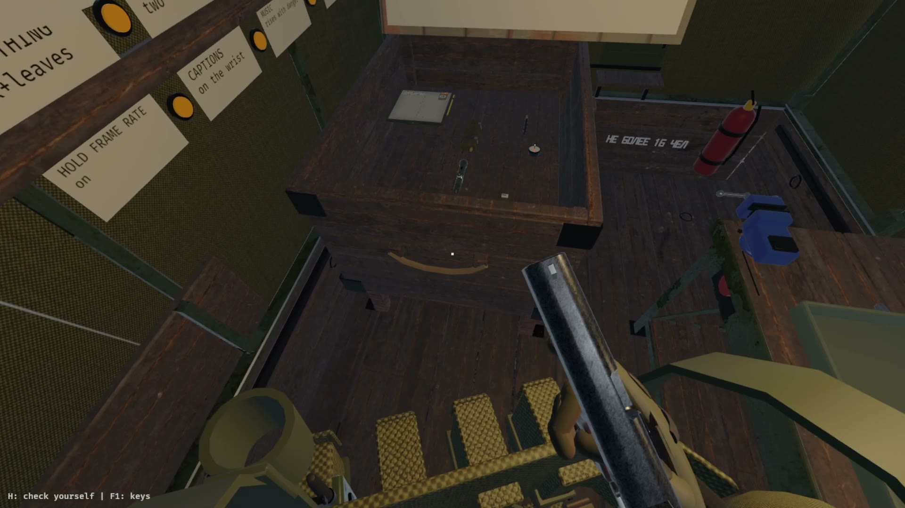 `[0:09:26]` screenshot: `screenshots/00926_item-clips-sideways-into-chest-pocket.jpg`

**[0:09:32]** need to be addressed at a certain point. Again, the hula hoop is cool. Um, maybe if it was billboarded

**[0:09:38]** towards the user camera, I think it would look a lot better than how it's just kind of flopping

**[0:09:43]** around as it is, right? Um, okay. Yeah, I don't know how to feel yet about how the rotation of

**[0:09:52]** my head left and right rotates the torso. That might need to be tuned a little bit,

**[0:09:57]** maybe from telemetry data. Uh, that could be sorted out. Okay. Do I have like a holster for

**[0:10:04]** the gun? Yes, I do. Okay. Hopefully next time I grab that gun, I'll grab the gun and not the

**[0:10:12]** magazine inside yeah okay 100 you cannot grab the magazine out of the gun by accident when you're

**[0:10:18]** trying to grab the gun i don't know if you just need to push a button to eject it or what

**[0:10:22]** but uh yeah that needs to that needs to be arranged

**[0:10:28]** okay let's see next the lit lamp okay clearly that doesn't mean the lamp by the tutorial message

**[0:10:39]** here, so, what does it mean? There's a can here, which floats, oh, now I dropped it.

**[0:10:49]** When I put things in the crate, does it float? Okay, when I put things in the crate, it doesn't

**[0:10:53]** float, but if I put things above the crate, it falls through the crate, lovely. Um, the

> 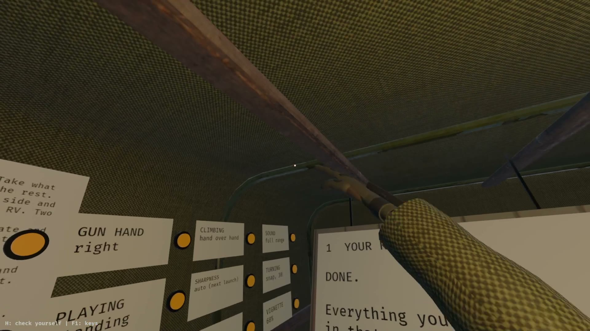 `[0:10:55]` screenshot: `screenshots/01055_item-falls-through-crate.jpg`

**[0:11:01]** lit lamp, could that be the, this flashlight looking thing? Oh, that looks like a, a battery.

**[0:11:09]** Yeah, that looks like a battery right there that I've now pulled out.

**[0:11:13]** Okay, so the battery goes in sideways through the flashlight, which is a little strange, but I have a flashlight now.

> 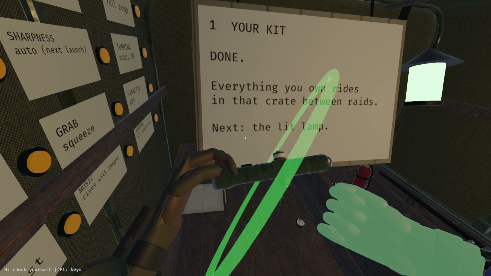 `[0:11:15]` screenshot: `screenshots/01115_battery-sideways-through-flashlight.jpg`

**[0:11:19]** I guess that's not what they mean by the lit lamp, and it won't turn on anyway.

> `[0:11:22] LOG` onboarding: onboarding: Crouch done

**[0:11:24]** So I'll put that down.

**[0:11:27]** Hmm.

**[0:11:30]** Next, the lit lamp.

**[0:11:31]** What could that possibly mean?

**[0:11:33]** I think I might be stuck.

> `[0:11:34] LOG` onboarding: onboarding: Turn done

**[0:11:36]** Okay, well...

**[0:11:37]** now we still have floating blocks of text here i get this is supposed to be maybe a menu of some

**[0:11:51]** kind it's all very unclear you know the fact that this like tutorial message is like at an angle

> 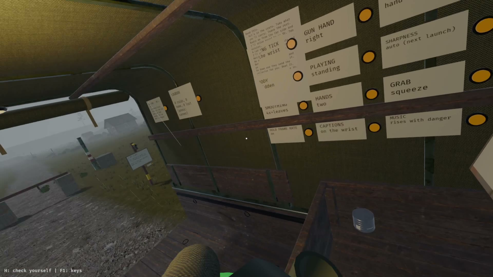 `[0:11:55]` screenshot: `screenshots/01155_tutorial-board-at-an-angle.jpg`

**[0:11:59]** is very unusual to me oh i see the ghost of my hand moves out from the character model's hand

> 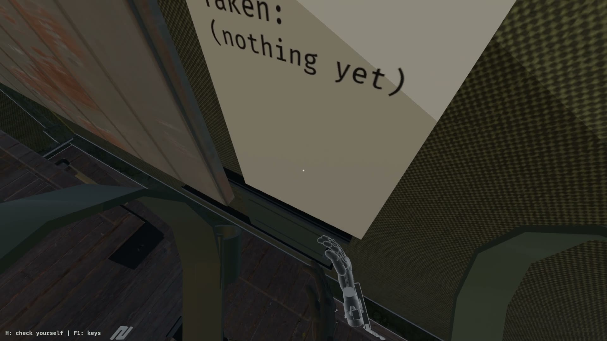 `[0:12:08]` screenshot: `screenshots/01208_ghost-hand-separates-from-glove.jpg`

**[0:12:10]** as the ik can't track it for whatever reason that's interesting i don't know why that decision

**[0:12:17]** was made but oh jesus if I bend over forward I think some texture is clipping through my face

> 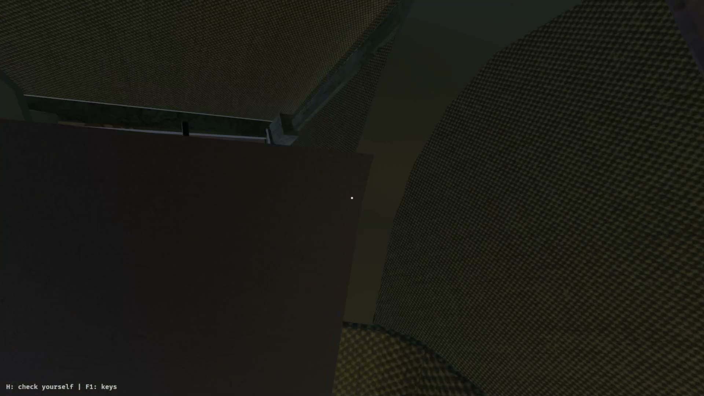 `[0:12:22]` screenshot: `screenshots/01222_bending-over-texture-clips-face.jpg`

**[0:12:24]** so I can't see the floor that is supremely unfortunate oh I just rung a bell okay let's

> `[0:12:27] LOG` raid: raid: Driver: "Not done yet. Pull again to go."

**[0:12:37]** okay two getting a oh when it said next the lit lamp that means go out of the truck and into the

**[0:12:50]** field. Okay, so I guess I'm leaving all that rest of that stuff in the box. Now, I'm questioning

**[0:12:57]** whether this truck idea is even a good idea. Oh, the truck is partway through the soil. That's

> 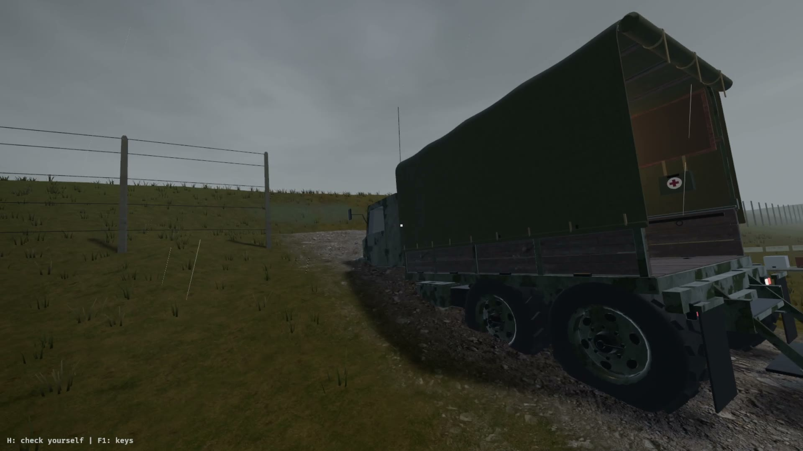 `[0:13:00]` screenshot: `screenshots/01300_truck-sunk-into-soil.jpg`

**[0:13:02]** lovely. Okay, well, oh, and these, uh, tire flaps are still not physically connected to the truck.

> 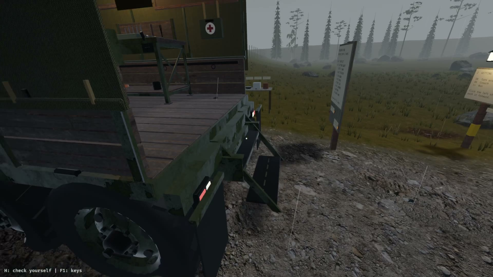 `[0:13:08]` screenshot: `screenshots/01308_mud-flaps-detached-from-truck.jpg`

**[0:13:11]** Lovely. Uh, yeah, the, the, the, the horizon feels rather abrupt still, right? Maybe the fog needs

> 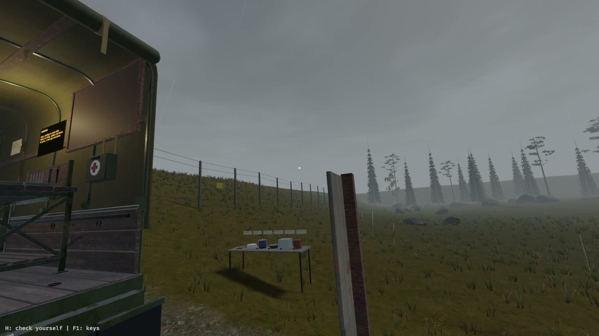 `[0:13:18]` screenshot: `screenshots/01318_abrupt-horizon-fog.jpg`

**[0:13:25]** to be more gradual or maybe we need like some kind of textury fog wall on the end of the map

**[0:13:31]** at least i don't know but this is this is not cutting it yet okay there's a table full of stuff

**[0:13:36]** board empty bowl deadly pot empty pan empty tin oven empty crock empty i have no idea why any of

> 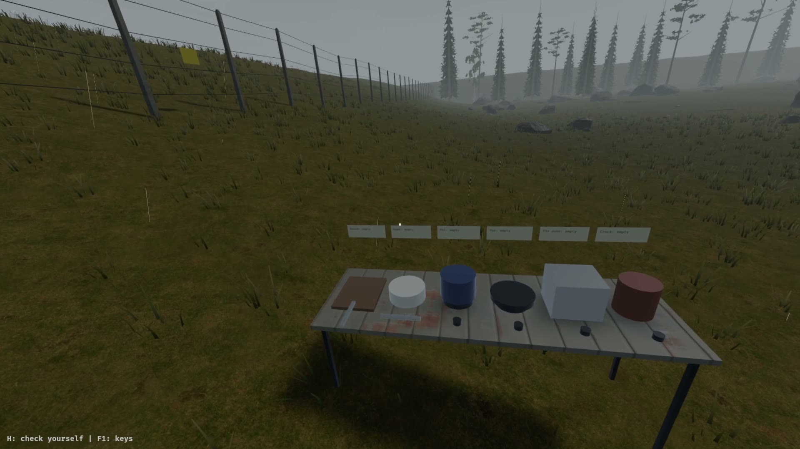 `[0:13:38]` screenshot: `screenshots/01338_whitebox-cooking-table.jpg`

**[0:13:44]** this is here i here i guess they are white box models for one reason or another

**[0:13:48]** okay okay turn around crouch run click the left stick and push forward to run okay fair enough

> `[0:13:57] LOG` onboarding: onboarding: Run done

> `[0:13:57] LOG` raid: raid: Driver: "Good. Next: the next lamp, right of the track."

**[0:14:00]** holster or pocket it something in the pack hold your hold it over your shoulder open in your hand

**[0:14:08]** i guess i could put the gun in oh the magazine where'd that go well i put the gun in the backpack

> `[0:14:15] LOG` onboarding: onboarding: Pack done

> `[0:14:15] LOG` raid: raid: Driver: "Good. Next: the lamp by the pen."

**[0:14:17]** and oh I push a button and the magazine came out okay I have no idea what's going on there

> `[0:14:19] LOG` onboarding: onboarding: DropMag done

**[0:14:23]** but it's in the gun again okay up reach get the box and the pen point at it squeeze grip flick

> `[0:14:24] LOG` onboarding: onboarding: SeatMag done

**[0:14:41]** your hand back all right well I kind of knew to expect that but this is a uh good tutorial again

> `[0:14:42] LOG` raid: raid: Driver: "Off you go. Next: the lamp by the pen."

> `[0:14:42] LOG` raid: raid: Out of the truck. The Surge is due in about 60 minutes.

> `[0:14:46] LOG` onboarding: onboarding: FarGrab done

> `[0:14:46] LOG` raid: raid: Driver: "Good. Next: the range, left past the gate."

**[0:14:47]** the fact that it does not actually end up in my hand but a bit in front of my hand feels like a

> 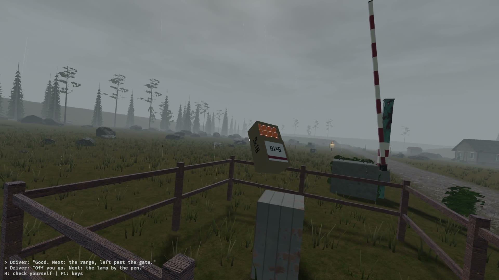 `[0:14:48]` screenshot: `screenshots/01448_far-grab-lands-ahead-of-hand.jpg`

**[0:14:54]** pretty big oversight. Pick up the backpack, put it in the backpack. It's in the backpack. Oh,

**[0:14:59]** when I put it in the backpack at an angle, it shouldn't snap to face up. It should just float

> 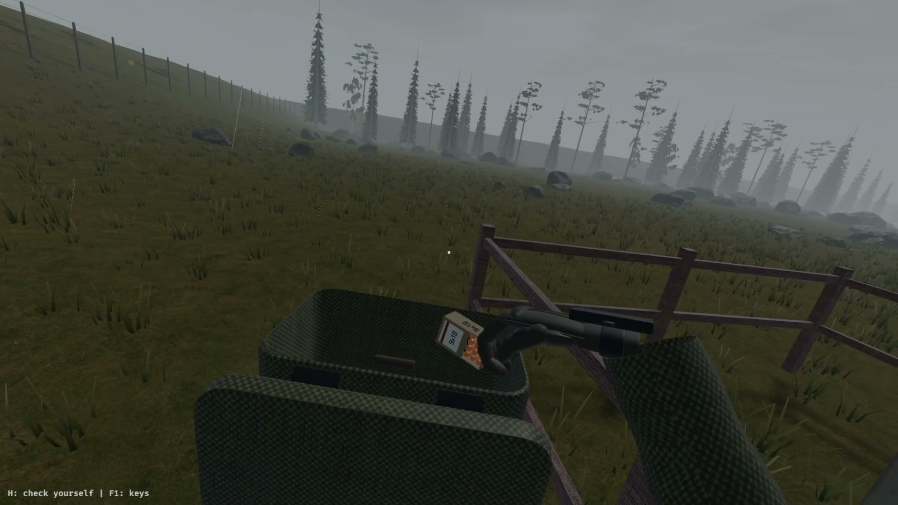 `[0:15:00]` screenshot: `screenshots/01500_item-snaps-upright-in-pack.jpg`

**[0:15:04]** as I put it in. Please? Yeah. And I'm assuming that this will feel a little bit nicer when the

**[0:15:16]** actual backpack I'm holding in front of my face opens into my face, rather than being a top open

**[0:15:21]** thing that is awkward to reach inside. But okay, cool. And I put that in my backpack. All right,

**[0:15:35]** proceed. Yeah, telling the person to go to the lit lamp feels a little bit silly. Uh,

**[0:15:43]** you could just have the tutorial only expose one thing at a time, right? I don't know.

**[0:15:56]** At a certain point, the onboarding experience needs to be fun, right, and not just go through

**[0:16:03]** a series of controls, instructions, right? Maybe we're not quite there yet, but worth keeping in

**[0:16:12]** mind. Oh, we might want some more varied grass textures looking around. That's probably not the

**[0:16:17]** current thing to be focusing on. Oh, those birds are cool. Oh, you know people are going to want

> 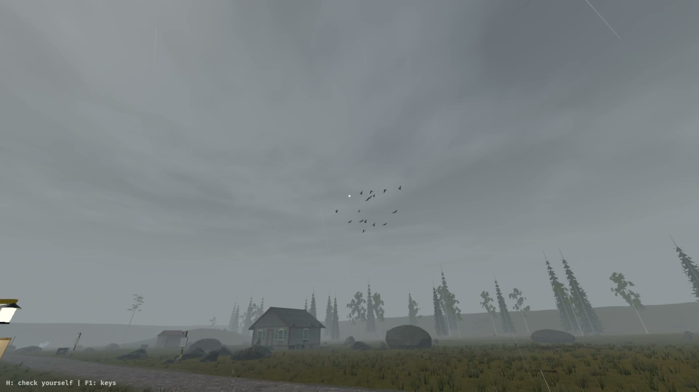 `[0:16:20]` screenshot: `screenshots/01620_birds-on-roof.jpg`

**[0:16:23]** to shoot them, right? If they have a gun and they see birds. I don't know if that's a good or a bad

**[0:16:28]** thing. All right, rounds in the mag. Okay, I've somehow done half this tutorial.

**[0:16:44]** Rack the slide, okay, safety off. I may have just ejected the mag while trying to turn off the

> `[0:16:44] LOG` onboarding: onboarding: Rack done

**[0:16:54]** safety. It says safety off, it does not tell me how to do that, which feels perhaps like a bit of

**[0:17:02]** an oversight I can eject the magazine at least so that's good oh I thought I'm having difficulty

**[0:17:12]** trying to put this back in well let me try to hit a plate oh when I put my hands together like this

**[0:17:27]** it would be cool if there were like uh finger animations right because I often when I'm doing

**[0:17:33]** this kind of thing in VR. I hold it with both hands to keep my hands steady. Anyway, let's try

**[0:17:41]** it. No, I still need to figure out how to do the safety. Oh, right, I bet that was the right

> `[0:17:51] LOG` onboarding: onboarding: Safety done

**[0:17:55]** thumbstick push down on it. Yep, all right, now I can, uh, hit the target. Yep, uh, my aim is dog

> `[0:18:12] LOG` onboarding: onboarding: HitPlate done

**[0:18:13]** shit and there is no feedback. I don't know if tracers, just for the sake of it being a video

**[0:18:18]** game, would be good or not, but I'm just gonna walk up close to it so I can actually hit this

**[0:18:22]** thing. Okay, now there appear to be bullet holes. Or maybe- no, I- no, I'm shooting straight through

> 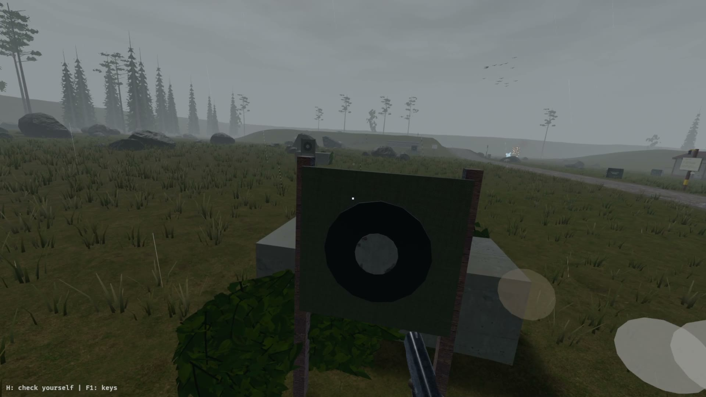 `[0:18:30]` screenshot: `screenshots/01830_shooting-through-target-plate.jpg`

**[0:18:33]** it! Okay, that's a little bit concerning. You would think that you can't hit- shoot straight

**[0:18:38]** through the target. Now I see the particles of impact and how those are supposed to give some

**[0:18:42]** sort of feedback there oh it's so cute that the birds perch on the house okay so the last thing

**[0:18:54]** is rounds into the mag so i guess i have to eject the magazine from my gun okay if i let me try

**[0:19:01]** something uh if i hold the eject magazine button it would be nice if it held the magazine out of

**[0:19:16]** the gun but didn't drop it like half out so that i could grab it with the other hand and didn't

**[0:19:21]** have to let it fall to the floor. Uh, let me figure out how to reload this. There is

**[0:19:31]** a mysterious brown block on this tutorial thingamadoohickey. Uh, okay, well this type

> 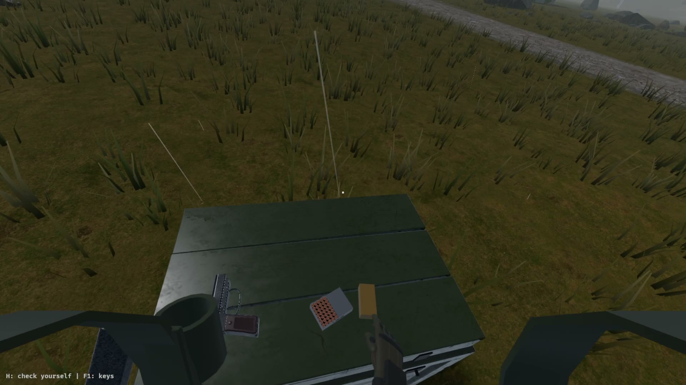 `[0:19:32]` screenshot: `screenshots/01932_brown-block-on-tutorial-board.jpg`

**[0:19:40]** of bullet doesn't seem to, it doesn't seem like I can, like, push any buttons to actually

**[0:19:45]** get bullets out of this magazine I've been using, or, oh, the 7.62x25 probably isn't

**[0:19:52]** even right, and I can't pull bullets out of it anyway. Uh, maybe the, if I open my backpack,

**[0:19:58]** nope, uh, it seems that the bullets I put in my backpack are gone. Wonder what happened to those.

**[0:20:04]** There's another gun over here, so I'm gonna try this one. I bet that the tutorial wanted me to

**[0:20:10]** use this gun, which is a separate gun the tutorial has given me for some reason, compared to the one

**[0:20:16]** I originally picked up. Pick it up. Z plane fighting on the top of the magazine. Uh, nine

> 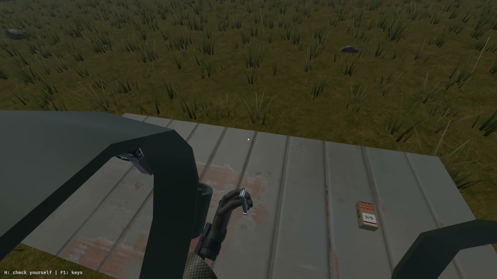 `[0:20:18]` screenshot: `screenshots/02018_z-fighting-top-of-magazine.jpg`

**[0:20:22]** by 16. Okay. And I just hold the, holding the ammo box close to the magazine, just fully loads it.

> `[0:20:22] LOG` onboarding: onboarding: FillMag done

> `[0:20:22] LOG` raid: raid: Driver: "Good. Next: the house on the right."

**[0:20:29]** I mean, it's halfway there. It'd be nice to have like a one bullet at a time kind of arrangement,

**[0:20:36]** right? And a way to like eject individual bullets from the box and individual bullets

**[0:20:41]** turn the magazine to like say I don't know mix and match or whatever but like we're getting there

**[0:20:47]** this that's mostly just imitation okay this here is a different gun let me pick it up okay

**[0:20:54]** load the magazine I think that it's a little bit too difficult to load the magazine right now

**[0:21:03]** uh maybe it could be a little more generous uh it's not it's also not easy to transfer the gun

**[0:21:09]** between hands. Like if I'm holding the gun with my right hand and I bring my left hand to it and

**[0:21:15]** then grip, it transfers. But now, uh, when I use my right hand, again, I think it has something to

**[0:21:21]** do with the fact that the magazine is grabbable while it's in the gun. I was like some kind of

**[0:21:26]** arrangement. Okay. Rack. Safety off. Okay. Yep. And the smoke particles are very cute. I like that.

**[0:21:43]** let's put the safety back on put it in the pocket i guess we'll just have this gun now

**[0:21:51]** continue why am i so slow i have no idea why i'm so slow all of a sudden

**[0:22:02]** that's open the door take what's inside grip the door anywhere and pull it around

**[0:22:08]** i have no idea why i'm so slow also as i rotate my wrist sometimes the screen doesn't show up

> 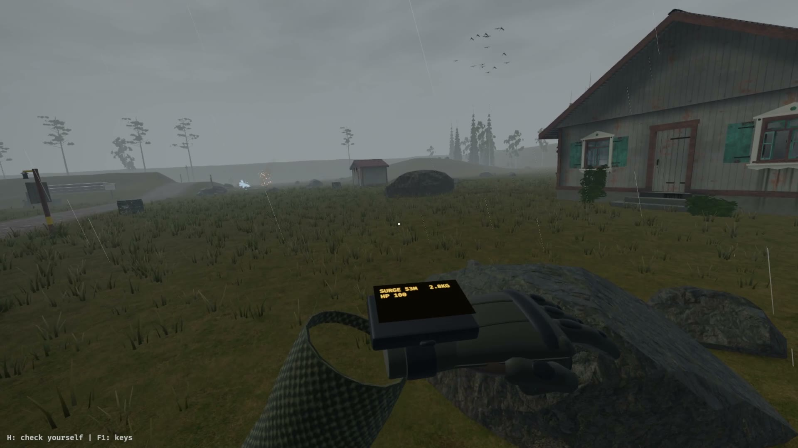 `[0:22:15]` screenshot: `screenshots/02215_wrist-screen-not-showing.jpg`

**[0:22:19]** as if it's secluded somehow 2.8 kilograms is it slowing me down because of my weight i wouldn't

**[0:22:27]** think 2.8 kilograms would do that okay uh very sad that i can't swing the window open and shut

**[0:22:34]** also the latch looking thing on this window is floating in midair when you would expect it to

> 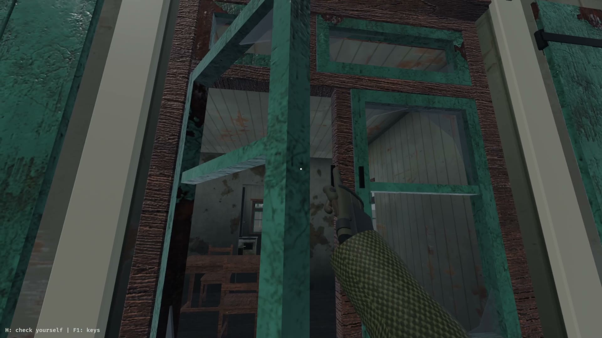 `[0:22:36]` screenshot: `screenshots/02236_window-latch-floating.jpg`

**[0:22:40]** follow the window that's been open the house looks way way better in this iteration than before

**[0:22:46]** obviously there are issues like right here you can see that there's like a gap that shouldn't

> 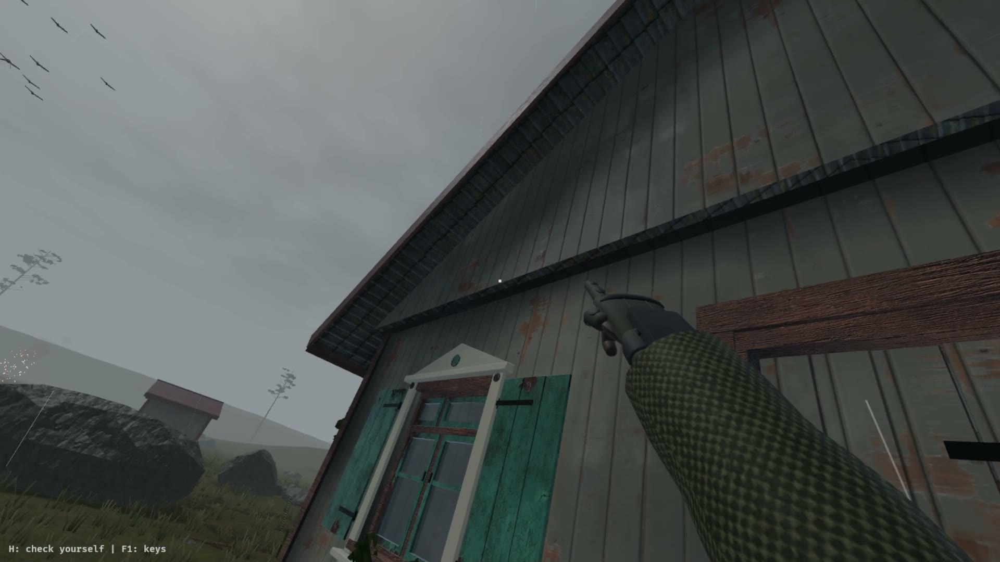 `[0:22:50]` screenshot: `screenshots/02250_gap-in-house-wall.jpg`

**[0:22:52]** be there and there's some the the wood texture here is it's it's rough right but it's better

**[0:22:58]** than nothing um and i think once again we cannot open the door because i grab it the door jitters

> `[0:22:58] LOG` onboarding: onboarding: OpenDoor done

> 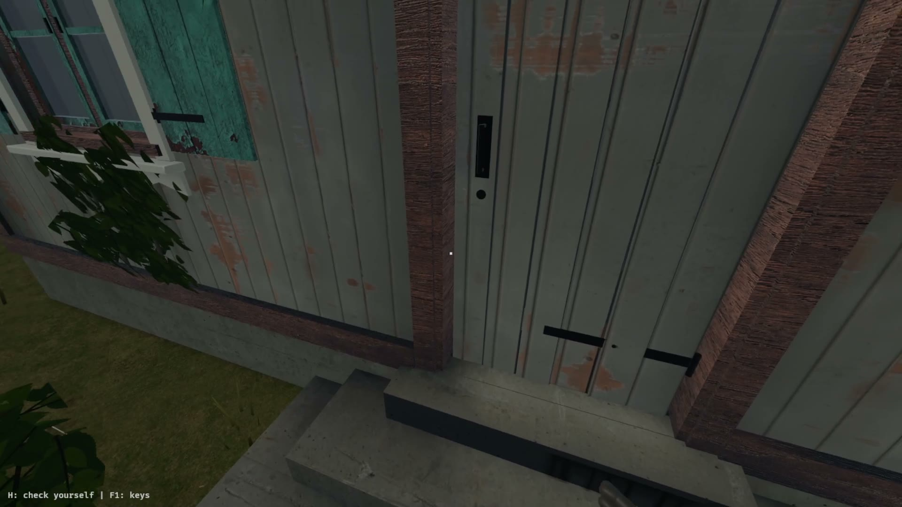 `[0:23:02]` screenshot: `screenshots/02302_door-jitters-wont-open.jpg`

**[0:23:06]** a little bit and then can no longer move which is super unfortunate oh okay now it just flung

**[0:23:16]** wide open. Okay, so I can't get into the house. Okay. Going inside seems to make the fog or

**[0:23:27]** some of the lightness outside go away, which is a bit weird. I see a bunch of stuff in

> 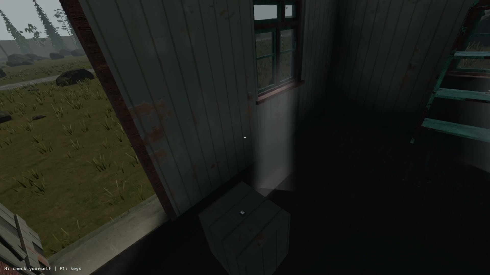 `[0:23:28]` screenshot: `screenshots/02328_indoors-fog-lighting-change.jpg`

> `[0:23:29] LOG` onboarding: onboarding: Search done

> `[0:23:29] LOG` raid: raid: Driver: "Good. Next: the lamp on the right."

**[0:23:31]** this area. Oh, the backpack is spazzing out. Can it not? I guess I'll just put this stuff

**[0:23:36]** in the backpack. Oh, when I move, the backpack should not... If the backpack is out and I

**[0:23:42]** move a little bit, it should not, like, snap down on me. Oh, and it seems that moving the

**[0:23:46]** backpack has caused the item inside it to not stay in the same place oh that's not good at all

**[0:23:53]** maybe that's why i lost that other thing earlier okay well i grabbed a thing inside this building

**[0:23:59]** so that's enough for now you know very sad 3d the 3d models are like better right the texture

**[0:24:09]** work on the house is doing a lot of heavy lifting right but like i don't think i need to explain why

**[0:24:17]** a capsule pill for a pillow is not sufficient right uh what do we got here looks like a can

> 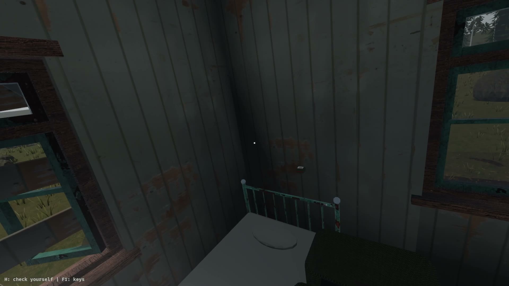 `[0:24:18]` screenshot: `screenshots/02418_capsule-pillow.jpg`

**[0:24:26]** of beans I can't speak Russian but that's okay yep and then grabbing the backpack no matter what

**[0:24:32]** I put in seems to do stuff what is this oh it's a pouch that's cute I will say the gun models

**[0:24:46]** definitely still need work. Um, this is a marked improvement over the last iteration, which is

**[0:24:53]** nice. Uh, ba-ba-ba-ba. Now, the inside of the house feels very nice and moody. Um, well, it doesn't

**[0:25:04]** seem like I can actually open the drawers that you've put here, which is a bit sad, but one day.

**[0:25:12]** Yeah, I love all the little pieces of garbage that are in this house that I can pick up. It's

**[0:25:17]** very delightful, so nice work on that. These tiny carrots are absolutely minuscule, I have no idea

**[0:25:25]** what's going on there, but it's very cute. World's smallest carrots. Mysterious red substance in a

> 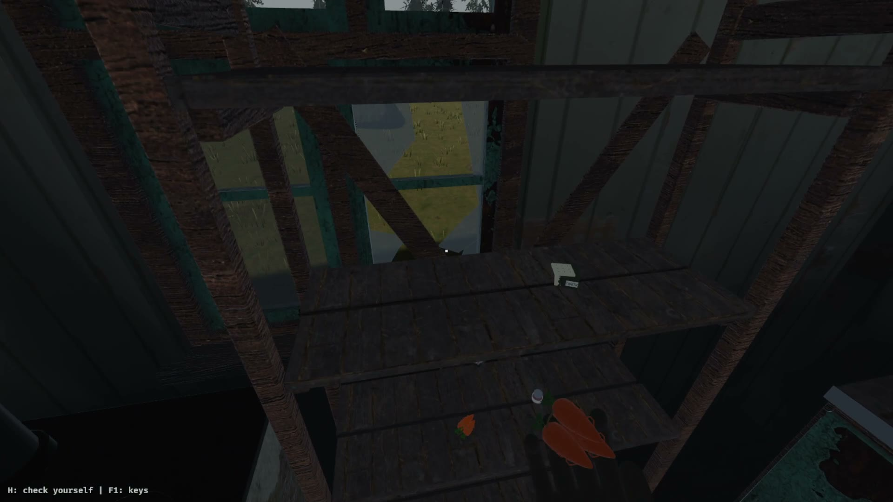 `[0:25:25]` screenshot: `screenshots/02525_tiny-carrots.jpg`

**[0:25:32]** jar. This is nice, this is nice. I, I, obviously it's gonna need more 3D modeling, right, and I

**[0:25:38]** don't know what any of this stuff does, but it feels nice to run around and scrounge up random

**[0:25:42]** crap. Um, so that's a good direction. Oh, maybe what would help with, like, the design of these

**[0:25:52]** buildings would be more reference research. Like, dedicated reference photo research agents

**[0:25:59]** could help a lot. The god rays, uh, are also cool. I can see, like, this very clear cross pattern on

> 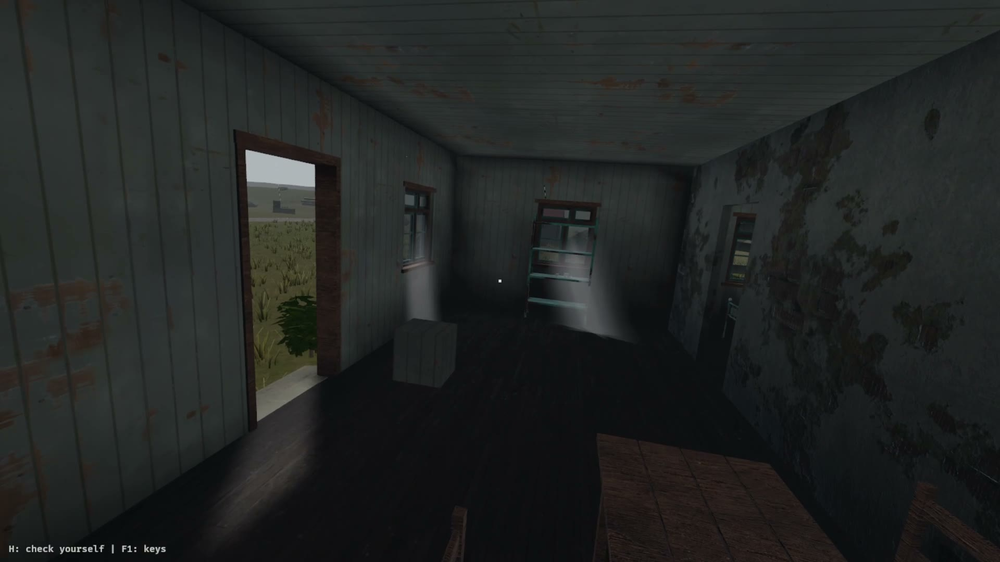 `[0:26:03]` screenshot: `screenshots/02603_god-rays-asterisk-pattern.jpg`

**[0:26:06]** the ground, or this asterisk pattern on the ground, which is no good, but I see what you're going for.

**[0:26:11]** It's, it's really nice. I think that, I think that the god rays are adding, have the potential to

**[0:26:17]** add a lot here, right? Maybe, maybe some rugs, right? Uh, some beat up rugs. What other furniture

**[0:26:27]** would you find in a dilapidated house? I don't know. Anyway, that was cool. Uh, back to the

**[0:26:38]** tutorial. I am still super slow and cannot run for some reason. When I hold my arm directly like

**[0:26:48]** this towards my face, the black brick, which I think is supposed to represent the body of the

> 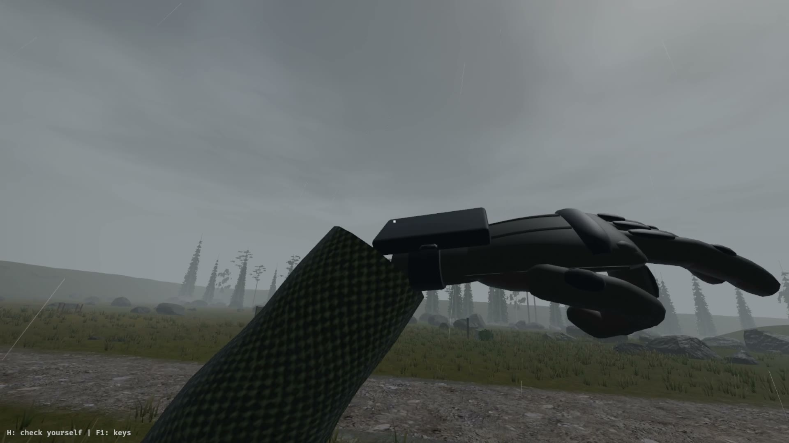 `[0:26:50]` screenshot: `screenshots/02650_watch-brick-renders-over-screen.jpg`

**[0:26:53]** watch, actually renders in front of the screen, which is very funny. Okay, read your wrist,

**[0:27:00]** use a dressing. Where, where would you, where's a dressing, my friend? I don't see a dressing.

**[0:27:08]** oh it's on this crate up ahead perhaps is that what this is this red looking thing oh yeah i

> 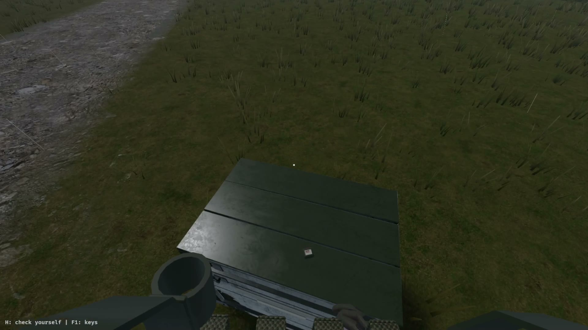 `[0:27:15]` screenshot: `screenshots/02715_dressing-on-crate.jpg`

**[0:27:20]** think this is a dressing okay i don't know how that reads as a dressing but i'm not exactly a

> `[0:27:21] LOG` onboarding: onboarding: Dressing done

> `[0:27:21] LOG` raid: raid: Driver: "Good. Next: the lamp on the right. Mind the shimmer."

> `[0:27:21] LOG` raid: raid: You bind the wound. The bleeding stops.

> 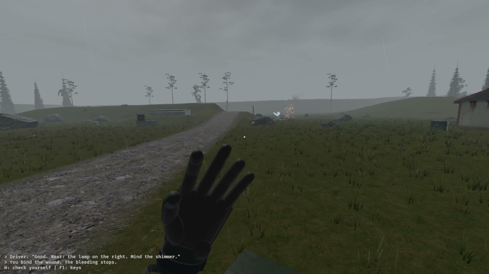 `[0:27:22]` screenshot: `screenshots/02722_log-dressing-done.jpg`

**[0:27:25]** military person so i wouldn't know it's a bit small okay um okay the next light is up ahead

**[0:27:40]** throw a part in first okay what is this thing i see a little spring looking contraption on it

**[0:28:18]** i guess i'll throw a part in i assume it's referring to the fire thing because the

**[0:28:29]** electrical looking thing well first of all has a weird blue puddle on the ground and

> 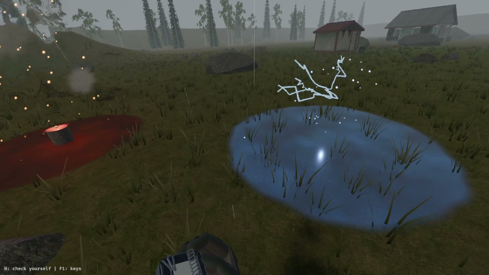 `[0:28:30]` screenshot: `screenshots/02830_blue-puddle-under-electric-anomaly.jpg`

**[0:28:34]** below it which i don't think is supposed to look like that i'll go out on a limb i'll go

**[0:28:40]** to the limit and say that that's supposed to be maybe a glow and not, like, a carpet.

**[0:28:47]** Anyway, I'm gonna throw this into it. Oh, I missed. Oh, I think we have discovered the agonizing

**[0:28:55]** reality of throwing things in VR is hard. All right, I'm gonna try a few times. I have no idea

**[0:29:03]** how people got throwing in VR to work well, historically speaking. It's always very difficult,

**[0:29:08]** but we're gonna keep trying. We're gonna have to release the grip a little earlier.

**[0:29:15]** Oh, well, that made a noise when I threw it in. Do I- I guess the idea is that I grab this-

> `[0:29:20] LOG` onboarding: onboarding: Artifact done

**[0:29:22]** Too hot to hold- Oh, drop. Okay. Oh, maybe I just throw it in my bag and don't hold onto it directly.

> `[0:29:22] LOG` raid: raid: Too hot to hold: you drop it. Let it cool, or pocket it.

> 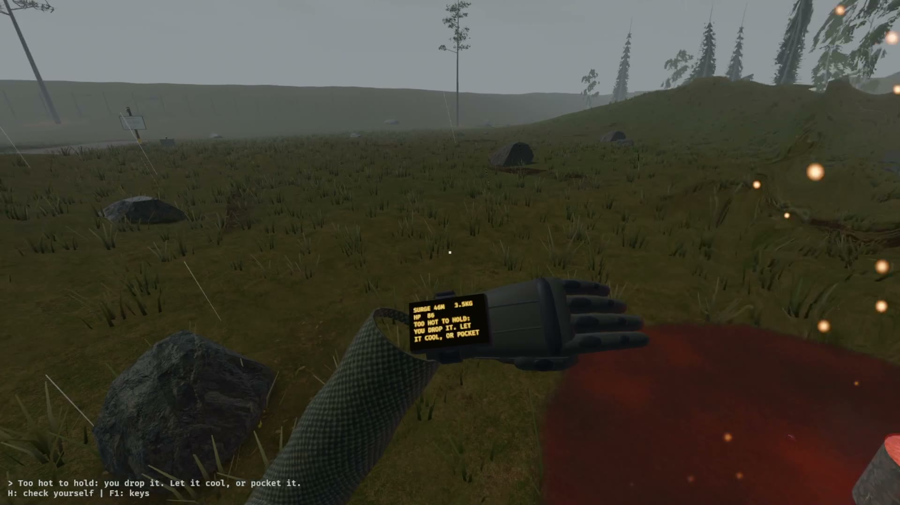 `[0:29:22]` screenshot: `screenshots/02922_log-artifact-too-hot.jpg`

**[0:29:34]** Okay, the haptic feedback there did a very good job of letting me know I was taking damage,

**[0:29:40]** so good on that. I have no idea why I just threw a- a, uh, throw a part in the first. Oh,

**[0:29:50]** okay, it wants me to throw it at the electric thingy-ma-do-hickey. Oh. Well, that got zapped

> `[0:30:01] LOG` onboarding: onboarding: Probe done

> `[0:30:01] LOG` raid: raid: Driver: "Good. Next: the lamp on the left."

**[0:30:04]** somehow. I don't know what that did. It definitely got zapped. Looks like I did- I had no idea what

**[0:30:18]** that was about. I still see some seams on the ground where the fallen leaf texture abruptly

> 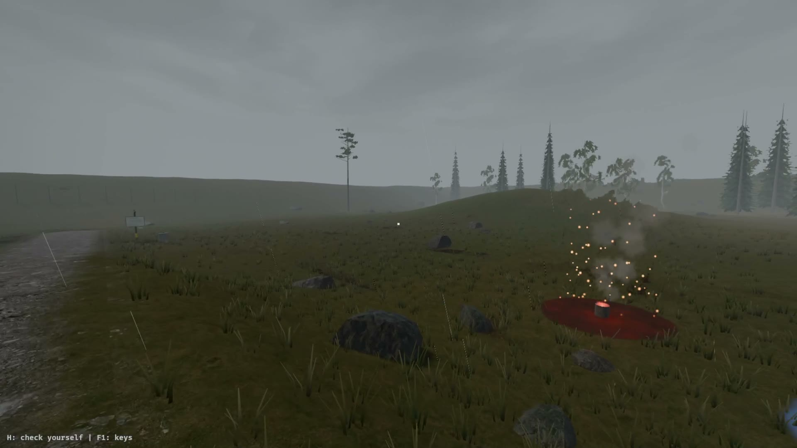 `[0:30:20]` screenshot: `screenshots/03020_leaf-texture-seam-on-path.jpg`

**[0:30:26]** cuts off and then it's just the regular grass texture. It's kind of a seam on the side of the

**[0:30:32]** walkway here too that still needs to get cleaned up. Push the button. Push me. You would think that

**[0:30:43]** this comes first. Okay. It's funny that pushing the button causes it to stick out the back of the

> `[0:30:45] LOG` onboarding: onboarding: Button done

> `[0:30:45] LOG` raid: raid: Driver: "Good. Next: the north post, end of the track."

> 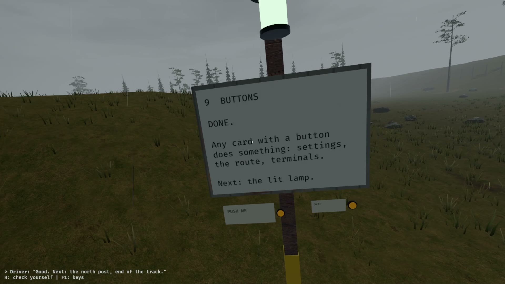 `[0:30:47]` screenshot: `screenshots/03047_push-button-sticks-out-back.jpg`

**[0:30:51]** I hear beeping I sure hope that that's coming from the game and not my

**[0:31:02]** apartment you know what fuck it I'll check yeah it's coming from the game

**[0:31:13]** all the truck pull the cord oh I see that the game is giving me another radio

**[0:31:22]** which is awfully convenient because the radio that I was carrying in my pouch at

**[0:31:27]** some point in that journey disappeared okay well there's another radio here so

**[0:31:32]** That's better than nothing. Press A. I hear some indecipherable muttering.

> `[0:31:36] LOG` onboarding: onboarding: CallTruck done

> `[0:31:36] LOG` raid: raid: Truck: "The north post, north, 10 m. Two minutes. Keep low."

**[0:31:45]** Where's the truck gonna come? Oh, it just, it just spawns in. I guess animations were

> `[0:31:46] LOG` raid: raid: Truck: "I'm at the north post. Five minutes, then I go."

> 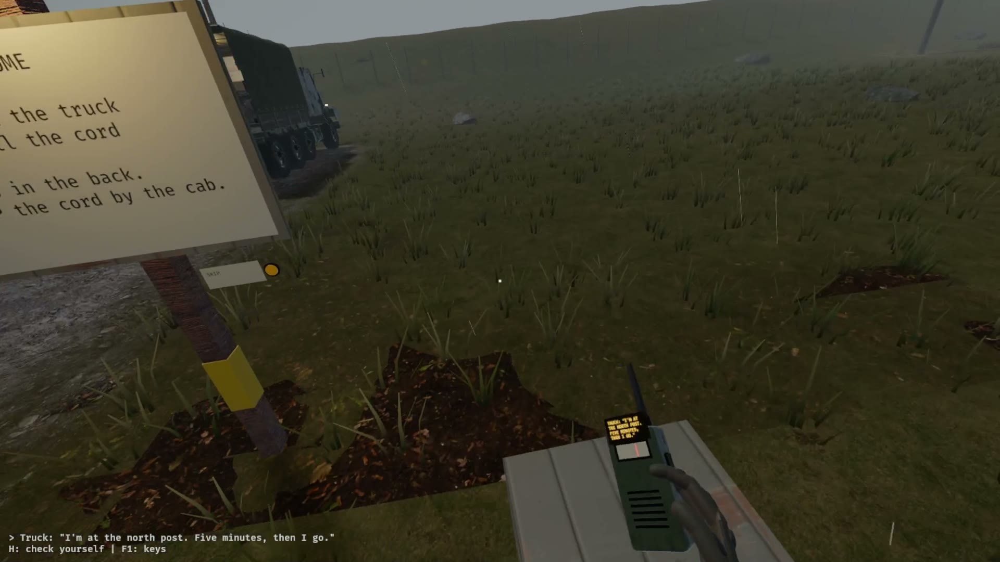 `[0:31:48]` screenshot: `screenshots/03148_truck-pops-in-no-arrival.jpg`

**[0:31:53]** too much to ask for. I don't know. Maybe one day we could do something with this, like, uh,

**[0:32:00]** like using the radio to call in the truck triggers activity to come investigate or something and then

**[0:32:09]** you could have the truck drive in and have some fun animations probably not important right now

**[0:32:14]** all right i am now wait am i done with this tutorial let me check i don't seem to be able

**[0:32:26]** to run anymore concerningly pull the cord okay i guess that would mark the end of the tutorial

**[0:32:33]** Oh, and I am in the SteamVR loading screen. Oh, the noise from the game is back. Is it

> 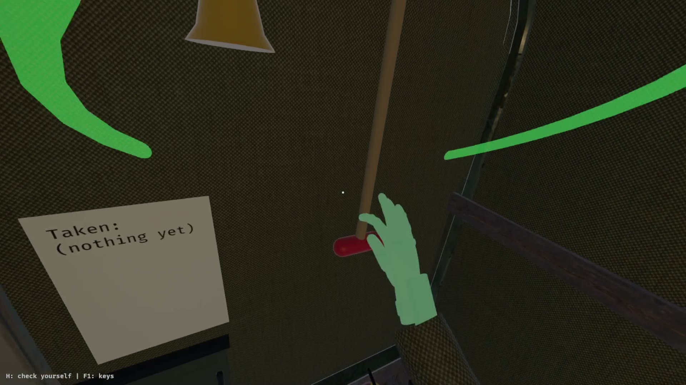 `[0:32:40]` screenshot: `screenshots/03240_log-yard-done-pull-cord.jpg`

> `[0:32:41] LOG` camp: camp: on to marrow_creek

> `[0:32:41] LOG` onboarding: onboarding: PullCord done

> `[0:32:41] LOG` raid: raid: "Right then." The engine turns over.

> `[0:32:41] LOG` raid: raid: Driver: "That's the lot. The real one's colder."

> `[0:32:43] LOG` persist: saving to C:\Users\<user>\AppData\Roaming\extraction\career.ron

> `[0:32:44] LOG` persist: loaded save: 16 items, cycle 0, 3600 s to the Surge

> `[0:32:44] LOG` persist: no career at C:\Users\<user>\AppData\Roaming\extraction\career.ron; starting fresh

> `[0:32:44] LOG` persist: restored 14 items

> `[0:32:46] LOG` robots::sorter: director: the Sorter wakes in the Depot's sorting hall

**[0:32:55]** failing the load? What's happening? Well, I got as far as pull the cord. Found. Oh,

> `[0:32:55] LOG` capstone: capstone: key_marrow lies at [152.0, -44.0]

**[0:33:04]** no, okay, it loaded. It just took its time. Yeah, a loading transition would help, so

> `[0:33:04] LOG` rig::xr: input: fingers tracked (Left hand first)

> `[0:33:04] LOG` rig::xr: input: left hand profile none

> `[0:33:04] LOG` rig::xr: input: right hand profile none

> `[0:33:05] LOG` rig::xr: input: Left stick works

> `[0:33:05] LOG` rig::xr: input: left hand profile /interaction_profiles/valve/index_controller

> `[0:33:05] LOG` rig::xr: input: right hand profile /interaction_profiles/valve/index_controller

**[0:33:09]** was alluring okay new career I guess the the light here on the table is flickering in and out of

> `[0:33:16] LOG` robots::director: director: survey drone to [-200.0, 22.0]

> `[0:33:18] LOG` rig::xr: input: Right grip works

> 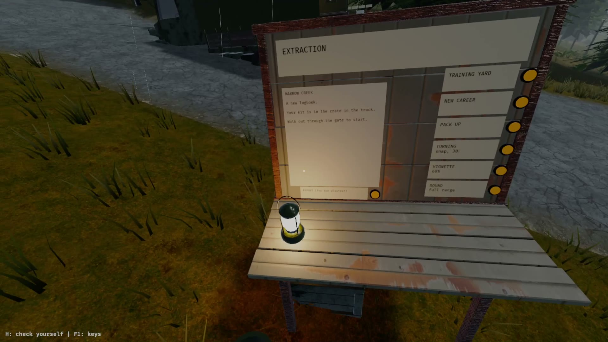 `[0:33:18]` screenshot: `screenshots/03318_lamp-and-trees-flickering-on-load.jpg`

> 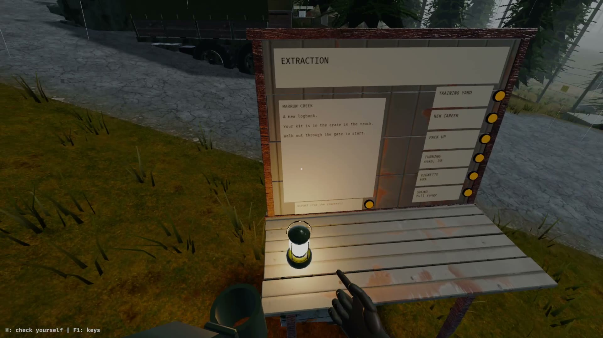 `[0:33:20]` screenshot: `screenshots/03320_log-marrow-creek-loading.jpg`

**[0:33:22]** existence and all of the trees like have their geometries flickering too on a steady pulse that's

**[0:33:29]** concerning okay it looks like none of the material from the tutorial has carried over I'm sitting at

> `[0:33:32] LOG` rig::xr: input: Left grip works

**[0:33:38]** a table there's a stool floating above the ground a crate clipping into the ground the table is just

> `[0:33:39] LOG` rig::xr: input: Right stick works

>  `[0:33:40]` screenshot: `screenshots/03340_floating-stool-crate-clipping-table.jpg`

**[0:33:43]** kind of sticking out of the ground with two legs not on any kind of floor we'll get there i see

**[0:33:50]** stuff in the distance some oh the blinking lights and the fog are beautiful let me tell you that

>  `[0:33:55]` screenshot: `screenshots/03355_blinking-lights-in-fog.jpg`

**[0:33:58]** very nice oh the pop in and out of the tree leaves is like coming and out is

**[0:34:04]** ugly as sin there needs to be lods or something or the fog should prevent isn't it too far away

>  `[0:34:05]` screenshot: `screenshots/03405_tree-leaf-lod-popping.jpg`

**[0:34:11]** together, we just have to draw the fog curtain closer, right? Realistically, LODs should solve

**[0:34:17]** this type of issue. It's what they're there for. Um, okay, so I guess I don't have any equipment

**[0:34:23]** right now. I know that the backpack doesn't exactly work, but I will at the very least

**[0:34:28]** try to play a little bit of the game. So, here we go. We got a gun. I grabbed the magazine first

> `[0:34:33] LOG` rig::xr: input: Right trigger works

**[0:34:43]** because of course I did. And now the magazine's on the floor, and I cannot see it because if I

> `[0:34:48] LOG` rig::xr: input: Left trigger works

**[0:34:50]** bend over to try to pick it up, I can't see shit. This is lovely. Anything? Okay, I was able to get

>  `[0:34:55]` screenshot: `screenshots/03455_magazine-lost-under-crate.jpg`

> `[0:34:57] LOG` robots::director: director: survey drone to [-230.0, -238.0]

**[0:35:05]** the magazine off the floor after some crawling around down there. The fact that it falls under

**[0:35:11]** the crate and I can't see it really doesn't work well. All right, put the backpack back on my back,

**[0:35:21]** Rack the slide, put the gun in the holster.

> `[0:35:21] LOG` robots::director: director: logistics run to [-90.0, 120.0]

**[0:35:26]** The leather thing on top of the holster is a bit weird because I can see it like pops

>  `[0:35:27]` screenshot: `screenshots/03527_holster-leather-flap.jpg`

**[0:35:30]** out.

**[0:35:31]** I'm not sure what that's supposed to represent.

**[0:35:34]** Uh, I'm just going out for now.

**[0:35:39]** I'm just gonna take this extra magazine and put it in the pouch there.

**[0:35:45]** The front of these pockets seems to pop out for some reason when there's something inside.

>  `[0:35:46]` screenshot: `screenshots/03546_pocket-fronts-pop-out.jpg`

**[0:35:49]** I'm not sure what that search, uh, supposed to indicate.

> `[0:35:51] LOG` robots::director: director: survey drone to [150.0, -40.0]

**[0:35:53]** Um, maybe a literal pocket, as in a geometry enclosed on all sides but the top for the chest rig.

**[0:36:01]** Or maybe just, like, a belt that you stick things in.

**[0:36:04]** Like, it doesn't have to be a perfectly realistic or accurate thing.

**[0:36:07]** It can be a UI abstraction, right?

**[0:36:10]** Just for, like, these pockets on the front would be nice, right?

**[0:36:13]** And maybe get rid of, like, the straps on the chest rig, too.

**[0:36:16]** Because, like, obviously my real shoulders aren't there.

**[0:36:18]** but the same logic we should be removing the arm rendering we should be removing the chest straps

**[0:36:22]** right um yeah okay so i have a spare magazine i see i have a dressing can that go in a pocket

**[0:36:30]** somewhere yes it can oh the dressing is now on the floor i guess i have five pockets huh well

**[0:36:44]** the dressing can go in this pocket oh compass that's cute flashlight can go here oh no the

**[0:36:59]** flashlight's on the ground now. My favorite. Okay, now the flashlight doesn't fit into that pocket.

> `[0:37:03] LOG` robots::director: director: walker to work site [-40.0, -60.0]

**[0:37:08]** Very interesting. It doesn't fit into any pocket. That's a little odd. I'll just leave it here. I

**[0:37:20]** probably won't need it. Uh, there's these three pin-looking things. I have no idea what these are,

**[0:37:27]** so I'll leave them here. Radio is important, so I'll put that in a pocket. I have no idea what

**[0:37:37]** that thing is I just picked up. Oh, ammo. Um, I'll put that in my backpack. Well, I would put that in

**[0:37:44]** my backpack if the backpack weren't open, so I'll use my last pocket for the ammo, and I'll take a

> `[0:37:51] LOG` robots::minelayer: minelayer: out from the gate to [Vec3(9, 19, 70), Vec3(-151, 25, 178)]

**[0:37:56]** look at the map. The map is super cool. It is, uh, I don't see a way to bring it with me right now,

>  `[0:38:00]` screenshot: `screenshots/03800_map-board.jpg`

**[0:38:17]** and it's on the floor. That's okay. Let's just go do the rest of the stuff. I see this, like,

**[0:38:21]** medical supply box on the side wall. I have no idea what is up with that. Uh, let's just-

>  `[0:38:22]` screenshot: `screenshots/03822_medical-box-on-wall.jpg`

**[0:38:32]** let's just go and see what happens. Maybe I'll run into some enemies, or maybe not, we'll see.

> `[0:38:35] LOG` raid: raid: Out of the truck. The Surge is due in about 60 minutes.

> `[0:38:35] LOG` robots::director: director: walker to work site [-90.0, 120.0]

> `[0:38:35] LOG` sim::playtest: recording this raid to C:\Users\<user>\AppData\Roaming\extraction\raids\marrow_creek\raid001-1793171014.jsonl

>  `[0:38:36]` screenshot: `screenshots/03836_log-raid1-out-of-truck.jpg`

> `[0:38:44] LOG` onboarding::firsts: first time: NotePinned

> `[0:38:44] LOG` raid: raid: Truck: "Reading their notes? I keep copies. Board in the back."

> `[0:38:44] LOG` raid::board: read: marrow_creek/Gate log

**[0:38:45]** Uh, the sound of rain inside of this little shack out front seems a little wrong. I love the little

**[0:38:57]** note. Maybe anything other than a solid white background. A cassette tape. I don't know what

>  `[0:38:58]` screenshot: `screenshots/03858_note-white-background.jpg`

**[0:39:21]** this cassette tape's for. There's some z-plane fighting on the bottom of it. It's got some

>  `[0:39:22]` screenshot: `screenshots/03922_cassette-player-z-fighting.jpg`

**[0:39:25]** buttons on the top. I don't know what they do. Oh this one seems to open the cassette player. Oh and

**[0:39:30]** there is a cassette here. All right this is fun. I like this. Okay well the cassette's in. I don't

**[0:39:38]** know how to close. Oh there that finger seems to have done it. Well the cassette is playing. It's

**[0:39:49]** just making an ominous hum though oh music okay so the actual buttons on the top of the cassette

>  `[0:40:05]` screenshot: `screenshots/04005_ui-over-cassette-buttons.jpg`

**[0:40:08]** the ui elements render on top of them so i couldn't actually see what the buttons i was

**[0:40:13]** pressing were okay that's cute i'm gonna put the cassette in my bag even if it ends up phasing out

**[0:40:19]** of reality by virtue of being in my backpack at least i'll be able to listen to it for a short

**[0:40:24]** while and then some shotguns tells which i will ceremoniously put in the bag even though i'm

**[0:40:29]** probably never getting them back once I put them in there. Oh I think the cassette is a little bit

**[0:40:41]** on the nose. If we're gonna do that it needs to at least be a little greener. Oh wait. Oh I just

**[0:40:47]** realized to my horror that because I put the cassette in the bag I now. Okay let's let's let's

**[0:40:56]** that's enough fun with the cassette player. We'll just leave it. Put that back on. I will say the

**[0:41:07]** the fun little music there spoils the vibe okay for some reason i'm walking at a reasonable speed

**[0:41:20]** again i have no idea why during the tutorial that just kind of stopped for some reason the red on

> `[0:41:25] LOG` robots::director: director: survey drone to [5.0, 70.0]

**[0:41:28]** that building over there is rendering like through the fog as if it's not affected by it

>  `[0:41:30]` screenshot: `screenshots/04130_red-building-ignores-fog.jpg`

**[0:41:35]** Oh the bird stuff is cool. If we- if you could get the bird animation for like takeoff and

**[0:41:42]** landing and add a little bit of flapping noises to it that would be incredible. More of that

**[0:41:47]** weird gap in the wall of the building. Door here already open. Oh! Oh this door is- its

**[0:41:54]** hinge is off the side of the building. That's no good. Um what's this? Looks like a door

>  `[0:41:56]` screenshot: `screenshots/04156_door-hinge-off-building.jpg`

**[0:42:06]** stop of something into the ceremony bag of no return oh there's something under the floor that

**[0:42:20]** i can't actually pick up or maybe it's invisible here okay the handsaw obviously super primitive

>  `[0:42:20]` screenshot: `screenshots/04220_item-under-floor.jpg`

>  `[0:42:28]` screenshot: `screenshots/04228_handsaw.jpg`

**[0:42:31]** model cool to have it'd be cool if i could use that to saw through something uh i will warn you

**[0:42:37]** if you give your players a handsaw they're gonna want something to saw through so you need to be

**[0:42:43]** ready for that. I'll put that in the bag. I see another battery. Some electronics looking scrap.

**[0:42:54]** We'll take that. What is this? More like metal scrap. Cool. Oh interesting how the leaves blink

**[0:43:10]** out of existence as I get close to them. They just kind of shrink away. Cute car models. Yeah I don't

>  `[0:43:12]` screenshot: `screenshots/04312_leaves-shrink-when-close.jpg`

**[0:43:31]** know the threat that i think like where does effort need to go other than the stuff i'm calling

**[0:43:37]** out right now i would say beyond the obvious things that i'm calling out and the genre of

**[0:43:43]** like defect that's associated with the things i'm calling out like there are some obvious

**[0:43:50]** correctness issues for 3d models right like this seam is wrong okay those footsteps sounding things

>  `[0:44:00]` screenshot: `screenshots/04400_model-seam.jpg`

**[0:44:05]** in the distance are freaking me out which is good that's what they're supposed to do

**[0:44:13]** what is that it's like an orb of some kind okay i gotta say this you probably get distracted by

> `[0:44:15] LOG` rig::xr: input: Right stick click works

>  `[0:44:17]` screenshot: `screenshots/04417_orb.jpg`

**[0:44:23]** what's going on in the game uh technical correctness issues aside like the seams

**[0:44:29]** uh the pop out i think that the number one and like obviously there are tons of parts of 3d

**[0:44:37]** models that just clip through each other or don't look right from certain angles i don't know what

**[0:44:42]** we need to do about that maybe we need to go searching for like connector skills to get the

**[0:44:46]** model sorted out or lean heavier on asset packs or something right um i would say that's definitely

**[0:44:54]** like what i foresee being the biggest hurdle towards this like project ever like being good

**[0:45:01]** right? Um, I know that everything is time and place. Here are footsteps, but I don't know what

**[0:45:10]** from where. Sound like they're coming from this direction. Oh, what's that? Oh, I've dropped my

**[0:45:32]** gun. Worst time for that to happen. I will say the map being very flat with no, like, walls or

**[0:45:50]** barriers is kind of boring like it's fine that this exists i'd like for the terrain and the i

>  `[0:45:52]` screenshot: `screenshots/04552_flat-open-map.jpg`

**[0:46:01]** would like for the sight line to be much more broken up right right now it looks like a couple

**[0:46:05]** of points in an otherwise empty plane what is that is it carrying something more importantly

**[0:46:17]** what's that thing coming towards me did i not go towards it should i hide behind this building i

**[0:46:30]** don't know. The smokestacks in the distance are amazing. Oh, big orb in the sky. That's scary.

>  `[0:46:35]` screenshot: `screenshots/04635_smokestacks-orb-in-sky.jpg`

**[0:46:46]** There's definitely something here. There is definitely something here. All right,

**[0:46:51]** I'm gonna go say hello to this guy. Just because I'm curious what it is. It doesn't seem to notice

**[0:46:58]** me. Got some caution stripes on its back there. Is it going somewhere? Hey, buddy. Oh, it's placing

> `[0:47:10] LOG` onboarding::firsts: first time: Heard

> `[0:47:10] LOG` raid: raid: Chirps answer each other nearby. They're calling.

> `[0:47:10] LOG` raid: raid: Truck: "Move off quiet, then go still. Something heard you."

**[0:47:13]** a landmine. Okay, that's a little mean. Hey, buddy, don't do that. Hey, stop it. Stop. Oh,

>  `[0:47:13]` screenshot: `screenshots/04713_minelayer-placing-mine.jpg`

**[0:47:23]** I am now riding it, I guess. Well, it seems harmless, other than the, you know, dropping

**[0:47:32]** landmine thing. Oh, it's that guy over there, the walker. Wow, I could hear it from a long way away.

**[0:47:41]** Oh, that little robot thing is really cute. Uh, the landmines are a bit obvious.

>  `[0:47:45]` screenshot: `screenshots/04745_landmines-glowing.jpg`

**[0:47:47]** I'm not sure what his job is. Uh, horrific, overall. Maybe something a real bit- a little

**[0:47:55]** bit less realistic than landmines lying on the floor these are like weird robots after all

**[0:48:00]** i i don't think that these like very clearly visible glowing things on the ground are gonna

**[0:48:05]** like be interesting but that's a cool design i like that very cute let's move towards the

**[0:48:12]** walking guy oh no he's far away now oh there's like a timber mill looking thing or a water wheel

>  `[0:48:17]` screenshot: `screenshots/04817_timber-mill.jpg`

**[0:48:21]** okay i noticed that these birds up in the distance as i'm walking are like very very what's the word

>  `[0:48:25]` screenshot: `screenshots/04825_distant-birds-jumpy.jpg`

**[0:48:30]** jumpy low frame rate i don't know what that's about oh something i was talking with my friends

**[0:48:39]** about the other day is how do people do good looking terrain right and one of the answers

**[0:48:46]** that they gave me was terrain packs right where even if you take the same like rough rocky cliff

**[0:48:53]** asset if you rotate it and place it in different configurations it can look like varied terrain

**[0:48:59]** the other thing they taught me about was tri-planner textures being making it a lot

**[0:49:05]** more forgiving to do like big cliffs and walls and stuff like that and arbitrarily scaling things

**[0:49:11]** to create the kind of environment you want I think that was pretty interesting

**[0:49:16]** yeah I think if we had LODs for like the foliage right and maybe if we focused on making the

**[0:49:26]** leaves look a little bit better right because right now there's some

**[0:49:29]** a little bit of roughness right I think that this would be a very gorgeous environment where I am

>  `[0:49:33]` screenshot: `screenshots/04933_woodsy-area.jpg`

**[0:49:38]** right now this kind of like woodsy place oh it's playing the indoor noise when I'm outside but

**[0:49:46]** under the roof, that's interesting. Again, it's a little bit difficult to open doors right now,

**[0:49:57]** not sure why. Glow stick? I'm not sure what that is. Green test tube. Oh god, I hear footsteps,

> `[0:49:57] LOG` raid: raid: Empty now. Wedge the door, then light the stove.

>  `[0:50:00]` screenshot: `screenshots/05000_glow-stick-test-tube.jpg`

> `[0:50:07] LOG` raid::board: read: marrow_creek/Cabin tally

**[0:50:09]** I'm scared. Fuck, fuck, fuck, fuck, fuck. Oh, the footsteps are scary as hell, which is a good thing.

**[0:50:15]** Genuinely unambiguously a good thing. I'm going out front. Where is it? God, those things move

**[0:50:24]** their feet so fast why are they in such a hurry oh god being in that building and then hearing

**[0:50:33]** the footsteps approach and not be able to look out and see where easily is scary okay further

**[0:50:42]** confirming that audio and vr is audio design and vr experiences is really really important

**[0:50:52]** okay there's a lot of stuff in this building um plenty of treasure makes me happy

**[0:51:00]** I'm too scared to be in here I gotta get out I cannot even be in the building because I'm scared

**[0:51:06]** where is that footstep coming from buddy buddy I'm gonna go over to the sawmill it's

**[0:51:22]** relatively open nobody can sneak up on me there oh a knife okay and uh it's like a tiny little

**[0:51:29]** grenade that's cute I did I guess I have a pocket for that I'll hold the knife in my off hand

**[0:51:36]** yeah there's a matchbox I feel like some of the props like the matchbox and the grenade and the

>  `[0:51:48]` screenshot: `screenshots/05148_matchbox-props-too-small.jpg`

**[0:51:54]** dressing are a little bit too small right I think they could bear to be a bit bigger and it would

**[0:52:00]** be fine also the fact that all these things are like uniform in size you could probably I mean I

**[0:52:06]** understand that the backpack space is a limiting constraint but like they can be a little bit

**[0:52:11]** bigger okay there's another one of those bolt looking things I saw near the start I don't know

**[0:52:17]** that's about i keep i keeping my gun out at all times because i'm so afraid but i am still

**[0:52:25]** ceremoniously gonna pick up a couple of things off the uh ground here now when you walk away

**[0:52:31]** from your backpack oh oh i shattered the box and now there's two floating googly eye looking things

>  `[0:52:37]` screenshot: `screenshots/05237_broken-crate-googly-eyes.jpg`

**[0:52:39]** and more treasure on the ground okay oh i'm scared i'm scared i'm scared i'm scared where is it where

**[0:52:49]** is it buddy oh okay when I'm holding my hand close to the gun the green halo popping up

>  `[0:52:55]` screenshot: `screenshots/05255_green-halo-near-gun.jpg`

**[0:53:00]** is very distracting and maybe not necessarily what I'm after okay I'm too scared I think the

**[0:53:10]** fact that the backpack doesn't work and a couple of the basic QOL issues are making this really

**[0:53:17]** rough for me to like want to have an extended play test with but there there's not enough here that

**[0:53:23]** I can like start to look at things and see and it's it's very promising and very exciting it's

**[0:53:28]** just oh wow I I don't know what it is the footsteps on the walker incredible I'll say

**[0:53:43]** walking up to the mine layer there was not like any audio feedback it was not clear what that

**[0:53:48]** thing was or what its relationship to me was so I just I ended up finding it cute I kind of like

**[0:53:54]** that it was going about its merry business, more or less, like, independently of whatever I was up

**[0:53:58]** to, right, I'm gonna, because I can't really loot anything, or, like, enjoy the loot economy,

**[0:54:05]** or whatever, I'm just gonna go hunt down this walker, and then I think I'll call the playtest

**[0:54:09]** there, I hope, I will say, I think things are too far apart, um, I think maybe designing the game

**[0:54:22]** to be tighter, right, and for the enemies to not see you from- at least for some enemies in the

**[0:54:28]** stair zone to not see you from as far away, and breaking up the sight line would make this whole

**[0:54:33]** place feel a lot less samey and monotonous. Um, I like that there's a bunch of buildings,

**[0:54:39]** for sure, right? Like, it's good, it's just the layout needs to- oh, there's a cluster of mines

**[0:54:45]** over there for some reason. Where the frick did the walker go? Oh, there it is! Hey, buddy!

>  `[0:54:45]` screenshot: `screenshots/05445_cluster-of-mines.jpg`

**[0:54:55]** I have no idea when that thing's actually gonna see me, but I now see it.

>  `[0:54:56]` screenshot: `screenshots/05456_walker-sighted.jpg`

**[0:55:01]** Okay, I can't use both hands on the gun.

**[0:55:05]** Hey buddy.

**[0:55:06]** Hey buddy.

> `[0:55:07] LOG` raid: raid: A machine close by calls out. Others answer.

> `[0:55:07] LOG` raid: raid: Machine talk on the radio, loud and close: coming here.

> `[0:55:08] LOG` onboarding::firsts: first time: Aimed

> `[0:55:08] LOG` raid: raid: Truck: "Break its line, now. It's aiming at you."

**[0:55:09]** Are you gonna shoot me?

>  `[0:55:09]` screenshot: `screenshots/05509_log-raid1-aimed-at-bleeding.jpg`

**[0:55:11]** What's up?

> `[0:55:12] LOG` onboarding::firsts: first time: Bleeding

> `[0:55:12] LOG` raid: raid: Truck: "Dressing on, now: you're bleeding. Before you drop."

**[0:55:16]** Come on.

**[0:55:17]** Come closer.

**[0:55:18]** Apparently I can't aim for crap, so I need to lure it closer by standing around this

**[0:55:22]** corner.

**[0:55:23]** Yep, it doesn't know to go far away from me, so that's perfect.

> `[0:55:29] LOG` raid: raid: Two-tone chirps, close. More of them coming.

**[0:55:30]** I got it!

>  `[0:55:31]` screenshot: `screenshots/05531_walker-hit.jpg`

**[0:55:35]** Two-tone chirps. Close. More of them coming. Oh, and I'm bleeding. Okay, well, backpack- I don't

> `[0:55:37] LOG` robots::director: director: survey drone to [-120.0, -175.0]

**[0:55:43]** know how the backpack got here. I will wrap- do the dressing. Okay. Oh, it's- oh, the- the way that

> `[0:55:48] LOG` raid: raid: You bind the wound. The bleeding stops.

>  `[0:55:52]` screenshot: `screenshots/05552_walker-falls-apart.jpg`

**[0:55:54]** it falls apart is utterly delightful. I love that. And the smoke, and- eh. Oh, I don't know what that

**[0:56:04]** cluster of noises was oh can i tell you the compulsion to try to pick up its gun and shoot

**[0:56:11]** it right now is very strong where is it oh yeah this is cumbersome come on point the gun

> `[0:56:17] LOG` onboarding::firsts: first time: LostYou

> `[0:56:17] LOG` raid: raid: The whirring fades. It's stopped looking.

> `[0:56:17] LOG` raid: raid: Truck: "Lost you, has it? Good. Stay low a while."

**[0:56:29]** point the gun oh if i can figure out how to like do this my butt my body pushing the corpse makes

>  `[0:56:35]` screenshot: `screenshots/05635_handling-walker-gun.jpg`

**[0:56:37]** it difficult to position this thing oh my gosh it would be so fun because i got it crouching low to

> `[0:56:40] LOG` raid: raid: Close by, a machine goes still, then walks off.

**[0:56:43]** the ground and like trying to stabilize it if i could use both hands to stabilize the dismembered

**[0:56:49]** body of this thing and try to point the gun in a direction that'd be amazing okay there's more

**[0:56:54]** walkers coming um shoot i i guess if i were playing normally i would run we're not doing

**[0:57:01]** that right now. I think I might be out of bullets in this one. Um, next magazine. That's not a

> `[0:57:01] LOG` robots::director: director: logistics run to [125.0, 80.0]

> `[0:57:07] LOG` rig::xr: input: Right primary works

**[0:57:10]** magazine. This is a grenade, right? Uh, the- the response. The idea of, like, the responses where

**[0:57:32]** they send out more guys is really cool. I feel like having time pressure to, like, keep you

**[0:57:39]** wanting to, like, grab- smash and grab. Oh my god, throwing things is hard. Throwing things is hard.

> `[0:57:43] LOG` raid: raid: The radio stutters in their tones. They're coming here.

**[0:57:47]** come on get closer buddy oh no you're clipping through the wall that's unfortunate oh

>  `[0:57:50]` screenshot: `screenshots/05750_walker-clipping-through-wall.jpg`

>  `[0:58:00]` screenshot: `screenshots/05800_log-raid1-death.jpg`

**[0:58:01]** okay something i want to talk with oh it's so cute and scary at the same time

> `[0:58:02] LOG` raid: raid: Everything goes grey. Somewhere, a collection order is filed.

> `[0:58:02] LOG` sim::playtest: raid recorded: died -> C:\Users\<user>\AppData\Roaming\extraction\raids\marrow_creek\raid001-1793171014.jsonl

>  `[0:58:03]` screenshot: `screenshots/05803_raid1-death.jpg`

**[0:58:07]** oh i just teleported back to the truck i have no idea how or why okay yeah i feel like the

> `[0:58:08] LOG` onboarding::firsts: first time: Death

> `[0:58:08] LOG` raid: left 14 items in remains at [-23, 18, 71]

> `[0:58:08] LOG` raid: raid: Truck: "Got you back. Don't ask how. Crate's as you left it: 8 things."

> `[0:58:08] LOG` raid: raid: You wake in the back of the truck. Your kit is gone.

>  `[0:58:10]` screenshot: `screenshots/05810_log-wake-in-truck.jpg`

> `[0:58:13] LOG` raid: raid: Truck: "14 things you carried are where you fell."

> `[0:58:18] LOG` raid: raid: Truck: "Beat their convoy there and they're yours again."

> `[0:58:23] LOG` raid: raid: Truck: "No radio on you. Take my spare, off the ledge."

**[0:58:24]** footsteps maybe can be heard from too far away yeah i have not been looking at my wrist so if

**[0:58:35]** you've been trying to tell me things through my wrist then you're not getting anything

**[0:58:41]** oh the the note log the the like log board up here is really cute and cool all right

>  `[0:58:45]` screenshot: `screenshots/05845_truck-note-board.jpg`

**[0:58:52]** for the stuff i found it'd be nice if i could like actually take back the notes home

**[0:58:58]** okay i don't know if i'm attached to the truck so maybe let's not spend too much time on this

**[0:59:02]** truck concept for now um just because i like having like shelves to put stuff on and like

**[0:59:10]** cabinets to put notes that i find out from the in the field and and stuff like is that a blimp

**[0:59:16]** that a blimp hello okay well i don't have any weapons more because i died with my only weapons

>  `[0:59:16]` screenshot: `screenshots/05916_blimp.jpg`

**[0:59:25]** but i have to see this that is so cool that is so cool oh there's something here all right i'm

> `[0:59:27] LOG` raid: raid: Driver: "Your place by the gate log? Shut again."

> `[0:59:27] LOG` raid: raid: Out of the truck. The Surge is due in about 41 minutes.

> `[0:59:27] LOG` sim::playtest: recording this raid to C:\Users\<user>\AppData\Roaming\extraction\raids\marrow_creek\raid002-1793172266.jsonl

**[0:59:47]** gonna go check out the blimp i'm gonna die immediately because i have literally nothing on me

**[0:59:51]** that's so cool oh you could give the blimp search lights maybe wouldn't that be fun

**[1:00:01]** oh one of the okay one of the things that's fresh to me about the zion i get and probably for now

**[1:00:08]** it's a good idea to throw a lot at me from the start because you know i need to see a lot and

**[1:00:13]** quickly talk about a lot like i could say this blimp thing is one of the coolest things i've

**[1:00:20]** ever seen the blinking lights on the smokestack that pierce the fog and like the all the blinking

>  `[1:00:22]` screenshot: `screenshots/10022_smokestack-lights-in-fog.jpg`

**[1:00:26]** lights that are piercing the flog the fog truly incredible design sensibility going on here

**[1:00:33]** right like there's a lot that's working i know that i've said like i'm really like i don't like

> `[1:00:34] LOG` robots::dirigible: dirigible: spotted someone at [96, 17, 173]

**[1:00:37]** the fact that this plain grassy field is the exact same grass that your coffee pasted for, like, a

**[1:00:42]** bunch of paces, right? But, like, there's so much cool stuff going on in this game. 100%, right?

**[1:00:51]** I don't even know if my ideas about what good map design would look like are even correct at all,

**[1:01:02]** right maybe having areas of like designed gamey space right but that have enemy activity broken

**[1:01:13]** up by big patches of like nothingness or like very little so just so that like gunfights in

**[1:01:20]** one part of the map won't attract the entirety of the robots to your front door right like maybe

**[1:01:28]** maybe, like, having, I don't know, I don't know how you want to deal with it, right? But, like,

**[1:01:33]** wow. Okay, I'm gonna, I'm gonna see if I can climb that rope. If I could climb that rope,

**[1:01:38]** that would be the coolest thing ever. Why is it here? Why isn't it moving? What is that? Is that

**[1:01:46]** a, is that a cassette from earlier? Is this my, is this my stuff? Well, the, the basket is, like,

>  `[1:01:50]` screenshot: `screenshots/10150_blimp-basket-buried.jpg`

**[1:01:57]** buried in the ground. So I guess not. Hold on, let me see if I can climb this. No, sadly I cannot

> `[1:02:04] LOG` robots::dirigible: dirigible: spotted someone at [128, 16, 83]

**[1:02:05]** climb the rope. Maybe if there was like a something or like a button or an override or

**[1:02:11]** something I could do to like ride the carriage up to the blimp. Let me tell you, that would be the

**[1:02:17]** coolest thing ever. Okay, well I see, I see my friends coming, so I probably do not have long

**[1:02:34]** for this world maybe this blimp isn't supposed to be stuck in the ground i don't know oh no it's

**[1:02:41]** going up oh okay well it pulled the thing up it did not pull me with it possibly because i stepped

>  `[1:02:45]` screenshot: `screenshots/10245_blimp-lifts-off.jpg`

**[1:02:51]** outside of it and now it's leaving oh that's cool okay blimps don't turn like that at least i don't

**[1:03:03]** think that they do, but the idea is super cool. All right, well, all I have left is my fists and

**[1:03:13]** two walkers heading straight towards me, so. Maybe some kind of vignette when you're taking damage

**[1:03:25]** would, like, let me know when I'm being shot. Oh, I'm being grappled now. Oh boy. Why? What are you

>  `[1:03:30]` screenshot: `screenshots/10330_grappled-by-walker.jpg`

**[1:03:34]** gonna do when i get close huh buddy oh the fuck wait what what what is their goal here is that

**[1:03:41]** hurting your grappling hook isn't hurting me buddy oh i love that i can like try to grab the robot

**[1:03:49]** here what is the goal of these what what are they doing they're pulling me back and forth

>  `[1:03:50]` screenshot: `screenshots/10350_grabbing-robot.jpg`

**[1:03:59]** i keep trying to grab their little robot parts to like push them around and stuff which would

> `[1:04:08] LOG` anomaly: director: attention buys a response to [92, 15, 54]

**[1:04:10]** be fun yeah oh these are really cool little guys oh one thing all right i was talking about enemy

**[1:04:22]** design then i got distracted uh when i'm standing at a little bit of a distance from these guys

**[1:04:27]** vr you are not hitting these tiny little joints on the legs they need to be big and pronounced

>  `[1:04:30]` screenshot: `screenshots/10430_walker-leg-joints-too-small.jpg`

**[1:04:34]** i don't know maybe make them orange or the instead of black on the paint or yellow if you want those

**[1:04:40]** to be like actual targetable points, right? Um, when I see this, I'm gonna see this like what

> `[1:04:43] LOG` robots::director: director: response team to [92, 15, 54]

**[1:04:47]** appears to be a glowing circle, right? And I'm gonna say, all right, I'm just gonna shoot the

>  `[1:04:50]` screenshot: `screenshots/10450_orange-glowing-circle-target.jpg`

**[1:04:52]** glowing circle, right? Because it's orange, right? Um, just like, you know, that's the kind of thing

**[1:04:58]** to be thinking about. Uh, these are, the robots are beautiful. A little bit of polish, and these

**[1:05:06]** are, this is a really fun design. Oh, there's one of the flying drones. Okay, this is where I die.

> `[1:05:15] LOG` onboarding::firsts: first time: DroneLock

> `[1:05:15] LOG` raid: raid: Truck: "Run across it, to cover. That chirp is it taking aim."

>  `[1:05:16]` screenshot: `screenshots/10516_log-raid2-drone-lock.jpg`

> `[1:05:20] LOG` raid: raid: Truck: "Under a roof's best. It sees down through trees."

>  `[1:05:20]` screenshot: `screenshots/10520_flying-drone.jpg`

**[1:05:24]** Oh, at least the flying drone is pretty. Yeah, okay, that thing is moving way too fast

**[1:05:29]** for somebody in VR to possibly have a shot. Okay, I am dead. Yeah, have the drone hold still for a

>  `[1:05:30]` screenshot: `screenshots/10530_log-raid2-death.jpg`

> `[1:05:31] LOG` sim::playtest: raid recorded: died -> C:\Users\<user>\AppData\Roaming\extraction\raids\marrow_creek\raid002-1793172266.jsonl

> `[1:05:37] LOG` raid: left 0 items in remains at [92, 15, 52]

**[1:05:43]** the drone is way over tuned. That thing is brutal. Um, okay, and I'm done playtesting for now. It is

**[1:05:50]** almost 11pm, and I am tired, and I am thirsty. Uh, but yeah, keep up the good work. Um, focus

**[1:05:59]** really hard on models and map work, right? I think is the mo- that is going to be the most visible

**[1:06:05]** thing and like especially onboarding super super important right um even if we don't know what

**[1:06:14]** we're going to do long term for onboarding making the onboarding fun and not just following a list

**[1:06:20]** of instructions and presenting you with one thing at a time would be good one or two things at a

**[1:06:27]** time anyway right and you could have fun with it you can let the player have some fun with the

**[1:06:32]** onboarding too but it's the first thing anybody's gonna see when looking at this stuff right so it's

**[1:06:41]** really important to get it right i guess all this like weird cooking stuff over here this can very

**[1:06:49]** much be sidelined for the time being i don't i do not think it is important like it's fun to have

**[1:06:55]** like pointless food related treasure that you can pick up i don't need like a cooking mini game

**[1:07:02]** right now. I just, it was, like, an idea for something you could have to, say, pick something

**[1:07:08]** up or not pick something up, right? Just to have things in the buildings to put in a bag that are,

**[1:07:14]** like, generally valuable treasure, that means something, right? Okay, sorry, I'm rambling,

**[1:07:19]** I'm rambling. I'm gonna stop now. I'm gonna stop the recording. Uh, there are your details.

**[1:07:24]** Good luck. Thank you again. Really, really cool stuff.

