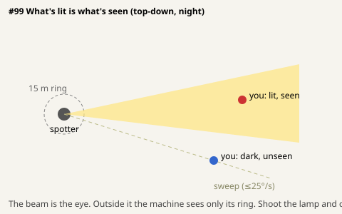
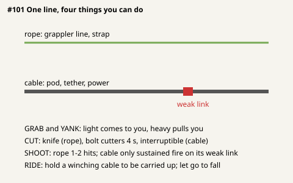
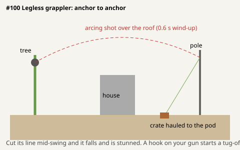
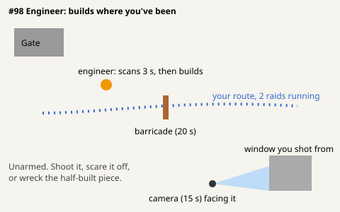

# Workers, second pass: #99, #100, #101, #98

A proposal for the coordinator to decide against the standing direction:
player-caused, readable before it lands, slow before fast, nothing on a
hidden counter. Robot minds owns behaviour; Robot bodies owns bodies,
models and the searchlights. Mock pictures are in `docs/robots/workers_2/`:
the behaviour sketches (`*_mind.svg`) are mine; Robot bodies adds the body
mocks beside them.

Only step 0 (no raid sends a minelayer) is built. Everything else waits on
a yes.

Order as asked: #99, #100 (on #101's line model), #98. Costs are in days of
Robot minds' work; bodies are costed by Robot bodies.

---

## #99 Searchlights: what's lit is what's seen

**What changes.** The spotter and the dirigible see through their beam.
Robot bodies gives each a `searchlight::Beam { yaw, pitch, half_angle,
reach }` with `aim()` (lamp position, direction), swept slowly over a watch
arc. In `senses::perceive`, for a robot with a `Beam`:

- **Inside the beam:** in the cone, within `reach`, and in line of sight from
  the lamp. You count as fully lit (light 1, as under a white star), so dark
  and night don't hide you there. This uses the existing starlight path in
  `exposure()`.
- **Outside the beam:** the robot's eye sees only a short ring around itself:
  spotter 15 m, dirigible 25 m below the gondola. Its 100° and 300° cones go.
  By day the ring widens to 40 m, so neither machine is blind at noon, but
  the long look is still only where the beam points.
- **The mind steers the beam** with `Beam::steer(target, rate)`:
  - It swings to a sighting, a heard Noise (dirigible only) or a last known
    spot, holds there, then goes back to sweeping.
  - The swing rate is capped at 25°/s. The beam coming round onto you is the
    first tell.
  - The spotter's existing 3.5 s fix (FIX) still runs before any report.

**What you can do.** Read the sweep and cross behind it. Stay out of the
pool of light. Shoot the lamp: a dead lamp leaves only the ring. Lead the
beam away with a noise.

**Tests.** Lit at reach means seen. Unlit just past the ring, at night, means
unseen, even inside the old cone. The beam's swing toward a noise takes at
least MIN_TELL. The spotter still needs FIX before it reports.

**Cost: 1 day.** **Cut:** the spotter's `pan_yaw` sweep. The beam's sweep
replaces it, and the body turns to follow the beam.

---

## #101 Lines you can work with (shared model, under #100)

**One model.** A `Line { from, to, kind, tension, hp, cut }` between two
ends, either of which may be an entity or a world anchor. Every line-like
thing goes onto it: grappler lines, the dirigible's pod cables, the spotter
tether, the sentry power cable and the engineer's straps and cables. The
existing `Cuttable`/`Cut` path stays the one way a line parts, so pylon,
sentry and mine-lead cuts keep working.

**Gauges by kind**, one table. Every pull and snap has a tell of at least
MIN_TELL: a creak and a haptic ramp through the one haptics path.

| | Rope (grappler line, strap) | Cable (pod, tether, power) |
|---|---|---|
| **Grab & yank** | Reuses the climbing `RopeGrip`. A pull against the line's tension: a light thing comes to you, a heavy one pulls you. | The same, at a heavier weight class. |
| **Cut** | A blade (the knife) cuts it in one stroke. This is new: blades write `Cut` on a line. | Bolt cutters over 4 s, seen and heard, and interruptible: let go and the progress stays. |
| **Shoot** | Parts in one or two hits on the line. | Only sustained fire on its weak link (a visible shackle, 6 hits), never one lucky round. |
| **Ride** | Not a ride: too thin to bear you. | Hold on while it winches and you're carried. Let go, fall, or climb onto the lip at the top. |

Cutting a line is never the only way past anything; there's always a
second way.

**Candidates, ranked by fun per day** (my estimate; you pick the set with
the user):

| # | Candidate | What you do | Days |
|---|---|---|---|
| 1 | **Grappler line** | Yank it, cut it, shoot it; tug-of-war over a snatched item (see #100) | in #100 |
| 2 | **Spotter tether** | Yank it down a metre at a time while it fights the winch; it can now be cut *and* pulled | 0.5 |
| 3 | **Pod cables: cut or shoot** | Part one cable and the pod tilts and spills; part both and it drops, loot and all | 1 |
| 4 | **Engineer straps and cables** | Drag a barricade away by its strap; cut a camera's cable to blind it | in #98 |
| 5 | **Pod cables: ride** | Hold the cable as it reels up and ride to the dirigible; climb onto the pod's lip or let go | 2 (plus a walkable gondola from Robot bodies) |
| 6 | **Sorter's tote** | Tug-of-war over a tote it holds: win and it lets go, lose and it walks off with it | 1 |
| 7 | **Collector's body bag** | Pull the bag back off its hook | 1 |

**Cost of the base: 2 days** (the line model, the gauges table, the knife
cutting lines, the ride hook), plus the days in the table.

**Owners.** The player's side (the knife writing `Cut`, the ride and climb
exit) touches Weapon feel's melee and the climbing gadget. I'd write those
hooks if the owners agree.

---

## #100 Grapplers without legs

**How it gets around.**
- It has no legs. It hooks an anchor and winches or swings to it: trees,
  poles, roof edges, rocks, the pod itself.
- Each valley gets an anchor graph built at load beside the nav grid.
  - Edges are hook range (22 m) with a clear line, or an **arcing shot** whose
    ballistic path clears a corner or a ridge. That's how it gets round tight
    spots.
  - A* runs over anchors. With no anchor in reach it drags itself along the
    ground on its hooks, slow and loud.
- Every throw has a 0.6 s wind-up (WINDUP, at least MIN_TELL) and a whirr
  you can hear.
- If its line is cut mid-swing, it falls and is stunned. Helpless, it's yours.

**A job: hauling.** While the dirigible works, the grapplers ferry salvage
from nearby wrecks and buildings to the lowered pod. A crate goes on a line
and is hauled back hand over hand, so they're visibly busy instead of
standing guard. Each crate is loot you can take or cut loose; each round
trip is a chance to see them work.

**When it sees you.**
- It hooks you, as now: the tether and the slow pull toward its friends,
  with `haul_to_friends` kept.
- **New: snatch.** If the hook lands on a held gun or item, it starts a
  tug-of-war. The line bites with a clank and a haptic, and the item only
  leaves your hand after a 1.5 s tug (MIN_LEAD, though it does no harm). You
  can:
  - grip and yank back: you win, and the grappler is torn off its anchor,
    falls and is stunned;
  - cut the line;
  - shoot the line;
  - let go: it reels the item in, and the item is on its body for you to take
    back.
- Kept: one grappler on you at a time. The claim rule ("two grapplers don't
  pull you back and forth") and its test stay.

**Tests.**
- Traverses every valley's pod sites by anchors without getting stuck.
- An arcing shot clears a corner a straight line can't.
- Hauls a crate to the pod.
- A snatch lets go only after the tug.
- A yanked grappler falls.
- A cut line drops it.
- The claim rule holds.

**Cost: 4.5 days** (anchor graph 1.5, locomotion 1.5, hauling 0.5,
snatch and tug 0.5, sims and tests 0.5). **Cut:** walker legs and nav for
grapplers, the Investigate creep and the Engage lie-in-wait (it waits up on
an anchor now instead).

---

## #98 Engineer (replaces the minelayer, takes the pylon from walkers)

**What it is.** Unarmed, slow and helpless on its own. It comes out of the
Gate carrying a visible bundle of kit (droppable salvage when wrecked). On
seeing you it freezes, calls out with the existing `CalledOut` shout and a
klaxon, then backs away. A shot within 10 m or an armed approach inside
15 m scares it off its build. If it isn't wrecked, it comes back later.

**What it builds.** Simple first. A pick comes from a short list, and each
build carries a reason you can see and read:

| Build | Why it's put there (your own doing) | What it does | Build time |
|---|---|---|---|
| **Barricade** | A route you used two raids running (Zone memory's routes), at its narrowest point | Struts and panels that block the way. Shoot or pry it apart, or drag it off by its strap | 20 s |
| **Camera** | A spot you shot from, or ground you looted (Zone memory) | A sentry without a gun: it sweeps a readable cone (a lit lens) and holds a 3.5 s fix before `queue_report`. Cut, jammed or spliced like any relay. Shoot it, or cut its cable | 15 s |
| **Relay pylon** | A relay gap (as now) | Moved over from the walkers, the same `run_pylons`. Walkers no longer build | 40 s |

**The rules it keeps.**
- It never builds on a counter you can't see. Before building it surveys the
  place: it stands and scans it with a lamp for 3 s. Every build stores its
  reason, and the radio says it ("They're putting a camera on the school
  roof, where you shot from").
- Building is seen and heard from 40 m: hammering, sparks and a growing
  frame. The half-built piece has hp in step with its progress, so it can be
  wrecked.
- You can stop it: shoot it, scare it off, or wreck the half-built piece.

**When it's idle:**
- fetching kit from the Gate;
- servicing its own builds: righting a knocked camera, re-stringing a cut
  cable;
- splicing a relay a mender would otherwise visit.

**Mines.** They retire with the minelayer. Step 0 already stops the sends.
Retiring it fully (about 2,000 lines, 20 files) also takes:
- the first-hour mine lesson, the minefield scenarios, the mine hazard,
  `map_mines` and the map lint;
- `First::Minelayer`, whose save key stays readable so old careers load.

**Tests.**
- Each build happens only for its reason.
- The survey comes before the build, and the build takes at least MIN_TELL.
- A shot scares it off.
- A half-built piece can be wrecked.
- A camera reports only after its fix.
- Walkers no longer build.
- A full-raid sim shows builds appearing where the bot actually goes.

**Cost: 5.5 days** (engineer mind and fleeing 1, reasons and site choice 1,
barricade 1, camera 1, pylon move 0.5, idle jobs 0.5, sims 0.5). Retiring
the mines: **1 day** more. **Cut:** the minelayer and its mines, and the
walkers' Construct job.

---

## Cost and cuts

| Item | Robot minds (days) | What's cut |
|---|---|---|
| Step 0: no raid sends a minelayer | done (in this tip) | in-raid minelayer sends |
| #99 sight follows the beam | 1 | spotter `pan_yaw` |
| #101 line base | 2 | none (the cut path is kept) |
| #101 candidates 2, 3, 6, 7 | 3.5 | none |
| #101 candidate 5 (pod ride) | 2 | none |
| #100 grapplers | 4.5 | grapplers' legs, creep and lie-in-wait |
| #98 engineer | 5.5 | walkers' Construct job |
| Mines retired | 1 | the minelayer, mines and the mine lesson |
| **Total** | **19.5** | |

**Before the ~20 Nov playtest** I can land step 0, #99 and #100's first
half: legless movement by anchors plus yank, cut and shoot on its line. The
snatch, the hauling job and #98 follow one tip at a time.
