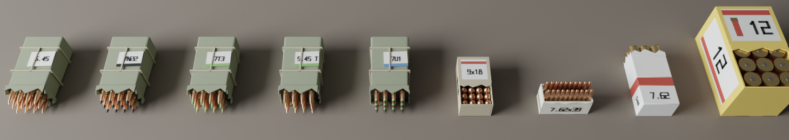
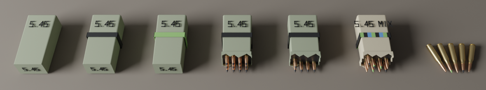

# Boxes of rounds: how they look and handle (#103, proposal)

Nothing here is built yet. The pictures are Blender line-ups at the
headset's sharpness (`art/lineup.py`, 0.8 m, looking down onto a table),
rendered at 2x. The crops are cut from those renders and never enlarged.
The mock-ups are made by `mock/boxes.py` and are not game assets.

## Now

From left: 5.45 ball, AP (7N22), tracer (7T3), one in four a tracer,
subsonic (7U1); then 9x18, 7.62x39, 7.62x54R and 12 gauge.

- A calibre's packing reads well: a 5.45 paper packet, a 9x18 card box, a
  54R carton, a 12-gauge box.
- Within a calibre, the type reads only from up close. The cue is a
  printed code on the slip (7N22, 7T3) and a stripe a few millimetres
  wide. The tip colours show only on the open end.
- A box is always full to look at. Thirty rounds or three, it looks the
  same.
- Handling: hold a box to a magazine's lips and a round goes in every
  0.15 s; hold it at a gun's port and it feeds the gun. Nothing else
  happens. You can't open a box, take a few rounds or pour some out.

## Proposed

From left: ball, AP and tracer packets closed; AP opened, full; AP opened
with 5 of its 12 visible noses left; a generic mixed box; a few loose
rounds.

### Read at a glance

- **Calibre**: the packing, as now, with the calibre printed large on the
  top and on the end. It is sized to read at the bench from a step away,
  held to `legibility::MUST_READ_DEG`.
- **Type**: a broad band right round the packet near its open end. It is
  the tips' own colour (black AP, green tracer, blue-over-black subsonic)
  and ball has none. It shows from any side, closed or open, at the
  distance you see a shelf across a room.
- **Opened**: the noses show the type a second time, with their tips
  painted.
- **Damp** (with #103's squib): a box with damp rounds is darker and
  glossier, as wet card is. Its callout counts the damp rounds. This part
  is built already, `items::damp`.

### Handle

- **Open**: a packet starts closed and shut tight, so it doesn't spill.
  A shut packet also soaks slower in the rain, which is a reason to keep
  your spares shut. Pinch the end with the other hand and pull: it tears
  open with a paper sound, and it stays open.
- **Take a few**: hold the open box in one hand. The other hand pinches
  into the mouth and draws out a round. Hold the pinch and it gathers more,
  one every 0.2 s, up to five. That handful is the loose rounds you
  already have, with their loads kept.
- **Pour**: tip the open box mouth-down over a palm held up. Rounds slide
  out one every 0.1 s, up to ten in the hand, and stop when you tip it
  back. Over nothing, they fall and lie where they land, and you can pick
  them up.
- **Load**: as now, the box's mouth to the magazine's lips. A handful at
  the lips loads the same way, and a single round can be thumbed in.

### Part-empty

- Each round in the open end is its own node, like a magazine's
  `round_N`. They go from the top row first, so the gap grows downward.
  What's left stands in the bottom rows, and you can count it at a
  glance.
- On a packet whose open end shows fewer noses than it holds, each nose
  stands for its share of the box. The mock-up shows 12 noses for 30
  rounds, and 5 of them left.
- An empty packet flattens. Drop it, or keep it to fill as a generic box
  (below).

### Room for generic and "enchanted" boxes (not built)

- A box is a container of one calibre. What it looks like comes from
  what's in it, the per-round `Loads`, not from its catalog id. Its tips
  are drawn per round, so a mixed box shows its mix when it's open.
- A box all of one type wears that type's band. A mixed one wears a
  hatched band, and its slip reads MIX (the fifth mock-up).
- A box you fill yourself is an emptied factory box with its band
  crossed out. Nothing new has to be made for it.
- A future artifact-touched round is one more load in `Loads`. It shows
  on its tip (a faint glow) and in the count on the slip, so boxes, mags
  and handfuls carry it without new UI.
- Organizing:
  - Basic: pour a box out and pick the rounds you want back in.
  - Later: a bench recipe, "sort a box by type", turns a mixed box into
    one box per type.
- Neither of these needs an inventory screen.

## What building it touches

- `art/items/ammo.py`: the band, the large calibre, closed and open
  states, and rounds as nodes.
- A new `items::rounds` module: open, pinch-take, pour and the part-empty
  look.
- `weapons::flat`: the loading that exists, extended to a handful.
- Nothing in the gun code.
