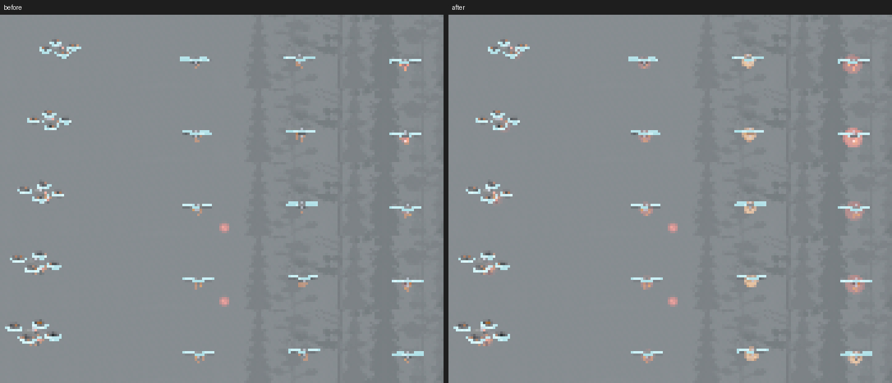
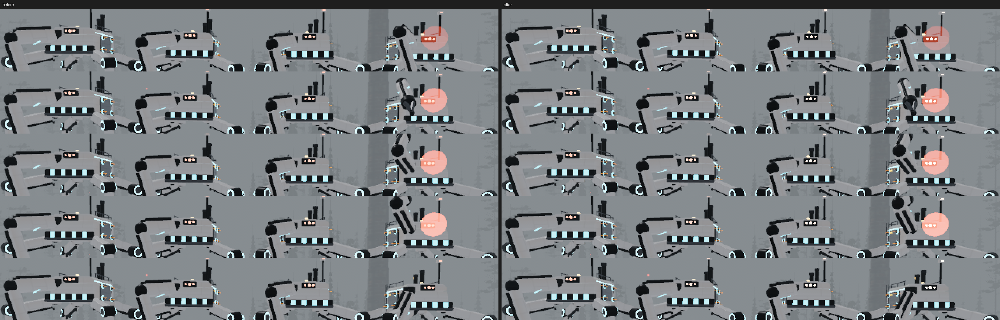
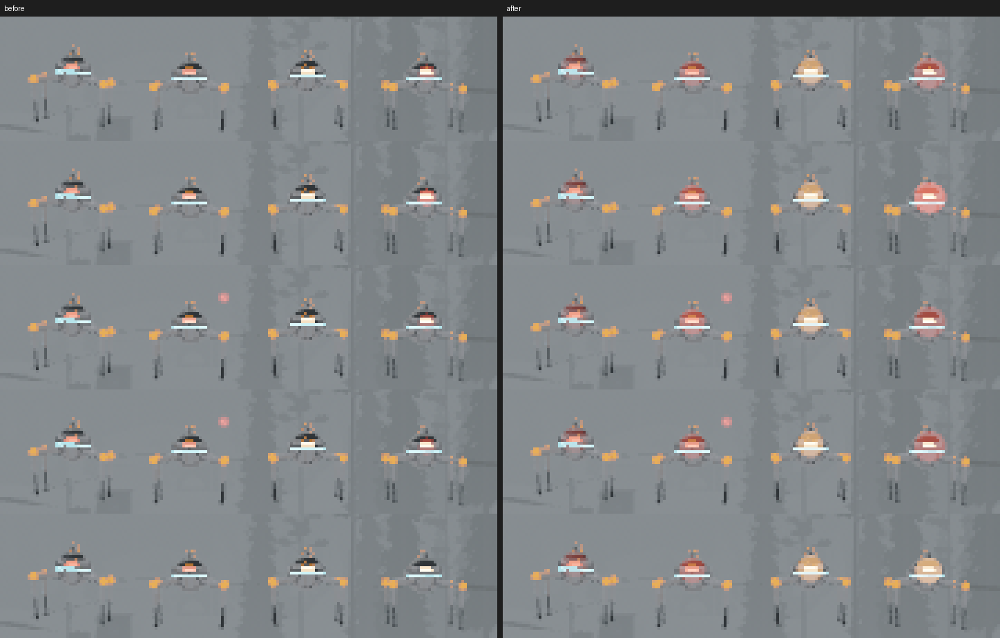
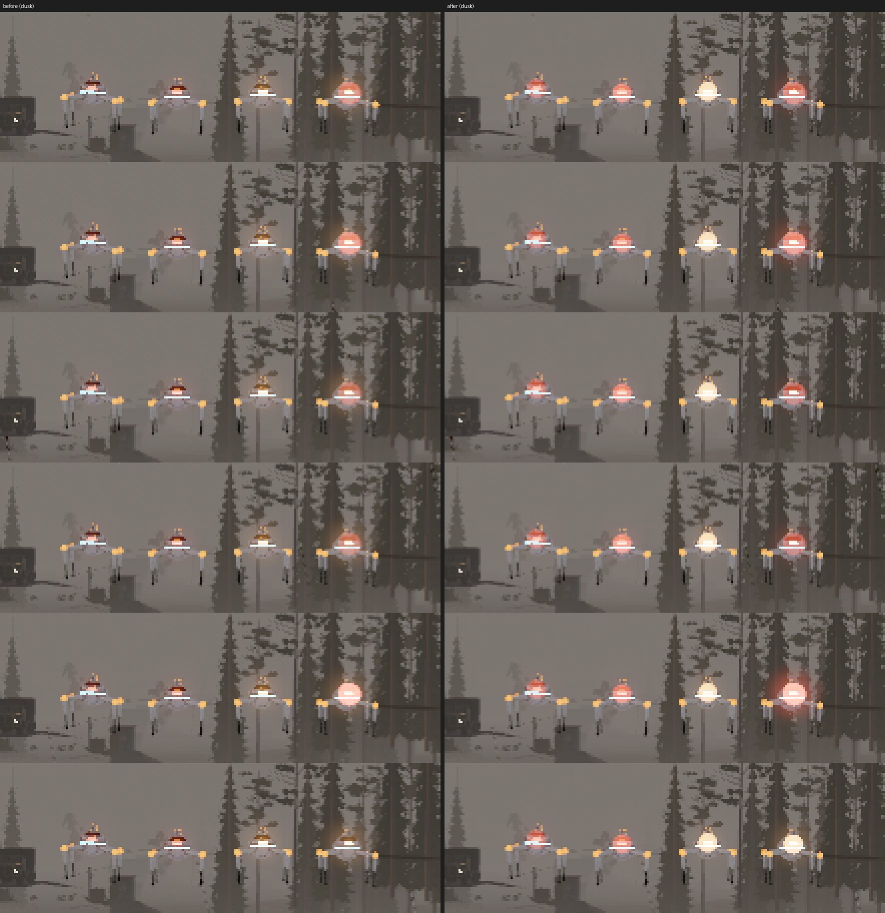
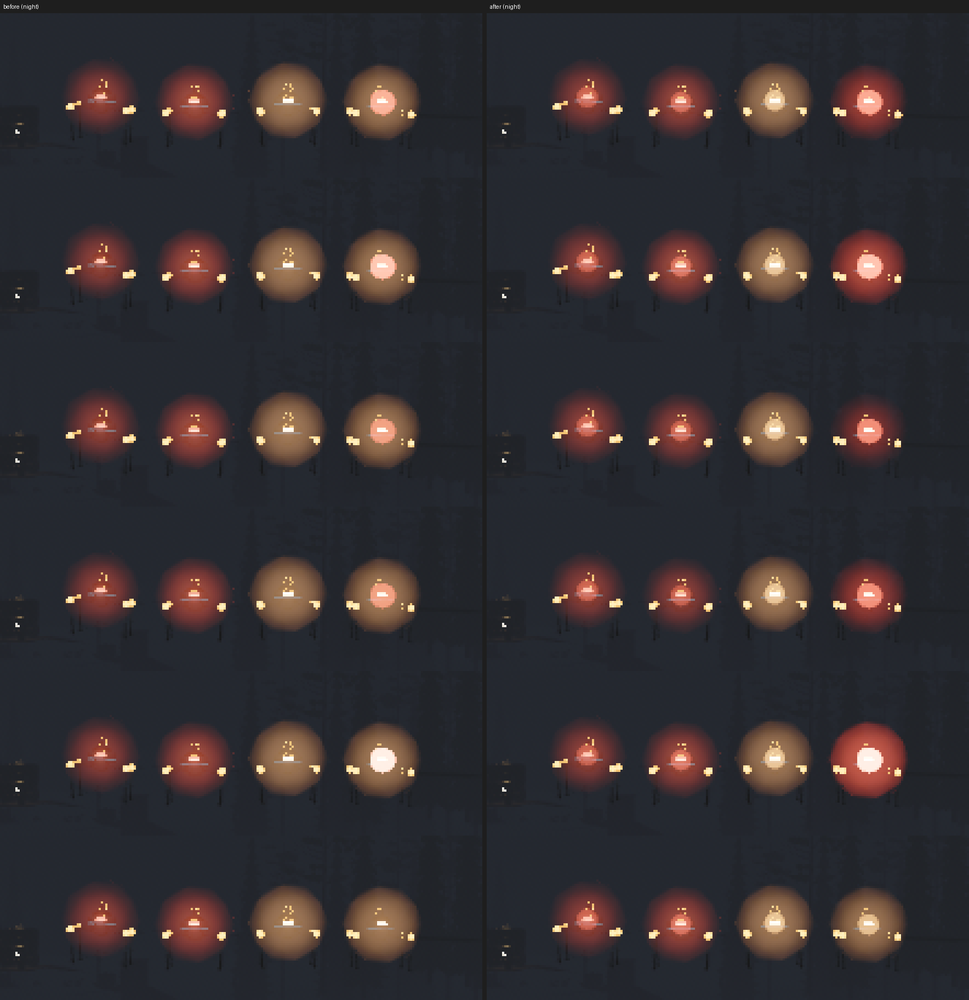
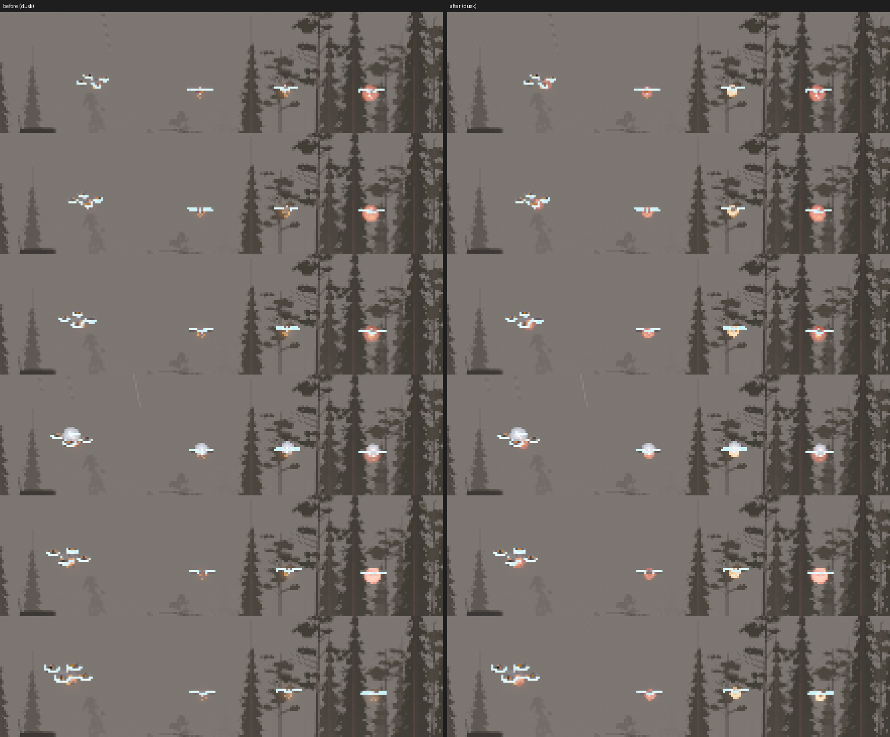
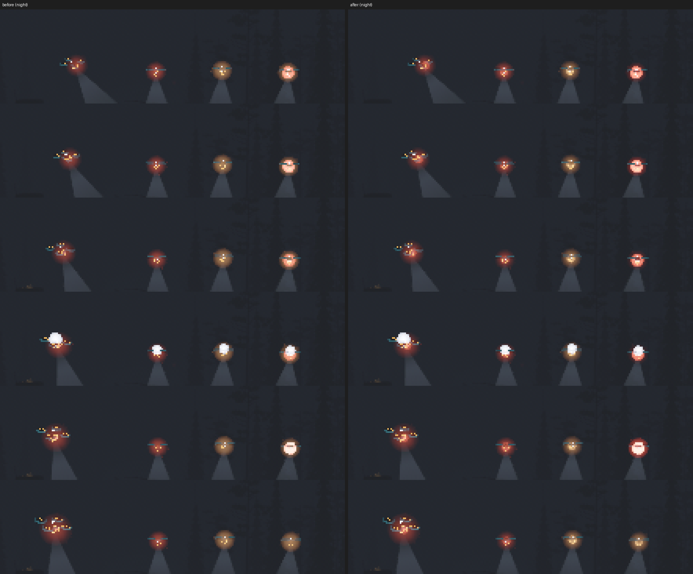

# Robot bodies: contact sheets

Frame sequences of robots moving and breaking, from `--gallery reel:WHAT`
(`src/robots/reel.rs`), tiled by `scripts/contact_sheet.py`. Time steps a
fixed 1/30 s a frame, so these are true intervals however slow the
software renderer is.

| Sheet | What | Interval |
| - | - | - |
| `walk.png` | A walker crossing the road: diagonal pairs stepping, the orb bobbing and leaning | 0.1 s |
| `drone_bank.png` | A drone flying a figure of eight: banking through the turns, nose leading | 0.2 s |
| `crawler_walk.png` | A crawler (the walker body at 0.6, for low ceilings underground) crossing: the same gait at its own scale | 0.13 s |
| `hound_run.png` | The hound's body (no mind yet, nothing spawns it): turning as it sets off and trotting across at nearly 4 m/s in diagonal pairs | 0.1 s |
| `sorter_at_work.png` | The Sorter (in the open for the camera; it lives in the Depot's sorting hall): the bridge running along its rails, the carriage across it, the arm reaching down and shifting orange totes, the festoon cable swinging | 1 s |
| `crawler_zap.png` | A crawler's spark gun: the blue charge glow and crackle for half a second, then the arc | 0.1 s |
| `shell_marks.png` | Rounds into a walker's front: its low armour plate takes them (sparks, marks) until it comes off, then the core behind scorches; the eye stutters when it's hit | 0.33 s |
| `eyes_by_hour.png` | Day, dusk and night (`--hour`): three walkers calm, suspicious and seeing you (left to right) and a drone; eyes glow by mood, more so the darker it is, and shells dim their own glow with the light | still |
| `eyes_night_glow.png` | Night: the eye glow is an HDR emissive now, and opens up after dark (core about 40 at rest), so calm, suspicious and seeing read as red, hot and near-white points. `reel:eyesfar` puts walkers at 30, 60 and 80 m for range checks | still |
| `eyes_halo_by_hour.png` | Day, dusk, night with `world::halos::Halo` on each eye (calm, suspicious, seeing you): after dark the shell gives up its own glow and the eye's halo is the tell | still |
| `eyes_halo_range.png` | `reel:eyesfar` at night, clear (top) and fog (bottom), zoomed: calm walkers at 30, 60 and 80 m and one that sees you | still |
| `feet_on_rubble.png` | `reel:rubble`: a walker crosses a heap of broken blocks on Destruction's debris layer; each foot comes down on a block's top, not through it | sheet |
| `knockdown.png` | `reel:knockdown`: one heavy round into a walker's side knocks it down, tipped the way it was hit, legs splayed; it lies 1.6 s, then plants its feet and rises on them | sheet |
| `crawl.png` | `reel:crawl`: two legs shot off, a walker no longer falls apart; belly down, it drags itself on the two it has left, the dead ones trailing | sheet |
| `damaged.png` | `reel:damaged` by day and dusk: plates on their last bolt hang from a corner and swing as it walks, the core at a fifth smokes and sparks, and its eye gutters (dusk row) | sheet |
| `rime_frost.png` | Rime Fell's weathering: shells iced cold blue down their sides and under, snow white on their tops, rime on the dark metal's tops (vertex colours, no new draws) | still |
| `rime_snow_walk.png` | Rime Fell's col in falling snow: an iced walker crossing lying snow (on the steep, icy ground beyond, its feet creep and it stumbles: `feet_slip_on_ice_slopes`) | sheet |
| `drone_lamps.png` | `reel:drone` at night in a downpour (top) and fog (bottom): after dark a drone hunts with its searchlight lit, down and ahead, a shaft through the rain and fog (`world::beams`) and a pool on the ground | sheet |
| `snow_prints.png` | Rime Fell's col: a walker leaves a trail of foot pads in the lying snow (`world::snow::Tracks`, the machines' own ring) | sheet |
| `damage_at_range.png` | `reel:tellsbefore` (top) and `reel:tells` (bottom) at dusk, 24-36 m: whole, then a walker on a shot leg (limping across), one with its eye shot dark, one with its core failing (scorched, smoking, guttering), and a drone with a rotor hit (listing, sinking, trailing smoke); wound effects draw larger with distance (`fx::at_range`) | sheet |
| `limp_and_eye_30m.png` | `reel:dying,24,4` at 1 pm, clearing, 28-32 m (crop): top two rows, the right walker's eye shot out (dark, its last red flare at the socket, then out for good; frames 2-9); bottom two, the left one on a leg at 0.3 limping across, hitching and listing onto its bad side as weight comes on it (frames 14-21) | 0.13 s |
| `salvage_seated.png` | `reel:salvage,16,10` at 1 pm, a walker brought down 2.4 m off (crop): what came through is seated on the wreck to be taken off by hand (`robots::salvage`): the servo packs at its hips (pale, on dark bolts), the cell on top (vented box), the gun pod where the turret was (left); the cables and bolts go mid-reel as the tools would take them. The hand work itself is in the headset tests (`vr_harness::salvage`) | 0.33 s |
| `pylon_cable.png` | `reel:pylon,2,10` at 1 pm (crop): a relay pylon's cable (Robot minds' `network::PylonCable`, cut with bolt cutters to silence it) down the cabinet's side into its junction box | still |
| `device_scan.png` | `reel:scan,24,3` at dusk (crop): a walker clocks a device on the ground in front of you (Robot minds' `devices::DeviceNoticed`): a fan of light from its eye sweeps the device, red when it means to shoot it (left), amber when it's coming to look (right) | 0.1 s |
| `hazard_marks.png` | `reel:hazards,12,5` at 14:00 from 10-16 m (crop): every hazard in Robot minds' table (`robots::hazards`) striking a machine, each its own mark (`hazard_look::mark`). Near row: a lift throws a drone (dust, tumbling off), burner (orange embers, soot), snare (blue arcs, smoke), well at its heart (crush sparks). Middle: mirror (shimmer; eye stutters, turret wanders), hush (still dark haze), gas on a crawler (green cloud), mine (sparks, soot). Back: EMP (blue arcs only), frost (cyan crystals, frost breath; heavy gait), heat on a crawler (embers in a haze) | 0.25 s |
| `strikes_before.png` | `reel:strikes,20,1` at 14:00, 15 m (crop), on main before this change: four walkers shot with a pistol round (34) every half second, left to right in the front plate, the core, the eye and a knee. At 15 m none of the four reads as more than a speck: the plate's, the eye's and the knee's leave a small dark mark, the core's nothing you can see. This is the playtest's fight (raid 1, t=997-1015: four core hits that read as nothing) | 1/30 s |
| `strikes_after.png` | The same, after (`damage::strike`, `fx::strike_flashes`): the plate **shrugs** (a dull scuff, it hardly rocks), the core is **wounded** (an orange spit and molten drops, and its smoke from the first round), the eye and the knee **tell** (a white-hot flash and a spray of sparks, and it flinches). Audio's sounds follow the same three (`damage::RobotStruck`) | 1/30 s |
| `strikes_before_frame.png` | One whole frame of the before (1280x720, uncropped): the fourth, where the rounds have just landed, as the after's `--frames 48` still (for Capture's before/after sheet, which crops it itself) | — |
| `broken_walker_before_after.png` | `reel:disarmed,2,30` (named `reel:broken` before this change), side on at 5 m, main (left) and after (right): a walker with its gun shot dead and a leg at 5%, standing still (Models' broken walker). Before, the dead gun sits level as if still on watch. After, it slumps: the barrel hangs off its mount, swung aside and listing (`anim::DEAD_GUN_DROOP`, `DEAD_GUN_SLEW`, `DEAD_GUN_LIST`), clear of the shell, and no longer tracks. `anim::a_dead_gun_droops_and_stops_tracking` checks this in world space: the muzzle ends at least 0.15 m below the mount, the turret lists, every barrel point stays outside the orb, and the muzzle holds still in the body frame when the look target moves. The failing leg's foot is held off the ground at rest (`anim::FAILING_LIFT`), and the failing knee keeps its orange mark: one round still drops it. Shot with `EXTRACTION_ALLOW_FALLBACK=1` (the valley's ground textures weren't generated in this container): the robot is the subject | — |
| `lamps_at_60m_fog_before_after.png` | Models' family line-up (`docs/craft/ROBOT_READING.md`): `--map training_yard --weather fog --hour 11 --gallery robots:walker+drone+grappler+sentry+hound+heavy,0,60`, camera `0,0,30,0,-1`, `--size 2234x1257` (the headset's 14.3 px a degree), crop 740,580 560x60 at 3x; main (top), after (bottom). Before, the walker and grappler at 60 m are pale shells with a cyan band: no eye, no marks. After, each shows its red eye and orange knee marks, and the drone its orange rotor marks. The cause was distance, not fog: the render budget fades a mesh under 1 m out at 200 times its size (`render::budget::small_range`), so a 15 cm eye went at about 30 m and a 19 cm knee mark at 38, in clear air too. A robot's lamps (any mesh on it whose material the fog can't touch: eye, marks, the eye's glow) now carry the budget's own `LodReach(visuals::LAMP_REACH)`, 150 m, put on as their material goes on (`a_robots_lamps_are_drawn_to_range`). They also hold their brightness through fog (`fog_enabled: false` on the eye, the models' `Eye`, the marks: `eyes_and_marks_hold_through_fog`), and keep their true size. Shot with `EXTRACTION_ALLOW_FALLBACK=1` | — |
| `lamps_at_30m_fog_before_after.png` | The same line-up at 30 m, crop 300,480 1650x250; main (top), after (bottom). Little changes this near: the marks and eye were already in range, and fog takes little off them at 30 m. The drone sits differently from run to run (it hovers) | — |
| `hound_at_60m_fog_before_after.png` | The hound in the same 60 m fog line-up, crop 1290,600 70x40 at 10x (half behind a rock, as it stands there); main (left), after `lamps_at_60m` (right). Before, a pale smudge with its teal tail lamp; after, its orange knee marks and the ring round its eye read too. No hound-specific change: it is the same class (a robot's lamps drawn to `LAMP_REACH`, held through fog). What's left at 60 m is its size, which is gameplay (`HOUND_SIZE`) | — |
| `broken_walker_30m_60m_fog.png` | A check, no change: job 2's broken walker beside a healthy one, `--gallery robots:walker+walker!broken,YAW,DIST` in Models' fog line-up (140 frames; broken at frame 4). Top: 30 m, facing you (left half) and side-on (right half), crop 900,520 440x170 at 2x. Bottom: 60 m, the same, crop 1000,570 240x70 at 4x. At 30 m it reads hurt: the dead gun slumped dark on top, a smoke column over it, no orange ring on its gun, its eye still lit (it still sees you). At 60 m the healthy one's gun ring and the broken one's slump are each a few pixels, and the smoke is a faint wisp in the fog: from that far it reads as a walker, not as a harmless one. The strongest far cue is the smoke | — |
| `dead_gun_column_30m_before_after.png` | Job 2's broken walker (right) beside a healthy one, `--gallery robots:walker+walker!broken,YAW,30` in Models' fog line-up, 140 frames, crop 900,450 440x240 at 2x. Main (left), after (right); facing you (top), side-on (bottom). Before, a faint grey wisp over the dead gun. After, a tall dark column stands over it: any robot whose gun is shot off sends one up (`fx::DEAD_GUN_SMOKE` soot puffs a second, rising as `fx::COLUMN`, about 4.3 m against a wound's 1.35, `a_dead_guns_column_stands_over_a_wound`). It says "harmless" from far off, and it's something to walk toward | — |
| `dead_gun_column_60m_before_after.png` | The same at 60 m, crop 1000,540 240x100 at 4x. Before, the broken walker reads as a walker; after, its column stands over it in the fog | — |
| `dead_gun_column_no_black_pixels.png` | The 60 m column side-on, frame 150, crop 1000,480 240x160 at 3x: lit soot (left) and unlit soot (right). Lit, a few of its far, small puffs came out as single pure-black pixels (1, 1, 1): 2, 1 and 0 of them in frames 150, 165 and 180, and one in `dead_gun_column_60m` (a soot puff is a third opaque at most, so pure black is a bad lighting value, not the smoke). Unlit (through `PuffAssets::material`; `render::puff` unchanged): none in frames 140, 150 and 165, and the column reads the same. Every dark puff of `robots::fx` is unlit now, the wreck's smoulder, a falling drone's trail and a hazard's soot with the column, as every puff of `weapons` already was | — |
| `wreck_soot_unlit_before_after.png` | `reel:wreck,2,60` in fog at 5 m, camera `40,0,262,90,-6`, crop 380,100 520x420; lit soot (left), unlit (right); the walker shot apart (top) and its smoulder 2 s on (bottom). Up close the unlit soot reads as the lit did | — |
| `sentry_chirp_lens_before_after.png` | Not a render: the sentry lens's brightness through a chirp, plotted from `sentry_look::chirp_gain` and the formula it replaced. Before (top), the lens jumped to 5x at the chirp and faded to normal by the first round, so the longer it ran, the more it read as "lamp on". After, a slow pulse that quickens (1.5 to 8 a second) and swells, from a crest at the chirp (seen as it's heard) to a hard 7x flash as the first round goes, scaled by `rules::CHIRP`: the old 1.6 s (middle) and Robot minds' 2.5 s (bottom) alike (`the_chirp_quickens_into_the_shot`) | — |
| `sentry_chirp_reel_before_after.png` | `reel:chirp,30,3` (a sentry 7 m off facing you, its 2.5 s chirp set off on the reel's first frame; a frame every 0.1 s), camera `40,0,262,0,-2`, fog, crop 595,85 100x95; main (top two rows), after (bottom two). Before, the lens looks the same in every frame: at 7 m it's a few pixels already at full red, so the old flare, a brightness, couldn't be seen (its red glow 48-53 px every frame). After, a glow round the lens (`sentry_look::HALO`, fogless, so drawn as far as the sentry) pulses with `chirp_gain`: 50 to 1500 px, quicker and brighter through the chirp, brightest at frames 24-25 as the warning burst goes, and out at 26. (At 10 frames a second the late pulses, up to 8 a second, alias; the plot shows them.) Frame 0 of the after run caught the sentry half dressed, before its chirp | — |
| `drone_lock_reel_before_after.png` | `reel:lock,20,3` (a drone hovering 8 m off, its lock on you set off by the reel; a frame every 0.1 s over its 1.5 s lock), camera `40,0,262,0,-2`, fog, crop 605,270 80x50 at 2x; main (top), after (bottom). Before, a lock showed only as a red point light under it. After, its lens glows as the sentry's does through a chirp: the same curve (`visuals::tell_gain`, `tell_halo`), over `drone::LOCK_TIME`, flashing as the burst goes. A player learns "pulsing red lens: about to fire" once, on either machine (`the_sentry_chirp_and_the_drone_lock_are_one_tell`) | — |
| `melee_tells_reel_before_after.png` | `reel:melee,24,2` (a crawler, left, a hound and a heavy, right, facing you about 6-8 m off; each run through its lead to a blow from the reel's first frame; a frame every 1/15 s), camera `40,0,262,0,-2`, fog, crop 340,150 560x340; main (top), after (bottom); frames 0, 5, 10, 17, 22. After, each lens glows with the sentry's and the drone's tell (`visuals::melee_halo`, the one curve: `tell_gain` / `tell_halo`, never out between pulses) through its own lead, flashing as the blow comes: the crawler through its charge (`indoor::ZAP_CHARGE`), the hound through its coil (`hound_mind::CROUCH_TIME`) and on through its lunge till it bites, the heavy through its raise (`heavy::RAISE_TIME`) and its slam; dark after (frame 22). Before, none: the crawler's was a sound and a blue swell, the hound's a crouch, the heavy's an arm. `each_melee_tell_shows_for_its_whole_lead` | — |
| `hound_stalk_12m_before_after.png` | `reel:stalk,10,6` frame 4: three hounds 12 m off in fog facing you, at rest (left), stalking (middle: Investigate, going low) and coiled to lunge (right); camera `40,0,262,0,-2`, crop 300,330 700x120 at 2x; main (top), after (bottom). After, the stalker's eye is a low, dull slit (`visuals::STALK_DIM`, `STALK_SLIT`): before, a stalking hound's eye burned brighter than at rest (its mood: suspicious). The coiled one carries the red tell. At 12 m a hound's eye is three pixels: the stalk reads as a darker eye, subtly; the tell plainly. `a_stalking_hounds_eye_is_neither_rest_nor_a_tell` holds the numbers (rest at least 2.5x the stalk, a tell at least 2x rest) | — |
| `aim_tells_before_after.png` | `reel:aim,24,2` (a walker settling its aim, left, and a grappler winding up, right, 8 m off), frame 4, crop 420,320 380x110 at 3x; main (left), after (right). After, the walker's lens glows through its aim (`walker::AIM_TIME`) and the grappler's through its wind-up (`grappler::WINDUP`): the one tell, now on every machine's body (`visuals::attacks`, `every_attack_tells_on_the_body`) | — |
| `pin_turret_before_after.png` | `reel:pin` frame 12 (a walker pinning the spot where you dropped from sight, `walker::Suppressing`), crop 160,300 240x160 at 2x; main (left), after (right). Before, its gun swung back to face ahead while its rounds still went to the spot; after, it holds on the spot (`a_pinners_gun_holds_on_where_you_went_down`) | — |
| `pin_tracer_before_after.png` | `reel:pin,28,1` frame 26, on main 8d5c1105 (Weapon feel's tracers lit from the muzzle), the spot 7 m to its right, camera `40,0,262,0,-2`, fog, crop 160,260 840x200; main (top), after (bottom). The pinner's fourth round, a tracer (every third, from its first: `a_pinners_rounds_carry_tracers`), streaks out past the spot; before, no streak and the gun facing ahead. An aimed burst carries none: a stream of streaks onto one place reads as "keeping your head down" | — |
| `weak_points_15m_before.png` / `weak_points_15m_after.png` | `reel:strikes,1,1` at 14:00, 15 m (crop), main and after: four whole walkers. Before, the knees are 12 cm grey joints and the eye an 8 cm band. After, every weak point (`weak_points::is_weak`: what one pistol round tells on) wears the one shoot-here orange: a ball at each knee, a ring round the eye and the turret. Each is at least 0.24 m across (0.92 deg at 15 m) | — |
| `weak_points_25m_before.png` / `weak_points_25m_after.png` | `reel:tellsbefore,1,1`, the same at 24-36 m (crop): the knees still pick the walkers out, 0.55 deg at 25 m, what a VR pistol holds (`weak_points::VR_HOLD_DEG`) | — |
| `weathering.png` | The same walker in the training yard (clean), Marrow Creek (rust streaks, moss on top) and Cinder Works (sooted, heat-blued metal) | still |
| `walker_limp.png` | A walker with a leg shot off: limping across on three, one foot up at a time, the dead leg dangling, the body sagging toward the gap | 0.2 s |
| `drone_wreck.png` | A drone killed in the air: a rotor flies off, it corkscrews down on its fading lift trailing smoke, hits in a burst of sparks, sheds its panel and gun pod, and smoulders | 0.17 s |
| `walker_wreck.png` | A walker killed in view: visor, turret and panels thrown, its legs (jointed at hip and knee) skid out and fold as it drops, two tear off at the hip as it lands, scorched and smouldering | 0.13 s |

To make one again (about 2 s a frame under lavapipe):

```bash
cargo build --profile fast
WGPU_BACKEND=vulkan xvfb-run -a -s "-screen 0 1600x900x24" target/fast/extraction \
    --screenshot /tmp/reel/wreck.png --frames 99999 --camera 40,0,262,0,-12 \
    --no-robots --data-dir /tmp/reel-data --gallery reel:wreck,16,5 --size 960x540
python3 scripts/contact_sheet.py docs/shots/robot-bodies/walker_wreck.png 4 \
    /tmp/reel/wreck_[0-9]*.png --crop 230,150,500,300 --scale 0.6
```

Other reels: `turn`, `limp` (a leg shot off), `hurt` (a leg at a fifth),
`drone`, `dronewreck`.

## Weak points: what a VR pistol can hit (F2, playtest 1:04:22)

Every weak point, every robot, as made (`weak_points::tests::every_robots_weak_points_are_big_and_marked` prints it). A VR pistol at arm's length holds about 0.55 deg (`VR_HOLD_DEG`); a weak point must subtend that at 25 m, so 0.24 m across (`WEAK_ACROSS`). Before, a walker's knee was 0.12 m (0.46 deg at 15 m, 0.28 at 25 m) and its eye 0.06 m deep.

| Robot | Weak points | Across | At 15 m | At 25 m |
|---|---|---|---|---|
| Walker, grappler | eye, turret, 4 knees | 0.24 m | 0.92 deg | 0.55 deg |
| Crawler | eye, emitter, 4 knees | 0.24 m | 0.92 deg | 0.55 deg |
| Hound | eye, 4 knees | 0.24 m | 0.92 deg | 0.55 deg |
| Heavy | 12 bolts | 0.24 m | 0.92 deg | 0.55 deg |
| Drone | eye, gun, 4 rotors | 0.24 m | 0.92 deg | 0.55 deg |
| Mender | core, eye, arm, 4 rotors | 0.24 m | 0.92 deg | 0.55 deg |
| Sentry, spotter, sorter | eye | 0.24 m | 0.92 deg | 0.55 deg |
| Pylon | eye | 0.36 m | 1.38 deg | 0.83 deg |
| Dirigible | eye | 0.60 m | 2.29 deg | 1.38 deg |

Not weak, by design: a walker's core (four rounds), every plate, a drone's body, the plough's and minelayer's hulls. Their hazard paint ("Warn", "Yellow") and the drones' beacons no longer wear orange (`weak_points::paint`; beacons are a cool white): on a robot, orange means shoot here and nothing else.

## Feet that won't land in a wall (M3, playtest 0:57:47)

The walker is kinematic, so nothing physical stopped a foot planted in a wall. Its path is Robot minds' (`walker::keep_off_walls` keeps its centre 1.3 m off buildings). The body now guards its own feet: each step's target is cast for from the body at hip height against `Layer::World`, and a foot aimed through a wall comes down 0.14 m short of it (`anim::wall_clear`, `step_walker_walled`). A slope rising under the ray isn't a wall, and rubble (`Layer::Debris`) is still stood on. `anim::tests::feet_never_land_in_a_wall` walks a walker along a wall 0.5 m off its middle. With the guard switched off, a foot came down 0.18 m inside it; with it, none does.

No shot: a wall tall enough to matter hides the far feet from any camera that shows the walker, and a cut-away view isn't something the reel can stage yet. `reel:wall` stages the walk for a look in the game.

## Awareness reads at range in fog

Each machine that hunts you has four states a player needs to tell apart: at work, searching, hunting you, and its tell. They must read apart at the range you meet the machine, in a pea-souper by day. `visuals::awareness` is the table: one row per machine, with its range, its eye's lit size and its glow, and what each state shows. `aware_px` counts the pixels that differ between two states at the headset's render scale. The eye and glows are lamps the fog can't touch; a crouch or a pace is fogged. `every_machines_awareness_reads_at_its_range` holds every pair of a machine's states to `READS_PX` (16 px) apart. The machines left out are in `AWARE_ELSEWHERE`, each with its reason:

- The spotter's lamp is its own awareness cue.
- The minelayer flees instead of hunting.
- The sorter is met at a few metres.
- The plough and the mender are blind to you.

| Machine | Range | Weakest pair | px |
|---|---|---|---|
| drone | 40 m | searching / hunting | 59 |
| heavy | 15 m | searching / hunting | 113 |
| sentry | 25 m | any | 132 |
| hound | 12 m | heading for a sound / hunting | 157 |
| walker | 30 m | any but tell | 206 |
| grappler | 14 m | searching / hunting | 236 |
| crawler | 8 m | searching / hunting | 259 |

What was wrong, and what changed:

- **Eye glow, beyond 25 m.** The glow faded out past 25 m even by day, when no halo takes over. That left the eye alone, and a drone's eye is 1 px at 40 m, so a searching drone and a hunting one were the same pixel. Now the glow carries the eye's rhythm by day. Past `GLOW_HOLDS_AT` (15 m) it holds the size it looks there (`HeldSize`).
- **Tell glows.** A tell's glow holds its size the same way. While a tell burns, the mood glow gives way to it (`tells_over_moods`). Otherwise a hunting machine's hot glow hid the red quickening of its aim or lock.
- **Heavy and sentry.** The heavy's eye and the sentry's lens burned the same whatever they knew. They now use the walker family's mood through `visuals::eye_mood`: steady at work, a slow pulse while searching, a fast one seeing you. The sentry's lens glow carries this between chirps (`eye_glow`).
- **The hound's stalk.** Its eye is a 3.5 px sliver at 12 m. Its second cue is its body: the stalk crouches (`anim::LOW`) and slows to `STALK_PACE`. These are 800 px or more against every other state.

The reels show the two weakest rows, and the walker at 30 m. Each strip runs left to right: at work, searching, hunting, its tell. It shows five frames 1/6 s apart, before beside after, in fog at 11:00 (`reel:awaredrone`, `reel:awareheavy`, `reel:awarewalker`):





Before, the four drones differ only in a pixel of eye, and the four heavies' eyes are the same. After, the drones read faint red, red pulse, orange-white, then the larger red lock. The heavy's eye is steady, then pulsing, then bright. The walkers read faint, red, hot, then the tell's red.

### At dusk and at night

The table runs in three lights from `world::weather`'s own conditions (`aware_weathers`): fog by day, drizzle at dusk, fog at night. After dark the eye has its halo (`world::halos`), the glow hands over to the halo as the dark comes, and a body's crouch or pace fades with the light.

The reels showed three faults, each fixed in `alert_eyes`:

- **Brightness alone didn't read after dark.** The night halo was steady. A searching walker's halo at 30 m was 4 levels of red over one at work's (58 against 62), and nothing pulsed. The halo now carries the eye's rhythm. The model credits only rhythm, not brightness steps.
- **A tell was lost in the night halo.** A telling walker or drone kept the hunting halo's orange glare, with only a small red sphere inside it. The halo now carries the tell's own red quickening while one burns (`TELL_IN_HALO`).
- **At dusk the glow handed over to a halo a dusk sky outshines.** The halos switch on at a light of 0.5, but at dusk (0.36) they barely show, so walkers at 30 m were their 15 px eyes alone. The glow now fades into the halo only as the dark comes (`night`).

The weakest rows after dark are the heavy (113 px: its eye, no halo) and the sentry (132 px: its lens glow), the same as by day. Each strip runs at work, searching, hunting, then its tell, before beside after:





